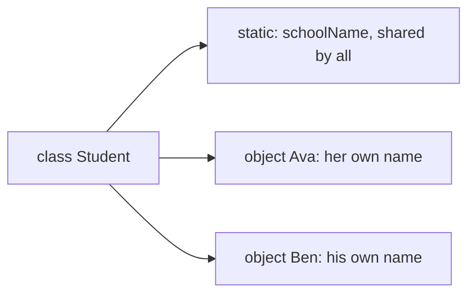
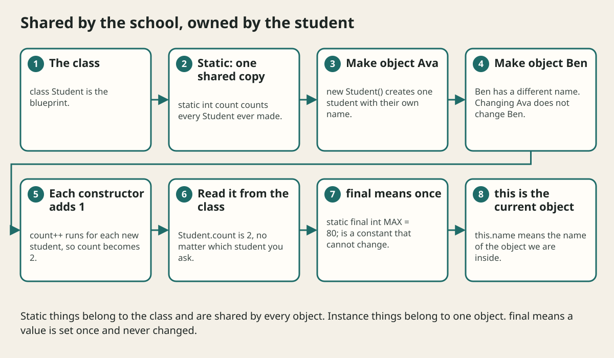

# Static Final And This Explained

## The big idea in plain words {#picture}

Think of a school. Each student has their own name and their own backpack. Those belong to *each student*. But the school has one bell and one school name that everyone shares. That belongs to *the school itself*.

In Java, the things each object owns are **instance** members. The things shared by the whole class are **static** members. Another word, **final**, means "once set, never changed", like a name written in permanent marker.



## What you will be able to do {#outcomes}

By the end of this lesson you will be able to:

- Explain static versus instance in plain words.
- Use `final` for constants and for safer variables.
- Use `this` to point to the current object.

## Words to know {#vocabulary}

- **static**: belongs to the class itself and is shared.
- **instance**: belongs to one object.
- **final**: can be given a value only once.
- **constant**: a final static value that never changes, like `MAX_SIZE`.
- **this**: the current object.
- **utility method**: a static method that does a job without needing an object, like `Math.max`.

## Why this idea exists {#history}

Mixing up static and instance is one of the most common beginner errors, with messages like "non-static variable cannot be referenced from a static context". Understanding the idea once clears up a lot of confusion.

## Concept 1: Instance: each object has its own {#concept-1}

```java
class Student {
    String name;            // each student has their own
}
Student a = new Student(); a.name = "Ava";
Student b = new Student(); b.name = "Ben";
```
Changing `a.name` does not change `b.name`. Two different backpacks.

## Concept 2: Static: one copy for the class {#concept-2}

```java
class Student {
    static int count = 0;       // one number, shared
    Student() { count++; }
}
```
Every `new Student()` adds one to the same `count`. You read it with the class name: `Student.count`. Methods can be static too, like `Math.max(3, 8)`: you do not need a Math object.

## Concept 3: final: set once {#concept-3}

`final int maxPages = 100;` can never be changed after this. A common pattern for constants: `static final int MAX_TITLE = 80;`. Capital letters with underscores are the habit for constants. A `final` class cannot be extended, and a `final` method cannot be overridden.

## Concept 4: this: the current object {#concept-4}

```java
class Note {
    private String title;
    Note(String title) {
        this.title = title;   // field = parameter
    }
}
```
Both the field and the parameter are called `title`. `this.title` is the field of this object. A static method has no "this", because it does not belong to one object, which explains that confusing error message.

## Counting students {#example}

```java
Student a = new Student();
Student b = new Student();
System.out.println(Student.count);   // 2
```
The count lives in the class, so it is 2 no matter which student you ask. If `count` were not static, each student would have their own count of 1.

## Going deeper: the technical walkthrough {#walkthrough}

## Worked scenario {#worked-scenario}

You want a counter that tracks how many Note objects have been created in total. What should it be?

The justified choice is **A static field in the Note class**. Select **use-static-counter** in the structured practical and explain why. Alternatives ignore a requirement, cross a trust boundary, or invent success.

### Structured decision contract

```json

{
  "decision": "use-static-counter",
  "justification": "The staticMember and instanceMember boundary must preserve the declared contract and ownership.",
  "failureBehavior": "Expose a safe failure and recover through the boundary owner."
}

```

Decision selects one declared behavior. Justification explains the boundary. FailureBehavior explains the observable error and recovery owner. These fields never execute commands. Required terms and minimum lengths form a basic practice rubric, not semantic grading.

## Step-by-step flow and matching picture {#flow}

```mermaid
flowchart LR
    N0["The class"]
    N1["Static: one shared copy"]
    N2["Make object Ava"]
    N3["Make object Ben"]
    N4["Each constructor adds 1"]
    N5["Read it from the class"]
    N6["final means once"]
    N7["this is the current object"]
    N0 --> N1
    N1 --> N2
    N2 --> N3
    N3 --> N4
    N4 --> N5
    N5 --> N6
    N6 --> N7
```





## Three real-life uses {#use-cases}

1. A `Math` class with utility methods such as `max` and `sqrt`.
2. A `MAX_TITLE_LENGTH` constant used in many places.
3. A counter that tracks how many objects have been created.

## What can go wrong, and how to stay safe {#failure-security}

Mistakes: making a field static just to avoid an error (it then becomes shared by everyone!), changing static data from many threads without a lock, and using `final` and thinking the object inside can never change. A `final List` means the variable always points to the same list, but you can still add things to the list.

## Practice lab and expected observation {#practice}

1. Predict the scenario decision before opening Practical. Explain each rejected alternative.
2. Run a relevant example above in an isolated exercise project. Record the expected result, then change one input to an invalid or boundary value. A failed assertion or deliberate error should replace silent success.
3. Submit the structured decision. Initially the checks fail. After selecting use-static-counter and writing an explanation and failure plan, all three pass. Follow the indicated review section for missed checks.

### Broken example to debug

```json

{"decision":"trust-client","justification":"","failureBehavior":""}

```

This ignores the responsible boundary and gives no reasoning or recovery. Correct the fields rather than changing the validator.

## Checkpoint and definition of done {#checkpoint}

- [ ] Define staticMember and instanceMember without looking.
- [ ] Trace input to owner and output.
- [ ] Explain one failure and one alternative.
- [ ] Pass at least four assignment questions.
- [ ] Pass every practical check and submit.
- [ ] Explain the concept again tomorrow.

## Sources, versions, and safe commands {#sources}

Java 17 baseline; installed validation JDK may be newer. Review date: 2026-10-02. The supplied blueprint is the teaching source; official landing pages were checked where reachable. No provider or original TM Schedule deployment was tested.

- [Official reference](https://docs.oracle.com/en/java/javase/17/)

[Course reading order](README.md) · [Previous lesson](06-classes-objects-and-encapsulation.md) · [Next lesson](07-inheritance-composition-and-polymorphism.md)

```study-quiz

{
  "schemaVersion": 1,
  "lessonId": "java/06a-static-final-and-this-explained",
  "title": "Assignment: Static Final And This Explained",
  "passPercentage": 80,
  "questions": [
    {
      "id": "q1",
      "sectionId": "concept-1",
      "prompt": "In Static Final And This Explained, what does staticMember mean?",
      "options": [
        {
          "id": "a",
          "text": "something that belongs to the class itself, shared by all objects",
          "explanation": "This preserves the definition and boundary described in the lesson."
        },
        {
          "id": "b",
          "text": "A permission granted by a hidden browser control",
          "explanation": "This changes the declared meaning or bypasses the responsible boundary."
        },
        {
          "id": "c",
          "text": "An unlimited provider operation with no ownership",
          "explanation": "This changes the declared meaning or bypasses the responsible boundary."
        },
        {
          "id": "d",
          "text": "A diagnostic credential intended for public logs",
          "explanation": "This changes the declared meaning or bypasses the responsible boundary."
        }
      ],
      "correctOptionId": "a",
      "explanation": "staticMember means something that belongs to the class itself, shared by all objects.",
      "reviewLabel": "Review concept 1"
    },
    {
      "id": "q2",
      "sectionId": "concept-2",
      "prompt": "In Static Final And This Explained, which rule is correct for checkpoint 2?",
      "options": [
        {
          "id": "a",
          "text": "Trust client-side checks instead of the server rule.",
          "explanation": "This changes the declared meaning or bypasses the responsible boundary."
        },
        {
          "id": "b",
          "text": "An instance field belongs to one object, and each object has its own copy.",
          "explanation": "This preserves the definition and boundary described in the lesson."
        },
        {
          "id": "c",
          "text": "Hide the failure by returning a fabricated successful result.",
          "explanation": "This changes the declared meaning or bypasses the responsible boundary."
        },
        {
          "id": "d",
          "text": "Skip the stated boundary, limit, or ownership check.",
          "explanation": "This changes the declared meaning or bypasses the responsible boundary."
        }
      ],
      "correctOptionId": "b",
      "explanation": "An instance field belongs to one object, and each object has its own copy.",
      "reviewLabel": "Review concept 2"
    },
    {
      "id": "q3",
      "sectionId": "concept-3",
      "prompt": "In Static Final And This Explained, which rule is correct for checkpoint 3?",
      "options": [
        {
          "id": "a",
          "text": "Trust client-side checks instead of the server rule.",
          "explanation": "This changes the declared meaning or bypasses the responsible boundary."
        },
        {
          "id": "b",
          "text": "Hide the failure by returning a fabricated successful result.",
          "explanation": "This changes the declared meaning or bypasses the responsible boundary."
        },
        {
          "id": "c",
          "text": "A final variable can be given a value only once.",
          "explanation": "This preserves the definition and boundary described in the lesson."
        },
        {
          "id": "d",
          "text": "Skip the stated boundary, limit, or ownership check.",
          "explanation": "This changes the declared meaning or bypasses the responsible boundary."
        }
      ],
      "correctOptionId": "c",
      "explanation": "A final variable can be given a value only once.",
      "reviewLabel": "Review concept 3"
    },
    {
      "id": "q4",
      "sectionId": "concept-4",
      "prompt": "In Static Final And This Explained, which rule is correct for checkpoint 4?",
      "options": [
        {
          "id": "a",
          "text": "Trust client-side checks instead of the server rule.",
          "explanation": "This changes the declared meaning or bypasses the responsible boundary."
        },
        {
          "id": "b",
          "text": "Hide the failure by returning a fabricated successful result.",
          "explanation": "This changes the declared meaning or bypasses the responsible boundary."
        },
        {
          "id": "c",
          "text": "Skip the stated boundary, limit, or ownership check.",
          "explanation": "This changes the declared meaning or bypasses the responsible boundary."
        },
        {
          "id": "d",
          "text": "The word this refers to the current object, and helps when a parameter has the same name as a field.",
          "explanation": "This preserves the definition and boundary described in the lesson."
        }
      ],
      "correctOptionId": "d",
      "explanation": "The word this refers to the current object, and helps when a parameter has the same name as a field.",
      "reviewLabel": "Review concept 4"
    },
    {
      "id": "q5",
      "sectionId": "worked-scenario",
      "prompt": "You want a counter that tracks how many Note objects have been created in total. What should it be?",
      "options": [
        {
          "id": "a",
          "text": "A static field in the Note class",
          "explanation": "This preserves the definition and boundary described in the lesson."
        },
        {
          "id": "b",
          "text": "An instance field that every note copies",
          "explanation": "This changes the declared meaning or bypasses the responsible boundary."
        },
        {
          "id": "c",
          "text": "A local variable in the constructor",
          "explanation": "This changes the declared meaning or bypasses the responsible boundary."
        },
        {
          "id": "d",
          "text": "A final field set to zero",
          "explanation": "This changes the declared meaning or bypasses the responsible boundary."
        }
      ],
      "correctOptionId": "a",
      "explanation": "A static field in the Note class. A static method cannot use instance fields directly because it does not belong to any one object.",
      "reviewLabel": "Review the worked scenario"
    }
  ]
}

```

```study-practical

{
  "schemaVersion": 1,
  "challengeId": "java/06a-static-final-and-this-explained/decision",
  "lessonId": "java/06a-static-final-and-this-explained",
  "title": "Practical: Static Final And This Explained",
  "language": "json",
  "mode": "structured",
  "instructions": "You want a counter that tracks how many Note objects have been created in total. What should it be? Return an object with decision (choose from use-static-counter, skip-check, unbounded-work, trust-client), justification (at least 40 characters; include staticMember and instanceMember), and failureBehavior (at least 25 characters; include failure and recover while explaining the error and recovery). These are structured reasoning checks, not code execution or an official grade.",
  "starterCode": "{\n  \"decision\": \"\",\n  \"justification\": \"\",\n  \"failureBehavior\": \"\"\n}",
  "entryPoint": "answer",
  "publicExamples": [
    {
      "input": {
        "decision": "skip-check",
        "justification": "",
        "failureBehavior": ""
      },
      "expected": {
        "passed": false
      }
    },
    {
      "input": {
        "decision": "use-static-counter",
        "justification": "The staticMember and instanceMember boundary must preserve the declared contract and ownership.",
        "failureBehavior": "Show a safe failure and recover through the responsible owner."
      },
      "expected": {
        "passed": true
      }
    }
  ],
  "publicTestIds": [
    "decision",
    "explanation",
    "failure-plan"
  ],
  "reviewSections": {
    "decision": "worked-scenario",
    "explanation": "concept-2",
    "failure-plan": "failure-security"
  },
  "limits": {
    "timeMs": 2000,
    "memoryMb": 128,
    "outputBytes": 20000
  }
}

```

