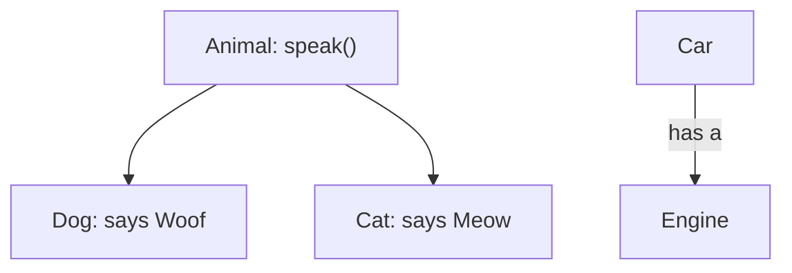
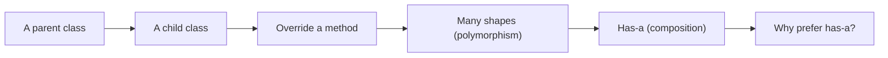
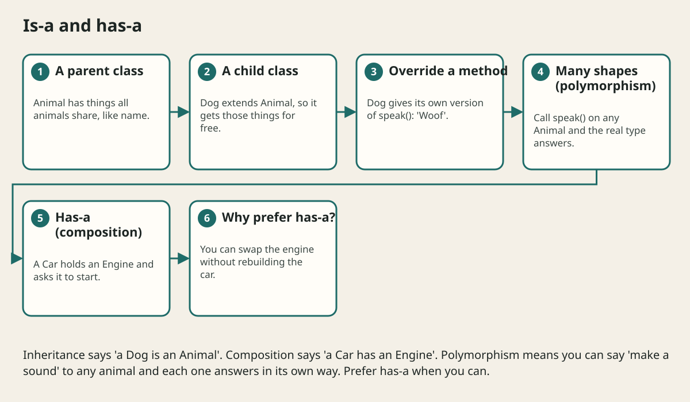

# Inheritance Composition And Polymorphism

## The big idea in plain words {#picture}

There are two ways to build new things from old things. One is **"is a"**: a Dog *is an* Animal, so it gets all animal abilities for free. The other is **"has a"**: a Car *has an* Engine and asks it to start.

Both are useful, but "has a" is more flexible. If a car has an engine, you can swap the engine for a better one. If a Dog is-an Animal forever, you cannot easily change that later.



## What you will be able to do {#outcomes}

By the end of this lesson you will be able to:

- Explain inheritance with "is a" and composition with "has a".
- Use `extends` and method overriding.
- Explain polymorphism and why we often choose composition.

## Words to know {#vocabulary}

- **inheritance**: a child class gets what its parent class has.
- **override**: a child gives its own version of a parent's method.
- **polymorphism**: one call, many behaviors, depending on the real object.
- **composition**: an object that uses other objects to do its work.
- **abstract class**: a half-finished class that cannot be created directly.
- **substitutability**: a child can stand in for its parent without breaking anything.

## Why this idea exists {#history}

We want to reuse code without copying it. But using inheritance carelessly can tie classes tightly together, so that changing a parent breaks many children.

## Concept 1: Inheritance: is a {#concept-1}

```java
class Animal { String speak() { return "..."; } }
class Dog extends Animal {
    @Override String speak() { return "Woof"; }
}
```
`Dog` gets everything `Animal` has, and `@Override` replaces `speak`. Use inheritance only when the child really *is* a kind of the parent.

## Concept 2: Polymorphism: many shapes {#concept-2}

`Animal pet = new Dog(); pet.speak();` The variable says Animal but the object is a Dog, so you hear "Woof". The same call works for cats, birds, and animals not yet invented. The code that calls `speak()` does not need to change.

## Concept 3: Composition: has a {#concept-3}

A `Car` can keep an `Engine` inside and call `engine.start()`. If you want an electric engine later, you hand the car a different engine. The car's code does not change. It is like swapping batteries in a toy.

## Concept 4: Keep the parent's promise {#concept-4}

A child must keep the promises of its parent. If every Animal can `speak()`, then a Fish that throws an error when asked to speak breaks the promise. This idea is called substitutability. When a child does not fit, choose composition instead.

## Many animals, one loop {#example}

```java
List<Animal> pets = List.of(new Dog(), new Cat());
for (Animal pet : pets) {
    System.out.println(pet.speak());
}
```
This prints "Woof" and then "Meow". The loop does not care about the kind of animal. Each animal answers in its own way.

## Going deeper: the technical walkthrough {#walkthrough}

### Classes and encapsulation


```java
public final class Counter {
    private int value;

    public void increment() {
        value += 1;
    }

    public int value() {
        return value;
    }
}
```

The field is private. Callers cannot change it directly. Encapsulation protects
invariants, such as never letting a counter become negative.


### Interfaces and dependency direction


```java
public interface NoteRepository {
    List<StudyNote> findByTopic(String topic);
    StudyNote save(StudyNote note);
}
```

A service can depend on this promise while one implementation uses memory and
another uses PostgreSQL. This is the basic idea behind a repository port and
adapter.

```text
Controller -> Service -> Repository interface -> Memory or database adapter
```

An interface is useful when the boundary is real. Do not create ten empty
interfaces only to make a diagram look sophisticated.


### Focused implementation

Inheritance states an is-a relationship: a subclass must honor every promise callers rely on. Composition states a has-a relationship: the object delegates to a collaborator. Overriding changes behavior behind the same method contract; overloading chooses from different parameter signatures at compile time. Prefer composition when you only need reuse. An abstract class can share protected implementation, while an interface exposes a contract without forcing one parent hierarchy.

```java

interface Renderer { String render(String title); }
class PlainRenderer implements Renderer {
  public String render(String title) { return title.trim(); }
}
class NoteView {
  private final Renderer renderer;
  NoteView(Renderer renderer) { this.renderer = renderer; }
  String show(String title) { return renderer.render(title); }
}
public class Example {
  public static void main(String[] args) {
    System.out.println(new NoteView(new PlainRenderer()).show("  APIs  "));
  }
}

```

Read the imports, then the values and checks, then the operation, and finally the result or cleanup. Java Example programs compile as Example.java. Python uses Python 3.11+. JavaScript ESM runs as example.mjs. Framework snippets run inside the generated project.

## Worked scenario {#worked-scenario}

A note must never have an empty title. Where should the object protect that rule?

The justified choice is **When it is created and whenever the title changes**. Select **protect-invariant** in the structured practical and explain why. Alternatives ignore a requirement, cross a trust boundary, or invent success.

### Structured decision contract

```json

{
  "decision": "protect-invariant",
  "justification": "The class and object boundary must preserve the declared contract and ownership.",
  "failureBehavior": "Expose a safe failure and recover through the boundary owner."
}

```

Decision selects one declared behavior. Justification explains the boundary. FailureBehavior explains the observable error and recovery owner. These fields never execute commands. Required terms and minimum lengths form a basic practice rubric, not semantic grading.

## Step-by-step flow and matching picture {#flow}





## Three real-life uses {#use-cases}

1. A drawing program calls `draw()` on many kinds of shapes in one loop.
2. A game has a `Player` that has a `Weapon`, and swaps weapons any time.
3. A payments class has a `PaymentMethod` that can be a card or a wallet.

## What can go wrong, and how to stay safe {#failure-security}

Mistakes: using inheritance only to reuse a few lines, building tall family trees that are hard to follow, and overriding a method so that it breaks the parent's rules. A good motto: "prefer has-a to is-a unless is-a is really true."

## Practice lab and expected observation {#practice}

1. Predict the scenario decision before opening Practical. Explain each rejected alternative.
2. Run a relevant example above in an isolated exercise project. Record the expected result, then change one input to an invalid or boundary value. A failed assertion or deliberate error should replace silent success.
3. Submit the structured decision. Initially the checks fail. After selecting protect-invariant and writing an explanation and failure plan, all three pass. Follow the indicated review section for missed checks.

### Broken example to debug

```json

{"decision":"trust-client","justification":"","failureBehavior":""}

```

This ignores the responsible boundary and gives no reasoning or recovery. Correct the fields rather than changing the validator.

## Checkpoint and definition of done {#checkpoint}

- [ ] Define class and object without looking.
- [ ] Trace input to owner and output.
- [ ] Explain one failure and one alternative.
- [ ] Pass at least four assignment questions.
- [ ] Pass every practical check and submit.
- [ ] Explain the concept again tomorrow.

## Sources, versions, and safe commands {#sources}

Java 17 baseline; installed validation JDK may be newer. Review date: 2026-10-02. The supplied blueprint is the teaching source; official landing pages were checked where reachable. No provider or original TM Schedule deployment was tested.

- [Official reference](https://docs.oracle.com/en/java/javase/17/)

[Course reading order](README.md) · [Previous lesson](06a-static-final-and-this-explained.md) · [Next lesson](08-interfaces-abstract-types-and-sealed-choices.md)

```study-quiz

{
  "schemaVersion": 1,
  "lessonId": "java/07-inheritance-composition-and-polymorphism",
  "title": "Assignment: Inheritance Composition And Polymorphism",
  "passPercentage": 80,
  "questions": [
    {
      "id": "q1",
      "sectionId": "concept-1",
      "prompt": "In Inheritance Composition And Polymorphism, what does class mean?",
      "options": [
        {
          "id": "a",
          "text": "A permission granted by a hidden browser control",
          "explanation": "This changes the declared meaning or bypasses the responsible boundary."
        },
        {
          "id": "b",
          "text": "a blueprint that describes the data and actions of something",
          "explanation": "This preserves the definition and boundary described in the lesson."
        },
        {
          "id": "c",
          "text": "An unlimited provider operation with no ownership",
          "explanation": "This changes the declared meaning or bypasses the responsible boundary."
        },
        {
          "id": "d",
          "text": "A diagnostic credential intended for public logs",
          "explanation": "This changes the declared meaning or bypasses the responsible boundary."
        }
      ],
      "correctOptionId": "b",
      "explanation": "class means a blueprint that describes the data and actions of something.",
      "reviewLabel": "Review concept 1"
    },
    {
      "id": "q2",
      "sectionId": "concept-2",
      "prompt": "In Inheritance Composition And Polymorphism, which rule is correct for checkpoint 2?",
      "options": [
        {
          "id": "a",
          "text": "Trust client-side checks instead of the server rule.",
          "explanation": "This changes the declared meaning or bypasses the responsible boundary."
        },
        {
          "id": "b",
          "text": "Hide the failure by returning a fabricated successful result.",
          "explanation": "This changes the declared meaning or bypasses the responsible boundary."
        },
        {
          "id": "c",
          "text": "Private data is changed only through carefully written methods.",
          "explanation": "This preserves the definition and boundary described in the lesson."
        },
        {
          "id": "d",
          "text": "Skip the stated boundary, limit, or ownership check.",
          "explanation": "This changes the declared meaning or bypasses the responsible boundary."
        }
      ],
      "correctOptionId": "c",
      "explanation": "Private data is changed only through carefully written methods.",
      "reviewLabel": "Review concept 2"
    },
    {
      "id": "q3",
      "sectionId": "concept-3",
      "prompt": "In Inheritance Composition And Polymorphism, which rule is correct for checkpoint 3?",
      "options": [
        {
          "id": "a",
          "text": "Trust client-side checks instead of the server rule.",
          "explanation": "This changes the declared meaning or bypasses the responsible boundary."
        },
        {
          "id": "b",
          "text": "Hide the failure by returning a fabricated successful result.",
          "explanation": "This changes the declared meaning or bypasses the responsible boundary."
        },
        {
          "id": "c",
          "text": "Skip the stated boundary, limit, or ownership check.",
          "explanation": "This changes the declared meaning or bypasses the responsible boundary."
        },
        {
          "id": "d",
          "text": "Composition means one object uses another object to help it.",
          "explanation": "This preserves the definition and boundary described in the lesson."
        }
      ],
      "correctOptionId": "d",
      "explanation": "Composition means one object uses another object to help it.",
      "reviewLabel": "Review concept 3"
    },
    {
      "id": "q4",
      "sectionId": "concept-4",
      "prompt": "In Inheritance Composition And Polymorphism, which rule is correct for checkpoint 4?",
      "options": [
        {
          "id": "a",
          "text": "A child class should keep the promises of its parent class.",
          "explanation": "This preserves the definition and boundary described in the lesson."
        },
        {
          "id": "b",
          "text": "Trust client-side checks instead of the server rule.",
          "explanation": "This changes the declared meaning or bypasses the responsible boundary."
        },
        {
          "id": "c",
          "text": "Hide the failure by returning a fabricated successful result.",
          "explanation": "This changes the declared meaning or bypasses the responsible boundary."
        },
        {
          "id": "d",
          "text": "Skip the stated boundary, limit, or ownership check.",
          "explanation": "This changes the declared meaning or bypasses the responsible boundary."
        }
      ],
      "correctOptionId": "a",
      "explanation": "A child class should keep the promises of its parent class.",
      "reviewLabel": "Review concept 4"
    },
    {
      "id": "q5",
      "sectionId": "worked-scenario",
      "prompt": "A note must never have an empty title. Where should the object protect that rule?",
      "options": [
        {
          "id": "a",
          "text": "Only in a color on the screen",
          "explanation": "This changes the declared meaning or bypasses the responsible boundary."
        },
        {
          "id": "b",
          "text": "When it is created and whenever the title changes",
          "explanation": "This preserves the definition and boundary described in the lesson."
        },
        {
          "id": "c",
          "text": "Only in a comment in the database",
          "explanation": "This changes the declared meaning or bypasses the responsible boundary."
        },
        {
          "id": "d",
          "text": "Only in a log message",
          "explanation": "This changes the declared meaning or bypasses the responsible boundary."
        }
      ],
      "correctOptionId": "b",
      "explanation": "When it is created and whenever the title changes. A record is a simple value holder, but things inside it can still be changeable.",
      "reviewLabel": "Review the worked scenario"
    }
  ]
}

```

```study-practical

{
  "schemaVersion": 1,
  "challengeId": "java/07-inheritance-composition-and-polymorphism/decision",
  "lessonId": "java/07-inheritance-composition-and-polymorphism",
  "title": "Practical: Inheritance Composition And Polymorphism",
  "language": "json",
  "mode": "structured",
  "instructions": "A note must never have an empty title. Where should the object protect that rule? Return an object with decision (choose from protect-invariant, skip-check, unbounded-work, trust-client), justification (at least 40 characters; include class and object), and failureBehavior (at least 25 characters; include failure and recover while explaining the error and recovery). These are structured reasoning checks, not code execution or an official grade.",
  "starterCode": "{\n  \"decision\": \"\",\n  \"justification\": \"\",\n  \"failureBehavior\": \"\"\n}",
  "entryPoint": "answer",
  "publicExamples": [
    {
      "input": {
        "decision": "skip-check",
        "justification": "",
        "failureBehavior": ""
      },
      "expected": {
        "passed": false
      }
    },
    {
      "input": {
        "decision": "protect-invariant",
        "justification": "The class and object boundary must preserve the declared contract and ownership.",
        "failureBehavior": "Show a safe failure and recover through the responsible owner."
      },
      "expected": {
        "passed": true
      }
    }
  ],
  "publicTestIds": [
    "decision",
    "explanation",
    "failure-plan"
  ],
  "reviewSections": {
    "decision": "worked-scenario",
    "explanation": "concept-2",
    "failure-plan": "failure-security"
  },
  "limits": {
    "timeMs": 2000,
    "memoryMb": 128,
    "outputBytes": 20000
  }
}

```

