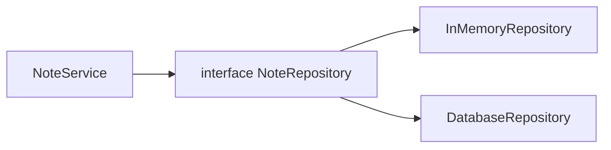
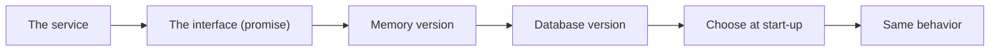

# Interfaces Abstract Types And Sealed Choices

## The big idea in plain words {#picture}

A wall socket has a certain shape. Any plug that fits will work: a lamp, a phone charger, a fan. The socket does not care which one. It only cares that the plug has the right shape.

A Java **interface** is the shape of the socket. It lists what is needed. Different classes can fit it in different ways. The code that uses the socket does not know or care which plug it got.



## What you will be able to do {#outcomes}

By the end of this lesson you will be able to:

- Write an interface and implement it in two classes.
- Explain abstract classes and sealed types in simple words.
- Use fake implementations to make tests easy.

## Words to know {#vocabulary}

- **interface**: a list of actions that a class promises to provide.
- **implements**: a class says "I keep this promise".
- **abstract class**: a partly built class meant to be extended.
- **sealed**: a type that only allows a fixed list of children.
- **default method**: an interface method that already has a body.
- **test double**: a fake piece used in a test instead of the real one.

## Why this idea exists {#history}

When your rules are tied to one specific database, you cannot test them without that database. With an interface, you can plug in a simple fake for tests and the real thing for production.

## Concept 1: An interface is a promise {#concept-1}

```java
interface NoteRepository {
    void save(Note note);
    Optional<Note> findById(int id);
}
```
It says what must be possible but not how. Any class that `implements NoteRepository` must provide both methods.

## Concept 2: Many classes, one promise {#concept-2}

`InMemoryNoteRepository` keeps notes in a list. `DatabaseNoteRepository` stores them in a real database. Both fit the interface, so `NoteService` works with either one, and you can change the choice without touching the service.

## Concept 3: Fakes make tests easy {#concept-3}

In a test, give the service the in-memory version. No database to set up, the test is fast and always the same. This is called a test double. It replaces the outside world, not the rule you are testing.

## Concept 4: Sealed and abstract: closed families {#concept-4}

An abstract class is a half-built class that children complete. A sealed type says "only these children are allowed", like the fixed list `Circle`, `Square`, `Triangle`. Then Java can warn you if you forget to handle one of them.

## Same service, two repositories {#example}

```java
NoteService test = new NoteService(new InMemoryNoteRepository());
NoteService real = new NoteService(new DatabaseNoteRepository(connection));
```
The service code is identical. In the tests we use the first line. In the real app we use the second.

## Going deeper: the technical walkthrough {#walkthrough}

### Interfaces and dependency direction


```java
public interface NoteRepository {
    List<StudyNote> findByTopic(String topic);
    StudyNote save(StudyNote note);
}
```

A service can depend on this promise while one implementation uses memory and
another uses PostgreSQL. This is the basic idea behind a repository port and
adapter.

```text
Controller -> Service -> Repository interface -> Memory or database adapter
```

An interface is useful when the boundary is real. Do not create ten empty
interfaces only to make a diagram look sophisticated.


### Focused implementation

A sealed type declares a finite family of permitted implementations. It fits a known set such as success and not-found. An open interface fits third-party adapters better. Default methods add behavior to interfaces but must not create conflicting hidden state. A service depends on the interface; infrastructure implements that port instead of controlling the domain.

```java

sealed interface Lookup permits Found, Missing {}
record Found(String title) implements Lookup {}
record Missing(long id) implements Lookup {}
public class Example {
  public static void main(String[] args) {
    Lookup result = new Found("APIs");
    if (result instanceof Found found) System.out.println(found.title());
  }
}

```

Read the imports, then the values and checks, then the operation, and finally the result or cleanup. Java Example programs compile as Example.java. Python uses Python 3.11+. JavaScript ESM runs as example.mjs. Framework snippets run inside the generated project.

## Worked scenario {#worked-scenario}

You want to test your service while the PostgreSQL database is switched off. What helps?

The justified choice is **Give the service an in-memory stand-in for its repository**. Select **inject-repository** in the structured practical and explain why. Alternatives ignore a requirement, cross a trust boundary, or invent success.

### Structured decision contract

```json

{
  "decision": "inject-repository",
  "justification": "The interface and adapter boundary must preserve the declared contract and ownership.",
  "failureBehavior": "Expose a safe failure and recover through the boundary owner."
}

```

Decision selects one declared behavior. Justification explains the boundary. FailureBehavior explains the observable error and recovery owner. These fields never execute commands. Required terms and minimum lengths form a basic practice rubric, not semantic grading.

## Step-by-step flow and matching picture {#flow}




## Three real-life uses {#use-cases}

1. A `Payment` interface with `CardPayment` and `WalletPayment` classes.
2. A logger interface with a console version and a file version.
3. A test that runs without internet because the email sender is a fake.

## What can go wrong, and how to stay safe {#failure-security}

Mistakes: creating an interface for every class even when there is only ever one version, making the fake behave differently from the real one so tests prove nothing, and forgetting that an interface cannot fix a class that does not keep the promise properly.

## Practice lab and expected observation {#practice}

1. Predict the scenario decision before opening Practical. Explain each rejected alternative.
2. Run a relevant example above in an isolated exercise project. Record the expected result, then change one input to an invalid or boundary value. A failed assertion or deliberate error should replace silent success.
3. Submit the structured decision. Initially the checks fail. After selecting inject-repository and writing an explanation and failure plan, all three pass. Follow the indicated review section for missed checks.

### Broken example to debug

```json

{"decision":"trust-client","justification":"","failureBehavior":""}

```

This ignores the responsible boundary and gives no reasoning or recovery. Correct the fields rather than changing the validator.

## Checkpoint and definition of done {#checkpoint}

- [ ] Define interface and adapter without looking.
- [ ] Trace input to owner and output.
- [ ] Explain one failure and one alternative.
- [ ] Pass at least four assignment questions.
- [ ] Pass every practical check and submit.
- [ ] Explain the concept again tomorrow.

## Sources, versions, and safe commands {#sources}

Java 17 baseline; installed validation JDK may be newer. Review date: 2026-10-02. The supplied blueprint is the teaching source; official landing pages were checked where reachable. No provider or original TM Schedule deployment was tested.

- [Official reference](https://docs.oracle.com/en/java/javase/17/)

[Course reading order](README.md) · [Previous lesson](07-inheritance-composition-and-polymorphism.md) · [Next lesson](08a-design-patterns-singleton-factory-builder-observer.md)

```study-quiz

{
  "schemaVersion": 1,
  "lessonId": "java/08-interfaces-abstract-types-and-sealed-choices",
  "title": "Assignment: Interfaces Abstract Types And Sealed Choices",
  "passPercentage": 80,
  "questions": [
    {
      "id": "q1",
      "sectionId": "concept-1",
      "prompt": "In Interfaces Abstract Types And Sealed Choices, what does interface mean?",
      "options": [
        {
          "id": "a",
          "text": "A permission granted by a hidden browser control",
          "explanation": "This changes the declared meaning or bypasses the responsible boundary."
        },
        {
          "id": "b",
          "text": "An unlimited provider operation with no ownership",
          "explanation": "This changes the declared meaning or bypasses the responsible boundary."
        },
        {
          "id": "c",
          "text": "a list of actions that something promises to offer",
          "explanation": "This preserves the definition and boundary described in the lesson."
        },
        {
          "id": "d",
          "text": "A diagnostic credential intended for public logs",
          "explanation": "This changes the declared meaning or bypasses the responsible boundary."
        }
      ],
      "correctOptionId": "c",
      "explanation": "interface means a list of actions that something promises to offer.",
      "reviewLabel": "Review concept 1"
    },
    {
      "id": "q2",
      "sectionId": "concept-2",
      "prompt": "In Interfaces Abstract Types And Sealed Choices, which rule is correct for checkpoint 2?",
      "options": [
        {
          "id": "a",
          "text": "Trust client-side checks instead of the server rule.",
          "explanation": "This changes the declared meaning or bypasses the responsible boundary."
        },
        {
          "id": "b",
          "text": "Hide the failure by returning a fabricated successful result.",
          "explanation": "This changes the declared meaning or bypasses the responsible boundary."
        },
        {
          "id": "c",
          "text": "Skip the stated boundary, limit, or ownership check.",
          "explanation": "This changes the declared meaning or bypasses the responsible boundary."
        },
        {
          "id": "d",
          "text": "A fake in-memory version is handy for fast, safe tests.",
          "explanation": "This preserves the definition and boundary described in the lesson."
        }
      ],
      "correctOptionId": "d",
      "explanation": "A fake in-memory version is handy for fast, safe tests.",
      "reviewLabel": "Review concept 2"
    },
    {
      "id": "q3",
      "sectionId": "concept-3",
      "prompt": "In Interfaces Abstract Types And Sealed Choices, which rule is correct for checkpoint 3?",
      "options": [
        {
          "id": "a",
          "text": "A real database version must behave the same way as the fake one.",
          "explanation": "This preserves the definition and boundary described in the lesson."
        },
        {
          "id": "b",
          "text": "Trust client-side checks instead of the server rule.",
          "explanation": "This changes the declared meaning or bypasses the responsible boundary."
        },
        {
          "id": "c",
          "text": "Hide the failure by returning a fabricated successful result.",
          "explanation": "This changes the declared meaning or bypasses the responsible boundary."
        },
        {
          "id": "d",
          "text": "Skip the stated boundary, limit, or ownership check.",
          "explanation": "This changes the declared meaning or bypasses the responsible boundary."
        }
      ],
      "correctOptionId": "a",
      "explanation": "A real database version must behave the same way as the fake one.",
      "reviewLabel": "Review concept 3"
    },
    {
      "id": "q4",
      "sectionId": "concept-4",
      "prompt": "In Interfaces Abstract Types And Sealed Choices, which rule is correct for checkpoint 4?",
      "options": [
        {
          "id": "a",
          "text": "Trust client-side checks instead of the server rule.",
          "explanation": "This changes the declared meaning or bypasses the responsible boundary."
        },
        {
          "id": "b",
          "text": "A test double stands in for the outside world, not for the rule you are testing.",
          "explanation": "This preserves the definition and boundary described in the lesson."
        },
        {
          "id": "c",
          "text": "Hide the failure by returning a fabricated successful result.",
          "explanation": "This changes the declared meaning or bypasses the responsible boundary."
        },
        {
          "id": "d",
          "text": "Skip the stated boundary, limit, or ownership check.",
          "explanation": "This changes the declared meaning or bypasses the responsible boundary."
        }
      ],
      "correctOptionId": "b",
      "explanation": "A test double stands in for the outside world, not for the rule you are testing.",
      "reviewLabel": "Review concept 4"
    },
    {
      "id": "q5",
      "sectionId": "worked-scenario",
      "prompt": "You want to test your service while the PostgreSQL database is switched off. What helps?",
      "options": [
        {
          "id": "a",
          "text": "Catch every error and pretend the catalog is empty",
          "explanation": "This changes the declared meaning or bypasses the responsible boundary."
        },
        {
          "id": "b",
          "text": "Put the database password inside the test",
          "explanation": "This changes the declared meaning or bypasses the responsible boundary."
        },
        {
          "id": "c",
          "text": "Give the service an in-memory stand-in for its repository",
          "explanation": "This preserves the definition and boundary described in the lesson."
        },
        {
          "id": "d",
          "text": "Delete the service rules",
          "explanation": "This changes the declared meaning or bypasses the responsible boundary."
        }
      ],
      "correctOptionId": "c",
      "explanation": "Give the service an in-memory stand-in for its repository. An interface cannot fix pieces that behave differently from the promise.",
      "reviewLabel": "Review the worked scenario"
    }
  ]
}

```

```study-practical

{
  "schemaVersion": 1,
  "challengeId": "java/08-interfaces-abstract-types-and-sealed-choices/decision",
  "lessonId": "java/08-interfaces-abstract-types-and-sealed-choices",
  "title": "Practical: Interfaces Abstract Types And Sealed Choices",
  "language": "json",
  "mode": "structured",
  "instructions": "You want to test your service while the PostgreSQL database is switched off. What helps? Return an object with decision (choose from inject-repository, skip-check, unbounded-work, trust-client), justification (at least 40 characters; include interface and adapter), and failureBehavior (at least 25 characters; include failure and recover while explaining the error and recovery). These are structured reasoning checks, not code execution or an official grade.",
  "starterCode": "{\n  \"decision\": \"\",\n  \"justification\": \"\",\n  \"failureBehavior\": \"\"\n}",
  "entryPoint": "answer",
  "publicExamples": [
    {
      "input": {
        "decision": "skip-check",
        "justification": "",
        "failureBehavior": ""
      },
      "expected": {
        "passed": false
      }
    },
    {
      "input": {
        "decision": "inject-repository",
        "justification": "The interface and adapter boundary must preserve the declared contract and ownership.",
        "failureBehavior": "Show a safe failure and recover through the responsible owner."
      },
      "expected": {
        "passed": true
      }
    }
  ],
  "publicTestIds": [
    "decision",
    "explanation",
    "failure-plan"
  ],
  "reviewSections": {
    "decision": "worked-scenario",
    "explanation": "concept-2",
    "failure-plan": "failure-security"
  },
  "limits": {
    "timeMs": 2000,
    "memoryMb": 128,
    "outputBytes": 20000
  }
}

```

