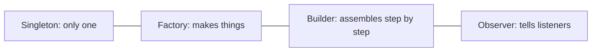
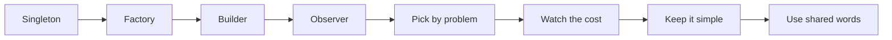
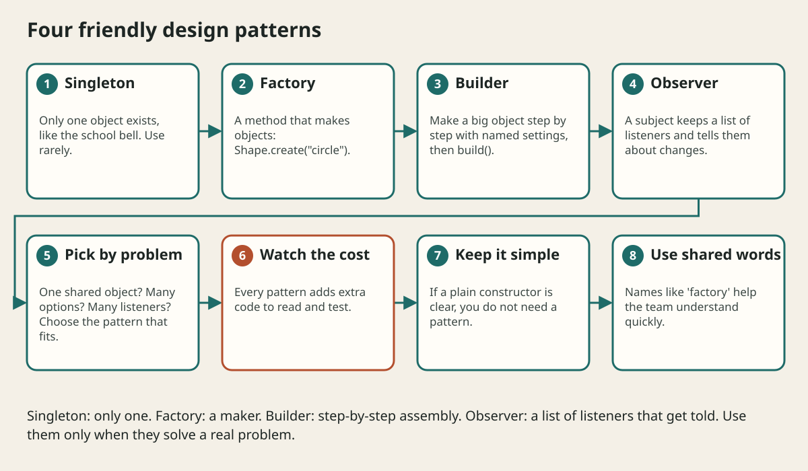

# Design Patterns Singleton Factory Builder Observer

## The big idea in plain words {#picture}

Cooks do not invent a way to fold a paper bag each time. They use known tricks with names. Programmers too have well-known tricks for common problems, called **design patterns**. When someone says "use a factory", everyone understands the idea right away.

In this lesson we meet four friendly ones: **Singleton** (just one), **Factory** (a maker), **Builder** (step-by-step assembly), and **Observer** (a notification list).



## What you will be able to do {#outcomes}

By the end of this lesson you will be able to:

- Describe singleton, factory, builder, and observer in your own words.
- Write a small example of each.
- Know the cost of each and when not to use it.

## Words to know {#vocabulary}

- **design pattern**: a named, reusable solution to a common problem.
- **singleton**: a class with only one object.
- **factory**: something that creates objects for you.
- **builder**: assembles an object step by step.
- **observer**: a listener that is told when something changes.
- **subject**: the thing that is watched in the observer pattern.

## Why this idea exists {#history}

Patterns give us a shared vocabulary. They also warn us about the downsides, because every pattern also adds some complexity.

## Concept 1: Singleton: exactly one {#concept-1}

```java
class Settings {
    private static final Settings INSTANCE = new Settings();
    private Settings() {}
    static Settings get() { return INSTANCE; }
}
```
The constructor is private, so nobody else can call `new Settings()`. It is like the school bell: there is just one. But be careful: global single objects make tests harder, so use them rarely.

## Concept 2: Factory: a maker method {#concept-2}

```java
static Shape create(String kind) {
    return switch (kind) {
        case "circle" -> new Circle();
        case "square" -> new Square();
        default -> throw new IllegalArgumentException(kind);
    };
}
```
The caller asks for a "circle" and does not need to know which class is used. This makes it easy to add new kinds in one place.

## Concept 3: Builder: many options, clear code {#concept-3}

```java
Note note = new NoteBuilder()
    .title("Math")
    .tag("homework")
    .pinned(true)
    .build();
```
Instead of a long constructor like `new Note("Math", null, true, false, 3)`, which nobody can read, the builder names each setting. `build()` checks the rules and gives you the finished object.

## Concept 4: Observer: tell the listeners {#concept-4}

```java
interface Listener { void onSaved(Note note); }
class NoteStore {
    private final List<Listener> listeners = new ArrayList<>();
    void add(Listener l) { listeners.add(l); }
    void save(Note n) { /* ... */ listeners.forEach(l -> l.onSaved(n)); }
}
```
The store keeps a list of listeners and tells all of them when a note is saved. The store does not know what they do: one sends an email, another updates a counter.

## A notification when a note is saved {#example}

Create a `NoteStore`. Add one listener that prints "Saved Math" and another that adds one to a counter. When `save` is called, both run. Later you can add a third listener without touching `NoteStore` at all.

## Going deeper: the technical walkthrough {#walkthrough}

## Worked scenario {#worked-scenario}

A class has ten settings and most are optional, so constructors become confusing. Which pattern helps?

The justified choice is **The builder pattern with named steps**. Select **use-builder** in the structured practical and explain why. Alternatives ignore a requirement, cross a trust boundary, or invent success.

### Structured decision contract

```json

{
  "decision": "use-builder",
  "justification": "The singleton and factory boundary must preserve the declared contract and ownership.",
  "failureBehavior": "Expose a safe failure and recover through the boundary owner."
}

```

Decision selects one declared behavior. Justification explains the boundary. FailureBehavior explains the observable error and recovery owner. These fields never execute commands. Required terms and minimum lengths form a basic practice rubric, not semantic grading.

## Step-by-step flow and matching picture {#flow}





## Three real-life uses {#use-cases}

1. A game has one `Settings` object that all parts read.
2. A drawing app creates shapes using a factory.
3. A form with many optional fields uses a builder.

## What can go wrong, and how to stay safe {#failure-security}

Mistakes: using a pattern because it sounds smart (not because there is a problem), singletons that hide dependencies and make tests hard, builders for classes with only two fields, and observers that forget to remove listeners, which causes memory leaks. If a plain constructor is clear, keep it.

## Practice lab and expected observation {#practice}

1. Predict the scenario decision before opening Practical. Explain each rejected alternative.
2. Run a relevant example above in an isolated exercise project. Record the expected result, then change one input to an invalid or boundary value. A failed assertion or deliberate error should replace silent success.
3. Submit the structured decision. Initially the checks fail. After selecting use-builder and writing an explanation and failure plan, all three pass. Follow the indicated review section for missed checks.

### Broken example to debug

```json

{"decision":"trust-client","justification":"","failureBehavior":""}

```

This ignores the responsible boundary and gives no reasoning or recovery. Correct the fields rather than changing the validator.

## Checkpoint and definition of done {#checkpoint}

- [ ] Define singleton and factory without looking.
- [ ] Trace input to owner and output.
- [ ] Explain one failure and one alternative.
- [ ] Pass at least four assignment questions.
- [ ] Pass every practical check and submit.
- [ ] Explain the concept again tomorrow.

## Sources, versions, and safe commands {#sources}

Java 17 baseline; installed validation JDK may be newer. Review date: 2026-10-02. The supplied blueprint is the teaching source; official landing pages were checked where reachable. No provider or original TM Schedule deployment was tested.

- [Official reference](https://docs.oracle.com/en/java/javase/17/)

[Course reading order](README.md) · [Previous lesson](08-interfaces-abstract-types-and-sealed-choices.md) · [Next lesson](09-records-enums-and-value-objects.md)

```study-quiz

{
  "schemaVersion": 1,
  "lessonId": "java/08a-design-patterns-singleton-factory-builder-observer",
  "title": "Assignment: Design Patterns Singleton Factory Builder Observer",
  "passPercentage": 80,
  "questions": [
    {
      "id": "q1",
      "sectionId": "concept-1",
      "prompt": "In Design Patterns Singleton Factory Builder Observer, what does singleton mean?",
      "options": [
        {
          "id": "a",
          "text": "A permission granted by a hidden browser control",
          "explanation": "This changes the declared meaning or bypasses the responsible boundary."
        },
        {
          "id": "b",
          "text": "An unlimited provider operation with no ownership",
          "explanation": "This changes the declared meaning or bypasses the responsible boundary."
        },
        {
          "id": "c",
          "text": "A diagnostic credential intended for public logs",
          "explanation": "This changes the declared meaning or bypasses the responsible boundary."
        },
        {
          "id": "d",
          "text": "a class that allows only one object to exist",
          "explanation": "This preserves the definition and boundary described in the lesson."
        }
      ],
      "correctOptionId": "d",
      "explanation": "singleton means a class that allows only one object to exist.",
      "reviewLabel": "Review concept 1"
    },
    {
      "id": "q2",
      "sectionId": "concept-2",
      "prompt": "In Design Patterns Singleton Factory Builder Observer, which rule is correct for checkpoint 2?",
      "options": [
        {
          "id": "a",
          "text": "A factory hides which exact class is created behind a simple method.",
          "explanation": "This preserves the definition and boundary described in the lesson."
        },
        {
          "id": "b",
          "text": "Trust client-side checks instead of the server rule.",
          "explanation": "This changes the declared meaning or bypasses the responsible boundary."
        },
        {
          "id": "c",
          "text": "Hide the failure by returning a fabricated successful result.",
          "explanation": "This changes the declared meaning or bypasses the responsible boundary."
        },
        {
          "id": "d",
          "text": "Skip the stated boundary, limit, or ownership check.",
          "explanation": "This changes the declared meaning or bypasses the responsible boundary."
        }
      ],
      "correctOptionId": "a",
      "explanation": "A factory hides which exact class is created behind a simple method.",
      "reviewLabel": "Review concept 2"
    },
    {
      "id": "q3",
      "sectionId": "concept-3",
      "prompt": "In Design Patterns Singleton Factory Builder Observer, which rule is correct for checkpoint 3?",
      "options": [
        {
          "id": "a",
          "text": "Trust client-side checks instead of the server rule.",
          "explanation": "This changes the declared meaning or bypasses the responsible boundary."
        },
        {
          "id": "b",
          "text": "A builder is helpful when an object has many optional settings.",
          "explanation": "This preserves the definition and boundary described in the lesson."
        },
        {
          "id": "c",
          "text": "Hide the failure by returning a fabricated successful result.",
          "explanation": "This changes the declared meaning or bypasses the responsible boundary."
        },
        {
          "id": "d",
          "text": "Skip the stated boundary, limit, or ownership check.",
          "explanation": "This changes the declared meaning or bypasses the responsible boundary."
        }
      ],
      "correctOptionId": "b",
      "explanation": "A builder is helpful when an object has many optional settings.",
      "reviewLabel": "Review concept 3"
    },
    {
      "id": "q4",
      "sectionId": "concept-4",
      "prompt": "In Design Patterns Singleton Factory Builder Observer, which rule is correct for checkpoint 4?",
      "options": [
        {
          "id": "a",
          "text": "Trust client-side checks instead of the server rule.",
          "explanation": "This changes the declared meaning or bypasses the responsible boundary."
        },
        {
          "id": "b",
          "text": "Hide the failure by returning a fabricated successful result.",
          "explanation": "This changes the declared meaning or bypasses the responsible boundary."
        },
        {
          "id": "c",
          "text": "In the observer pattern, the subject keeps a list of listeners and notifies them of changes.",
          "explanation": "This preserves the definition and boundary described in the lesson."
        },
        {
          "id": "d",
          "text": "Skip the stated boundary, limit, or ownership check.",
          "explanation": "This changes the declared meaning or bypasses the responsible boundary."
        }
      ],
      "correctOptionId": "c",
      "explanation": "In the observer pattern, the subject keeps a list of listeners and notifies them of changes.",
      "reviewLabel": "Review concept 4"
    },
    {
      "id": "q5",
      "sectionId": "worked-scenario",
      "prompt": "A class has ten settings and most are optional, so constructors become confusing. Which pattern helps?",
      "options": [
        {
          "id": "a",
          "text": "A singleton",
          "explanation": "This changes the declared meaning or bypasses the responsible boundary."
        },
        {
          "id": "b",
          "text": "Ten constructors with different orders",
          "explanation": "This changes the declared meaning or bypasses the responsible boundary."
        },
        {
          "id": "c",
          "text": "Making every field public",
          "explanation": "This changes the declared meaning or bypasses the responsible boundary."
        },
        {
          "id": "d",
          "text": "The builder pattern with named steps",
          "explanation": "This preserves the definition and boundary described in the lesson."
        }
      ],
      "correctOptionId": "d",
      "explanation": "The builder pattern with named steps. Patterns are tools, not goals, and the simplest code that works is usually best.",
      "reviewLabel": "Review the worked scenario"
    }
  ]
}

```

```study-practical

{
  "schemaVersion": 1,
  "challengeId": "java/08a-design-patterns-singleton-factory-builder-observer/decision",
  "lessonId": "java/08a-design-patterns-singleton-factory-builder-observer",
  "title": "Practical: Design Patterns Singleton Factory Builder Observer",
  "language": "json",
  "mode": "structured",
  "instructions": "A class has ten settings and most are optional, so constructors become confusing. Which pattern helps? Return an object with decision (choose from use-builder, skip-check, unbounded-work, trust-client), justification (at least 40 characters; include singleton and factory), and failureBehavior (at least 25 characters; include failure and recover while explaining the error and recovery). These are structured reasoning checks, not code execution or an official grade.",
  "starterCode": "{\n  \"decision\": \"\",\n  \"justification\": \"\",\n  \"failureBehavior\": \"\"\n}",
  "entryPoint": "answer",
  "publicExamples": [
    {
      "input": {
        "decision": "skip-check",
        "justification": "",
        "failureBehavior": ""
      },
      "expected": {
        "passed": false
      }
    },
    {
      "input": {
        "decision": "use-builder",
        "justification": "The singleton and factory boundary must preserve the declared contract and ownership.",
        "failureBehavior": "Show a safe failure and recover through the responsible owner."
      },
      "expected": {
        "passed": true
      }
    }
  ],
  "publicTestIds": [
    "decision",
    "explanation",
    "failure-plan"
  ],
  "reviewSections": {
    "decision": "worked-scenario",
    "explanation": "concept-2",
    "failure-plan": "failure-security"
  },
  "limits": {
    "timeMs": 2000,
    "memoryMb": 128,
    "outputBytes": 20000
  }
}

```

