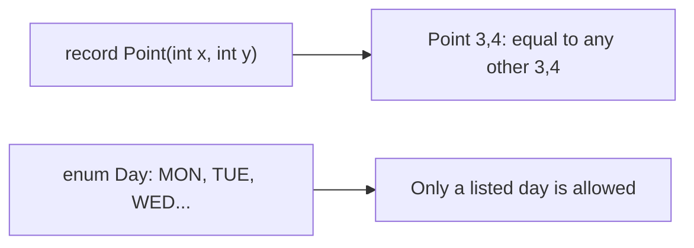
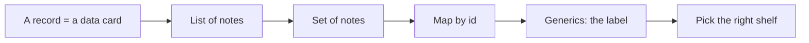
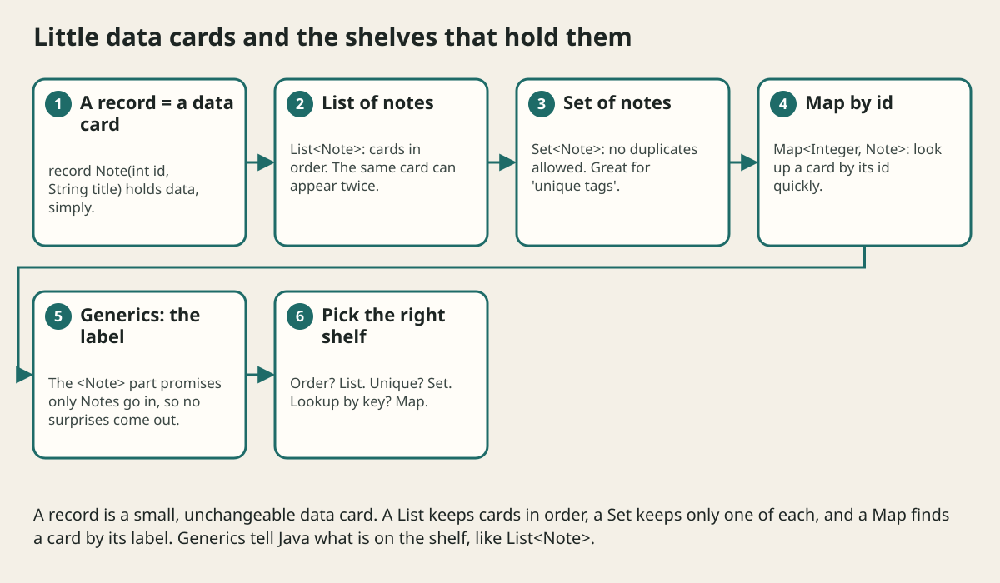

# Records Enums And Value Objects

## The big idea in plain words {#picture}

Some things are just facts: a point on a map (x and y), a day of the week, a coin that is either heads or tails. You do not change the point. You make a new one. A **record** is a short way to write down such a fact in Java. An **enum** is a fixed list of choices, like the seven days.

Both help you say exactly what you mean, and both help Java catch mistakes for you.



## What you will be able to do {#outcomes}

By the end of this lesson you will be able to:

- Write a record and an enum.
- Explain value equality in simple words.
- Know when a normal changeable class is a better choice.

## Words to know {#vocabulary}

- **record**: a short way to write a class that only holds data.
- **enum**: a type with a fixed list of allowed values.
- **value object**: a small object that is defined by its content, like a point.
- **immutable**: cannot be changed after it is created.
- **equality**: two things count as the same because their content is the same.
- **canonical constructor**: the main constructor of a record, where you can add checks.

## Why this idea exists {#history}

Writing a class just to hold data used to take many lines. Records make this one line, with equals, hashCode, and toString built in. Enums stop mistakes like typing "Mondey".

## Concept 1: A record is a data card {#concept-1}

`record Note(int id, String title) {}` is complete. It gives you a constructor, getters (`note.title()`), `equals`, and a readable `toString`. Records are immutable: you cannot change a field once it is made.

## Concept 2: Value equality {#concept-2}

Two records with the same content are equal: `new Point(3, 4).equals(new Point(3, 4))` is `true`. This is how we compare things like money or coordinates: by what they hold, not by where they live in memory.

## Concept 3: Check inside the record {#concept-3}

You can add a check in the constructor: if the title is blank, throw an error. Now a bad `Note` cannot exist. A record checks its data once, at the door.

## Concept 4: Enums list the choices {#concept-4}

`enum Status { TODO, DOING, DONE }` allows only these three values. If someone types `Status.FINISHED`, Java says "that does not exist" before the program runs. Enums can have their own methods too, such as `isOpen()`.

## Status of a note {#example}

```java
record Note(int id, String title, Status status) {
    Note {
        if (title.isBlank()) throw new IllegalArgumentException("blank title");
    }
}
enum Status { TODO, DOING, DONE }

Note n = new Note(1, "Math", Status.TODO);
Note done = new Note(n.id(), n.title(), Status.DONE);  // a new note, not a change
```
We do not change `n`. We make a new note with the new status. That makes it safe to share a `Note` anywhere.

## Going deeper: the technical walkthrough {#walkthrough}

### Records and value objects


```java
public record StudyNote(long id, String title, String topic) {
}
```

A record is a compact immutable data carrier. Java creates the constructor,
accessors, equality, hash code, and string representation. The accessor is
`title()`, not `getTitle()`.

Use records for request and response data when behavior does not need mutable
identity. Use a class when the object owns complex state transitions or
invariants.


## Worked scenario {#worked-scenario}

A note must never have an empty title. Where should the object protect that rule?

The justified choice is **When it is created and whenever the title changes**. Select **protect-invariant** in the structured practical and explain why. Alternatives ignore a requirement, cross a trust boundary, or invent success.

### Structured decision contract

```json

{
  "decision": "protect-invariant",
  "justification": "The class and object boundary must preserve the declared contract and ownership.",
  "failureBehavior": "Expose a safe failure and recover through the boundary owner."
}

```

Decision selects one declared behavior. Justification explains the boundary. FailureBehavior explains the observable error and recovery owner. These fields never execute commands. Required terms and minimum lengths form a basic practice rubric, not semantic grading.

## Step-by-step flow and matching picture {#flow}





## Three real-life uses {#use-cases}

1. A `Money(amount, currency)` record in a shop.
2. A `Direction` enum with NORTH, SOUTH, EAST, WEST in a game.
3. A `Coordinates(lat, lon)` record for a map.

## What can go wrong, and how to stay safe {#failure-security}

Mistakes: using a record for something that must change a lot (like a shopping cart that adds items), thinking the things inside a record are also frozen (a list inside can still change!), and using plain strings like "done" instead of an enum, which allows typos.

## Practice lab and expected observation {#practice}

Implement valid to return true only when the numeric note ID is positive and the title is nonblank after trimming. This checks a value invariant, not authorization. Do not mutate or persist the input.

The language starter and public examples appear in Practical. Run is unavailable until a trusted isolated worker is configured. Reading and assignment review still work; this lesson does not claim code-test completion.

1. Predict the scenario decision before opening Practical. Explain each rejected alternative.
2. Run a relevant example above in an isolated exercise project. Record the expected result, then change one input to an invalid or boundary value. A failed assertion or deliberate error should replace silent success.
3. Submit the structured decision. Initially the checks fail. After selecting protect-invariant and writing an explanation and failure plan, all three pass. Follow the indicated review section for missed checks.

### Broken example to debug

```json

{"decision":"trust-client","justification":"","failureBehavior":""}

```

This ignores the responsible boundary and gives no reasoning or recovery. Correct the fields rather than changing the validator.

## Checkpoint and definition of done {#checkpoint}

- [ ] Define class and object without looking.
- [ ] Trace input to owner and output.
- [ ] Explain one failure and one alternative.
- [ ] Pass at least four assignment questions.
- [ ] Pass every practical check and submit.
- [ ] Explain the concept again tomorrow.

## Sources, versions, and safe commands {#sources}

Java 17 baseline; installed validation JDK may be newer. Review date: 2026-10-02. The supplied blueprint is the teaching source; official landing pages were checked where reachable. No provider or original TM Schedule deployment was tested.

- [Official reference](https://docs.oracle.com/en/java/javase/17/)

[Course reading order](README.md) · [Previous lesson](08a-design-patterns-singleton-factory-builder-observer.md) · [Next lesson](10-collections-and-generics.md)

```study-quiz

{
  "schemaVersion": 1,
  "lessonId": "java/09-records-enums-and-value-objects",
  "title": "Assignment: Records Enums And Value Objects",
  "passPercentage": 80,
  "questions": [
    {
      "id": "q1",
      "sectionId": "concept-1",
      "prompt": "In Records Enums And Value Objects, what does class mean?",
      "options": [
        {
          "id": "a",
          "text": "a blueprint that describes the data and actions of something",
          "explanation": "This preserves the definition and boundary described in the lesson."
        },
        {
          "id": "b",
          "text": "A permission granted by a hidden browser control",
          "explanation": "This changes the declared meaning or bypasses the responsible boundary."
        },
        {
          "id": "c",
          "text": "An unlimited provider operation with no ownership",
          "explanation": "This changes the declared meaning or bypasses the responsible boundary."
        },
        {
          "id": "d",
          "text": "A diagnostic credential intended for public logs",
          "explanation": "This changes the declared meaning or bypasses the responsible boundary."
        }
      ],
      "correctOptionId": "a",
      "explanation": "class means a blueprint that describes the data and actions of something.",
      "reviewLabel": "Review concept 1"
    },
    {
      "id": "q2",
      "sectionId": "concept-2",
      "prompt": "In Records Enums And Value Objects, which rule is correct for checkpoint 2?",
      "options": [
        {
          "id": "a",
          "text": "Trust client-side checks instead of the server rule.",
          "explanation": "This changes the declared meaning or bypasses the responsible boundary."
        },
        {
          "id": "b",
          "text": "Private data is changed only through carefully written methods.",
          "explanation": "This preserves the definition and boundary described in the lesson."
        },
        {
          "id": "c",
          "text": "Hide the failure by returning a fabricated successful result.",
          "explanation": "This changes the declared meaning or bypasses the responsible boundary."
        },
        {
          "id": "d",
          "text": "Skip the stated boundary, limit, or ownership check.",
          "explanation": "This changes the declared meaning or bypasses the responsible boundary."
        }
      ],
      "correctOptionId": "b",
      "explanation": "Private data is changed only through carefully written methods.",
      "reviewLabel": "Review concept 2"
    },
    {
      "id": "q3",
      "sectionId": "concept-3",
      "prompt": "In Records Enums And Value Objects, which rule is correct for checkpoint 3?",
      "options": [
        {
          "id": "a",
          "text": "Trust client-side checks instead of the server rule.",
          "explanation": "This changes the declared meaning or bypasses the responsible boundary."
        },
        {
          "id": "b",
          "text": "Hide the failure by returning a fabricated successful result.",
          "explanation": "This changes the declared meaning or bypasses the responsible boundary."
        },
        {
          "id": "c",
          "text": "Composition means one object uses another object to help it.",
          "explanation": "This preserves the definition and boundary described in the lesson."
        },
        {
          "id": "d",
          "text": "Skip the stated boundary, limit, or ownership check.",
          "explanation": "This changes the declared meaning or bypasses the responsible boundary."
        }
      ],
      "correctOptionId": "c",
      "explanation": "Composition means one object uses another object to help it.",
      "reviewLabel": "Review concept 3"
    },
    {
      "id": "q4",
      "sectionId": "concept-4",
      "prompt": "In Records Enums And Value Objects, which rule is correct for checkpoint 4?",
      "options": [
        {
          "id": "a",
          "text": "Trust client-side checks instead of the server rule.",
          "explanation": "This changes the declared meaning or bypasses the responsible boundary."
        },
        {
          "id": "b",
          "text": "Hide the failure by returning a fabricated successful result.",
          "explanation": "This changes the declared meaning or bypasses the responsible boundary."
        },
        {
          "id": "c",
          "text": "Skip the stated boundary, limit, or ownership check.",
          "explanation": "This changes the declared meaning or bypasses the responsible boundary."
        },
        {
          "id": "d",
          "text": "A child class should keep the promises of its parent class.",
          "explanation": "This preserves the definition and boundary described in the lesson."
        }
      ],
      "correctOptionId": "d",
      "explanation": "A child class should keep the promises of its parent class.",
      "reviewLabel": "Review concept 4"
    },
    {
      "id": "q5",
      "sectionId": "worked-scenario",
      "prompt": "A note must never have an empty title. Where should the object protect that rule?",
      "options": [
        {
          "id": "a",
          "text": "When it is created and whenever the title changes",
          "explanation": "This preserves the definition and boundary described in the lesson."
        },
        {
          "id": "b",
          "text": "Only in a color on the screen",
          "explanation": "This changes the declared meaning or bypasses the responsible boundary."
        },
        {
          "id": "c",
          "text": "Only in a comment in the database",
          "explanation": "This changes the declared meaning or bypasses the responsible boundary."
        },
        {
          "id": "d",
          "text": "Only in a log message",
          "explanation": "This changes the declared meaning or bypasses the responsible boundary."
        }
      ],
      "correctOptionId": "a",
      "explanation": "When it is created and whenever the title changes. A record is a simple value holder, but things inside it can still be changeable.",
      "reviewLabel": "Review the worked scenario"
    }
  ]
}

```

```study-practical

{
  "schemaVersion": 1,
  "challengeId": "java/09-records-enums-and-value-objects/coding",
  "lessonId": "java/09-records-enums-and-value-objects",
  "title": "Practical: Validate a note value",
  "language": "java",
  "mode": "function",
  "instructions": "Implement valid to return true only when the numeric note ID is positive and the title is nonblank after trimming. This checks a value invariant, not authorization. Do not mutate or persist the input. A disposable isolated code runner is required; this installation never executes learner code on the host.",
  "starterCode": "public class Solution {\n  public static boolean valid(long id, String title) {\n    return false;\n  }\n}",
  "entryPoint": "valid",
  "publicExamples": [
    {
      "input": {
        "id": 1,
        "title": "APIs"
      },
      "expected": true
    },
    {
      "input": {
        "id": 0,
        "title": "APIs"
      },
      "expected": false
    },
    {
      "input": {
        "id": 1,
        "title": " "
      },
      "expected": false
    }
  ],
  "publicTestIds": [
    "valid-note",
    "nonpositive-id",
    "blank-title"
  ],
  "reviewSections": {
    "valid-note": "walkthrough",
    "nonpositive-id": "walkthrough",
    "blank-title": "walkthrough"
  },
  "limits": {
    "timeMs": 2000,
    "memoryMb": 128,
    "outputBytes": 20000
  }
}

```

