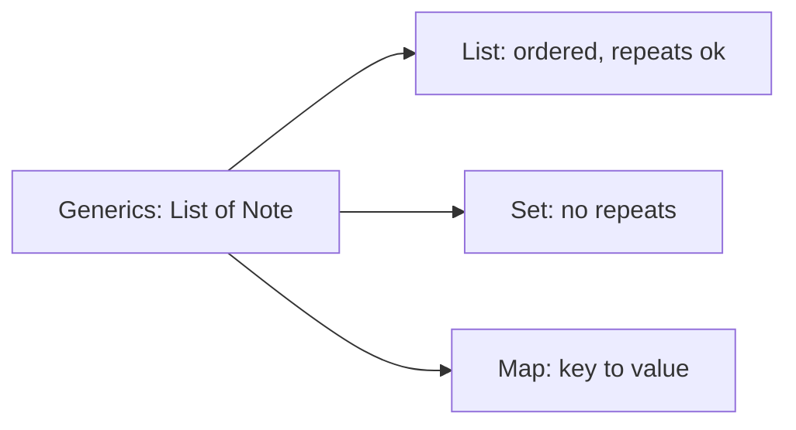
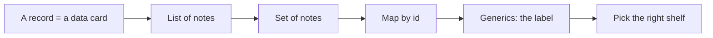

# Collections And Generics

## The big idea in plain words {#picture}

A library has shelves of different kinds. One shelf keeps books in the order they arrived (a **List**). One drawer has cards and never allows two of the same (a **Set**). One catalog lets you find a book by its code (a **Map**).

Java gives you these shelves, called **collections**. And **generics** are the labels on the shelves: `List<Note>` means "a list that only holds Notes". If you try to put in a banana, Java stops you.



## What you will be able to do {#outcomes}

By the end of this lesson you will be able to:

- Choose between List, Set, and Map.
- Read and write generic types like `List<String>` and `Map<Integer, Note>`.
- Loop through collections and know when each is fast.

## Words to know {#vocabulary}

- **collection**: a container that holds many items.
- **List**: items in order. Repeats allowed.
- **Set**: items with no repeats.
- **Map**: a lookup from a key to a value.
- **generics**: telling Java what type a container holds, written in `< >`.
- **iterate**: go through the items one by one.

## Why this idea exists {#history}

Real programs work with many things: a list of students, a set of tags, a table of prices. Choosing the right container makes code both easy to read and fast.

## Concept 1: List keeps the order {#concept-1}

`List<String> names = new ArrayList<>(); names.add("Ana");`. Items are in the order you added them, and you can ask for position 0, 1, 2. The same name can appear twice. Use a list when order matters.

## Concept 2: Set keeps things unique {#concept-2}

`Set<String> tags = new HashSet<>();` If you add "java" twice, it is stored once. Use a set to remove duplicates or to ask "have I seen this before?" very quickly.

## Concept 3: Map finds by key {#concept-3}

`Map<Integer, Note> byId = new HashMap<>(); byId.put(1, note);` Then `byId.get(1)` finds it immediately. It is like a dictionary: look up the word, get the meaning. Each key has exactly one value.

## Concept 4: Generics keep things safe {#concept-4}

`List<Note>` promises that only notes go in and only notes come out. Without it, you would have to guess and cast, and a surprise could crash the program. The label `<Note>` lets Java check for you before the program runs.

## Count words {#example}

```java
Map<String, Integer> counts = new HashMap<>();
for (String word : List.of("cat", "dog", "cat")) {
    counts.merge(word, 1, Integer::sum);
}
System.out.println(counts);   // {cat=2, dog=1}
```
For each word we add 1 to its count. The map remembers one number per word.

## Going deeper: the technical walkthrough {#walkthrough}

### Collections and generics


```java
List<String> topics = List.of("Java", "APIs");
Set<String> uniqueTopics = new HashSet<>(topics);
Map<Long, StudyNote> notesById = new HashMap<>();
```

- `List` keeps order and can contain duplicates.
- `Set` keeps unique values.
- `Map` finds a value by key.
- A generic such as `List<StudyNote>` tells the compiler what belongs inside.

Choose the collection from the operation you need, not from habit.


### Focused implementation

Generics put element contracts in the compiler. List<String> prevents adding an Integer, but erasure means most type arguments are not reified at runtime. A ? extends T collection produces T; a ? super T collection consumes T. Hash lookup is expected constant time under suitable hashing; sorting normally costs O(n log n). These estimates do not excuse an unbounded web response.

```java

import java.util.*;
public class Example {
  static int count(Collection<?> values) { return values.size(); }
  public static void main(String[] args) {
    List<String> titles = List.of("APIs", "Java", "APIs");
    Set<String> unique = new LinkedHashSet<>(titles);
    System.out.println(count(unique));
  }
}

```

Read the imports, then the values and checks, then the operation, and finally the result or cleanup. Java Example programs compile as Example.java. Python uses Python 3.11+. JavaScript ESM runs as example.mjs. Framework snippets run inside the generated project.

## Worked scenario {#worked-scenario}

You often need to find a note by its unique ID in a small program. Which container fits best?

The justified choice is **A map where the note ID is the key**. Select **map-by-id** in the structured practical and explain why. Alternatives ignore a requirement, cross a trust boundary, or invent success.

### Structured decision contract

```json

{
  "decision": "map-by-id",
  "justification": "The list and set boundary must preserve the declared contract and ownership.",
  "failureBehavior": "Expose a safe failure and recover through the boundary owner."
}

```

Decision selects one declared behavior. Justification explains the boundary. FailureBehavior explains the observable error and recovery owner. These fields never execute commands. Required terms and minimum lengths form a basic practice rubric, not semantic grading.

## Step-by-step flow and matching picture {#flow}




## Three real-life uses {#use-cases}

1. A `List` of homework tasks in the order due.
2. A `Set` of student ids that already submitted.
3. A `Map` from product code to price.

## What can go wrong, and how to stay safe {#failure-security}

Mistakes: using a List and searching it again and again when a Map would find the answer instantly, changing a list while looping over it (Java will complain), and forgetting that a `HashSet` or `HashMap` does not keep a promised order. If the order matters, use a List, or a `LinkedHashMap`.

## Practice lab and expected observation {#practice}

Implement titles to return distinct note titles in ascending ASCII order without changing the caller’s list. An empty list returns an empty list. This is an in-memory exercise, not a replacement for a database pagination query.

The language starter and public examples appear in Practical. Run is unavailable until a trusted isolated worker is configured. Reading and assignment review still work; this lesson does not claim code-test completion.

1. Predict the scenario decision before opening Practical. Explain each rejected alternative.
2. Run a relevant example above in an isolated exercise project. Record the expected result, then change one input to an invalid or boundary value. A failed assertion or deliberate error should replace silent success.
3. Submit the structured decision. Initially the checks fail. After selecting map-by-id and writing an explanation and failure plan, all three pass. Follow the indicated review section for missed checks.

### Broken example to debug

```json

{"decision":"trust-client","justification":"","failureBehavior":""}

```

This ignores the responsible boundary and gives no reasoning or recovery. Correct the fields rather than changing the validator.

## Checkpoint and definition of done {#checkpoint}

- [ ] Define list and set without looking.
- [ ] Trace input to owner and output.
- [ ] Explain one failure and one alternative.
- [ ] Pass at least four assignment questions.
- [ ] Pass every practical check and submit.
- [ ] Explain the concept again tomorrow.

## Sources, versions, and safe commands {#sources}

Java 17 baseline; installed validation JDK may be newer. Review date: 2026-10-02. The supplied blueprint is the teaching source; official landing pages were checked where reachable. No provider or original TM Schedule deployment was tested.

- [Official reference](https://docs.oracle.com/en/java/javase/17/)

[Course reading order](README.md) · [Previous lesson](09-records-enums-and-value-objects.md) · [Next lesson](10a-equals-hashcode-and-sorting.md)

```study-quiz

{
  "schemaVersion": 1,
  "lessonId": "java/10-collections-and-generics",
  "title": "Assignment: Collections And Generics",
  "passPercentage": 80,
  "questions": [
    {
      "id": "q1",
      "sectionId": "concept-1",
      "prompt": "In Collections And Generics, what does list mean?",
      "options": [
        {
          "id": "a",
          "text": "A permission granted by a hidden browser control",
          "explanation": "This changes the declared meaning or bypasses the responsible boundary."
        },
        {
          "id": "b",
          "text": "items in order; the same item can appear twice",
          "explanation": "This preserves the definition and boundary described in the lesson."
        },
        {
          "id": "c",
          "text": "An unlimited provider operation with no ownership",
          "explanation": "This changes the declared meaning or bypasses the responsible boundary."
        },
        {
          "id": "d",
          "text": "A diagnostic credential intended for public logs",
          "explanation": "This changes the declared meaning or bypasses the responsible boundary."
        }
      ],
      "correctOptionId": "b",
      "explanation": "list means items in order; the same item can appear twice.",
      "reviewLabel": "Review concept 1"
    },
    {
      "id": "q2",
      "sectionId": "concept-2",
      "prompt": "In Collections And Generics, which rule is correct for checkpoint 2?",
      "options": [
        {
          "id": "a",
          "text": "Trust client-side checks instead of the server rule.",
          "explanation": "This changes the declared meaning or bypasses the responsible boundary."
        },
        {
          "id": "b",
          "text": "Hide the failure by returning a fabricated successful result.",
          "explanation": "This changes the declared meaning or bypasses the responsible boundary."
        },
        {
          "id": "c",
          "text": "A set is how you say 'no duplicates'.",
          "explanation": "This preserves the definition and boundary described in the lesson."
        },
        {
          "id": "d",
          "text": "Skip the stated boundary, limit, or ownership check.",
          "explanation": "This changes the declared meaning or bypasses the responsible boundary."
        }
      ],
      "correctOptionId": "c",
      "explanation": "A set is how you say 'no duplicates'.",
      "reviewLabel": "Review concept 2"
    },
    {
      "id": "q3",
      "sectionId": "concept-3",
      "prompt": "In Collections And Generics, which rule is correct for checkpoint 3?",
      "options": [
        {
          "id": "a",
          "text": "Trust client-side checks instead of the server rule.",
          "explanation": "This changes the declared meaning or bypasses the responsible boundary."
        },
        {
          "id": "b",
          "text": "Hide the failure by returning a fabricated successful result.",
          "explanation": "This changes the declared meaning or bypasses the responsible boundary."
        },
        {
          "id": "c",
          "text": "Skip the stated boundary, limit, or ownership check.",
          "explanation": "This changes the declared meaning or bypasses the responsible boundary."
        },
        {
          "id": "d",
          "text": "A map connects each key to exactly one current value.",
          "explanation": "This preserves the definition and boundary described in the lesson."
        }
      ],
      "correctOptionId": "d",
      "explanation": "A map connects each key to exactly one current value.",
      "reviewLabel": "Review concept 3"
    },
    {
      "id": "q4",
      "sectionId": "concept-4",
      "prompt": "In Collections And Generics, which rule is correct for checkpoint 4?",
      "options": [
        {
          "id": "a",
          "text": "Sorting needs a clear rule for what 'smaller' means.",
          "explanation": "This preserves the definition and boundary described in the lesson."
        },
        {
          "id": "b",
          "text": "Trust client-side checks instead of the server rule.",
          "explanation": "This changes the declared meaning or bypasses the responsible boundary."
        },
        {
          "id": "c",
          "text": "Hide the failure by returning a fabricated successful result.",
          "explanation": "This changes the declared meaning or bypasses the responsible boundary."
        },
        {
          "id": "d",
          "text": "Skip the stated boundary, limit, or ownership check.",
          "explanation": "This changes the declared meaning or bypasses the responsible boundary."
        }
      ],
      "correctOptionId": "a",
      "explanation": "Sorting needs a clear rule for what 'smaller' means.",
      "reviewLabel": "Review concept 4"
    },
    {
      "id": "q5",
      "sectionId": "worked-scenario",
      "prompt": "You often need to find a note by its unique ID in a small program. Which container fits best?",
      "options": [
        {
          "id": "a",
          "text": "A list you search from the start every time",
          "explanation": "This changes the declared meaning or bypasses the responsible boundary."
        },
        {
          "id": "b",
          "text": "A map where the note ID is the key",
          "explanation": "This preserves the definition and boundary described in the lesson."
        },
        {
          "id": "c",
          "text": "A set that stores no notes",
          "explanation": "This changes the declared meaning or bypasses the responsible boundary."
        },
        {
          "id": "d",
          "text": "One big changeable text string",
          "explanation": "This changes the declared meaning or bypasses the responsible boundary."
        }
      ],
      "correctOptionId": "b",
      "explanation": "A map where the note ID is the key. A database index helps find things in big stored data; a map in memory disappears when the program stops.",
      "reviewLabel": "Review the worked scenario"
    }
  ]
}

```

```study-practical

{
  "schemaVersion": 1,
  "challengeId": "java/10-collections-and-generics/coding",
  "lessonId": "java/10-collections-and-generics",
  "title": "Practical: Create a distinct sorted title list",
  "language": "java",
  "mode": "function",
  "instructions": "Implement titles to return distinct note titles in ascending ASCII order without changing the caller’s list. An empty list returns an empty list. This is an in-memory exercise, not a replacement for a database pagination query. A disposable isolated code runner is required; this installation never executes learner code on the host.",
  "starterCode": "import java.util.List;\npublic class Solution {\n  public static List<String> titles(List<String> values) {\n    return values;\n  }\n}",
  "entryPoint": "titles",
  "publicExamples": [
    {
      "input": [
        "Java",
        "API",
        "Java"
      ],
      "expected": [
        "API",
        "Java"
      ]
    },
    {
      "input": [],
      "expected": []
    }
  ],
  "publicTestIds": [
    "sorted-distinct",
    "empty-list",
    "input-unchanged"
  ],
  "reviewSections": {
    "sorted-distinct": "walkthrough",
    "empty-list": "walkthrough",
    "input-unchanged": "walkthrough"
  },
  "limits": {
    "timeMs": 2000,
    "memoryMb": 128,
    "outputBytes": 20000
  }
}

```

