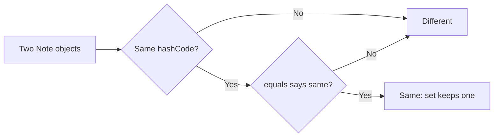
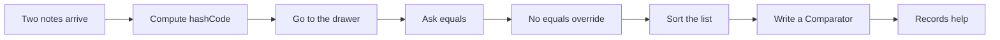
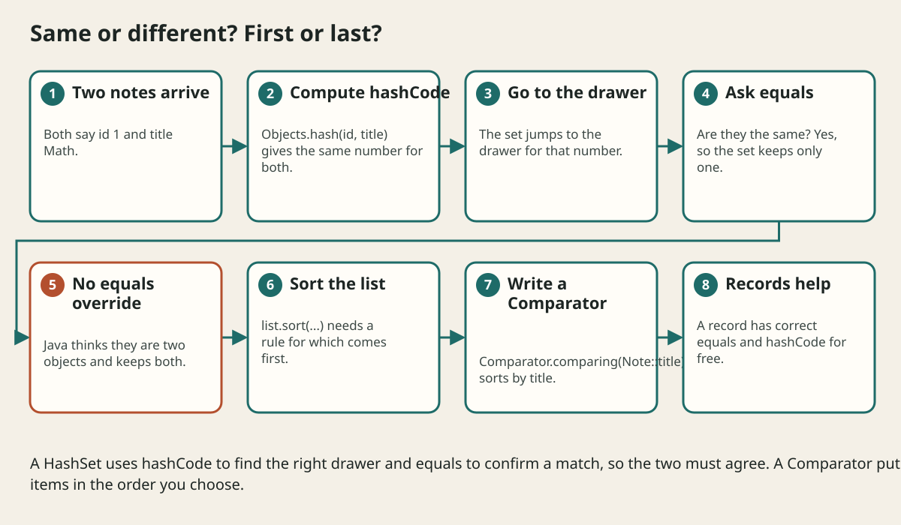

# Equals Hashcode And Sorting

## The big idea in plain words {#picture}

Suppose you have two cards that both say "Ava, age 10". Are they the same card or two copies? In real life you might say "same person". But Java, by default, says "different", because they are two different pieces of paper.

You must teach Java what "the same" means for your own classes. That teaching is called **equals**. A second method, **hashCode**, is like a quick label that lets collections find things in a flash. And a **Comparator** tells Java how to put things in order.



## What you will be able to do {#outcomes}

By the end of this lesson you will be able to:

- Explain `==` versus `equals`.
- Explain why `equals` and `hashCode` go together.
- Sort a list with `Comparable` and `Comparator`.

## Words to know {#vocabulary}

- **equals**: decides if two objects count as the same.
- **hashCode**: a number that helps collections find objects quickly.
- **hash collection**: a `HashSet` or `HashMap`, which use hashCode.
- **Comparable**: an interface saying "I know my natural order".
- **Comparator**: a separate rule for ordering, so you can sort in many ways.
- **record**: a data class that gets correct equals and hashCode for free.

## Why this idea exists {#history}

Without correct `equals` and `hashCode`, a `HashSet` may keep duplicates and a `HashMap` may fail to find a key you just stored. Bugs like these are confusing, because nothing crashes: the answers are just quietly wrong.

## Concept 1: == and equals are different {#concept-1}

`==` asks "are these the very same object in memory?" `equals` asks "do these count as the same thing?" For your own class, `equals` starts out the same as `==` until you override it.

## Concept 2: equals and hashCode are a pair {#concept-2}

```java
@Override public boolean equals(Object o) {
    return o instanceof Note n && id == n.id && title.equals(n.title);
}
@Override public int hashCode() {
    return Objects.hash(id, title);
}
```
The rule: if two objects are equal, they must have the same hashCode. A hash collection uses the hashCode to jump to the right "drawer", and then equals to check the match inside the drawer. Break the pair and the lookup goes to the wrong drawer.

## Concept 3: Records do it for you {#concept-3}

`record Note(int id, String title) {}` already has correct `equals` and `hashCode` that compare all fields. That is one more reason to use records for simple data.

## Concept 4: Sorting with Comparator {#concept-4}

```java
notes.sort(Comparator.comparing(Note::title));
notes.sort(Comparator.comparing(Note::id).reversed());
```
A `Comparator` says how to order. You can sort by title, then by id, or backwards. `Comparable` is for one built-in "natural" order, like numbers or alphabetical order. Comparator is the flexible tool.

## A set that keeps too many {#example}

```java
Set<Note> set = new HashSet<>();
set.add(new Note(1, "Math"));
set.add(new Note(1, "Math"));
System.out.println(set.size());   // 2 if Note is a normal class without equals; 1 for a record
```
Without equals and hashCode, Java sees two different objects. With them (or with a record) it sees the same note and stores it once.

## Going deeper: the technical walkthrough {#walkthrough}

## Worked scenario {#worked-scenario}

Two Note objects have the same id and title, but a HashSet keeps both. What is the most likely cause?

The justified choice is **The class does not override equals and hashCode**. Select **override-equals-hashcode** in the structured practical and explain why. Alternatives ignore a requirement, cross a trust boundary, or invent success.

### Structured decision contract

```json

{
  "decision": "override-equals-hashcode",
  "justification": "The equalsMethod and hashCode boundary must preserve the declared contract and ownership.",
  "failureBehavior": "Expose a safe failure and recover through the boundary owner."
}

```

Decision selects one declared behavior. Justification explains the boundary. FailureBehavior explains the observable error and recovery owner. These fields never execute commands. Required terms and minimum lengths form a basic practice rubric, not semantic grading.

## Step-by-step flow and matching picture {#flow}





## Three real-life uses {#use-cases}

1. A set of unique student records.
2. A map where a custom `ProductKey` object finds a price.
3. A list of names sorted alphabetically, then by age.

## What can go wrong, and how to stay safe {#failure-security}

Mistakes: overriding `equals` but not `hashCode`, using fields that change in hashCode (the object gets lost in the set), comparing with `==` for objects, and a Comparator that is not consistent, such as subtracting numbers that may overflow. Use `Integer.compare` instead of subtraction.

## Practice lab and expected observation {#practice}

1. Predict the scenario decision before opening Practical. Explain each rejected alternative.
2. Run a relevant example above in an isolated exercise project. Record the expected result, then change one input to an invalid or boundary value. A failed assertion or deliberate error should replace silent success.
3. Submit the structured decision. Initially the checks fail. After selecting override-equals-hashcode and writing an explanation and failure plan, all three pass. Follow the indicated review section for missed checks.

### Broken example to debug

```json

{"decision":"trust-client","justification":"","failureBehavior":""}

```

This ignores the responsible boundary and gives no reasoning or recovery. Correct the fields rather than changing the validator.

## Checkpoint and definition of done {#checkpoint}

- [ ] Define equalsMethod and hashCode without looking.
- [ ] Trace input to owner and output.
- [ ] Explain one failure and one alternative.
- [ ] Pass at least four assignment questions.
- [ ] Pass every practical check and submit.
- [ ] Explain the concept again tomorrow.

## Sources, versions, and safe commands {#sources}

Java 17 baseline; installed validation JDK may be newer. Review date: 2026-10-02. The supplied blueprint is the teaching source; official landing pages were checked where reachable. No provider or original TM Schedule deployment was tested.

- [Official reference](https://docs.oracle.com/en/java/javase/17/)

[Course reading order](README.md) · [Previous lesson](10-collections-and-generics.md) · [Next lesson](11-null-optional-and-validation.md)

```study-quiz

{
  "schemaVersion": 1,
  "lessonId": "java/10a-equals-hashcode-and-sorting",
  "title": "Assignment: Equals Hashcode And Sorting",
  "passPercentage": 80,
  "questions": [
    {
      "id": "q1",
      "sectionId": "concept-1",
      "prompt": "In Equals Hashcode And Sorting, what does equalsMethod mean?",
      "options": [
        {
          "id": "a",
          "text": "A permission granted by a hidden browser control",
          "explanation": "This changes the declared meaning or bypasses the responsible boundary."
        },
        {
          "id": "b",
          "text": "An unlimited provider operation with no ownership",
          "explanation": "This changes the declared meaning or bypasses the responsible boundary."
        },
        {
          "id": "c",
          "text": "the method that decides whether two objects count as the same",
          "explanation": "This preserves the definition and boundary described in the lesson."
        },
        {
          "id": "d",
          "text": "A diagnostic credential intended for public logs",
          "explanation": "This changes the declared meaning or bypasses the responsible boundary."
        }
      ],
      "correctOptionId": "c",
      "explanation": "equalsMethod means the method that decides whether two objects count as the same.",
      "reviewLabel": "Review concept 1"
    },
    {
      "id": "q2",
      "sectionId": "concept-2",
      "prompt": "In Equals Hashcode And Sorting, which rule is correct for checkpoint 2?",
      "options": [
        {
          "id": "a",
          "text": "Trust client-side checks instead of the server rule.",
          "explanation": "This changes the declared meaning or bypasses the responsible boundary."
        },
        {
          "id": "b",
          "text": "Hide the failure by returning a fabricated successful result.",
          "explanation": "This changes the declared meaning or bypasses the responsible boundary."
        },
        {
          "id": "c",
          "text": "Skip the stated boundary, limit, or ownership check.",
          "explanation": "This changes the declared meaning or bypasses the responsible boundary."
        },
        {
          "id": "d",
          "text": "HashSet and HashMap use hashCode first to find the right spot and equals to confirm the match.",
          "explanation": "This preserves the definition and boundary described in the lesson."
        }
      ],
      "correctOptionId": "d",
      "explanation": "HashSet and HashMap use hashCode first to find the right spot and equals to confirm the match.",
      "reviewLabel": "Review concept 2"
    },
    {
      "id": "q3",
      "sectionId": "concept-3",
      "prompt": "In Equals Hashcode And Sorting, which rule is correct for checkpoint 3?",
      "options": [
        {
          "id": "a",
          "text": "Records and enums already have correct equals and hashCode.",
          "explanation": "This preserves the definition and boundary described in the lesson."
        },
        {
          "id": "b",
          "text": "Trust client-side checks instead of the server rule.",
          "explanation": "This changes the declared meaning or bypasses the responsible boundary."
        },
        {
          "id": "c",
          "text": "Hide the failure by returning a fabricated successful result.",
          "explanation": "This changes the declared meaning or bypasses the responsible boundary."
        },
        {
          "id": "d",
          "text": "Skip the stated boundary, limit, or ownership check.",
          "explanation": "This changes the declared meaning or bypasses the responsible boundary."
        }
      ],
      "correctOptionId": "a",
      "explanation": "Records and enums already have correct equals and hashCode.",
      "reviewLabel": "Review concept 3"
    },
    {
      "id": "q4",
      "sectionId": "concept-4",
      "prompt": "In Equals Hashcode And Sorting, which rule is correct for checkpoint 4?",
      "options": [
        {
          "id": "a",
          "text": "Trust client-side checks instead of the server rule.",
          "explanation": "This changes the declared meaning or bypasses the responsible boundary."
        },
        {
          "id": "b",
          "text": "A Comparator lets you sort by any rule, such as by title or by date.",
          "explanation": "This preserves the definition and boundary described in the lesson."
        },
        {
          "id": "c",
          "text": "Hide the failure by returning a fabricated successful result.",
          "explanation": "This changes the declared meaning or bypasses the responsible boundary."
        },
        {
          "id": "d",
          "text": "Skip the stated boundary, limit, or ownership check.",
          "explanation": "This changes the declared meaning or bypasses the responsible boundary."
        }
      ],
      "correctOptionId": "b",
      "explanation": "A Comparator lets you sort by any rule, such as by title or by date.",
      "reviewLabel": "Review concept 4"
    },
    {
      "id": "q5",
      "sectionId": "worked-scenario",
      "prompt": "Two Note objects have the same id and title, but a HashSet keeps both. What is the most likely cause?",
      "options": [
        {
          "id": "a",
          "text": "The set is too small",
          "explanation": "This changes the declared meaning or bypasses the responsible boundary."
        },
        {
          "id": "b",
          "text": "Strings cannot be compared",
          "explanation": "This changes the declared meaning or bypasses the responsible boundary."
        },
        {
          "id": "c",
          "text": "The class does not override equals and hashCode",
          "explanation": "This preserves the definition and boundary described in the lesson."
        },
        {
          "id": "d",
          "text": "The notes are too long",
          "explanation": "This changes the declared meaning or bypasses the responsible boundary."
        }
      ],
      "correctOptionId": "c",
      "explanation": "The class does not override equals and hashCode. Never change a field that is used in hashCode while the object is inside a HashSet.",
      "reviewLabel": "Review the worked scenario"
    }
  ]
}

```

```study-practical

{
  "schemaVersion": 1,
  "challengeId": "java/10a-equals-hashcode-and-sorting/decision",
  "lessonId": "java/10a-equals-hashcode-and-sorting",
  "title": "Practical: Equals Hashcode And Sorting",
  "language": "json",
  "mode": "structured",
  "instructions": "Two Note objects have the same id and title, but a HashSet keeps both. What is the most likely cause? Return an object with decision (choose from override-equals-hashcode, skip-check, unbounded-work, trust-client), justification (at least 40 characters; include equalsMethod and hashCode), and failureBehavior (at least 25 characters; include failure and recover while explaining the error and recovery). These are structured reasoning checks, not code execution or an official grade.",
  "starterCode": "{\n  \"decision\": \"\",\n  \"justification\": \"\",\n  \"failureBehavior\": \"\"\n}",
  "entryPoint": "answer",
  "publicExamples": [
    {
      "input": {
        "decision": "skip-check",
        "justification": "",
        "failureBehavior": ""
      },
      "expected": {
        "passed": false
      }
    },
    {
      "input": {
        "decision": "override-equals-hashcode",
        "justification": "The equalsMethod and hashCode boundary must preserve the declared contract and ownership.",
        "failureBehavior": "Show a safe failure and recover through the responsible owner."
      },
      "expected": {
        "passed": true
      }
    }
  ],
  "publicTestIds": [
    "decision",
    "explanation",
    "failure-plan"
  ],
  "reviewSections": {
    "decision": "worked-scenario",
    "explanation": "concept-2",
    "failure-plan": "failure-security"
  },
  "limits": {
    "timeMs": 2000,
    "memoryMb": 128,
    "outputBytes": 20000
  }
}

```

