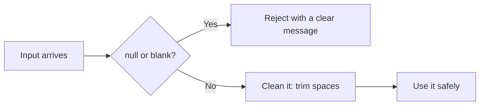
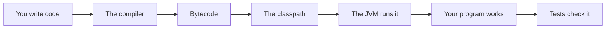

# Null Optional And Validation

## The big idea in plain words {#picture}

An empty seat in a bus is different from a seat with a sign that says "empty". In Java, the special value `null` means "there is nothing here". If you ask something that is not there to do something, Java throws a `NullPointerException`, which is a famous crash.

Smart programmers do two things: they check for missing values at the door, and they use `Optional` to say clearly, "this answer might be empty".



## What you will be able to do {#outcomes}

By the end of this lesson you will be able to:

- Explain `null` and why it causes crashes.
- Use `Optional` to handle "maybe nothing".
- Check and clean input at the edge of your program.

## Words to know {#vocabulary}

- **null**: a marker meaning "no object here".
- **NullPointerException**: the crash when you use something that is null.
- **Optional**: a box that either holds a value or is empty.
- **blank**: empty, or only spaces.
- **normalize**: clean up and make a standard form, like trimming spaces.
- **validation**: checking that data follows the rules.

## Why this idea exists {#history}

Missing data is normal. A form is left empty, a record is not found, a field is not sent. If code does not plan for it, the program crashes at the worst time.

## Concept 1: null means nothing is there {#concept-1}

`String name = null;` Then `name.length()` crashes, because there is nobody to ask. Imagine asking an empty seat its name. Always ask: "can this be null?"

## Concept 2: Optional says "maybe" {#concept-2}

Instead of returning `null` from `findById`, return `Optional<Note>`. The caller sees in the type: "might be empty". They must handle it: `.orElse(...)`, `.ifPresent(...)`, or `.orElseThrow()`.

## Concept 3: Clean before you check {#concept-3}

A title of `"   "` (just spaces) looks full but is empty. First `trim()` it, then check `isBlank()`. Doing it the other way round lets bad data through. Tidying the data first is called normalizing.

## Concept 4: Check at the door {#concept-4}

Check inputs where they enter your program: web requests, files, forms. Inside the program you can then trust the data. Do not hide real bugs by catching every error and pretending it was "just missing data". Zero is also a real value, and `0` is not `null`.

## Finding a note {#example}

```java
Optional<Note> found = repository.findById(7);
String title = found
    .map(Note::title)
    .orElse("No such note");
System.out.println(title);
```
If note 7 exists, we print its title. If not, we print "No such note". There is no crash either way.

## Going deeper: the technical walkthrough {#walkthrough}

### Null, Optional, and validation


`null` means there is no object. An empty string is still a string. Normalize
untrusted text at a boundary:

```java
static String blankToNull(String value) {
    if (value == null || value.isBlank()) {
        return null;
    }
    return value.trim();
}
```

Use `Optional<StudyNote>` as a return value when "may not exist" is the normal
contract. Do not use `Optional` for every field or as a replacement for learning
which values are required.


## Worked scenario {#worked-scenario}

An update request leaves out the title. With PATCH rules, what should happen to the title?

The justified choice is **Keep the current title unless the contract says otherwise**. Select **preserve-omitted** in the structured practical and explain why. Alternatives ignore a requirement, cross a trust boundary, or invent success.

### Structured decision contract

```json

{
  "decision": "preserve-omitted",
  "justification": "The null and optional boundary must preserve the declared contract and ownership.",
  "failureBehavior": "Expose a safe failure and recover through the boundary owner."
}

```

Decision selects one declared behavior. Justification explains the boundary. FailureBehavior explains the observable error and recovery owner. These fields never execute commands. Required terms and minimum lengths form a basic practice rubric, not semantic grading.

## Step-by-step flow and matching picture {#flow}




## Three real-life uses {#use-cases}

1. A login form rejects a blank username.
2. A search for a student by id returns "not found" when there is no such student.
3. An update that leaves out the title keeps the old title.

## What can go wrong, and how to stay safe {#failure-security}

Mistakes: returning null for "not found" and forgetting the caller must check, calling `.get()` on an empty Optional (it crashes!), checking for blank before trimming, and treating "unknown id" and "invalid title" as the same problem. They are different and need different messages.

## Practice lab and expected observation {#practice}

Implement normalize so null or whitespace-only input returns null, and a nonblank string returns its trimmed value. Preserve internal spaces. The caller translates null to a deliberate validation error instead of saving a blank note.

The language starter and public examples appear in Practical. Run is unavailable until a trusted isolated worker is configured. Reading and assignment review still work; this lesson does not claim code-test completion.

1. Predict the scenario decision before opening Practical. Explain each rejected alternative.
2. Run a relevant example above in an isolated exercise project. Record the expected result, then change one input to an invalid or boundary value. A failed assertion or deliberate error should replace silent success.
3. Submit the structured decision. Initially the checks fail. After selecting preserve-omitted and writing an explanation and failure plan, all three pass. Follow the indicated review section for missed checks.

### Broken example to debug

```json

{"decision":"trust-client","justification":"","failureBehavior":""}

```

This ignores the responsible boundary and gives no reasoning or recovery. Correct the fields rather than changing the validator.

## Checkpoint and definition of done {#checkpoint}

- [ ] Define null and optional without looking.
- [ ] Trace input to owner and output.
- [ ] Explain one failure and one alternative.
- [ ] Pass at least four assignment questions.
- [ ] Pass every practical check and submit.
- [ ] Explain the concept again tomorrow.

## Sources, versions, and safe commands {#sources}

Java 17 baseline; installed validation JDK may be newer. Review date: 2026-10-02. The supplied blueprint is the teaching source; official landing pages were checked where reachable. No provider or original TM Schedule deployment was tested.

- [Official reference](https://docs.oracle.com/en/java/javase/17/)

[Course reading order](README.md) · [Previous lesson](10a-equals-hashcode-and-sorting.md) · [Next lesson](12-exceptions-and-error-design.md)

```study-quiz

{
  "schemaVersion": 1,
  "lessonId": "java/11-null-optional-and-validation",
  "title": "Assignment: Null Optional And Validation",
  "passPercentage": 80,
  "questions": [
    {
      "id": "q1",
      "sectionId": "concept-1",
      "prompt": "In Null Optional And Validation, what does null mean?",
      "options": [
        {
          "id": "a",
          "text": "A permission granted by a hidden browser control",
          "explanation": "This changes the declared meaning or bypasses the responsible boundary."
        },
        {
          "id": "b",
          "text": "An unlimited provider operation with no ownership",
          "explanation": "This changes the declared meaning or bypasses the responsible boundary."
        },
        {
          "id": "c",
          "text": "A diagnostic credential intended for public logs",
          "explanation": "This changes the declared meaning or bypasses the responsible boundary."
        },
        {
          "id": "d",
          "text": "a marker meaning 'there is no value here'",
          "explanation": "This preserves the definition and boundary described in the lesson."
        }
      ],
      "correctOptionId": "d",
      "explanation": "null means a marker meaning 'there is no value here'.",
      "reviewLabel": "Review concept 1"
    },
    {
      "id": "q2",
      "sectionId": "concept-2",
      "prompt": "In Null Optional And Validation, which rule is correct for checkpoint 2?",
      "options": [
        {
          "id": "a",
          "text": "Zero is a real number and does not mean 'missing'.",
          "explanation": "This preserves the definition and boundary described in the lesson."
        },
        {
          "id": "b",
          "text": "Trust client-side checks instead of the server rule.",
          "explanation": "This changes the declared meaning or bypasses the responsible boundary."
        },
        {
          "id": "c",
          "text": "Hide the failure by returning a fabricated successful result.",
          "explanation": "This changes the declared meaning or bypasses the responsible boundary."
        },
        {
          "id": "d",
          "text": "Skip the stated boundary, limit, or ownership check.",
          "explanation": "This changes the declared meaning or bypasses the responsible boundary."
        }
      ],
      "correctOptionId": "a",
      "explanation": "Zero is a real number and does not mean 'missing'.",
      "reviewLabel": "Review concept 2"
    },
    {
      "id": "q3",
      "sectionId": "concept-3",
      "prompt": "In Null Optional And Validation, which rule is correct for checkpoint 3?",
      "options": [
        {
          "id": "a",
          "text": "Trust client-side checks instead of the server rule.",
          "explanation": "This changes the declared meaning or bypasses the responsible boundary."
        },
        {
          "id": "b",
          "text": "Look inside an optional box before you take something out.",
          "explanation": "This preserves the definition and boundary described in the lesson."
        },
        {
          "id": "c",
          "text": "Hide the failure by returning a fabricated successful result.",
          "explanation": "This changes the declared meaning or bypasses the responsible boundary."
        },
        {
          "id": "d",
          "text": "Skip the stated boundary, limit, or ownership check.",
          "explanation": "This changes the declared meaning or bypasses the responsible boundary."
        }
      ],
      "correctOptionId": "b",
      "explanation": "Look inside an optional box before you take something out.",
      "reviewLabel": "Review concept 3"
    },
    {
      "id": "q4",
      "sectionId": "concept-4",
      "prompt": "In Null Optional And Validation, which rule is correct for checkpoint 4?",
      "options": [
        {
          "id": "a",
          "text": "Trust client-side checks instead of the server rule.",
          "explanation": "This changes the declared meaning or bypasses the responsible boundary."
        },
        {
          "id": "b",
          "text": "Hide the failure by returning a fabricated successful result.",
          "explanation": "This changes the declared meaning or bypasses the responsible boundary."
        },
        {
          "id": "c",
          "text": "A bad title and an unknown note ID are different problems.",
          "explanation": "This preserves the definition and boundary described in the lesson."
        },
        {
          "id": "d",
          "text": "Skip the stated boundary, limit, or ownership check.",
          "explanation": "This changes the declared meaning or bypasses the responsible boundary."
        }
      ],
      "correctOptionId": "c",
      "explanation": "A bad title and an unknown note ID are different problems.",
      "reviewLabel": "Review concept 4"
    },
    {
      "id": "q5",
      "sectionId": "worked-scenario",
      "prompt": "An update request leaves out the title. With PATCH rules, what should happen to the title?",
      "options": [
        {
          "id": "a",
          "text": "Replace it with an empty string",
          "explanation": "This changes the declared meaning or bypasses the responsible boundary."
        },
        {
          "id": "b",
          "text": "Delete the whole note",
          "explanation": "This changes the declared meaning or bypasses the responsible boundary."
        },
        {
          "id": "c",
          "text": "Treat the missing title as permission to do anything",
          "explanation": "This changes the declared meaning or bypasses the responsible boundary."
        },
        {
          "id": "d",
          "text": "Keep the current title unless the contract says otherwise",
          "explanation": "This preserves the definition and boundary described in the lesson."
        }
      ],
      "correctOptionId": "d",
      "explanation": "Keep the current title unless the contract says otherwise. Do not hide real bugs by pretending they are just missing data.",
      "reviewLabel": "Review the worked scenario"
    }
  ]
}

```

```study-practical

{
  "schemaVersion": 1,
  "challengeId": "java/11-null-optional-and-validation/coding",
  "lessonId": "java/11-null-optional-and-validation",
  "title": "Practical: Normalize a note title",
  "language": "java",
  "mode": "function",
  "instructions": "Implement normalize so null or whitespace-only input returns null, and a nonblank string returns its trimmed value. Preserve internal spaces. The caller translates null to a deliberate validation error instead of saving a blank note. A disposable isolated code runner is required; this installation never executes learner code on the host.",
  "starterCode": "public class Solution {\n  public static String normalize(String value) {\n    return value;\n  }\n}",
  "entryPoint": "normalize",
  "publicExamples": [
    {
      "input": "  APIs  ",
      "expected": "APIs"
    },
    {
      "input": "   ",
      "expected": null
    },
    {
      "input": null,
      "expected": null
    }
  ],
  "publicTestIds": [
    "trim-title",
    "blank-title",
    "missing-title",
    "preserve-inner-spaces"
  ],
  "reviewSections": {
    "trim-title": "walkthrough",
    "blank-title": "walkthrough",
    "missing-title": "walkthrough",
    "preserve-inner-spaces": "walkthrough"
  },
  "limits": {
    "timeMs": 2000,
    "memoryMb": 128,
    "outputBytes": 20000
  }
}

```

