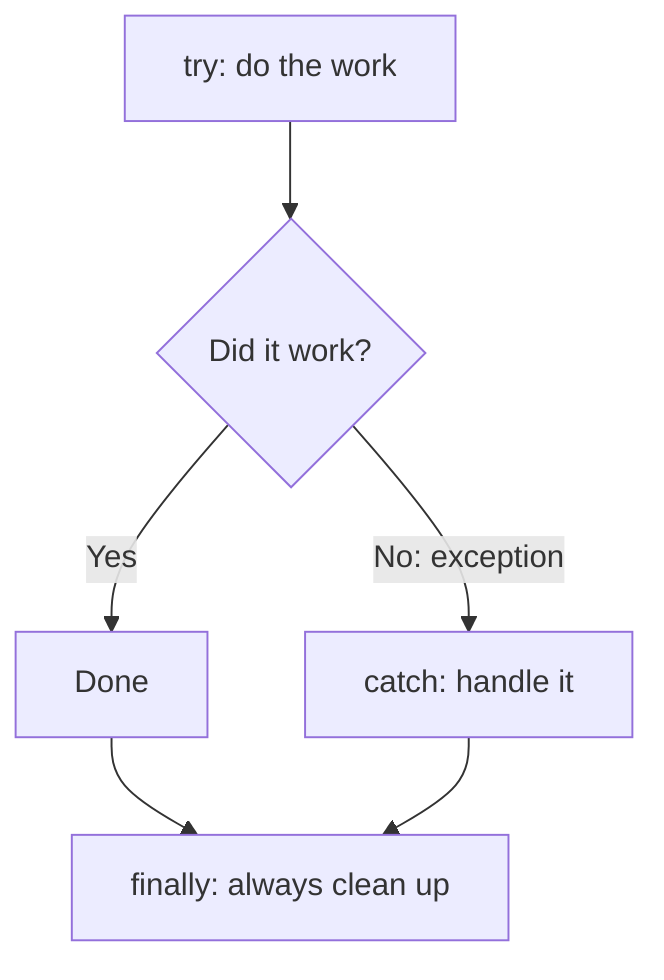
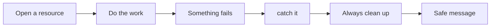
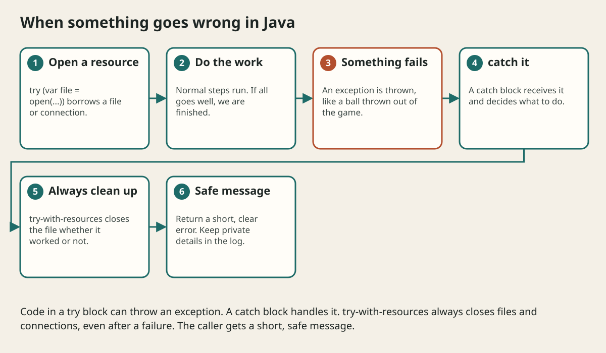

# Exceptions And Error Design

## The big idea in plain words {#picture}

When you play a video game and fall into a hole, the game does not just turn off. It shows "You fell! Try again". An exception in Java is like falling into a hole: something unexpected happened, normal flow stops, and Java looks for someone who knows what to do.

A good program expects things to go wrong: a missing file, a bad number, an offline database. It catches the problem, cleans up, and gives a helpful message.



## What you will be able to do {#outcomes}

By the end of this lesson you will be able to:

- Use `try`, `catch`, and `finally`.
- Tell checked from unchecked exceptions.
- Use try-with-resources and write safe error messages.

## Words to know {#vocabulary}

- **exception**: an object that describes a problem.
- **throw**: raise an exception.
- **catch**: handle an exception.
- **finally**: a block that always runs.
- **try-with-resources**: automatically closes files and connections.
- **stack trace**: a list of the calls that led to the error.

## Why this idea exists {#history}

Without good error handling, one small problem becomes a crash or, even worse, quietly wrong data. With it, the program tells the user what happened and stays safe.

## Concept 1: try and catch {#concept-1}

```java
try {
    int n = Integer.parseInt("abc");
} catch (NumberFormatException e) {
    System.out.println("That is not a number");
}
```
The risky code goes in `try`. If it throws, `catch` runs instead of crashing.

## Concept 2: Clean up always {#concept-2}

If you open a file, you must close it, even when something goes wrong. `try-with-resources` does this for you: `try (var reader = Files.newBufferedReader(path)) { ... }`. The reader is closed automatically at the end, success or failure.

## Concept 3: Checked and unchecked {#concept-3}

A **checked** exception, like `IOException`, is one Java forces you to deal with. An **unchecked** one, like `IllegalArgumentException`, usually means "the programmer made a mistake". Use unchecked ones for bad arguments and checked ones for things the outside world can do to you, like a missing file.

## Concept 4: Safe messages for outsiders {#concept-4}

Do not show a user the raw error with file paths or SQL. Catch it, write the full details in a private log, and send a short, friendly message with an error code. Keep the original exception as the **cause**, so no information is lost for the developers.

## Translating an error {#example}

```java
try {
    return repository.findById(id);
} catch (SQLException e) {
    log.error("DB failed for id " + id, e);               // details, privately
    throw new ServiceUnavailableException("Please try again later", e);
}
```
The user sees "Please try again later". The team sees the whole story in the log.

## Going deeper: the technical walkthrough {#walkthrough}

### Exceptions and error paths


```java
if (title == null || title.isBlank()) {
    throw new IllegalArgumentException("Title is required");
}
```

An exception describes an operation that cannot fulfill its contract. A web
boundary should translate it into a safe status and error body. Do not catch an
exception, ignore it, and pretend that the write succeeded.


## Worked scenario {#worked-scenario}

A database error includes a private file path. What should the API send back?

The justified choice is **A general safe error with a steady code and a request ID**. Select **safe-error** in the structured practical and explain why. Alternatives ignore a requirement, cross a trust boundary, or invent success.

### Structured decision contract

```json

{
  "decision": "safe-error",
  "justification": "The exception and safeError boundary must preserve the declared contract and ownership.",
  "failureBehavior": "Expose a safe failure and recover through the boundary owner."
}

```

Decision selects one declared behavior. Justification explains the boundary. FailureBehavior explains the observable error and recovery owner. These fields never execute commands. Required terms and minimum lengths form a basic practice rubric, not semantic grading.

## Step-by-step flow and matching picture {#flow}





## Three real-life uses {#use-cases}

1. A calculator catches "divide by zero" and shows a friendly message.
2. A file reader always closes the file, even if reading fails.
3. A web service turns a database problem into a clean "503 try again" reply.

## What can go wrong, and how to stay safe {#failure-security}

Mistakes: an empty `catch` that hides the problem, catching everything with `Exception` and pretending it is fine, forgetting to close resources, and showing internal details to users. Never swallow an error silently.

## Practice lab and expected observation {#practice}

1. Predict the scenario decision before opening Practical. Explain each rejected alternative.
2. Run a relevant example above in an isolated exercise project. Record the expected result, then change one input to an invalid or boundary value. A failed assertion or deliberate error should replace silent success.
3. Submit the structured decision. Initially the checks fail. After selecting safe-error and writing an explanation and failure plan, all three pass. Follow the indicated review section for missed checks.

### Broken example to debug

```json

{"decision":"trust-client","justification":"","failureBehavior":""}

```

This ignores the responsible boundary and gives no reasoning or recovery. Correct the fields rather than changing the validator.

## Checkpoint and definition of done {#checkpoint}

- [ ] Define exception and safeError without looking.
- [ ] Trace input to owner and output.
- [ ] Explain one failure and one alternative.
- [ ] Pass at least four assignment questions.
- [ ] Pass every practical check and submit.
- [ ] Explain the concept again tomorrow.

## Sources, versions, and safe commands {#sources}

Java 17 baseline; installed validation JDK may be newer. Review date: 2026-10-02. The supplied blueprint is the teaching source; official landing pages were checked where reachable. No provider or original TM Schedule deployment was tested.

- [Official reference](https://docs.oracle.com/en/java/javase/17/)

[Course reading order](README.md) · [Previous lesson](11-null-optional-and-validation.md) · [Next lesson](13-dates-time-strings-and-unicode.md)

```study-quiz

{
  "schemaVersion": 1,
  "lessonId": "java/12-exceptions-and-error-design",
  "title": "Assignment: Exceptions And Error Design",
  "passPercentage": 80,
  "questions": [
    {
      "id": "q1",
      "sectionId": "concept-1",
      "prompt": "In Exceptions And Error Design, what does exception mean?",
      "options": [
        {
          "id": "a",
          "text": "a problem that interrupts the normal flow of a program",
          "explanation": "This preserves the definition and boundary described in the lesson."
        },
        {
          "id": "b",
          "text": "A permission granted by a hidden browser control",
          "explanation": "This changes the declared meaning or bypasses the responsible boundary."
        },
        {
          "id": "c",
          "text": "An unlimited provider operation with no ownership",
          "explanation": "This changes the declared meaning or bypasses the responsible boundary."
        },
        {
          "id": "d",
          "text": "A diagnostic credential intended for public logs",
          "explanation": "This changes the declared meaning or bypasses the responsible boundary."
        }
      ],
      "correctOptionId": "a",
      "explanation": "exception means a problem that interrupts the normal flow of a program.",
      "reviewLabel": "Review concept 1"
    },
    {
      "id": "q2",
      "sectionId": "concept-2",
      "prompt": "In Exceptions And Error Design, which rule is correct for checkpoint 2?",
      "options": [
        {
          "id": "a",
          "text": "Trust client-side checks instead of the server rule.",
          "explanation": "This changes the declared meaning or bypasses the responsible boundary."
        },
        {
          "id": "b",
          "text": "A validation problem must never turn into a fake success.",
          "explanation": "This preserves the definition and boundary described in the lesson."
        },
        {
          "id": "c",
          "text": "Hide the failure by returning a fabricated successful result.",
          "explanation": "This changes the declared meaning or bypasses the responsible boundary."
        },
        {
          "id": "d",
          "text": "Skip the stated boundary, limit, or ownership check.",
          "explanation": "This changes the declared meaning or bypasses the responsible boundary."
        }
      ],
      "correctOptionId": "b",
      "explanation": "A validation problem must never turn into a fake success.",
      "reviewLabel": "Review concept 2"
    },
    {
      "id": "q3",
      "sectionId": "concept-3",
      "prompt": "In Exceptions And Error Design, which rule is correct for checkpoint 3?",
      "options": [
        {
          "id": "a",
          "text": "Trust client-side checks instead of the server rule.",
          "explanation": "This changes the declared meaning or bypasses the responsible boundary."
        },
        {
          "id": "b",
          "text": "Hide the failure by returning a fabricated successful result.",
          "explanation": "This changes the declared meaning or bypasses the responsible boundary."
        },
        {
          "id": "c",
          "text": "Whoever opens a resource must close it, even when something fails.",
          "explanation": "This preserves the definition and boundary described in the lesson."
        },
        {
          "id": "d",
          "text": "Skip the stated boundary, limit, or ownership check.",
          "explanation": "This changes the declared meaning or bypasses the responsible boundary."
        }
      ],
      "correctOptionId": "c",
      "explanation": "Whoever opens a resource must close it, even when something fails.",
      "reviewLabel": "Review concept 3"
    },
    {
      "id": "q4",
      "sectionId": "concept-4",
      "prompt": "In Exceptions And Error Design, which rule is correct for checkpoint 4?",
      "options": [
        {
          "id": "a",
          "text": "Trust client-side checks instead of the server rule.",
          "explanation": "This changes the declared meaning or bypasses the responsible boundary."
        },
        {
          "id": "b",
          "text": "Hide the failure by returning a fabricated successful result.",
          "explanation": "This changes the declared meaning or bypasses the responsible boundary."
        },
        {
          "id": "c",
          "text": "Skip the stated boundary, limit, or ownership check.",
          "explanation": "This changes the declared meaning or bypasses the responsible boundary."
        },
        {
          "id": "d",
          "text": "Error messages for callers must not reveal SQL, file paths, secrets, or stack traces.",
          "explanation": "This preserves the definition and boundary described in the lesson."
        }
      ],
      "correctOptionId": "d",
      "explanation": "Error messages for callers must not reveal SQL, file paths, secrets, or stack traces.",
      "reviewLabel": "Review concept 4"
    },
    {
      "id": "q5",
      "sectionId": "worked-scenario",
      "prompt": "A database error includes a private file path. What should the API send back?",
      "options": [
        {
          "id": "a",
          "text": "A general safe error with a steady code and a request ID",
          "explanation": "This preserves the definition and boundary described in the lesson."
        },
        {
          "id": "b",
          "text": "The raw error text exactly as it came",
          "explanation": "This changes the declared meaning or bypasses the responsible boundary."
        },
        {
          "id": "c",
          "text": "An empty success answer",
          "explanation": "This changes the declared meaning or bypasses the responsible boundary."
        },
        {
          "id": "d",
          "text": "The private path, to help debugging",
          "explanation": "This changes the declared meaning or bypasses the responsible boundary."
        }
      ],
      "correctOptionId": "a",
      "explanation": "A general safe error with a steady code and a request ID. For surprises, send a general message and a request ID that your team can look up.",
      "reviewLabel": "Review the worked scenario"
    }
  ]
}

```

```study-practical

{
  "schemaVersion": 1,
  "challengeId": "java/12-exceptions-and-error-design/decision",
  "lessonId": "java/12-exceptions-and-error-design",
  "title": "Practical: Exceptions And Error Design",
  "language": "json",
  "mode": "structured",
  "instructions": "A database error includes a private file path. What should the API send back? Return an object with decision (choose from safe-error, skip-check, unbounded-work, trust-client), justification (at least 40 characters; include exception and safeError), and failureBehavior (at least 25 characters; include failure and recover while explaining the error and recovery). These are structured reasoning checks, not code execution or an official grade.",
  "starterCode": "{\n  \"decision\": \"\",\n  \"justification\": \"\",\n  \"failureBehavior\": \"\"\n}",
  "entryPoint": "answer",
  "publicExamples": [
    {
      "input": {
        "decision": "skip-check",
        "justification": "",
        "failureBehavior": ""
      },
      "expected": {
        "passed": false
      }
    },
    {
      "input": {
        "decision": "safe-error",
        "justification": "The exception and safeError boundary must preserve the declared contract and ownership.",
        "failureBehavior": "Show a safe failure and recover through the responsible owner."
      },
      "expected": {
        "passed": true
      }
    }
  ],
  "publicTestIds": [
    "decision",
    "explanation",
    "failure-plan"
  ],
  "reviewSections": {
    "decision": "worked-scenario",
    "explanation": "concept-2",
    "failure-plan": "failure-security"
  },
  "limits": {
    "timeMs": 2000,
    "memoryMb": 128,
    "outputBytes": 20000
  }
}

```

