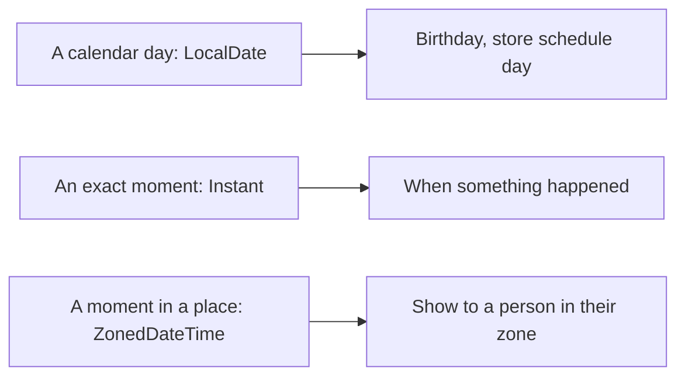

# Dates Time Strings And Unicode

## The big idea in plain words {#picture}

Words and time look easy until you meet the real world. Some letters, like "é" or emojis, take more than one byte. And "5 pm" is a different moment in Tokyo than in New York. A calendar date, like "March 3", has no clock and no place at all.

Java has careful tools for text and time. When you pick the right one, strange bugs just do not happen.



## What you will be able to do {#outcomes}

By the end of this lesson you will be able to:

- Choose `LocalDate`, `Instant`, or `ZonedDateTime` for the right job.
- Format and parse dates safely.
- Explain strings, characters, encoding, and Unicode in simple words.

## Words to know {#vocabulary}

- **LocalDate**: a date with no time and no place, like 2026-10-11.
- **Instant**: one exact moment on the world's timeline.
- **time zone**: the rules for local time in a place.
- **encoding**: the rule for turning text into bytes, such as UTF-8.
- **Unicode**: the huge list of all letters, symbols, and emojis.
- **locale**: language and region settings, like how to write a date.

## Why this idea exists {#history}

Wrong time handling causes real problems: meetings on the wrong day, bills charged twice, and ages that are off by one. Choosing the right type removes most of them.

## Concept 1: Pick the right time type {#concept-1}

A birthday is a `LocalDate`: it has no clock. "The moment this note was saved" is an `Instant`. "Show it as 3 pm in Paris" needs a `ZonedDateTime` with a time zone. If you pick the wrong one, you get the wrong answer in some part of the world.

## Concept 2: Time zones must be named {#concept-2}

Never guess the zone. Say it: `ZoneId.of("Europe/Paris")`. Daylight-saving changes make days with 23 or 25 hours, and only a real zone knows about them. Store the exact moment (Instant), and show it in the user's zone.

## Concept 3: Parse and format with a pattern {#concept-3}

`LocalDate.parse("2026-10-11")` reads the standard format. For other styles, use `DateTimeFormatter.ofPattern("dd/MM/yyyy")`. Always state the pattern so there is no guessing between 03/04 meaning March 4 or April 3.

## Concept 4: Text is more than letters {#concept-4}

A Java `String` holds Unicode text. The number of characters you see is not always the string's length, because an emoji can use two slots. When saving text to a file, say the encoding: `StandardCharsets.UTF_8`. It works for every language.

## A schedule day {#example}

```java
LocalDate day = LocalDate.of(2026, 10, 11);
Instant saved = Instant.now();
ZonedDateTime paris = saved.atZone(ZoneId.of("Europe/Paris"));
System.out.println(day + " saved at " + paris);
```
The store's "trading day" is a `LocalDate`. The save time is an `Instant`. When we show it to someone in Paris, we convert it with their zone.

## Going deeper: the technical walkthrough {#walkthrough}

### Dates and time


Use the `java.time` API:

```java
LocalDate lessonDate = LocalDate.of(2026, 10, 2);
Instant createdAt = Instant.now();
```

`LocalDate` is a calendar date without a time zone. `Instant` is a point on the
UTC timeline. Choose the type from the business meaning. Do not store every
date as an unstructured string.


### Focused implementation

A LocalDate describes a day; Instant describes a timestamp. ZonedDateTime adds timezone rules. Never infer a store timezone from the server location. String.length counts UTF-16 code units; supplementary characters may use two. Use UTF-8 for portable files and select Locale explicitly for language-dependent case conversion.

```java

import java.time.*;
import java.nio.charset.StandardCharsets;
public class Example {
  public static void main(String[] args) {
    LocalDate day = LocalDate.of(2026, 10, 2);
    Instant start = day.atStartOfDay(ZoneId.of("America/Chicago")).toInstant();
    System.out.println(start);
    System.out.println(new String("API".getBytes(StandardCharsets.UTF_8), StandardCharsets.UTF_8));
  }
}

```

Read the imports, then the values and checks, then the operation, and finally the result or cleanup. Java Example programs compile as Example.java. Python uses Python 3.11+. JavaScript ESM runs as example.mjs. Framework snippets run inside the generated project.

## Worked scenario {#worked-scenario}

A shop schedule is about a whole trading day, not one exact moment. What should you store?

The justified choice is **A calendar date plus the store's time zone rule**. Select **calendar-date** in the structured practical and explain why. Alternatives ignore a requirement, cross a trust boundary, or invent success.

### Structured decision contract

```json

{
  "decision": "calendar-date",
  "justification": "The instant and localDate boundary must preserve the declared contract and ownership.",
  "failureBehavior": "Expose a safe failure and recover through the boundary owner."
}

```

Decision selects one declared behavior. Justification explains the boundary. FailureBehavior explains the observable error and recovery owner. These fields never execute commands. Required terms and minimum lengths form a basic practice rubric, not semantic grading.

## Step-by-step flow and matching picture {#flow}


## Three real-life uses {#use-cases}

1. A school stores each student's birthday as a `LocalDate`.
2. A chat app saves each message's `Instant` and shows it in the reader's time zone.
3. A text file of names in many languages is saved as UTF-8 so no letters break.

## What can go wrong, and how to stay safe {#failure-security}

Mistakes: storing a date as plain text without a format, mixing `LocalDate` and `Instant` without thinking, adding 24 hours to mean "tomorrow" (daylight saving can break it), and saving text without an encoding, which turns letters into question marks.

## Practice lab and expected observation {#practice}

1. Predict the scenario decision before opening Practical. Explain each rejected alternative.
2. Run a relevant example above in an isolated exercise project. Record the expected result, then change one input to an invalid or boundary value. A failed assertion or deliberate error should replace silent success.
3. Submit the structured decision. Initially the checks fail. After selecting calendar-date and writing an explanation and failure plan, all three pass. Follow the indicated review section for missed checks.

### Broken example to debug

```json

{"decision":"trust-client","justification":"","failureBehavior":""}

```

This ignores the responsible boundary and gives no reasoning or recovery. Correct the fields rather than changing the validator.

## Checkpoint and definition of done {#checkpoint}

- [ ] Define instant and localDate without looking.
- [ ] Trace input to owner and output.
- [ ] Explain one failure and one alternative.
- [ ] Pass at least four assignment questions.
- [ ] Pass every practical check and submit.
- [ ] Explain the concept again tomorrow.

## Sources, versions, and safe commands {#sources}

Java 17 baseline; installed validation JDK may be newer. Review date: 2026-10-02. The supplied blueprint is the teaching source; official landing pages were checked where reachable. No provider or original TM Schedule deployment was tested.

- [Official reference](https://docs.oracle.com/en/java/javase/17/)

[Course reading order](README.md) · [Previous lesson](12-exceptions-and-error-design.md) · [Next lesson](14-lambdas-streams-and-functional-style.md)

```study-quiz

{
  "schemaVersion": 1,
  "lessonId": "java/13-dates-time-strings-and-unicode",
  "title": "Assignment: Dates Time Strings And Unicode",
  "passPercentage": 80,
  "questions": [
    {
      "id": "q1",
      "sectionId": "concept-1",
      "prompt": "In Dates Time Strings And Unicode, what does instant mean?",
      "options": [
        {
          "id": "a",
          "text": "A permission granted by a hidden browser control",
          "explanation": "This changes the declared meaning or bypasses the responsible boundary."
        },
        {
          "id": "b",
          "text": "one exact moment on the world's timeline",
          "explanation": "This preserves the definition and boundary described in the lesson."
        },
        {
          "id": "c",
          "text": "An unlimited provider operation with no ownership",
          "explanation": "This changes the declared meaning or bypasses the responsible boundary."
        },
        {
          "id": "d",
          "text": "A diagnostic credential intended for public logs",
          "explanation": "This changes the declared meaning or bypasses the responsible boundary."
        }
      ],
      "correctOptionId": "b",
      "explanation": "instant means one exact moment on the world's timeline.",
      "reviewLabel": "Review concept 1"
    },
    {
      "id": "q2",
      "sectionId": "concept-2",
      "prompt": "In Dates Time Strings And Unicode, which rule is correct for checkpoint 2?",
      "options": [
        {
          "id": "a",
          "text": "Trust client-side checks instead of the server rule.",
          "explanation": "This changes the declared meaning or bypasses the responsible boundary."
        },
        {
          "id": "b",
          "text": "Hide the failure by returning a fabricated successful result.",
          "explanation": "This changes the declared meaning or bypasses the responsible boundary."
        },
        {
          "id": "c",
          "text": "A record of when something happened is usually an instant.",
          "explanation": "This preserves the definition and boundary described in the lesson."
        },
        {
          "id": "d",
          "text": "Skip the stated boundary, limit, or ownership check.",
          "explanation": "This changes the declared meaning or bypasses the responsible boundary."
        }
      ],
      "correctOptionId": "c",
      "explanation": "A record of when something happened is usually an instant.",
      "reviewLabel": "Review concept 2"
    },
    {
      "id": "q3",
      "sectionId": "concept-3",
      "prompt": "In Dates Time Strings And Unicode, which rule is correct for checkpoint 3?",
      "options": [
        {
          "id": "a",
          "text": "Trust client-side checks instead of the server rule.",
          "explanation": "This changes the declared meaning or bypasses the responsible boundary."
        },
        {
          "id": "b",
          "text": "Hide the failure by returning a fabricated successful result.",
          "explanation": "This changes the declared meaning or bypasses the responsible boundary."
        },
        {
          "id": "c",
          "text": "Skip the stated boundary, limit, or ownership check.",
          "explanation": "This changes the declared meaning or bypasses the responsible boundary."
        },
        {
          "id": "d",
          "text": "Changing time zones needs a named zone.",
          "explanation": "This preserves the definition and boundary described in the lesson."
        }
      ],
      "correctOptionId": "d",
      "explanation": "Changing time zones needs a named zone.",
      "reviewLabel": "Review concept 3"
    },
    {
      "id": "q4",
      "sectionId": "concept-4",
      "prompt": "In Dates Time Strings And Unicode, which rule is correct for checkpoint 4?",
      "options": [
        {
          "id": "a",
          "text": "The number of characters you see can differ from the length of the string.",
          "explanation": "This preserves the definition and boundary described in the lesson."
        },
        {
          "id": "b",
          "text": "Trust client-side checks instead of the server rule.",
          "explanation": "This changes the declared meaning or bypasses the responsible boundary."
        },
        {
          "id": "c",
          "text": "Hide the failure by returning a fabricated successful result.",
          "explanation": "This changes the declared meaning or bypasses the responsible boundary."
        },
        {
          "id": "d",
          "text": "Skip the stated boundary, limit, or ownership check.",
          "explanation": "This changes the declared meaning or bypasses the responsible boundary."
        }
      ],
      "correctOptionId": "a",
      "explanation": "The number of characters you see can differ from the length of the string.",
      "reviewLabel": "Review concept 4"
    },
    {
      "id": "q5",
      "sectionId": "worked-scenario",
      "prompt": "A shop schedule is about a whole trading day, not one exact moment. What should you store?",
      "options": [
        {
          "id": "a",
          "text": "A server time with no explanation",
          "explanation": "This changes the declared meaning or bypasses the responsible boundary."
        },
        {
          "id": "b",
          "text": "A calendar date plus the store's time zone rule",
          "explanation": "This preserves the definition and boundary described in the lesson."
        },
        {
          "id": "c",
          "text": "A decimal number of months",
          "explanation": "This changes the declared meaning or bypasses the responsible boundary."
        },
        {
          "id": "d",
          "text": "A password string",
          "explanation": "This changes the declared meaning or bypasses the responsible boundary."
        }
      ],
      "correctOptionId": "b",
      "explanation": "A calendar date plus the store's time zone rule. Always say which encoding a text file uses.",
      "reviewLabel": "Review the worked scenario"
    }
  ]
}

```

```study-practical

{
  "schemaVersion": 1,
  "challengeId": "java/13-dates-time-strings-and-unicode/decision",
  "lessonId": "java/13-dates-time-strings-and-unicode",
  "title": "Practical: Dates Time Strings And Unicode",
  "language": "json",
  "mode": "structured",
  "instructions": "A shop schedule is about a whole trading day, not one exact moment. What should you store? Return an object with decision (choose from calendar-date, skip-check, unbounded-work, trust-client), justification (at least 40 characters; include instant and localDate), and failureBehavior (at least 25 characters; include failure and recover while explaining the error and recovery). These are structured reasoning checks, not code execution or an official grade.",
  "starterCode": "{\n  \"decision\": \"\",\n  \"justification\": \"\",\n  \"failureBehavior\": \"\"\n}",
  "entryPoint": "answer",
  "publicExamples": [
    {
      "input": {
        "decision": "skip-check",
        "justification": "",
        "failureBehavior": ""
      },
      "expected": {
        "passed": false
      }
    },
    {
      "input": {
        "decision": "calendar-date",
        "justification": "The instant and localDate boundary must preserve the declared contract and ownership.",
        "failureBehavior": "Show a safe failure and recover through the responsible owner."
      },
      "expected": {
        "passed": true
      }
    }
  ],
  "publicTestIds": [
    "decision",
    "explanation",
    "failure-plan"
  ],
  "reviewSections": {
    "decision": "worked-scenario",
    "explanation": "concept-2",
    "failure-plan": "failure-security"
  },
  "limits": {
    "timeMs": 2000,
    "memoryMb": 128,
    "outputBytes": 20000
  }
}

```

