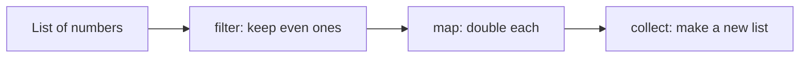
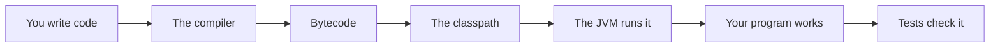

# Lambdas Streams And Functional Style

## The big idea in plain words {#picture}

Imagine a conveyor belt in a factory. Items move along. One worker removes the broken ones (filter). Another paints each item red (map). A last worker counts them (reduce). You do not walk back and forth between workers. You just describe the line and let the items flow.

A Java **stream** is a conveyor belt for data, and a **lambda** is a tiny worker described in one short line: `x -> x * 2`.



## What you will be able to do {#outcomes}

By the end of this lesson you will be able to:

- Write simple lambdas and method references.
- Use `filter`, `map`, and `collect` on a stream.
- Decide when a plain loop is clearer.

## Words to know {#vocabulary}

- **lambda**: a short, nameless function like `x -> x + 1`.
- **method reference**: a shorter way to point to a method, like `String::length`.
- **stream**: a pipeline of steps run on a collection.
- **filter**: keep only the items that match.
- **map**: change each item into something else.
- **collector**: gathers the stream results into a list, set, or map.

## Why this idea exists {#history}

Loops with lots of lines for simple tasks like "keep the long names and shout them" are noisy. Streams let you say what you want in a few readable lines.

## Concept 1: A lambda is a tiny function {#concept-1}

`(a, b) -> a + b` means "given a and b, return a plus b". You can pass it to other methods, like telling a robot "do this to each item".

## Concept 2: A stream is a pipeline {#concept-2}

```java
List<String> shout = names.stream()
    .filter(n -> n.length() > 3)
    .map(String::toUpperCase)
    .toList();
```
Read it like a sentence: "From names, keep the long ones, make them uppercase, and give me a list."

## Concept 3: Do not hide side effects {#concept-3}

A stream step should not secretly change things outside, like adding to some other list or printing in the middle. Keep each step simple and pure so the pipeline is easy to trust and to change.

## Concept 4: Loops are okay too {#concept-4}

If the stream gets long and hard to read, a plain `for` loop is better. The goal is clear code, not fancy code. Use streams for simple "filter, change, collect" jobs.

## Even squares {#example}

```java
List<Integer> result = List.of(1, 2, 3, 4, 5, 6).stream()
    .filter(n -> n % 2 == 0)
    .map(n -> n * n)
    .toList();
System.out.println(result);   // [4, 16, 36]
```
Keep the even numbers (2, 4, 6) and then square each. We never wrote a loop, and the code reads like the idea.

## Going deeper: the technical walkthrough {#walkthrough}

### Lambdas and streams


```java
List<String> titles = notes.stream()
        .map(StudyNote::title)
        .filter(title -> title.startsWith("API"))
        .sorted()
        .toList();
```

A stream is a pipeline, not a database query. It is useful for small in-memory
transformations. Use a database query for filtering a large table.

A normal loop is often clearer than a long stream. Readability is the goal.


## Worked scenario {#worked-scenario}

You often need to find a note by its unique ID in a small program. Which container fits best?

The justified choice is **A map where the note ID is the key**. Select **map-by-id** in the structured practical and explain why. Alternatives ignore a requirement, cross a trust boundary, or invent success.

### Structured decision contract

```json

{
  "decision": "map-by-id",
  "justification": "The list and set boundary must preserve the declared contract and ownership.",
  "failureBehavior": "Expose a safe failure and recover through the boundary owner."
}

```

Decision selects one declared behavior. Justification explains the boundary. FailureBehavior explains the observable error and recovery owner. These fields never execute commands. Required terms and minimum lengths form a basic practice rubric, not semantic grading.

## Step-by-step flow and matching picture {#flow}




## Three real-life uses {#use-cases}

1. Find all students who scored above 80 and list their names.
2. Add up the price of every item in a basket.
3. Group orders by the day they were placed.

## What can go wrong, and how to stay safe {#failure-security}

Mistakes: using a stream when a simple loop is clearer, putting complicated multi-line logic inside a lambda, changing a variable from inside a lambda (Java does not allow most of that), and using the same stream twice (a stream can be consumed only once).

## Practice lab and expected observation {#practice}

Implement titles to return distinct note titles in ascending ASCII order without changing the caller’s list. An empty list returns an empty list. This is an in-memory exercise, not a replacement for a database pagination query.

The language starter and public examples appear in Practical. Run is unavailable until a trusted isolated worker is configured. Reading and assignment review still work; this lesson does not claim code-test completion.

1. Predict the scenario decision before opening Practical. Explain each rejected alternative.
2. Run a relevant example above in an isolated exercise project. Record the expected result, then change one input to an invalid or boundary value. A failed assertion or deliberate error should replace silent success.
3. Submit the structured decision. Initially the checks fail. After selecting map-by-id and writing an explanation and failure plan, all three pass. Follow the indicated review section for missed checks.

### Broken example to debug

```json

{"decision":"trust-client","justification":"","failureBehavior":""}

```

This ignores the responsible boundary and gives no reasoning or recovery. Correct the fields rather than changing the validator.

## Checkpoint and definition of done {#checkpoint}

- [ ] Define list and set without looking.
- [ ] Trace input to owner and output.
- [ ] Explain one failure and one alternative.
- [ ] Pass at least four assignment questions.
- [ ] Pass every practical check and submit.
- [ ] Explain the concept again tomorrow.

## Sources, versions, and safe commands {#sources}

Java 17 baseline; installed validation JDK may be newer. Review date: 2026-10-02. The supplied blueprint is the teaching source; official landing pages were checked where reachable. No provider or original TM Schedule deployment was tested.

- [Official reference](https://docs.oracle.com/en/java/javase/17/)

[Course reading order](README.md) · [Previous lesson](13-dates-time-strings-and-unicode.md) · [Next lesson](15-files-json-http-and-jdbc.md)

```study-quiz

{
  "schemaVersion": 1,
  "lessonId": "java/14-lambdas-streams-and-functional-style",
  "title": "Assignment: Lambdas Streams And Functional Style",
  "passPercentage": 80,
  "questions": [
    {
      "id": "q1",
      "sectionId": "concept-1",
      "prompt": "In Lambdas Streams And Functional Style, what does list mean?",
      "options": [
        {
          "id": "a",
          "text": "A permission granted by a hidden browser control",
          "explanation": "This changes the declared meaning or bypasses the responsible boundary."
        },
        {
          "id": "b",
          "text": "An unlimited provider operation with no ownership",
          "explanation": "This changes the declared meaning or bypasses the responsible boundary."
        },
        {
          "id": "c",
          "text": "items in order; the same item can appear twice",
          "explanation": "This preserves the definition and boundary described in the lesson."
        },
        {
          "id": "d",
          "text": "A diagnostic credential intended for public logs",
          "explanation": "This changes the declared meaning or bypasses the responsible boundary."
        }
      ],
      "correctOptionId": "c",
      "explanation": "list means items in order; the same item can appear twice.",
      "reviewLabel": "Review concept 1"
    },
    {
      "id": "q2",
      "sectionId": "concept-2",
      "prompt": "In Lambdas Streams And Functional Style, which rule is correct for checkpoint 2?",
      "options": [
        {
          "id": "a",
          "text": "Trust client-side checks instead of the server rule.",
          "explanation": "This changes the declared meaning or bypasses the responsible boundary."
        },
        {
          "id": "b",
          "text": "Hide the failure by returning a fabricated successful result.",
          "explanation": "This changes the declared meaning or bypasses the responsible boundary."
        },
        {
          "id": "c",
          "text": "Skip the stated boundary, limit, or ownership check.",
          "explanation": "This changes the declared meaning or bypasses the responsible boundary."
        },
        {
          "id": "d",
          "text": "A set is how you say 'no duplicates'.",
          "explanation": "This preserves the definition and boundary described in the lesson."
        }
      ],
      "correctOptionId": "d",
      "explanation": "A set is how you say 'no duplicates'.",
      "reviewLabel": "Review concept 2"
    },
    {
      "id": "q3",
      "sectionId": "concept-3",
      "prompt": "In Lambdas Streams And Functional Style, which rule is correct for checkpoint 3?",
      "options": [
        {
          "id": "a",
          "text": "A map connects each key to exactly one current value.",
          "explanation": "This preserves the definition and boundary described in the lesson."
        },
        {
          "id": "b",
          "text": "Trust client-side checks instead of the server rule.",
          "explanation": "This changes the declared meaning or bypasses the responsible boundary."
        },
        {
          "id": "c",
          "text": "Hide the failure by returning a fabricated successful result.",
          "explanation": "This changes the declared meaning or bypasses the responsible boundary."
        },
        {
          "id": "d",
          "text": "Skip the stated boundary, limit, or ownership check.",
          "explanation": "This changes the declared meaning or bypasses the responsible boundary."
        }
      ],
      "correctOptionId": "a",
      "explanation": "A map connects each key to exactly one current value.",
      "reviewLabel": "Review concept 3"
    },
    {
      "id": "q4",
      "sectionId": "concept-4",
      "prompt": "In Lambdas Streams And Functional Style, which rule is correct for checkpoint 4?",
      "options": [
        {
          "id": "a",
          "text": "Trust client-side checks instead of the server rule.",
          "explanation": "This changes the declared meaning or bypasses the responsible boundary."
        },
        {
          "id": "b",
          "text": "Sorting needs a clear rule for what 'smaller' means.",
          "explanation": "This preserves the definition and boundary described in the lesson."
        },
        {
          "id": "c",
          "text": "Hide the failure by returning a fabricated successful result.",
          "explanation": "This changes the declared meaning or bypasses the responsible boundary."
        },
        {
          "id": "d",
          "text": "Skip the stated boundary, limit, or ownership check.",
          "explanation": "This changes the declared meaning or bypasses the responsible boundary."
        }
      ],
      "correctOptionId": "b",
      "explanation": "Sorting needs a clear rule for what 'smaller' means.",
      "reviewLabel": "Review concept 4"
    },
    {
      "id": "q5",
      "sectionId": "worked-scenario",
      "prompt": "You often need to find a note by its unique ID in a small program. Which container fits best?",
      "options": [
        {
          "id": "a",
          "text": "A list you search from the start every time",
          "explanation": "This changes the declared meaning or bypasses the responsible boundary."
        },
        {
          "id": "b",
          "text": "A set that stores no notes",
          "explanation": "This changes the declared meaning or bypasses the responsible boundary."
        },
        {
          "id": "c",
          "text": "A map where the note ID is the key",
          "explanation": "This preserves the definition and boundary described in the lesson."
        },
        {
          "id": "d",
          "text": "One big changeable text string",
          "explanation": "This changes the declared meaning or bypasses the responsible boundary."
        }
      ],
      "correctOptionId": "c",
      "explanation": "A map where the note ID is the key. A database index helps find things in big stored data; a map in memory disappears when the program stops.",
      "reviewLabel": "Review the worked scenario"
    }
  ]
}

```

```study-practical

{
  "schemaVersion": 1,
  "challengeId": "java/14-lambdas-streams-and-functional-style/coding",
  "lessonId": "java/14-lambdas-streams-and-functional-style",
  "title": "Practical: Create a distinct sorted title list",
  "language": "java",
  "mode": "function",
  "instructions": "Implement titles to return distinct note titles in ascending ASCII order without changing the caller’s list. An empty list returns an empty list. This is an in-memory exercise, not a replacement for a database pagination query. A disposable isolated code runner is required; this installation never executes learner code on the host.",
  "starterCode": "import java.util.List;\npublic class Solution {\n  public static List<String> titles(List<String> values) {\n    return values;\n  }\n}",
  "entryPoint": "titles",
  "publicExamples": [
    {
      "input": [
        "Java",
        "API",
        "Java"
      ],
      "expected": [
        "API",
        "Java"
      ]
    },
    {
      "input": [],
      "expected": []
    }
  ],
  "publicTestIds": [
    "sorted-distinct",
    "empty-list",
    "input-unchanged"
  ],
  "reviewSections": {
    "sorted-distinct": "walkthrough",
    "empty-list": "walkthrough",
    "input-unchanged": "walkthrough"
  },
  "limits": {
    "timeMs": 2000,
    "memoryMb": 128,
    "outputBytes": 20000
  }
}

```

