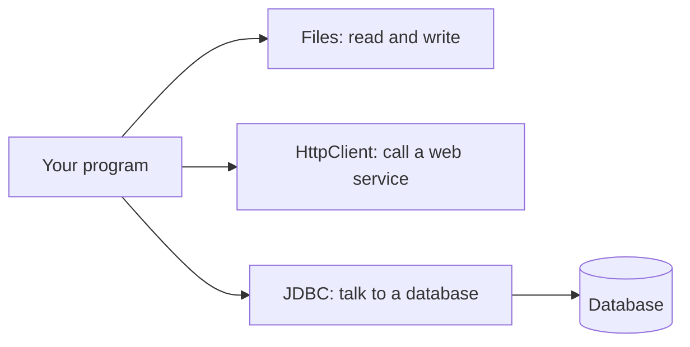
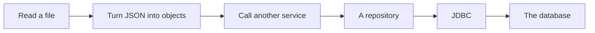
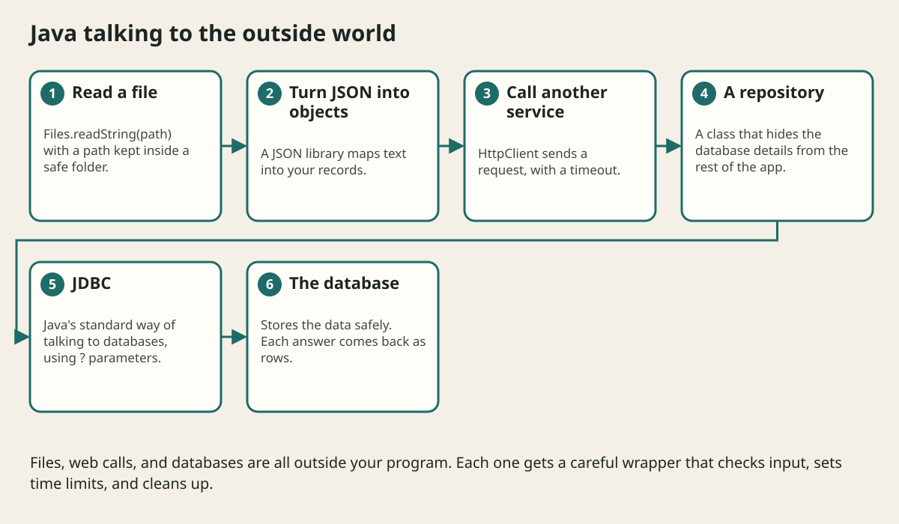

# Files Json Http And Jdbc

## The big idea in plain words {#picture}

Most real programs do not live alone. They read files, talk to other computers over the web, and save data in a database. These are all the outside world, and the outside world can be slow, broken, or even dangerous.

For each door to the outside, Java has a standard tool: `Files` for files, `HttpClient` for the web, and **JDBC** for databases. For each one, we follow the same safe habits: check the input, set a time limit, and close what we open.



## What you will be able to do {#outcomes}

By the end of this lesson you will be able to:

- Read and write files safely with `Files` and `Path`.
- Make a web request with a time limit.
- Use JDBC with `?` parameters and transactions.

## Words to know {#vocabulary}

- **Path**: the address of a file.
- **JSON**: a simple text format for data, like `{"title": "Math"}`.
- **HttpClient**: Java's built-in tool for calling web services.
- **JDBC**: Java's standard way to talk to databases.
- **PreparedStatement**: a SQL command with safe `?` slots for values.
- **transaction**: a group of database changes that all succeed or all fail.

## Why this idea exists {#history}

Programs that only live in memory forget everything when they stop. To be useful, they must save data and talk to others, and do it safely.

## Concept 1: Files: stay inside the fence {#concept-1}

```java
Path root = Path.of("notes").toAbsolutePath().normalize();
Path file = root.resolve(name).normalize();
if (!file.startsWith(root)) throw new IllegalArgumentException("bad path");
String text = Files.readString(file, StandardCharsets.UTF_8);
```
A name like `../secret.txt` tries to climb out of the folder. We clean the path and check that it is still inside the fence.

## Concept 2: The web: always set a time limit {#concept-2}

`HttpClient` sends requests. Set a timeout so one slow server cannot freeze your program: `HttpRequest.newBuilder(uri).timeout(Duration.ofSeconds(5))`. Then check the status code before trusting the answer.

## Concept 3: JDBC: use the ? slots {#concept-3}

Never glue user text into SQL. Write `SELECT * FROM notes WHERE id = ?` and then give the value separately. This stops a famous attack called SQL injection, where a user types SQL as their "name".

## Concept 4: Transactions and cleanup {#concept-4}

To save a note and its tag together, use one transaction: either both are saved or neither. Always close connections (try-with-resources does it), because a database has only a limited number of connections to hand out.

## Safe database read {#example}

```java
String sql = "SELECT title FROM notes WHERE id = ?";
try (PreparedStatement ps = connection.prepareStatement(sql)) {
    ps.setInt(1, id);
    try (ResultSet rs = ps.executeQuery()) {
        return rs.next() ? Optional.of(rs.getString("title")) : Optional.empty();
    }
}
```
The `?` is a safe slot. `setInt` fills it. Both the statement and result are closed automatically.

## Going deeper: the technical walkthrough {#walkthrough}

### Files, JSON, HTTP, and JDBC


Keep external systems behind boundaries:

- `Path` and `Files` handle local files;
- Jackson or another library maps JSON to typed records;
- `HttpClient` calls another HTTP service;
- JDBC or Spring JDBC uses parameterized SQL;
- a repository owns database mapping.

Never build SQL with string concatenation from user input:

```java
String sql = "select id, title from notes where topic = :topic";
```

Use the parameter API of the database library. A type-safe parameter is a
small security boundary.


## Worked scenario {#worked-scenario}

A caller asks the file API for ../private.key. What happens?

The justified choice is **Reject it before opening any file**. Select **reject-traversal** in the structured practical and explain why. Alternatives ignore a requirement, cross a trust boundary, or invent success.

### Structured decision contract

```json

{
  "decision": "reject-traversal",
  "justification": "The path and buffer boundary must preserve the declared contract and ownership.",
  "failureBehavior": "Expose a safe failure and recover through the boundary owner."
}

```

Decision selects one declared behavior. Justification explains the boundary. FailureBehavior explains the observable error and recovery owner. These fields never execute commands. Required terms and minimum lengths form a basic practice rubric, not semantic grading.

## Step-by-step flow and matching picture {#flow}





## Three real-life uses {#use-cases}

1. A program reads a list of students from a file.
2. A weather app calls a web service with a 5-second timeout.
3. A shop saves orders in a database inside a transaction.

## What can go wrong, and how to stay safe {#failure-security}

Mistakes: building SQL by joining strings, opening a file path directly from user input, forgetting timeouts on web calls, leaving connections open, and loading a huge file fully into memory when you could read it in pieces.

## Practice lab and expected observation {#practice}

1. Predict the scenario decision before opening Practical. Explain each rejected alternative.
2. Run a relevant example above in an isolated exercise project. Record the expected result, then change one input to an invalid or boundary value. A failed assertion or deliberate error should replace silent success.
3. Submit the structured decision. Initially the checks fail. After selecting reject-traversal and writing an explanation and failure plan, all three pass. Follow the indicated review section for missed checks.

### Broken example to debug

```json

{"decision":"trust-client","justification":"","failureBehavior":""}

```

This ignores the responsible boundary and gives no reasoning or recovery. Correct the fields rather than changing the validator.

## Checkpoint and definition of done {#checkpoint}

- [ ] Define path and buffer without looking.
- [ ] Trace input to owner and output.
- [ ] Explain one failure and one alternative.
- [ ] Pass at least four assignment questions.
- [ ] Pass every practical check and submit.
- [ ] Explain the concept again tomorrow.

## Sources, versions, and safe commands {#sources}

Java 17 baseline; installed validation JDK may be newer. Review date: 2026-10-02. The supplied blueprint is the teaching source; official landing pages were checked where reachable. No provider or original TM Schedule deployment was tested.

- [Official reference](https://docs.oracle.com/en/java/javase/17/)

[Course reading order](README.md) · [Previous lesson](14-lambdas-streams-and-functional-style.md) · [Next lesson](16-concurrency-threads-and-executors.md)

```study-quiz

{
  "schemaVersion": 1,
  "lessonId": "java/15-files-json-http-and-jdbc",
  "title": "Assignment: Files Json Http And Jdbc",
  "passPercentage": 80,
  "questions": [
    {
      "id": "q1",
      "sectionId": "concept-1",
      "prompt": "In Files Json Http And Jdbc, what does path mean?",
      "options": [
        {
          "id": "a",
          "text": "A permission granted by a hidden browser control",
          "explanation": "This changes the declared meaning or bypasses the responsible boundary."
        },
        {
          "id": "b",
          "text": "An unlimited provider operation with no ownership",
          "explanation": "This changes the declared meaning or bypasses the responsible boundary."
        },
        {
          "id": "c",
          "text": "A diagnostic credential intended for public logs",
          "explanation": "This changes the declared meaning or bypasses the responsible boundary."
        },
        {
          "id": "d",
          "text": "the address that points to a file",
          "explanation": "This preserves the definition and boundary described in the lesson."
        }
      ],
      "correctOptionId": "d",
      "explanation": "path means the address that points to a file.",
      "reviewLabel": "Review concept 1"
    },
    {
      "id": "q2",
      "sectionId": "concept-2",
      "prompt": "In Files Json Http And Jdbc, which rule is correct for checkpoint 2?",
      "options": [
        {
          "id": "a",
          "text": "A shortcut link (symlink) can fool a simple text check.",
          "explanation": "This preserves the definition and boundary described in the lesson."
        },
        {
          "id": "b",
          "text": "Trust client-side checks instead of the server rule.",
          "explanation": "This changes the declared meaning or bypasses the responsible boundary."
        },
        {
          "id": "c",
          "text": "Hide the failure by returning a fabricated successful result.",
          "explanation": "This changes the declared meaning or bypasses the responsible boundary."
        },
        {
          "id": "d",
          "text": "Skip the stated boundary, limit, or ownership check.",
          "explanation": "This changes the declared meaning or bypasses the responsible boundary."
        }
      ],
      "correctOptionId": "a",
      "explanation": "A shortcut link (symlink) can fool a simple text check.",
      "reviewLabel": "Review concept 2"
    },
    {
      "id": "q3",
      "sectionId": "concept-3",
      "prompt": "In Files Json Http And Jdbc, which rule is correct for checkpoint 3?",
      "options": [
        {
          "id": "a",
          "text": "Trust client-side checks instead of the server rule.",
          "explanation": "This changes the declared meaning or bypasses the responsible boundary."
        },
        {
          "id": "b",
          "text": "Say which encoding to use when turning bytes into text.",
          "explanation": "This preserves the definition and boundary described in the lesson."
        },
        {
          "id": "c",
          "text": "Hide the failure by returning a fabricated successful result.",
          "explanation": "This changes the declared meaning or bypasses the responsible boundary."
        },
        {
          "id": "d",
          "text": "Skip the stated boundary, limit, or ownership check.",
          "explanation": "This changes the declared meaning or bypasses the responsible boundary."
        }
      ],
      "correctOptionId": "b",
      "explanation": "Say which encoding to use when turning bytes into text.",
      "reviewLabel": "Review concept 3"
    },
    {
      "id": "q4",
      "sectionId": "concept-4",
      "prompt": "In Files Json Http And Jdbc, which rule is correct for checkpoint 4?",
      "options": [
        {
          "id": "a",
          "text": "Trust client-side checks instead of the server rule.",
          "explanation": "This changes the declared meaning or bypasses the responsible boundary."
        },
        {
          "id": "b",
          "text": "Hide the failure by returning a fabricated successful result.",
          "explanation": "This changes the declared meaning or bypasses the responsible boundary."
        },
        {
          "id": "c",
          "text": "Stream big files and slow the sender when needed.",
          "explanation": "This preserves the definition and boundary described in the lesson."
        },
        {
          "id": "d",
          "text": "Skip the stated boundary, limit, or ownership check.",
          "explanation": "This changes the declared meaning or bypasses the responsible boundary."
        }
      ],
      "correctOptionId": "c",
      "explanation": "Stream big files and slow the sender when needed.",
      "reviewLabel": "Review concept 4"
    },
    {
      "id": "q5",
      "sectionId": "worked-scenario",
      "prompt": "A caller asks the file API for ../private.key. What happens?",
      "options": [
        {
          "id": "a",
          "text": "Open it because it is valid text",
          "explanation": "This changes the declared meaning or bypasses the responsible boundary."
        },
        {
          "id": "b",
          "text": "Search the whole disk for the key",
          "explanation": "This changes the declared meaning or bypasses the responsible boundary."
        },
        {
          "id": "c",
          "text": "Return the full folder path in the error",
          "explanation": "This changes the declared meaning or bypasses the responsible boundary."
        },
        {
          "id": "d",
          "text": "Reject it before opening any file",
          "explanation": "This preserves the definition and boundary described in the lesson."
        }
      ],
      "correctOptionId": "d",
      "explanation": "Reject it before opening any file. Close files and delete temporary files, even when something fails.",
      "reviewLabel": "Review the worked scenario"
    }
  ]
}

```

```study-practical

{
  "schemaVersion": 1,
  "challengeId": "java/15-files-json-http-and-jdbc/decision",
  "lessonId": "java/15-files-json-http-and-jdbc",
  "title": "Practical: Files Json Http And Jdbc",
  "language": "json",
  "mode": "structured",
  "instructions": "A caller asks the file API for ../private.key. What happens? Return an object with decision (choose from reject-traversal, skip-check, unbounded-work, trust-client), justification (at least 40 characters; include path and buffer), and failureBehavior (at least 25 characters; include failure and recover while explaining the error and recovery). These are structured reasoning checks, not code execution or an official grade.",
  "starterCode": "{\n  \"decision\": \"\",\n  \"justification\": \"\",\n  \"failureBehavior\": \"\"\n}",
  "entryPoint": "answer",
  "publicExamples": [
    {
      "input": {
        "decision": "skip-check",
        "justification": "",
        "failureBehavior": ""
      },
      "expected": {
        "passed": false
      }
    },
    {
      "input": {
        "decision": "reject-traversal",
        "justification": "The path and buffer boundary must preserve the declared contract and ownership.",
        "failureBehavior": "Show a safe failure and recover through the responsible owner."
      },
      "expected": {
        "passed": true
      }
    }
  ],
  "publicTestIds": [
    "decision",
    "explanation",
    "failure-plan"
  ],
  "reviewSections": {
    "decision": "worked-scenario",
    "explanation": "concept-2",
    "failure-plan": "failure-security"
  },
  "limits": {
    "timeMs": 2000,
    "memoryMb": 128,
    "outputBytes": 20000
  }
}

```

