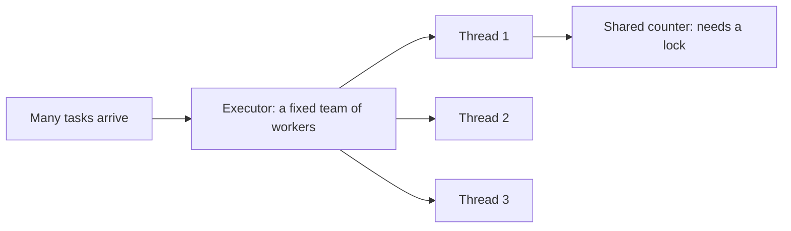
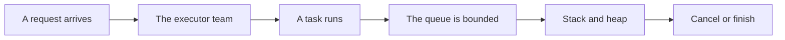

# Concurrency Threads And Executors

## The big idea in plain words {#picture}

Think about a kitchen with many cooks. If each cook has their own counter and ingredients, they work in peace. But if two cooks reach for the last egg at the same time, there is a problem. Who gets it? What if both think they did?

Threads are cooks: they let Java do several things at once. The tricky part is sharing. This lesson is about sharing safely, using turn-taking rules, and about keeping the number of cooks under control.



## What you will be able to do {#outcomes}

By the end of this lesson you will be able to:

- Explain a thread and a race condition.
- Use `synchronized`, atomics, and executors.
- Explain why we keep the number of tasks and threads bounded.

## Words to know {#vocabulary}

- **thread**: one path of work running at the same time as others.
- **race condition**: the result depends on whose turn comes first by luck.
- **lock**: a rule that lets only one thread in at a time.
- **atomic**: an operation that cannot be split in the middle.
- **executor**: a manager that runs tasks with a limited team of threads.
- **future**: a ticket for a result that will come later.

## Why this idea exists {#history}

Modern computers have many cores, and servers handle many visitors at once. Using threads well makes programs fast. Using them badly makes bugs that appear only sometimes and are very hard to find.

## Concept 1: A race: two cooks, one scoreboard {#concept-1}

Two threads each do: read the score (5), add one, write it back (6). If both read 5 at the same time, both write 6, and one point disappears! The whole read-add-write should happen as one step.

## Concept 2: Turn-taking tools {#concept-2}

`synchronized` is like a bathroom door lock: only one thread inside at a time. `AtomicInteger` does the read-add-write as one safe step: `counter.incrementAndGet()`. A lock must protect the whole rule, not just part of it.

## Concept 3: Use executors, not new threads everywhere {#concept-3}

```java
ExecutorService pool = Executors.newFixedThreadPool(4);
Future<Integer> result = pool.submit(() -> compute());
```
A pool is a team of four workers. Tasks wait in line when all are busy. This stops your program from creating thousands of threads and running out of memory.

## Concept 4: Stop politely {#concept-4}

To cancel a task, you ask it to stop (`interrupt`) and it must notice, clean up, and exit. Always shut down the pool when finished (`pool.shutdown()`). Newer Java also has virtual threads, very light threads for programs that mostly wait for the network.

## Fixing the counter {#example}

```java
AtomicInteger score = new AtomicInteger();
Runnable add = () -> { for (int i = 0; i < 1000; i++) score.incrementAndGet(); };
// run add on two threads: the final score is always 2000
```
With a plain `int` and `score++`, the answer might be 1,874 or 1,990. With `AtomicInteger`, it is always 2,000.

## Going deeper: the technical walkthrough {#walkthrough}

### Concurrency and memory


The stack holds method calls and local references. The heap holds objects. The
JVM manages object memory, but a program can still leak resources by leaving
files, database connections, or threads open.

Concurrency means more than one piece of work can make progress. Shared mutable
maps need a deliberate design. Prefer immutable values, bounded executors, and
clear ownership. Learn `ExecutorService`, `CompletableFuture`, and thread-safety
before adding parallel work to a web service.


### Focused implementation

ExecutorService owns an execution policy; callers own deadlines and cancellation. A Future.get timeout stops waiting, not necessarily the operation. Preserve interruption intent rather than swallowing InterruptedException. Virtual threads are newer than this Java 17 baseline; they reduce waiting-thread costs without removing database or CPU limits. In production, configure a bounded queue instead of the convenience unbounded queue used in this two-task demonstration.

```java

import java.util.concurrent.*;
public class Example {
  public static void main(String[] args) throws Exception {
    ExecutorService pool = Executors.newFixedThreadPool(2);
    try {
      Future<String> result = pool.submit(() -> "APIs");
      System.out.println(result.get(1, TimeUnit.SECONDS));
    } finally { pool.shutdownNow(); }
  }
}

```

Read the imports, then the values and checks, then the operation, and finally the result or cleanup. Java Example programs compile as Example.java. Python uses Python 3.11+. JavaScript ESM runs as example.mjs. Framework snippets run inside the generated project.

## Worked scenario {#worked-scenario}

Two workers each read a counter, add one, and write it back. What fixes the lost updates?

The justified choice is **An atomic operation or a lock around the whole update**. Select **atomic-update** in the structured practical and explain why. Alternatives ignore a requirement, cross a trust boundary, or invent success.

### Structured decision contract

```json

{
  "decision": "atomic-update",
  "justification": "The race and executor boundary must preserve the declared contract and ownership.",
  "failureBehavior": "Expose a safe failure and recover through the boundary owner."
}

```

Decision selects one declared behavior. Justification explains the boundary. FailureBehavior explains the observable error and recovery owner. These fields never execute commands. Required terms and minimum lengths form a basic practice rubric, not semantic grading.

## Step-by-step flow and matching picture {#flow}




## Three real-life uses {#use-cases}

1. A web server answers many visitors at once with a pool of threads.
2. A program downloads ten files in parallel and waits for all of them.
3. A counter of "visitors today" uses an atomic number.

## What can go wrong, and how to stay safe {#failure-security}

Mistakes: sharing changeable data without any lock, locking too little or too much (slow and can freeze: a deadlock), starting an unlimited number of threads, and forgetting to shut down the executor, so the program never ends. When in doubt, share less.

## Practice lab and expected observation {#practice}

1. Predict the scenario decision before opening Practical. Explain each rejected alternative.
2. Run a relevant example above in an isolated exercise project. Record the expected result, then change one input to an invalid or boundary value. A failed assertion or deliberate error should replace silent success.
3. Submit the structured decision. Initially the checks fail. After selecting atomic-update and writing an explanation and failure plan, all three pass. Follow the indicated review section for missed checks.

### Broken example to debug

```json

{"decision":"trust-client","justification":"","failureBehavior":""}

```

This ignores the responsible boundary and gives no reasoning or recovery. Correct the fields rather than changing the validator.

## Checkpoint and definition of done {#checkpoint}

- [ ] Define race and executor without looking.
- [ ] Trace input to owner and output.
- [ ] Explain one failure and one alternative.
- [ ] Pass at least four assignment questions.
- [ ] Pass every practical check and submit.
- [ ] Explain the concept again tomorrow.

## Sources, versions, and safe commands {#sources}

Java 17 baseline; installed validation JDK may be newer. Review date: 2026-10-02. The supplied blueprint is the teaching source; official landing pages were checked where reachable. No provider or original TM Schedule deployment was tested.

- [Official reference](https://docs.oracle.com/en/java/javase/17/)

[Course reading order](README.md) · [Previous lesson](15-files-json-http-and-jdbc.md) · [Next lesson](17-jvm-memory-resources-and-performance.md)

```study-quiz

{
  "schemaVersion": 1,
  "lessonId": "java/16-concurrency-threads-and-executors",
  "title": "Assignment: Concurrency Threads And Executors",
  "passPercentage": 80,
  "questions": [
    {
      "id": "q1",
      "sectionId": "concept-1",
      "prompt": "In Concurrency Threads And Executors, what does race mean?",
      "options": [
        {
          "id": "a",
          "text": "a result that depends on lucky timing",
          "explanation": "This preserves the definition and boundary described in the lesson."
        },
        {
          "id": "b",
          "text": "A permission granted by a hidden browser control",
          "explanation": "This changes the declared meaning or bypasses the responsible boundary."
        },
        {
          "id": "c",
          "text": "An unlimited provider operation with no ownership",
          "explanation": "This changes the declared meaning or bypasses the responsible boundary."
        },
        {
          "id": "d",
          "text": "A diagnostic credential intended for public logs",
          "explanation": "This changes the declared meaning or bypasses the responsible boundary."
        }
      ],
      "correctOptionId": "a",
      "explanation": "race means a result that depends on lucky timing.",
      "reviewLabel": "Review concept 1"
    },
    {
      "id": "q2",
      "sectionId": "concept-2",
      "prompt": "In Concurrency Threads And Executors, which rule is correct for checkpoint 2?",
      "options": [
        {
          "id": "a",
          "text": "Trust client-side checks instead of the server rule.",
          "explanation": "This changes the declared meaning or bypasses the responsible boundary."
        },
        {
          "id": "b",
          "text": "A lock must cover the whole rule, not just part of it.",
          "explanation": "This preserves the definition and boundary described in the lesson."
        },
        {
          "id": "c",
          "text": "Hide the failure by returning a fabricated successful result.",
          "explanation": "This changes the declared meaning or bypasses the responsible boundary."
        },
        {
          "id": "d",
          "text": "Skip the stated boundary, limit, or ownership check.",
          "explanation": "This changes the declared meaning or bypasses the responsible boundary."
        }
      ],
      "correctOptionId": "b",
      "explanation": "A lock must cover the whole rule, not just part of it.",
      "reviewLabel": "Review concept 2"
    },
    {
      "id": "q3",
      "sectionId": "concept-3",
      "prompt": "In Concurrency Threads And Executors, which rule is correct for checkpoint 3?",
      "options": [
        {
          "id": "a",
          "text": "Trust client-side checks instead of the server rule.",
          "explanation": "This changes the declared meaning or bypasses the responsible boundary."
        },
        {
          "id": "b",
          "text": "Hide the failure by returning a fabricated successful result.",
          "explanation": "This changes the declared meaning or bypasses the responsible boundary."
        },
        {
          "id": "c",
          "text": "Shared changeable data needs one clear owner.",
          "explanation": "This preserves the definition and boundary described in the lesson."
        },
        {
          "id": "d",
          "text": "Skip the stated boundary, limit, or ownership check.",
          "explanation": "This changes the declared meaning or bypasses the responsible boundary."
        }
      ],
      "correctOptionId": "c",
      "explanation": "Shared changeable data needs one clear owner.",
      "reviewLabel": "Review concept 3"
    },
    {
      "id": "q4",
      "sectionId": "concept-4",
      "prompt": "In Concurrency Threads And Executors, which rule is correct for checkpoint 4?",
      "options": [
        {
          "id": "a",
          "text": "Trust client-side checks instead of the server rule.",
          "explanation": "This changes the declared meaning or bypasses the responsible boundary."
        },
        {
          "id": "b",
          "text": "Hide the failure by returning a fabricated successful result.",
          "explanation": "This changes the declared meaning or bypasses the responsible boundary."
        },
        {
          "id": "c",
          "text": "Skip the stated boundary, limit, or ownership check.",
          "explanation": "This changes the declared meaning or bypasses the responsible boundary."
        },
        {
          "id": "d",
          "text": "A limited pool of workers stops tasks piling up forever.",
          "explanation": "This preserves the definition and boundary described in the lesson."
        }
      ],
      "correctOptionId": "d",
      "explanation": "A limited pool of workers stops tasks piling up forever.",
      "reviewLabel": "Review concept 4"
    },
    {
      "id": "q5",
      "sectionId": "worked-scenario",
      "prompt": "Two workers each read a counter, add one, and write it back. What fixes the lost updates?",
      "options": [
        {
          "id": "a",
          "text": "An atomic operation or a lock around the whole update",
          "explanation": "This preserves the definition and boundary described in the lesson."
        },
        {
          "id": "b",
          "text": "Adding a sleep with no locking rule",
          "explanation": "This changes the declared meaning or bypasses the responsible boundary."
        },
        {
          "id": "c",
          "text": "A longer variable name",
          "explanation": "This changes the declared meaning or bypasses the responsible boundary."
        },
        {
          "id": "d",
          "text": "Two separate copies that pretend to agree",
          "explanation": "This changes the declared meaning or bypasses the responsible boundary."
        }
      ],
      "correctOptionId": "a",
      "explanation": "An atomic operation or a lock around the whole update. Stopping a task is cooperative and needs cleanup.",
      "reviewLabel": "Review the worked scenario"
    }
  ]
}

```

```study-practical

{
  "schemaVersion": 1,
  "challengeId": "java/16-concurrency-threads-and-executors/decision",
  "lessonId": "java/16-concurrency-threads-and-executors",
  "title": "Practical: Concurrency Threads And Executors",
  "language": "json",
  "mode": "structured",
  "instructions": "Two workers each read a counter, add one, and write it back. What fixes the lost updates? Return an object with decision (choose from atomic-update, skip-check, unbounded-work, trust-client), justification (at least 40 characters; include race and executor), and failureBehavior (at least 25 characters; include failure and recover while explaining the error and recovery). These are structured reasoning checks, not code execution or an official grade.",
  "starterCode": "{\n  \"decision\": \"\",\n  \"justification\": \"\",\n  \"failureBehavior\": \"\"\n}",
  "entryPoint": "answer",
  "publicExamples": [
    {
      "input": {
        "decision": "skip-check",
        "justification": "",
        "failureBehavior": ""
      },
      "expected": {
        "passed": false
      }
    },
    {
      "input": {
        "decision": "atomic-update",
        "justification": "The race and executor boundary must preserve the declared contract and ownership.",
        "failureBehavior": "Show a safe failure and recover through the responsible owner."
      },
      "expected": {
        "passed": true
      }
    }
  ],
  "publicTestIds": [
    "decision",
    "explanation",
    "failure-plan"
  ],
  "reviewSections": {
    "decision": "worked-scenario",
    "explanation": "concept-2",
    "failure-plan": "failure-security"
  },
  "limits": {
    "timeMs": 2000,
    "memoryMb": 128,
    "outputBytes": 20000
  }
}

```

