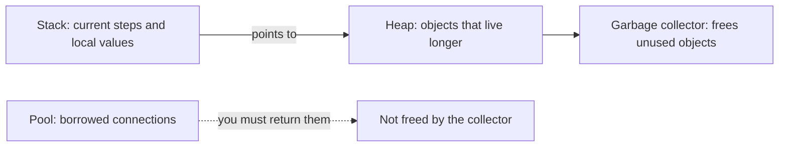
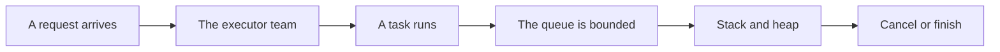
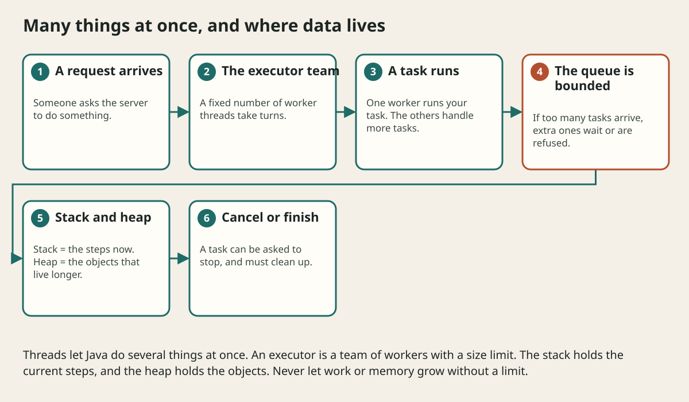

# Jvm Memory Resources And Performance

## The big idea in plain words {#picture}

Your desk at school has two places for things. There is a small spot right in front of you for what you are using this very second (that is the **stack**). And there is a big shelf behind you for things you want to keep for later (that is the **heap**).

Java manages both for you. When nothing points to an object any more, a helper called the **garbage collector** removes it from the shelf. But the helper cannot close the door to a borrowed library room, which means files and database connections still need you.



## What you will be able to do {#outcomes}

By the end of this lesson you will be able to:

- Explain stack, heap, and garbage collection with the desk analogy.
- Spot a memory leak and a connection leak.
- Measure before trying to speed anything up.

## Words to know {#vocabulary}

- **stack**: the tidy area that tracks the method calls happening now.
- **heap**: the big area where objects live.
- **garbage collection**: Java automatically freeing objects nobody uses.
- **memory leak**: holding on to objects you no longer need.
- **connection pool**: a set of ready database connections to borrow.
- **profiling**: measuring where a program spends time or memory.

## Why this idea exists {#history}

Slow or crashing programs often have nothing to do with the language itself. They happen because something is held too long or grows without a limit. Knowing where things live helps you find these problems.

## Concept 1: Stack and heap {#concept-1}

When a method runs, its local variables sit on the stack. When it finishes, they vanish. Objects created with `new` live on the heap. The stack holds only the "address" of the object. That is why many variables can point to the same object.

## Concept 2: The garbage collector cleans up {#concept-2}

When no variable can reach an object any more, the collector may remove it. You do not call `delete`. But if a long-lived list keeps pointing to old objects, they stay forever. This is a **leak**: not forgotten by Java, but still held by you.

## Concept 3: Some things the collector cannot close {#concept-3}

Files, network sockets, and database connections are borrowed from the operating system or from a pool. The collector will not return them. You must close them yourself, using try-with-resources. If you forget, the pool runs dry and the app freezes.

## Concept 4: Measure first {#concept-4}

Do not guess what is slow. Use a profiler or simple timers to find the real bottleneck. A cache with no size limit is a common leak: it grows until memory is full. Give every cache a maximum size and a rule for what to drop.

## A leaking list {#example}

```java
static final List<byte[]> keep = new ArrayList<>();
void handle() {
    keep.add(new byte[1_000_000]);   // never removed!
}
```
Every call adds a megabyte that stays forever. After a thousand requests, that is a gigabyte, and the program runs out of memory. Fix: do not keep what you do not need, or limit the size.

## Going deeper: the technical walkthrough {#walkthrough}

### Concurrency and memory


The stack holds method calls and local references. The heap holds objects. The
JVM manages object memory, but a program can still leak resources by leaving
files, database connections, or threads open.

Concurrency means more than one piece of work can make progress. Shared mutable
maps need a deliberate design. Prefer immutable values, bounded executors, and
clear ownership. Learn `ExecutorService`, `CompletableFuture`, and thread-safety
before adding parallel work to a web service.


## Worked scenario {#worked-scenario}

A server never gives pooled connections back after failed queries. What happens?

The justified choice is **The pool can run dry even while garbage collection runs**. Select **release-pool** in the structured practical and explain why. Alternatives ignore a requirement, cross a trust boundary, or invent success.

### Structured decision contract

```json

{
  "decision": "release-pool",
  "justification": "The heap and stack boundary must preserve the declared contract and ownership.",
  "failureBehavior": "Expose a safe failure and recover through the boundary owner."
}

```

Decision selects one declared behavior. Justification explains the boundary. FailureBehavior explains the observable error and recovery owner. These fields never execute commands. Required terms and minimum lengths form a basic practice rubric, not semantic grading.

## Step-by-step flow and matching picture {#flow}





## Three real-life uses {#use-cases}

1. A server watches its memory chart and sees it keep growing: a leak.
2. A web app returns database connections after every request, so the pool never runs dry.
3. A team uses a profiler to find that one slow loop used most of the time.

## What can go wrong, and how to stay safe {#failure-security}

Mistakes: guessing instead of measuring, keeping everything in a static list, forgetting to close connections, and calling `System.gc()` hoping it fixes things (it does not). The cure is to be careful about what you hold and for how long.

## Practice lab and expected observation {#practice}

1. Predict the scenario decision before opening Practical. Explain each rejected alternative.
2. Run a relevant example above in an isolated exercise project. Record the expected result, then change one input to an invalid or boundary value. A failed assertion or deliberate error should replace silent success.
3. Submit the structured decision. Initially the checks fail. After selecting release-pool and writing an explanation and failure plan, all three pass. Follow the indicated review section for missed checks.

### Broken example to debug

```json

{"decision":"trust-client","justification":"","failureBehavior":""}

```

This ignores the responsible boundary and gives no reasoning or recovery. Correct the fields rather than changing the validator.

## Checkpoint and definition of done {#checkpoint}

- [ ] Define heap and stack without looking.
- [ ] Trace input to owner and output.
- [ ] Explain one failure and one alternative.
- [ ] Pass at least four assignment questions.
- [ ] Pass every practical check and submit.
- [ ] Explain the concept again tomorrow.

## Sources, versions, and safe commands {#sources}

Java 17 baseline; installed validation JDK may be newer. Review date: 2026-10-02. The supplied blueprint is the teaching source; official landing pages were checked where reachable. No provider or original TM Schedule deployment was tested.

- [Official reference](https://docs.oracle.com/en/java/javase/17/)

[Course reading order](README.md) · [Previous lesson](16-concurrency-threads-and-executors.md) · [Next lesson](18-packages-visibility-and-modules.md)

```study-quiz

{
  "schemaVersion": 1,
  "lessonId": "java/17-jvm-memory-resources-and-performance",
  "title": "Assignment: Jvm Memory Resources And Performance",
  "passPercentage": 80,
  "questions": [
    {
      "id": "q1",
      "sectionId": "concept-1",
      "prompt": "In Jvm Memory Resources And Performance, what does heap mean?",
      "options": [
        {
          "id": "a",
          "text": "A permission granted by a hidden browser control",
          "explanation": "This changes the declared meaning or bypasses the responsible boundary."
        },
        {
          "id": "b",
          "text": "the big area of memory where objects live",
          "explanation": "This preserves the definition and boundary described in the lesson."
        },
        {
          "id": "c",
          "text": "An unlimited provider operation with no ownership",
          "explanation": "This changes the declared meaning or bypasses the responsible boundary."
        },
        {
          "id": "d",
          "text": "A diagnostic credential intended for public logs",
          "explanation": "This changes the declared meaning or bypasses the responsible boundary."
        }
      ],
      "correctOptionId": "b",
      "explanation": "heap means the big area of memory where objects live.",
      "reviewLabel": "Review concept 1"
    },
    {
      "id": "q2",
      "sectionId": "concept-2",
      "prompt": "In Jvm Memory Resources And Performance, which rule is correct for checkpoint 2?",
      "options": [
        {
          "id": "a",
          "text": "Trust client-side checks instead of the server rule.",
          "explanation": "This changes the declared meaning or bypasses the responsible boundary."
        },
        {
          "id": "b",
          "text": "Hide the failure by returning a fabricated successful result.",
          "explanation": "This changes the declared meaning or bypasses the responsible boundary."
        },
        {
          "id": "c",
          "text": "A reference that is still alive keeps its data in memory.",
          "explanation": "This preserves the definition and boundary described in the lesson."
        },
        {
          "id": "d",
          "text": "Skip the stated boundary, limit, or ownership check.",
          "explanation": "This changes the declared meaning or bypasses the responsible boundary."
        }
      ],
      "correctOptionId": "c",
      "explanation": "A reference that is still alive keeps its data in memory.",
      "reviewLabel": "Review concept 2"
    },
    {
      "id": "q3",
      "sectionId": "concept-3",
      "prompt": "In Jvm Memory Resources And Performance, which rule is correct for checkpoint 3?",
      "options": [
        {
          "id": "a",
          "text": "Trust client-side checks instead of the server rule.",
          "explanation": "This changes the declared meaning or bypasses the responsible boundary."
        },
        {
          "id": "b",
          "text": "Hide the failure by returning a fabricated successful result.",
          "explanation": "This changes the declared meaning or bypasses the responsible boundary."
        },
        {
          "id": "c",
          "text": "Skip the stated boundary, limit, or ownership check.",
          "explanation": "This changes the declared meaning or bypasses the responsible boundary."
        },
        {
          "id": "d",
          "text": "A cache with no size limit can fill all the memory.",
          "explanation": "This preserves the definition and boundary described in the lesson."
        }
      ],
      "correctOptionId": "d",
      "explanation": "A cache with no size limit can fill all the memory.",
      "reviewLabel": "Review concept 3"
    },
    {
      "id": "q4",
      "sectionId": "concept-4",
      "prompt": "In Jvm Memory Resources And Performance, which rule is correct for checkpoint 4?",
      "options": [
        {
          "id": "a",
          "text": "Profiling shows where the real slowness is.",
          "explanation": "This preserves the definition and boundary described in the lesson."
        },
        {
          "id": "b",
          "text": "Trust client-side checks instead of the server rule.",
          "explanation": "This changes the declared meaning or bypasses the responsible boundary."
        },
        {
          "id": "c",
          "text": "Hide the failure by returning a fabricated successful result.",
          "explanation": "This changes the declared meaning or bypasses the responsible boundary."
        },
        {
          "id": "d",
          "text": "Skip the stated boundary, limit, or ownership check.",
          "explanation": "This changes the declared meaning or bypasses the responsible boundary."
        }
      ],
      "correctOptionId": "a",
      "explanation": "Profiling shows where the real slowness is.",
      "reviewLabel": "Review concept 4"
    },
    {
      "id": "q5",
      "sectionId": "worked-scenario",
      "prompt": "A server never gives pooled connections back after failed queries. What happens?",
      "options": [
        {
          "id": "a",
          "text": "Garbage collection returns them immediately",
          "explanation": "This changes the declared meaning or bypasses the responsible boundary."
        },
        {
          "id": "b",
          "text": "The pool can run dry even while garbage collection runs",
          "explanation": "This preserves the definition and boundary described in the lesson."
        },
        {
          "id": "c",
          "text": "Every query gets faster",
          "explanation": "This changes the declared meaning or bypasses the responsible boundary."
        },
        {
          "id": "d",
          "text": "Changing CSS on the client fixes it",
          "explanation": "This changes the declared meaning or bypasses the responsible boundary."
        }
      ],
      "correctOptionId": "b",
      "explanation": "The pool can run dry even while garbage collection runs. Whoever creates a resource is responsible for cleaning it up.",
      "reviewLabel": "Review the worked scenario"
    }
  ]
}

```

```study-practical

{
  "schemaVersion": 1,
  "challengeId": "java/17-jvm-memory-resources-and-performance/decision",
  "lessonId": "java/17-jvm-memory-resources-and-performance",
  "title": "Practical: Jvm Memory Resources And Performance",
  "language": "json",
  "mode": "structured",
  "instructions": "A server never gives pooled connections back after failed queries. What happens? Return an object with decision (choose from release-pool, skip-check, unbounded-work, trust-client), justification (at least 40 characters; include heap and stack), and failureBehavior (at least 25 characters; include failure and recover while explaining the error and recovery). These are structured reasoning checks, not code execution or an official grade.",
  "starterCode": "{\n  \"decision\": \"\",\n  \"justification\": \"\",\n  \"failureBehavior\": \"\"\n}",
  "entryPoint": "answer",
  "publicExamples": [
    {
      "input": {
        "decision": "skip-check",
        "justification": "",
        "failureBehavior": ""
      },
      "expected": {
        "passed": false
      }
    },
    {
      "input": {
        "decision": "release-pool",
        "justification": "The heap and stack boundary must preserve the declared contract and ownership.",
        "failureBehavior": "Show a safe failure and recover through the responsible owner."
      },
      "expected": {
        "passed": true
      }
    }
  ],
  "publicTestIds": [
    "decision",
    "explanation",
    "failure-plan"
  ],
  "reviewSections": {
    "decision": "worked-scenario",
    "explanation": "concept-2",
    "failure-plan": "failure-security"
  },
  "limits": {
    "timeMs": 2000,
    "memoryMb": 128,
    "outputBytes": 20000
  }
}

```

