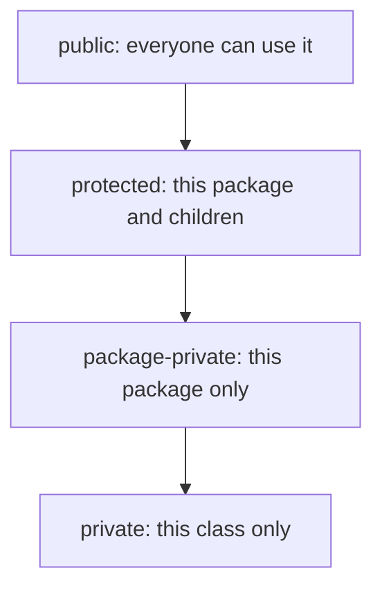
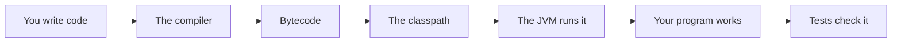
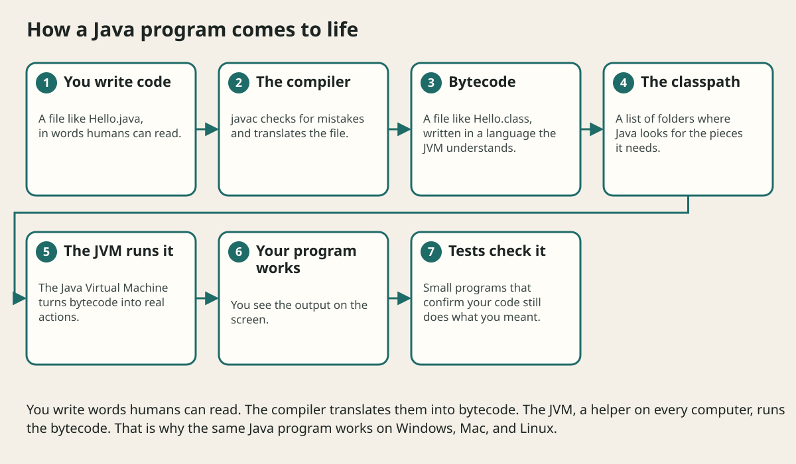

# Packages Visibility And Modules

## The big idea in plain words {#picture}

In a school, some rooms are open to everyone (the hall), some only to students (classrooms), and some only to teachers (the staff room). A building is easier to manage when each room's door says who may enter.

Java does this with **packages** (folders for your classes) and **visibility** words: `public`, `protected`, `private`, and the default "package-private". They decide who may use what.



## What you will be able to do {#outcomes}

By the end of this lesson you will be able to:

- Organize code into packages.
- Pick `public`, `private`, or package-private on purpose.
- Describe modules and why circular dependencies are a problem.

## Words to know {#vocabulary}

- **package**: a folder-like group of related classes.
- **public**: anyone may use it.
- **private**: only the same class may use it.
- **package-private**: only classes in the same package may use it.
- **module**: a bigger bundle that decides what it shares with other modules.
- **dependency cycle**: A needs B and B needs A.

## Why this idea exists {#history}

When everything is public, any code can use any other code and nothing can ever be changed safely. Hiding things gives you freedom to change the inside later.

## Concept 1: Packages are folders with names {#concept-1}

`package com.school.notes;` at the top of a file places it in a group. Related classes live together: `notes`, `users`, `billing`. Package names are written in lowercase.

## Concept 2: The four visibility levels {#concept-2}

`private` is the tightest, then package-private (no word), then `protected`, then `public`. Start with the tightest level that works. You can always open a door later, but closing a door that others are using is hard.

## Concept 3: Keep a small public face {#concept-3}

A package should show only the few classes others really need, and hide the helpers. That small public surface is the promise you must keep. Everything hidden can change freely.

## Concept 4: Avoid cycles {#concept-4}

If package `notes` needs `users` and `users` needs `notes`, they are tangled: you cannot understand or test either alone. Draw the arrows between packages. Arrows should go in one direction. Java modules (`module-info.java`) can make these boundaries strict for larger projects.

## Hide the helper {#example}

```java
package com.school.notes;

public class NoteService {          // public: others use it
    public void save(Note note) { validate(note); /* ... */ }
    private void validate(Note note) { /* only used inside */ }
}
```
Other packages can call `save`, but cannot call `validate`. We can rewrite `validate` tomorrow without breaking anyone.

## Going deeper: the technical walkthrough {#walkthrough}

### Packages, visibility, and Gradle


A useful package layout is:

```text
com.example.study/
+-- controller/
+-- service/
+-- repository/
+-- domain/
+-- configuration/
```

- `public` exposes an API widely.
- package-private keeps an implementation local to its package.
- `private` protects a field or helper.
- `final` prevents reassignment or inheritance where appropriate.

Gradle compiles, tests, resolves dependencies, and packages the application.
The build file is part of the project contract. Pin versions and keep secrets
out of it.


## Worked scenario {#worked-scenario}

Two computers install different versions of the same libraries. What makes builds the same?

The justified choice is **A lockfile saved with the project and used by the package manager**. Select **use-lockfile** in the structured practical and explain why. Alternatives ignore a requirement, cross a trust boundary, or invent success.

### Structured decision contract

```json

{
  "decision": "use-lockfile",
  "justification": "The module and package boundary must preserve the declared contract and ownership.",
  "failureBehavior": "Expose a safe failure and recover through the boundary owner."
}

```

Decision selects one declared behavior. Justification explains the boundary. FailureBehavior explains the observable error and recovery owner. These fields never execute commands. Required terms and minimum lengths form a basic practice rubric, not semantic grading.

## Step-by-step flow and matching picture {#flow}





## Three real-life uses {#use-cases}

1. A library has one public class to use and many hidden helper classes.
2. A project is split into `web`, `service`, and `repository` packages with arrows pointing one way.
3. A company shares a module with only the classes other teams may use.

## What can go wrong, and how to stay safe {#failure-security}

Mistakes: making everything `public` "just in case", putting every class in one package, and creating cycles between packages. A simple rule: if you are not sure it needs to be public, make it private.

## Practice lab and expected observation {#practice}

1. Predict the scenario decision before opening Practical. Explain each rejected alternative.
2. Run a relevant example above in an isolated exercise project. Record the expected result, then change one input to an invalid or boundary value. A failed assertion or deliberate error should replace silent success.
3. Submit the structured decision. Initially the checks fail. After selecting use-lockfile and writing an explanation and failure plan, all three pass. Follow the indicated review section for missed checks.

### Broken example to debug

```json

{"decision":"trust-client","justification":"","failureBehavior":""}

```

This ignores the responsible boundary and gives no reasoning or recovery. Correct the fields rather than changing the validator.

## Checkpoint and definition of done {#checkpoint}

- [ ] Define module and package without looking.
- [ ] Trace input to owner and output.
- [ ] Explain one failure and one alternative.
- [ ] Pass at least four assignment questions.
- [ ] Pass every practical check and submit.
- [ ] Explain the concept again tomorrow.

## Sources, versions, and safe commands {#sources}

Java 17 baseline; installed validation JDK may be newer. Review date: 2026-10-02. The supplied blueprint is the teaching source; official landing pages were checked where reachable. No provider or original TM Schedule deployment was tested.

- [Official reference](https://docs.oracle.com/en/java/javase/17/)

[Course reading order](README.md) · [Previous lesson](17-jvm-memory-resources-and-performance.md) · [Next lesson](19-gradle-dependencies-and-builds.md)

```study-quiz

{
  "schemaVersion": 1,
  "lessonId": "java/18-packages-visibility-and-modules",
  "title": "Assignment: Packages Visibility And Modules",
  "passPercentage": 80,
  "questions": [
    {
      "id": "q1",
      "sectionId": "concept-1",
      "prompt": "In Packages Visibility And Modules, what does module mean?",
      "options": [
        {
          "id": "a",
          "text": "A permission granted by a hidden browser control",
          "explanation": "This changes the declared meaning or bypasses the responsible boundary."
        },
        {
          "id": "b",
          "text": "An unlimited provider operation with no ownership",
          "explanation": "This changes the declared meaning or bypasses the responsible boundary."
        },
        {
          "id": "c",
          "text": "one piece of code with clear things it takes in and gives out",
          "explanation": "This preserves the definition and boundary described in the lesson."
        },
        {
          "id": "d",
          "text": "A diagnostic credential intended for public logs",
          "explanation": "This changes the declared meaning or bypasses the responsible boundary."
        }
      ],
      "correctOptionId": "c",
      "explanation": "module means one piece of code with clear things it takes in and gives out.",
      "reviewLabel": "Review concept 1"
    },
    {
      "id": "q2",
      "sectionId": "concept-2",
      "prompt": "In Packages Visibility And Modules, which rule is correct for checkpoint 2?",
      "options": [
        {
          "id": "a",
          "text": "Trust client-side checks instead of the server rule.",
          "explanation": "This changes the declared meaning or bypasses the responsible boundary."
        },
        {
          "id": "b",
          "text": "Hide the failure by returning a fabricated successful result.",
          "explanation": "This changes the declared meaning or bypasses the responsible boundary."
        },
        {
          "id": "c",
          "text": "Skip the stated boundary, limit, or ownership check.",
          "explanation": "This changes the declared meaning or bypasses the responsible boundary."
        },
        {
          "id": "d",
          "text": "A lockfile makes installs repeatable.",
          "explanation": "This preserves the definition and boundary described in the lesson."
        }
      ],
      "correctOptionId": "d",
      "explanation": "A lockfile makes installs repeatable.",
      "reviewLabel": "Review concept 2"
    },
    {
      "id": "q3",
      "sectionId": "concept-3",
      "prompt": "In Packages Visibility And Modules, which rule is correct for checkpoint 3?",
      "options": [
        {
          "id": "a",
          "text": "Pieces that depend on each other in a circle are hard to understand.",
          "explanation": "This preserves the definition and boundary described in the lesson."
        },
        {
          "id": "b",
          "text": "Trust client-side checks instead of the server rule.",
          "explanation": "This changes the declared meaning or bypasses the responsible boundary."
        },
        {
          "id": "c",
          "text": "Hide the failure by returning a fabricated successful result.",
          "explanation": "This changes the declared meaning or bypasses the responsible boundary."
        },
        {
          "id": "d",
          "text": "Skip the stated boundary, limit, or ownership check.",
          "explanation": "This changes the declared meaning or bypasses the responsible boundary."
        }
      ],
      "correctOptionId": "a",
      "explanation": "Pieces that depend on each other in a circle are hard to understand.",
      "reviewLabel": "Review concept 3"
    },
    {
      "id": "q4",
      "sectionId": "concept-4",
      "prompt": "In Packages Visibility And Modules, which rule is correct for checkpoint 4?",
      "options": [
        {
          "id": "a",
          "text": "Trust client-side checks instead of the server rule.",
          "explanation": "This changes the declared meaning or bypasses the responsible boundary."
        },
        {
          "id": "b",
          "text": "Different module systems find files in different ways.",
          "explanation": "This preserves the definition and boundary described in the lesson."
        },
        {
          "id": "c",
          "text": "Hide the failure by returning a fabricated successful result.",
          "explanation": "This changes the declared meaning or bypasses the responsible boundary."
        },
        {
          "id": "d",
          "text": "Skip the stated boundary, limit, or ownership check.",
          "explanation": "This changes the declared meaning or bypasses the responsible boundary."
        }
      ],
      "correctOptionId": "b",
      "explanation": "Different module systems find files in different ways.",
      "reviewLabel": "Review concept 4"
    },
    {
      "id": "q5",
      "sectionId": "worked-scenario",
      "prompt": "Two computers install different versions of the same libraries. What makes builds the same?",
      "options": [
        {
          "id": "a",
          "text": "A screenshot of the editor",
          "explanation": "This changes the declared meaning or bypasses the responsible boundary."
        },
        {
          "id": "b",
          "text": "A hidden browser setting",
          "explanation": "This changes the declared meaning or bypasses the responsible boundary."
        },
        {
          "id": "c",
          "text": "A lockfile saved with the project and used by the package manager",
          "explanation": "This preserves the definition and boundary described in the lesson."
        },
        {
          "id": "d",
          "text": "A tag called 'latest' on its own",
          "explanation": "This changes the declared meaning or bypasses the responsible boundary."
        }
      ],
      "correctOptionId": "c",
      "explanation": "A lockfile saved with the project and used by the package manager. Keep secrets out of files you commit.",
      "reviewLabel": "Review the worked scenario"
    }
  ]
}

```

```study-practical

{
  "schemaVersion": 1,
  "challengeId": "java/18-packages-visibility-and-modules/decision",
  "lessonId": "java/18-packages-visibility-and-modules",
  "title": "Practical: Packages Visibility And Modules",
  "language": "json",
  "mode": "structured",
  "instructions": "Two computers install different versions of the same libraries. What makes builds the same? Return an object with decision (choose from use-lockfile, skip-check, unbounded-work, trust-client), justification (at least 40 characters; include module and package), and failureBehavior (at least 25 characters; include failure and recover while explaining the error and recovery). These are structured reasoning checks, not code execution or an official grade.",
  "starterCode": "{\n  \"decision\": \"\",\n  \"justification\": \"\",\n  \"failureBehavior\": \"\"\n}",
  "entryPoint": "answer",
  "publicExamples": [
    {
      "input": {
        "decision": "skip-check",
        "justification": "",
        "failureBehavior": ""
      },
      "expected": {
        "passed": false
      }
    },
    {
      "input": {
        "decision": "use-lockfile",
        "justification": "The module and package boundary must preserve the declared contract and ownership.",
        "failureBehavior": "Show a safe failure and recover through the responsible owner."
      },
      "expected": {
        "passed": true
      }
    }
  ],
  "publicTestIds": [
    "decision",
    "explanation",
    "failure-plan"
  ],
  "reviewSections": {
    "decision": "worked-scenario",
    "explanation": "concept-2",
    "failure-plan": "failure-security"
  },
  "limits": {
    "timeMs": 2000,
    "memoryMb": 128,
    "outputBytes": 20000
  }
}

```

