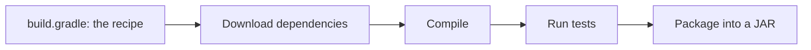
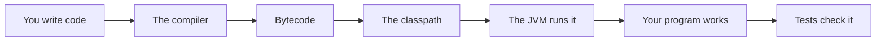

# Gradle Dependencies And Builds

## The big idea in plain words {#picture}

Cooking a big meal is easier with a shopping list and a recipe. A **build tool** like Gradle is your shopping list and recipe for a Java project. It knows which libraries to fetch (dependencies), how to compile, how to run tests, and how to pack the final program.

Instead of doing these steps by hand every time, you type one command, and Gradle does them all in the same way on every computer.



## What you will be able to do {#outcomes}

By the end of this lesson you will be able to:

- Explain what Gradle does and its main tasks.
- Add a dependency and understand its scope.
- Keep secrets out of the build and make builds repeatable.

## Words to know {#vocabulary}

- **build tool**: a program that compiles, tests, and packages your project.
- **Gradle**: a popular Java build tool.
- **dependency**: a library your project needs.
- **repository**: a place that stores libraries to download.
- **task**: one named step of the build, like `test`.
- **artifact**: the finished result of a build, like a JAR file.

## Why this idea exists {#history}

Without a build tool, every developer has different library versions and different steps, and "it works on my machine" becomes a daily sentence. A build file makes everything the same.

## Concept 1: One command does it all {#concept-1}

`./gradlew build` compiles, runs tests, and makes the JAR. `./gradlew test` runs only the tests. The `gradlew` file is a small helper that downloads the right Gradle version, so you do not even need to install it.

## Concept 2: Dependencies come from repositories {#concept-2}

In `build.gradle` you write: `implementation 'org.slf4j:slf4j-api:2.0.13'`. Gradle downloads that library from a repository like Maven Central. Different scopes mean: `implementation` for normal code and `testImplementation` for tests only.

## Concept 3: Repeatable builds {#concept-3}

Always say the exact version of each library. "Latest" changes without warning and can break your project overnight. A lock or fixed version means the same build today, next month, and on a teammate's computer.

## Concept 4: Keep secrets out {#concept-4}

Never write passwords or API keys into `build.gradle` or any file you share. Load them from the environment on the machine that needs them. The build artifact should be the same for every environment.

## A small build file {#example}

```groovy
plugins { id 'java' }
repositories { mavenCentral() }
dependencies {
    implementation 'com.google.guava:guava:33.2.1-jre'
    testImplementation 'org.junit.jupiter:junit-jupiter:5.10.2'
}
test { useJUnitPlatform() }
```
This tells Gradle: it is a Java project, get libraries from Maven Central, use Guava in the app, and use JUnit only for tests.

## Going deeper: the technical walkthrough {#walkthrough}

### Packages, visibility, and Gradle


A useful package layout is:

```text
com.example.study/
+-- controller/
+-- service/
+-- repository/
+-- domain/
+-- configuration/
```

- `public` exposes an API widely.
- package-private keeps an implementation local to its package.
- `private` protects a field or helper.
- `final` prevents reassignment or inheritance where appropriate.

Gradle compiles, tests, resolves dependencies, and packages the application.
The build file is part of the project contract. Pin versions and keep secrets
out of it.


### Commands and version note


For a Gradle project:

```bash
./gradlew test
./gradlew build
```

Use Java 17 as the baseline for the accompanying Spring lessons. Check the
current JDK and Gradle documentation when using a newer release because syntax,
plugins, and library versions change.


## Worked scenario {#worked-scenario}

Two computers install different versions of the same libraries. What makes builds the same?

The justified choice is **A lockfile saved with the project and used by the package manager**. Select **use-lockfile** in the structured practical and explain why. Alternatives ignore a requirement, cross a trust boundary, or invent success.

### Structured decision contract

```json

{
  "decision": "use-lockfile",
  "justification": "The module and package boundary must preserve the declared contract and ownership.",
  "failureBehavior": "Expose a safe failure and recover through the boundary owner."
}

```

Decision selects one declared behavior. Justification explains the boundary. FailureBehavior explains the observable error and recovery owner. These fields never execute commands. Required terms and minimum lengths form a basic practice rubric, not semantic grading.

## Step-by-step flow and matching picture {#flow}




## Three real-life uses {#use-cases}

1. A team builds the same JAR on every developer's laptop and on the build server.
2. A project upgrades one library version in one line and reruns the tests.
3. A build server runs `./gradlew build` for every change.

## What can go wrong, and how to stay safe {#failure-security}

Mistakes: using "latest" versions, adding libraries "just in case" (each one is code you must trust and update), putting secrets in the build file, and not running tests in the build. A broken test should stop the build.

## Practice lab and expected observation {#practice}

1. Predict the scenario decision before opening Practical. Explain each rejected alternative.
2. Run a relevant example above in an isolated exercise project. Record the expected result, then change one input to an invalid or boundary value. A failed assertion or deliberate error should replace silent success.
3. Submit the structured decision. Initially the checks fail. After selecting use-lockfile and writing an explanation and failure plan, all three pass. Follow the indicated review section for missed checks.

### Broken example to debug

```json

{"decision":"trust-client","justification":"","failureBehavior":""}

```

This ignores the responsible boundary and gives no reasoning or recovery. Correct the fields rather than changing the validator.

## Checkpoint and definition of done {#checkpoint}

- [ ] Define module and package without looking.
- [ ] Trace input to owner and output.
- [ ] Explain one failure and one alternative.
- [ ] Pass at least four assignment questions.
- [ ] Pass every practical check and submit.
- [ ] Explain the concept again tomorrow.

## Sources, versions, and safe commands {#sources}

Java 17 baseline; installed validation JDK may be newer. Review date: 2026-10-02. The supplied blueprint is the teaching source; official landing pages were checked where reachable. No provider or original TM Schedule deployment was tested.

- [Official reference](https://docs.oracle.com/en/java/javase/17/)

[Course reading order](README.md) · [Previous lesson](18-packages-visibility-and-modules.md) · [Next lesson](20-testing-debugging-and-quality.md)

```study-quiz

{
  "schemaVersion": 1,
  "lessonId": "java/19-gradle-dependencies-and-builds",
  "title": "Assignment: Gradle Dependencies And Builds",
  "passPercentage": 80,
  "questions": [
    {
      "id": "q1",
      "sectionId": "concept-1",
      "prompt": "In Gradle Dependencies And Builds, what does module mean?",
      "options": [
        {
          "id": "a",
          "text": "A permission granted by a hidden browser control",
          "explanation": "This changes the declared meaning or bypasses the responsible boundary."
        },
        {
          "id": "b",
          "text": "An unlimited provider operation with no ownership",
          "explanation": "This changes the declared meaning or bypasses the responsible boundary."
        },
        {
          "id": "c",
          "text": "A diagnostic credential intended for public logs",
          "explanation": "This changes the declared meaning or bypasses the responsible boundary."
        },
        {
          "id": "d",
          "text": "one piece of code with clear things it takes in and gives out",
          "explanation": "This preserves the definition and boundary described in the lesson."
        }
      ],
      "correctOptionId": "d",
      "explanation": "module means one piece of code with clear things it takes in and gives out.",
      "reviewLabel": "Review concept 1"
    },
    {
      "id": "q2",
      "sectionId": "concept-2",
      "prompt": "In Gradle Dependencies And Builds, which rule is correct for checkpoint 2?",
      "options": [
        {
          "id": "a",
          "text": "A lockfile makes installs repeatable.",
          "explanation": "This preserves the definition and boundary described in the lesson."
        },
        {
          "id": "b",
          "text": "Trust client-side checks instead of the server rule.",
          "explanation": "This changes the declared meaning or bypasses the responsible boundary."
        },
        {
          "id": "c",
          "text": "Hide the failure by returning a fabricated successful result.",
          "explanation": "This changes the declared meaning or bypasses the responsible boundary."
        },
        {
          "id": "d",
          "text": "Skip the stated boundary, limit, or ownership check.",
          "explanation": "This changes the declared meaning or bypasses the responsible boundary."
        }
      ],
      "correctOptionId": "a",
      "explanation": "A lockfile makes installs repeatable.",
      "reviewLabel": "Review concept 2"
    },
    {
      "id": "q3",
      "sectionId": "concept-3",
      "prompt": "In Gradle Dependencies And Builds, which rule is correct for checkpoint 3?",
      "options": [
        {
          "id": "a",
          "text": "Trust client-side checks instead of the server rule.",
          "explanation": "This changes the declared meaning or bypasses the responsible boundary."
        },
        {
          "id": "b",
          "text": "Pieces that depend on each other in a circle are hard to understand.",
          "explanation": "This preserves the definition and boundary described in the lesson."
        },
        {
          "id": "c",
          "text": "Hide the failure by returning a fabricated successful result.",
          "explanation": "This changes the declared meaning or bypasses the responsible boundary."
        },
        {
          "id": "d",
          "text": "Skip the stated boundary, limit, or ownership check.",
          "explanation": "This changes the declared meaning or bypasses the responsible boundary."
        }
      ],
      "correctOptionId": "b",
      "explanation": "Pieces that depend on each other in a circle are hard to understand.",
      "reviewLabel": "Review concept 3"
    },
    {
      "id": "q4",
      "sectionId": "concept-4",
      "prompt": "In Gradle Dependencies And Builds, which rule is correct for checkpoint 4?",
      "options": [
        {
          "id": "a",
          "text": "Trust client-side checks instead of the server rule.",
          "explanation": "This changes the declared meaning or bypasses the responsible boundary."
        },
        {
          "id": "b",
          "text": "Hide the failure by returning a fabricated successful result.",
          "explanation": "This changes the declared meaning or bypasses the responsible boundary."
        },
        {
          "id": "c",
          "text": "Different module systems find files in different ways.",
          "explanation": "This preserves the definition and boundary described in the lesson."
        },
        {
          "id": "d",
          "text": "Skip the stated boundary, limit, or ownership check.",
          "explanation": "This changes the declared meaning or bypasses the responsible boundary."
        }
      ],
      "correctOptionId": "c",
      "explanation": "Different module systems find files in different ways.",
      "reviewLabel": "Review concept 4"
    },
    {
      "id": "q5",
      "sectionId": "worked-scenario",
      "prompt": "Two computers install different versions of the same libraries. What makes builds the same?",
      "options": [
        {
          "id": "a",
          "text": "A screenshot of the editor",
          "explanation": "This changes the declared meaning or bypasses the responsible boundary."
        },
        {
          "id": "b",
          "text": "A hidden browser setting",
          "explanation": "This changes the declared meaning or bypasses the responsible boundary."
        },
        {
          "id": "c",
          "text": "A tag called 'latest' on its own",
          "explanation": "This changes the declared meaning or bypasses the responsible boundary."
        },
        {
          "id": "d",
          "text": "A lockfile saved with the project and used by the package manager",
          "explanation": "This preserves the definition and boundary described in the lesson."
        }
      ],
      "correctOptionId": "d",
      "explanation": "A lockfile saved with the project and used by the package manager. Keep secrets out of files you commit.",
      "reviewLabel": "Review the worked scenario"
    }
  ]
}

```

```study-practical

{
  "schemaVersion": 1,
  "challengeId": "java/19-gradle-dependencies-and-builds/decision",
  "lessonId": "java/19-gradle-dependencies-and-builds",
  "title": "Practical: Gradle Dependencies And Builds",
  "language": "json",
  "mode": "structured",
  "instructions": "Two computers install different versions of the same libraries. What makes builds the same? Return an object with decision (choose from use-lockfile, skip-check, unbounded-work, trust-client), justification (at least 40 characters; include module and package), and failureBehavior (at least 25 characters; include failure and recover while explaining the error and recovery). These are structured reasoning checks, not code execution or an official grade.",
  "starterCode": "{\n  \"decision\": \"\",\n  \"justification\": \"\",\n  \"failureBehavior\": \"\"\n}",
  "entryPoint": "answer",
  "publicExamples": [
    {
      "input": {
        "decision": "skip-check",
        "justification": "",
        "failureBehavior": ""
      },
      "expected": {
        "passed": false
      }
    },
    {
      "input": {
        "decision": "use-lockfile",
        "justification": "The module and package boundary must preserve the declared contract and ownership.",
        "failureBehavior": "Show a safe failure and recover through the responsible owner."
      },
      "expected": {
        "passed": true
      }
    }
  ],
  "publicTestIds": [
    "decision",
    "explanation",
    "failure-plan"
  ],
  "reviewSections": {
    "decision": "worked-scenario",
    "explanation": "concept-2",
    "failure-plan": "failure-security"
  },
  "limits": {
    "timeMs": 2000,
    "memoryMb": 128,
    "outputBytes": 20000
  }
}

```

