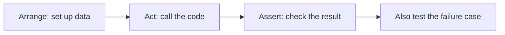
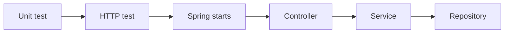

# Testing Debugging And Quality

## The big idea in plain words {#picture}

Before a school play, everyone rehearses. The actors practice the happy ending, but a good director also asks, "What if the curtain gets stuck? What if someone forgets a line?" and rehearses those too.

Tests are the rehearsals for your code. You write small programs that call your code and check the answer. If something breaks later, the rehearsal fails and tells you before the audience sees.



## What you will be able to do {#outcomes}

By the end of this lesson you will be able to:

- Write a JUnit test using arrange, act, assert.
- Test failures and edge cases, not only the happy path.
- Explain mocks, coverage, and debugging steps.

## Words to know {#vocabulary}

- **test**: a small program that checks that code works.
- **JUnit**: the most popular Java testing library.
- **assertion**: a check, such as "the answer must be 5".
- **fixture**: prepared data or setup for a test.
- **mock**: a fake helper used in a test.
- **coverage**: how much of your code the tests ran.

## Why this idea exists {#history}

Fixing a bug in one place often breaks something somewhere else. A set of tests that runs in seconds tells you right away.

## Concept 1: Arrange, act, assert {#concept-1}

```java
@Test
void trimsTheTitle() {
    Note note = new Note("  Math  ");        // arrange and act
    assertEquals("Math", note.title());      // assert
}
```
Set things up, do the one thing you want to test, and check the result. One test, one idea, and a clear name.

## Concept 2: Test the sad paths {#concept-2}

```java
@Test
void rejectsBlankTitle() {
    assertThrows(IllegalArgumentException.class, () -> new Note("   "));
}
```
Many bugs hide in the unusual cases: empty, very big, negative, missing. A good test suite checks them on purpose.

## Concept 3: Mocks and fakes {#concept-3}

A mock replaces a slow or risky helper (like a real email server) so the test is fast and safe. But a mock cannot prove the real thing works. So also keep a few tests that use the real database or service in a safe test setup.

## Concept 4: Coverage is a hint, not a score {#concept-4}

Coverage tells how many lines the tests ran. A test with no assertion can give 100 percent and prove nothing. Aim for meaningful checks, and use a debugger or print statements to follow what the code does when a test fails.

## Test and fix {#example}

A test says `expected: 5 but was: 4`. You look at the code: the loop runs `i < 5` instead of `i <= 5`. You fix the one character, run the test again, and it turns green. Your test pointed straight at the problem.

## Going deeper: the technical walkthrough {#walkthrough}

### Testing Java behavior


A unit test usually follows Arrange, Act, Assert:

```java
@Test
void blankTitleIsRejected() {
    ScheduleService service = new ScheduleService(repository);

    assertThrows(IllegalArgumentException.class,
            () -> service.create("  ", "Java"));
}
```

Test successful behavior, invalid input, missing records, duplicate actions,
database failure, and boundary values. A high percentage is useful only when
assertions prove the important behavior.


## Worked scenario {#worked-scenario}

A controller test uses the real production database. What should replace it?

The justified choice is **A separate test database with made-up data that is cleaned afterwards**. Select **isolated-fixtures** in the structured practical and explain why. Alternatives ignore a requirement, cross a trust boundary, or invent success.

### Structured decision contract

```json

{
  "decision": "isolated-fixtures",
  "justification": "The fixture and unitTest boundary must preserve the declared contract and ownership.",
  "failureBehavior": "Expose a safe failure and recover through the boundary owner."
}

```

Decision selects one declared behavior. Justification explains the boundary. FailureBehavior explains the observable error and recovery owner. These fields never execute commands. Required terms and minimum lengths form a basic practice rubric, not semantic grading.

## Step-by-step flow and matching picture {#flow}




## Three real-life uses {#use-cases}

1. A school grading program has tests for passing, failing, and missing scores.
2. A shop checks that discount code "SAVE10" works and that a fake code does not.
3. Before a release, the whole test suite runs in 30 seconds.

## What can go wrong, and how to stay safe {#failure-security}

Mistakes: only testing when everything goes well, tests that depend on each other's order, tests that use real private data, and tests with no assertion. Also, do not change a test just to make it pass when the code is the part that is wrong.

## Practice lab and expected observation {#practice}

1. Predict the scenario decision before opening Practical. Explain each rejected alternative.
2. Run a relevant example above in an isolated exercise project. Record the expected result, then change one input to an invalid or boundary value. A failed assertion or deliberate error should replace silent success.
3. Submit the structured decision. Initially the checks fail. After selecting isolated-fixtures and writing an explanation and failure plan, all three pass. Follow the indicated review section for missed checks.

### Broken example to debug

```json

{"decision":"trust-client","justification":"","failureBehavior":""}

```

This ignores the responsible boundary and gives no reasoning or recovery. Correct the fields rather than changing the validator.

## Checkpoint and definition of done {#checkpoint}

- [ ] Define fixture and unitTest without looking.
- [ ] Trace input to owner and output.
- [ ] Explain one failure and one alternative.
- [ ] Pass at least four assignment questions.
- [ ] Pass every practical check and submit.
- [ ] Explain the concept again tomorrow.

## Sources, versions, and safe commands {#sources}

Java 17 baseline; installed validation JDK may be newer. Review date: 2026-10-02. The supplied blueprint is the teaching source; official landing pages were checked where reachable. No provider or original TM Schedule deployment was tested.

- [Official reference](https://docs.oracle.com/en/java/javase/17/)

[Course reading order](README.md) · [Previous lesson](19-gradle-dependencies-and-builds.md) · [Next lesson](21-security-and-safe-input.md)

```study-quiz

{
  "schemaVersion": 1,
  "lessonId": "java/20-testing-debugging-and-quality",
  "title": "Assignment: Testing Debugging And Quality",
  "passPercentage": 80,
  "questions": [
    {
      "id": "q1",
      "sectionId": "concept-1",
      "prompt": "In Testing Debugging And Quality, what does fixture mean?",
      "options": [
        {
          "id": "a",
          "text": "prepared test data or setup",
          "explanation": "This preserves the definition and boundary described in the lesson."
        },
        {
          "id": "b",
          "text": "A permission granted by a hidden browser control",
          "explanation": "This changes the declared meaning or bypasses the responsible boundary."
        },
        {
          "id": "c",
          "text": "An unlimited provider operation with no ownership",
          "explanation": "This changes the declared meaning or bypasses the responsible boundary."
        },
        {
          "id": "d",
          "text": "A diagnostic credential intended for public logs",
          "explanation": "This changes the declared meaning or bypasses the responsible boundary."
        }
      ],
      "correctOptionId": "a",
      "explanation": "fixture means prepared test data or setup.",
      "reviewLabel": "Review concept 1"
    },
    {
      "id": "q2",
      "sectionId": "concept-2",
      "prompt": "In Testing Debugging And Quality, which rule is correct for checkpoint 2?",
      "options": [
        {
          "id": "a",
          "text": "Trust client-side checks instead of the server rule.",
          "explanation": "This changes the declared meaning or bypasses the responsible boundary."
        },
        {
          "id": "b",
          "text": "Check both the status code and the shape of the answer.",
          "explanation": "This preserves the definition and boundary described in the lesson."
        },
        {
          "id": "c",
          "text": "Hide the failure by returning a fabricated successful result.",
          "explanation": "This changes the declared meaning or bypasses the responsible boundary."
        },
        {
          "id": "d",
          "text": "Skip the stated boundary, limit, or ownership check.",
          "explanation": "This changes the declared meaning or bypasses the responsible boundary."
        }
      ],
      "correctOptionId": "b",
      "explanation": "Check both the status code and the shape of the answer.",
      "reviewLabel": "Review concept 2"
    },
    {
      "id": "q3",
      "sectionId": "concept-3",
      "prompt": "In Testing Debugging And Quality, which rule is correct for checkpoint 3?",
      "options": [
        {
          "id": "a",
          "text": "Trust client-side checks instead of the server rule.",
          "explanation": "This changes the declared meaning or bypasses the responsible boundary."
        },
        {
          "id": "b",
          "text": "Hide the failure by returning a fabricated successful result.",
          "explanation": "This changes the declared meaning or bypasses the responsible boundary."
        },
        {
          "id": "c",
          "text": "Test bad input and broken helpers too.",
          "explanation": "This preserves the definition and boundary described in the lesson."
        },
        {
          "id": "d",
          "text": "Skip the stated boundary, limit, or ownership check.",
          "explanation": "This changes the declared meaning or bypasses the responsible boundary."
        }
      ],
      "correctOptionId": "c",
      "explanation": "Test bad input and broken helpers too.",
      "reviewLabel": "Review concept 3"
    },
    {
      "id": "q4",
      "sectionId": "concept-4",
      "prompt": "In Testing Debugging And Quality, which rule is correct for checkpoint 4?",
      "options": [
        {
          "id": "a",
          "text": "Trust client-side checks instead of the server rule.",
          "explanation": "This changes the declared meaning or bypasses the responsible boundary."
        },
        {
          "id": "b",
          "text": "Hide the failure by returning a fabricated successful result.",
          "explanation": "This changes the declared meaning or bypasses the responsible boundary."
        },
        {
          "id": "c",
          "text": "Skip the stated boundary, limit, or ownership check.",
          "explanation": "This changes the declared meaning or bypasses the responsible boundary."
        },
        {
          "id": "d",
          "text": "A mock isolates a helper but cannot prove the real SQL works.",
          "explanation": "This preserves the definition and boundary described in the lesson."
        }
      ],
      "correctOptionId": "d",
      "explanation": "A mock isolates a helper but cannot prove the real SQL works.",
      "reviewLabel": "Review concept 4"
    },
    {
      "id": "q5",
      "sectionId": "worked-scenario",
      "prompt": "A controller test uses the real production database. What should replace it?",
      "options": [
        {
          "id": "a",
          "text": "A separate test database with made-up data that is cleaned afterwards",
          "explanation": "This preserves the definition and boundary described in the lesson."
        },
        {
          "id": "b",
          "text": "The same database with a different log color",
          "explanation": "This changes the declared meaning or bypasses the responsible boundary."
        },
        {
          "id": "c",
          "text": "A public copy of everyone's data",
          "explanation": "This changes the declared meaning or bypasses the responsible boundary."
        },
        {
          "id": "d",
          "text": "A test with no checks",
          "explanation": "This changes the declared meaning or bypasses the responsible boundary."
        }
      ],
      "correctOptionId": "a",
      "explanation": "A separate test database with made-up data that is cleaned afterwards. A coverage percentage shows what code ran, not that it is correct.",
      "reviewLabel": "Review the worked scenario"
    }
  ]
}

```

```study-practical

{
  "schemaVersion": 1,
  "challengeId": "java/20-testing-debugging-and-quality/decision",
  "lessonId": "java/20-testing-debugging-and-quality",
  "title": "Practical: Testing Debugging And Quality",
  "language": "json",
  "mode": "structured",
  "instructions": "A controller test uses the real production database. What should replace it? Return an object with decision (choose from isolated-fixtures, skip-check, unbounded-work, trust-client), justification (at least 40 characters; include fixture and unitTest), and failureBehavior (at least 25 characters; include failure and recover while explaining the error and recovery). These are structured reasoning checks, not code execution or an official grade.",
  "starterCode": "{\n  \"decision\": \"\",\n  \"justification\": \"\",\n  \"failureBehavior\": \"\"\n}",
  "entryPoint": "answer",
  "publicExamples": [
    {
      "input": {
        "decision": "skip-check",
        "justification": "",
        "failureBehavior": ""
      },
      "expected": {
        "passed": false
      }
    },
    {
      "input": {
        "decision": "isolated-fixtures",
        "justification": "The fixture and unitTest boundary must preserve the declared contract and ownership.",
        "failureBehavior": "Show a safe failure and recover through the responsible owner."
      },
      "expected": {
        "passed": true
      }
    }
  ],
  "publicTestIds": [
    "decision",
    "explanation",
    "failure-plan"
  ],
  "reviewSections": {
    "decision": "worked-scenario",
    "explanation": "concept-2",
    "failure-plan": "failure-security"
  },
  "limits": {
    "timeMs": 2000,
    "memoryMb": 128,
    "outputBytes": 20000
  }
}

```

