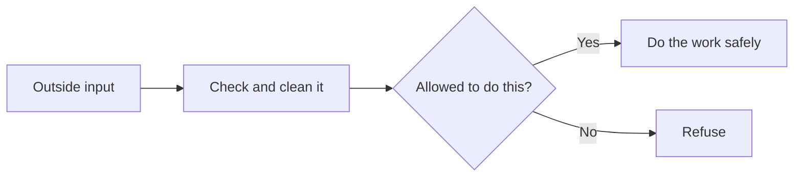
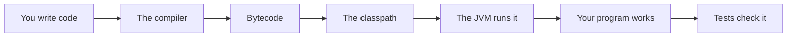

# Security And Safe Input

## The big idea in plain words {#picture}

Imagine a bank with a front door and a vault. The guard at the door checks every person, and nobody gets into the vault unless they are on the list. Even someone with a perfect uniform is checked, because uniforms can be faked.

In programs, "uniforms" are the data that comes from outside: forms, URLs, files. We never trust them. We check each one, we give each part only the power it needs, and we never leave keys lying around.



## What you will be able to do {#outcomes}

By the end of this lesson you will be able to:

- Explain SQL injection and path traversal in simple words.
- Keep secrets safe and avoid logging private data.
- Separate "who are you?" from "may you do this?".

## Words to know {#vocabulary}

- **SQL injection**: tricking a program into running SQL a user typed.
- **path traversal**: using `../` to climb out of an allowed folder.
- **deserialization**: turning bytes back into objects, which is risky for untrusted data.
- **secret**: a password or key that must stay private.
- **authentication**: proving who you are.
- **authorization**: checking what you may do.

## Why this idea exists {#history}

Attackers do not break in through clever magic. They try the doors we forgot to lock. Most problems come from trusting input that should have been checked.

## Concept 1: SQL injection {#concept-1}

If you build SQL like `"... WHERE name = '" + name + "'"` and a user types `' OR '1'='1`, the query now matches everybody! Use `PreparedStatement` with `?` so the database treats the user's text only as data, never as commands.

## Concept 2: Path traversal {#concept-2}

A file name such as `../../etc/passwd` tries to reach files outside your folder. Clean the path, then check that the result is still inside the allowed root. Reject anything else before opening the file.

## Concept 3: Secrets and logs {#concept-3}

Keep passwords and keys in environment settings or a secrets manager, never inside code that is shared. And never print them: logs are read by many people. Also be careful with deserialization: reading objects from untrusted bytes can run harmful code, so prefer plain JSON with a fixed shape.

## Concept 4: Identity and permission {#concept-4}

Authentication checks who you are. Authorization checks if this person may read this note. Check both on every request, on the server. Hiding a button in the screen is not a lock.

## Safe versus unsafe {#example}

Unsafe: `"SELECT * FROM users WHERE name = '" + name + "'"`
Safe: `"SELECT * FROM users WHERE name = ?"` and then `ps.setString(1, name)`. If a user types `' OR '1'='1`, it is just a strange name, and no rows match.

## Going deeper: the technical walkthrough {#walkthrough}

### Files, JSON, HTTP, and JDBC


Keep external systems behind boundaries:

- `Path` and `Files` handle local files;
- Jackson or another library maps JSON to typed records;
- `HttpClient` calls another HTTP service;
- JDBC or Spring JDBC uses parameterized SQL;
- a repository owns database mapping.

Never build SQL with string concatenation from user input:

```java
String sql = "select id, title from notes where topic = :topic";
```

Use the parameter API of the database library. A type-safe parameter is a
small security boundary.


### Exceptions and error paths


```java
if (title == null || title.isBlank()) {
    throw new IllegalArgumentException("Title is required");
}
```

An exception describes an operation that cannot fulfill its contract. A web
boundary should translate it into a safe status and error body. Do not catch an
exception, ignore it, and pretend that the write succeeded.


## Worked scenario {#worked-scenario}

A signed-in student asks for another student's private note. What should happen?

The justified choice is **Say no, because the ownership check fails**. Select **deny-cross-user** in the structured practical and explain why. Alternatives ignore a requirement, cross a trust boundary, or invent success.

### Structured decision contract

```json

{
  "decision": "deny-cross-user",
  "justification": "The authentication and authorization boundary must preserve the declared contract and ownership.",
  "failureBehavior": "Expose a safe failure and recover through the boundary owner."
}

```

Decision selects one declared behavior. Justification explains the boundary. FailureBehavior explains the observable error and recovery owner. These fields never execute commands. Required terms and minimum lengths form a basic practice rubric, not semantic grading.

## Step-by-step flow and matching picture {#flow}




## Three real-life uses {#use-cases}

1. A login page uses prepared statements so nobody can inject SQL.
2. A download service refuses file names that try to leave its folder.
3. A server reads its database password from a protected setting, not from the code.

## What can go wrong, and how to stay safe {#failure-security}

Mistakes: trusting the browser, glueing SQL from user text, printing passwords in logs, hard-coding keys, and giving every part of the program full powers. The safe habit: assume every input is hostile until it has been checked.

## Practice lab and expected observation {#practice}

1. Predict the scenario decision before opening Practical. Explain each rejected alternative.
2. Run a relevant example above in an isolated exercise project. Record the expected result, then change one input to an invalid or boundary value. A failed assertion or deliberate error should replace silent success.
3. Submit the structured decision. Initially the checks fail. After selecting deny-cross-user and writing an explanation and failure plan, all three pass. Follow the indicated review section for missed checks.

### Broken example to debug

```json

{"decision":"trust-client","justification":"","failureBehavior":""}

```

This ignores the responsible boundary and gives no reasoning or recovery. Correct the fields rather than changing the validator.

## Checkpoint and definition of done {#checkpoint}

- [ ] Define authentication and authorization without looking.
- [ ] Trace input to owner and output.
- [ ] Explain one failure and one alternative.
- [ ] Pass at least four assignment questions.
- [ ] Pass every practical check and submit.
- [ ] Explain the concept again tomorrow.

## Sources, versions, and safe commands {#sources}

Java 17 baseline; installed validation JDK may be newer. Review date: 2026-10-02. The supplied blueprint is the teaching source; official landing pages were checked where reachable. No provider or original TM Schedule deployment was tested.

- [Official reference](https://docs.oracle.com/en/java/javase/17/)

[Course reading order](README.md) · [Previous lesson](20-testing-debugging-and-quality.md) · [Next lesson](22-java-backend-project-structure.md)

```study-quiz

{
  "schemaVersion": 1,
  "lessonId": "java/21-security-and-safe-input",
  "title": "Assignment: Security And Safe Input",
  "passPercentage": 80,
  "questions": [
    {
      "id": "q1",
      "sectionId": "concept-1",
      "prompt": "In Security And Safe Input, what does authentication mean?",
      "options": [
        {
          "id": "a",
          "text": "A permission granted by a hidden browser control",
          "explanation": "This changes the declared meaning or bypasses the responsible boundary."
        },
        {
          "id": "b",
          "text": "proving who someone is",
          "explanation": "This preserves the definition and boundary described in the lesson."
        },
        {
          "id": "c",
          "text": "An unlimited provider operation with no ownership",
          "explanation": "This changes the declared meaning or bypasses the responsible boundary."
        },
        {
          "id": "d",
          "text": "A diagnostic credential intended for public logs",
          "explanation": "This changes the declared meaning or bypasses the responsible boundary."
        }
      ],
      "correctOptionId": "b",
      "explanation": "authentication means proving who someone is.",
      "reviewLabel": "Review concept 1"
    },
    {
      "id": "q2",
      "sectionId": "concept-2",
      "prompt": "In Security And Safe Input, which rule is correct for checkpoint 2?",
      "options": [
        {
          "id": "a",
          "text": "Trust client-side checks instead of the server rule.",
          "explanation": "This changes the declared meaning or bypasses the responsible boundary."
        },
        {
          "id": "b",
          "text": "Hide the failure by returning a fabricated successful result.",
          "explanation": "This changes the declared meaning or bypasses the responsible boundary."
        },
        {
          "id": "c",
          "text": "Hiding a button does not protect anything.",
          "explanation": "This preserves the definition and boundary described in the lesson."
        },
        {
          "id": "d",
          "text": "Skip the stated boundary, limit, or ownership check.",
          "explanation": "This changes the declared meaning or bypasses the responsible boundary."
        }
      ],
      "correctOptionId": "c",
      "explanation": "Hiding a button does not protect anything.",
      "reviewLabel": "Review concept 2"
    },
    {
      "id": "q3",
      "sectionId": "concept-3",
      "prompt": "In Security And Safe Input, which rule is correct for checkpoint 3?",
      "options": [
        {
          "id": "a",
          "text": "Trust client-side checks instead of the server rule.",
          "explanation": "This changes the declared meaning or bypasses the responsible boundary."
        },
        {
          "id": "b",
          "text": "Hide the failure by returning a fabricated successful result.",
          "explanation": "This changes the declared meaning or bypasses the responsible boundary."
        },
        {
          "id": "c",
          "text": "Skip the stated boundary, limit, or ownership check.",
          "explanation": "This changes the declared meaning or bypasses the responsible boundary."
        },
        {
          "id": "d",
          "text": "Keep passwords and keys in protected server settings.",
          "explanation": "This preserves the definition and boundary described in the lesson."
        }
      ],
      "correctOptionId": "d",
      "explanation": "Keep passwords and keys in protected server settings.",
      "reviewLabel": "Review concept 3"
    },
    {
      "id": "q4",
      "sectionId": "concept-4",
      "prompt": "In Security And Safe Input, which rule is correct for checkpoint 4?",
      "options": [
        {
          "id": "a",
          "text": "If users can give a link, control where the server is allowed to go.",
          "explanation": "This preserves the definition and boundary described in the lesson."
        },
        {
          "id": "b",
          "text": "Trust client-side checks instead of the server rule.",
          "explanation": "This changes the declared meaning or bypasses the responsible boundary."
        },
        {
          "id": "c",
          "text": "Hide the failure by returning a fabricated successful result.",
          "explanation": "This changes the declared meaning or bypasses the responsible boundary."
        },
        {
          "id": "d",
          "text": "Skip the stated boundary, limit, or ownership check.",
          "explanation": "This changes the declared meaning or bypasses the responsible boundary."
        }
      ],
      "correctOptionId": "a",
      "explanation": "If users can give a link, control where the server is allowed to go.",
      "reviewLabel": "Review concept 4"
    },
    {
      "id": "q5",
      "sectionId": "worked-scenario",
      "prompt": "A signed-in student asks for another student's private note. What should happen?",
      "options": [
        {
          "id": "a",
          "text": "Allow it because any login is enough",
          "explanation": "This changes the declared meaning or bypasses the responsible boundary."
        },
        {
          "id": "b",
          "text": "Say no, because the ownership check fails",
          "explanation": "This preserves the definition and boundary described in the lesson."
        },
        {
          "id": "c",
          "text": "Believe the role the student claims",
          "explanation": "This changes the declared meaning or bypasses the responsible boundary."
        },
        {
          "id": "d",
          "text": "Send a secret so they can sign in",
          "explanation": "This changes the declared meaning or bypasses the responsible boundary."
        }
      ],
      "correctOptionId": "b",
      "explanation": "Say no, because the ownership check fails. Logs must hide passwords and private content.",
      "reviewLabel": "Review the worked scenario"
    }
  ]
}

```

```study-practical

{
  "schemaVersion": 1,
  "challengeId": "java/21-security-and-safe-input/decision",
  "lessonId": "java/21-security-and-safe-input",
  "title": "Practical: Security And Safe Input",
  "language": "json",
  "mode": "structured",
  "instructions": "A signed-in student asks for another student's private note. What should happen? Return an object with decision (choose from deny-cross-user, skip-check, unbounded-work, trust-client), justification (at least 40 characters; include authentication and authorization), and failureBehavior (at least 25 characters; include failure and recover while explaining the error and recovery). These are structured reasoning checks, not code execution or an official grade.",
  "starterCode": "{\n  \"decision\": \"\",\n  \"justification\": \"\",\n  \"failureBehavior\": \"\"\n}",
  "entryPoint": "answer",
  "publicExamples": [
    {
      "input": {
        "decision": "skip-check",
        "justification": "",
        "failureBehavior": ""
      },
      "expected": {
        "passed": false
      }
    },
    {
      "input": {
        "decision": "deny-cross-user",
        "justification": "The authentication and authorization boundary must preserve the declared contract and ownership.",
        "failureBehavior": "Show a safe failure and recover through the responsible owner."
      },
      "expected": {
        "passed": true
      }
    }
  ],
  "publicTestIds": [
    "decision",
    "explanation",
    "failure-plan"
  ],
  "reviewSections": {
    "decision": "worked-scenario",
    "explanation": "concept-2",
    "failure-plan": "failure-security"
  },
  "limits": {
    "timeMs": 2000,
    "memoryMb": 128,
    "outputBytes": 20000
  }
}

```

