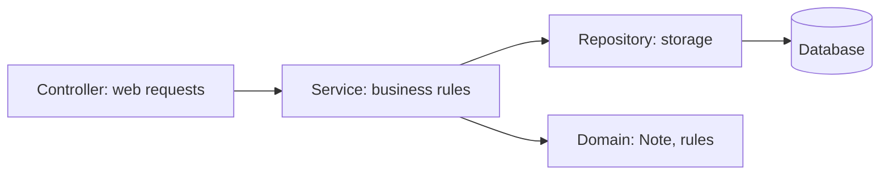
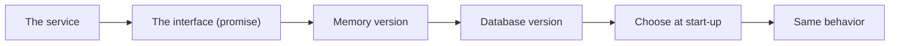
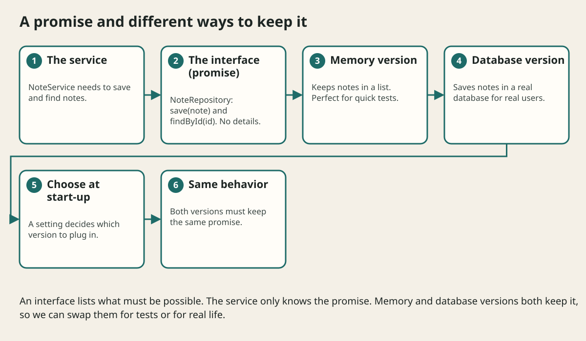

# Java Backend Project Structure

## The big idea in plain words {#picture}

A restaurant has a clear flow: the waiter takes the order (controller), the chef follows the recipe (service), the pantry manager fetches ingredients (repository), and the recipe cards and food are the domain (the notes, the rules). Each person talks only to the next in line.

A Java backend is organized in the same way. Arrows go one way, and each layer has one job.



## What you will be able to do {#outcomes}

By the end of this lesson you will be able to:

- Name the layers: controller, service, repository, domain.
- Keep dependencies pointing one way.
- Place configuration and tests where they belong.

## Words to know {#vocabulary}

- **controller**: receives web requests and sends back responses.
- **service**: applies the business rules.
- **repository**: reads and writes data.
- **domain**: the core classes and rules, like `Note`.
- **configuration**: settings that change between places.
- **layer**: one level of the program with one job.

## Why this idea exists {#history}

When everything is in one class, nobody can find or change anything. A clear structure means a new teammate can find "where is the rule about blank titles?" in seconds.

## Concept 1: Controller: the front desk {#concept-1}

It turns a web request into a method call and the result into a response. It does no business thinking. It only translates between the web world and your program.

## Concept 2: Service: the rules {#concept-2}

`NoteService.create(title)` trims, checks, and decides. It does not know about HTTP or SQL. That is why it can be tested without a web server or a database.

## Concept 3: Repository: the storage helper {#concept-3}

It hides database details behind an interface like `NoteRepository`. The service asks for `save` and `findById`. How it is done (SQL? memory?) is not the service's business.

## Concept 4: One direction only {#concept-4}

Controller calls service, service calls repository. Never the other way. Folders can mirror the layers: `web`, `service`, `repository`, `domain`. Keep configuration (database address, ports) outside of the code, and tests next to the layer they check.

## Follow "create note" {#example}

`POST /notes` arrives at the controller. The controller calls `service.create("Math")`. The service trims and checks the title and calls `repository.save(note)`. The repository saves and returns the saved note. The service returns it, and the controller sends `201 Created`.

## Going deeper: the technical walkthrough {#walkthrough}

### Interfaces and dependency direction


```java
public interface NoteRepository {
    List<StudyNote> findByTopic(String topic);
    StudyNote save(StudyNote note);
}
```

A service can depend on this promise while one implementation uses memory and
another uses PostgreSQL. This is the basic idea behind a repository port and
adapter.

```text
Controller -> Service -> Repository interface -> Memory or database adapter
```

An interface is useful when the boundary is real. Do not create ten empty
interfaces only to make a diagram look sophisticated.


### Packages, visibility, and Gradle


A useful package layout is:

```text
com.example.study/
+-- controller/
+-- service/
+-- repository/
+-- domain/
+-- configuration/
```

- `public` exposes an API widely.
- package-private keeps an implementation local to its package.
- `private` protects a field or helper.
- `final` prevents reassignment or inheritance where appropriate.

Gradle compiles, tests, resolves dependencies, and packages the application.
The build file is part of the project contract. Pin versions and keep secrets
out of it.


## Worked scenario {#worked-scenario}

You want to test your service while the PostgreSQL database is switched off. What helps?

The justified choice is **Give the service an in-memory stand-in for its repository**. Select **inject-repository** in the structured practical and explain why. Alternatives ignore a requirement, cross a trust boundary, or invent success.

### Structured decision contract

```json

{
  "decision": "inject-repository",
  "justification": "The interface and adapter boundary must preserve the declared contract and ownership.",
  "failureBehavior": "Expose a safe failure and recover through the boundary owner."
}

```

Decision selects one declared behavior. Justification explains the boundary. FailureBehavior explains the observable error and recovery owner. These fields never execute commands. Required terms and minimum lengths form a basic practice rubric, not semantic grading.

## Step-by-step flow and matching picture {#flow}





## Three real-life uses {#use-cases}

1. A to-do backend with `web`, `service`, `repository`, and `domain` folders.
2. A shop backend where the same service works for the website and the phone app.
3. A project where tests use an in-memory repository for speed.

## What can go wrong, and how to stay safe {#failure-security}

Mistakes: SQL inside controllers, business rules inside repositories, services that depend on the web framework, and layers calling "upwards". If you cannot test a service without a database, the layers are mixed up.

## Practice lab and expected observation {#practice}

1. Predict the scenario decision before opening Practical. Explain each rejected alternative.
2. Run a relevant example above in an isolated exercise project. Record the expected result, then change one input to an invalid or boundary value. A failed assertion or deliberate error should replace silent success.
3. Submit the structured decision. Initially the checks fail. After selecting inject-repository and writing an explanation and failure plan, all three pass. Follow the indicated review section for missed checks.

### Broken example to debug

```json

{"decision":"trust-client","justification":"","failureBehavior":""}

```

This ignores the responsible boundary and gives no reasoning or recovery. Correct the fields rather than changing the validator.

## Checkpoint and definition of done {#checkpoint}

- [ ] Define interface and adapter without looking.
- [ ] Trace input to owner and output.
- [ ] Explain one failure and one alternative.
- [ ] Pass at least four assignment questions.
- [ ] Pass every practical check and submit.
- [ ] Explain the concept again tomorrow.

## Sources, versions, and safe commands {#sources}

Java 17 baseline; installed validation JDK may be newer. Review date: 2026-10-02. The supplied blueprint is the teaching source; official landing pages were checked where reachable. No provider or original TM Schedule deployment was tested.

- [Official reference](https://docs.oracle.com/en/java/javase/17/)

[Course reading order](README.md) · [Previous lesson](21-security-and-safe-input.md) · [Next lesson](23-java-to-spring-boot-bridge.md)

```study-quiz

{
  "schemaVersion": 1,
  "lessonId": "java/22-java-backend-project-structure",
  "title": "Assignment: Java Backend Project Structure",
  "passPercentage": 80,
  "questions": [
    {
      "id": "q1",
      "sectionId": "concept-1",
      "prompt": "In Java Backend Project Structure, what does interface mean?",
      "options": [
        {
          "id": "a",
          "text": "A permission granted by a hidden browser control",
          "explanation": "This changes the declared meaning or bypasses the responsible boundary."
        },
        {
          "id": "b",
          "text": "An unlimited provider operation with no ownership",
          "explanation": "This changes the declared meaning or bypasses the responsible boundary."
        },
        {
          "id": "c",
          "text": "a list of actions that something promises to offer",
          "explanation": "This preserves the definition and boundary described in the lesson."
        },
        {
          "id": "d",
          "text": "A diagnostic credential intended for public logs",
          "explanation": "This changes the declared meaning or bypasses the responsible boundary."
        }
      ],
      "correctOptionId": "c",
      "explanation": "interface means a list of actions that something promises to offer.",
      "reviewLabel": "Review concept 1"
    },
    {
      "id": "q2",
      "sectionId": "concept-2",
      "prompt": "In Java Backend Project Structure, which rule is correct for checkpoint 2?",
      "options": [
        {
          "id": "a",
          "text": "Trust client-side checks instead of the server rule.",
          "explanation": "This changes the declared meaning or bypasses the responsible boundary."
        },
        {
          "id": "b",
          "text": "Hide the failure by returning a fabricated successful result.",
          "explanation": "This changes the declared meaning or bypasses the responsible boundary."
        },
        {
          "id": "c",
          "text": "Skip the stated boundary, limit, or ownership check.",
          "explanation": "This changes the declared meaning or bypasses the responsible boundary."
        },
        {
          "id": "d",
          "text": "A fake in-memory version is handy for fast, safe tests.",
          "explanation": "This preserves the definition and boundary described in the lesson."
        }
      ],
      "correctOptionId": "d",
      "explanation": "A fake in-memory version is handy for fast, safe tests.",
      "reviewLabel": "Review concept 2"
    },
    {
      "id": "q3",
      "sectionId": "concept-3",
      "prompt": "In Java Backend Project Structure, which rule is correct for checkpoint 3?",
      "options": [
        {
          "id": "a",
          "text": "A real database version must behave the same way as the fake one.",
          "explanation": "This preserves the definition and boundary described in the lesson."
        },
        {
          "id": "b",
          "text": "Trust client-side checks instead of the server rule.",
          "explanation": "This changes the declared meaning or bypasses the responsible boundary."
        },
        {
          "id": "c",
          "text": "Hide the failure by returning a fabricated successful result.",
          "explanation": "This changes the declared meaning or bypasses the responsible boundary."
        },
        {
          "id": "d",
          "text": "Skip the stated boundary, limit, or ownership check.",
          "explanation": "This changes the declared meaning or bypasses the responsible boundary."
        }
      ],
      "correctOptionId": "a",
      "explanation": "A real database version must behave the same way as the fake one.",
      "reviewLabel": "Review concept 3"
    },
    {
      "id": "q4",
      "sectionId": "concept-4",
      "prompt": "In Java Backend Project Structure, which rule is correct for checkpoint 4?",
      "options": [
        {
          "id": "a",
          "text": "Trust client-side checks instead of the server rule.",
          "explanation": "This changes the declared meaning or bypasses the responsible boundary."
        },
        {
          "id": "b",
          "text": "A test double stands in for the outside world, not for the rule you are testing.",
          "explanation": "This preserves the definition and boundary described in the lesson."
        },
        {
          "id": "c",
          "text": "Hide the failure by returning a fabricated successful result.",
          "explanation": "This changes the declared meaning or bypasses the responsible boundary."
        },
        {
          "id": "d",
          "text": "Skip the stated boundary, limit, or ownership check.",
          "explanation": "This changes the declared meaning or bypasses the responsible boundary."
        }
      ],
      "correctOptionId": "b",
      "explanation": "A test double stands in for the outside world, not for the rule you are testing.",
      "reviewLabel": "Review concept 4"
    },
    {
      "id": "q5",
      "sectionId": "worked-scenario",
      "prompt": "You want to test your service while the PostgreSQL database is switched off. What helps?",
      "options": [
        {
          "id": "a",
          "text": "Catch every error and pretend the catalog is empty",
          "explanation": "This changes the declared meaning or bypasses the responsible boundary."
        },
        {
          "id": "b",
          "text": "Put the database password inside the test",
          "explanation": "This changes the declared meaning or bypasses the responsible boundary."
        },
        {
          "id": "c",
          "text": "Give the service an in-memory stand-in for its repository",
          "explanation": "This preserves the definition and boundary described in the lesson."
        },
        {
          "id": "d",
          "text": "Delete the service rules",
          "explanation": "This changes the declared meaning or bypasses the responsible boundary."
        }
      ],
      "correctOptionId": "c",
      "explanation": "Give the service an in-memory stand-in for its repository. An interface cannot fix pieces that behave differently from the promise.",
      "reviewLabel": "Review the worked scenario"
    }
  ]
}

```

```study-practical

{
  "schemaVersion": 1,
  "challengeId": "java/22-java-backend-project-structure/decision",
  "lessonId": "java/22-java-backend-project-structure",
  "title": "Practical: Java Backend Project Structure",
  "language": "json",
  "mode": "structured",
  "instructions": "You want to test your service while the PostgreSQL database is switched off. What helps? Return an object with decision (choose from inject-repository, skip-check, unbounded-work, trust-client), justification (at least 40 characters; include interface and adapter), and failureBehavior (at least 25 characters; include failure and recover while explaining the error and recovery). These are structured reasoning checks, not code execution or an official grade.",
  "starterCode": "{\n  \"decision\": \"\",\n  \"justification\": \"\",\n  \"failureBehavior\": \"\"\n}",
  "entryPoint": "answer",
  "publicExamples": [
    {
      "input": {
        "decision": "skip-check",
        "justification": "",
        "failureBehavior": ""
      },
      "expected": {
        "passed": false
      }
    },
    {
      "input": {
        "decision": "inject-repository",
        "justification": "The interface and adapter boundary must preserve the declared contract and ownership.",
        "failureBehavior": "Show a safe failure and recover through the responsible owner."
      },
      "expected": {
        "passed": true
      }
    }
  ],
  "publicTestIds": [
    "decision",
    "explanation",
    "failure-plan"
  ],
  "reviewSections": {
    "decision": "worked-scenario",
    "explanation": "concept-2",
    "failure-plan": "failure-security"
  },
  "limits": {
    "timeMs": 2000,
    "memoryMb": 128,
    "outputBytes": 20000
  }
}

```

