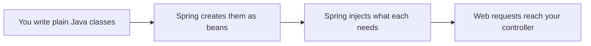
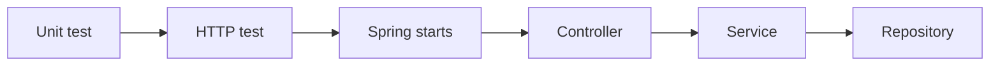
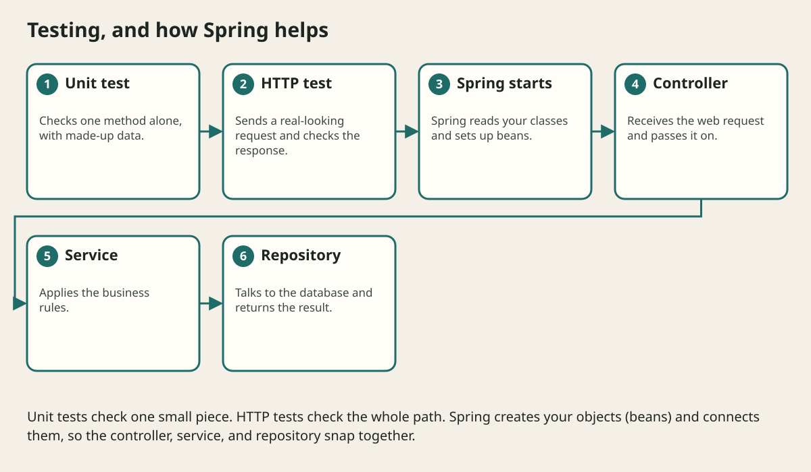

# Java To Spring Boot Bridge

## The big idea in plain words {#picture}

Building a house from nothing means cutting every plank. Building from a kit is much faster. Spring is a kit for Java servers. It brings ready-made pieces for web requests, databases, and settings so you can focus on your own rules.

The important truth: Spring does not replace Java. Your classes are still plain Java classes. Spring just creates them (as **beans**), connects them to each other (**dependency injection**), and runs them when web requests come.



## What you will be able to do {#outcomes}

By the end of this lesson you will be able to:

- Explain what Spring adds and what stays plain Java.
- Explain beans and dependency injection in simple words.
- Read common annotations like `@RestController` and `@Service`.

## Words to know {#vocabulary}

- **Spring Boot**: a tool that sets up a Spring application with sensible defaults.
- **bean**: an object that Spring creates and manages for you.
- **dependency injection**: Spring hands each class what it needs, so you do not create it yourself.
- **annotation**: a label starting with `@` that tells Spring what a class is for.
- **profile**: a named set of settings, like `dev` or `prod`.
- **MVC**: the pattern for web controllers, models, and views.

## Why this idea exists {#history}

Writing web servers from scratch is repeated work. Spring does the repeated parts the same way for everyone, so teams can move faster and new people can read the code.

## Concept 1: Spring adds plumbing {#concept-1}

It handles HTTP, JSON, database connections, and settings. Everything else, your classes, rules, and tests, is still plain Java. If you understand Java, you already understand most of a Spring app.

## Concept 2: Beans and injection {#concept-2}

```java
@Service
class NoteService {
    private final NoteRepository repository;
    NoteService(NoteRepository repository) { this.repository = repository; }
}
```
`@Service` says "Spring, please manage this." The constructor asks for a `NoteRepository`. Spring finds one and hands it over. You never write `new`.

## Concept 3: Annotations are labels {#concept-3}

`@RestController` says "this class answers web requests". `@GetMapping("/notes")` says "this method handles GET /notes". `@Repository` and `@Service` label the other layers. They are instructions for Spring, not magic.

## Concept 4: Profiles change settings {#concept-4}

A `dev` profile might use an in-memory database, and `prod` uses PostgreSQL. You change which one runs with a setting, not by editing code. Keep secrets out of the code, as always.

## A tiny endpoint {#example}

```java
@RestController
class NoteController {
    private final NoteService service;
    NoteController(NoteService service) { this.service = service; }

    @GetMapping("/notes/{id}")
    Note get(@PathVariable int id) { return service.find(id); }
}
```
When someone asks `GET /notes/7`, Spring calls `get(7)` and turns the returned `Note` into JSON.

## Going deeper: the technical walkthrough {#walkthrough}

### From Java to Spring Boot


When reading a Spring application, identify these pieces:

```text
@RestController -> HTTP binding
@Service       -> business rules
@Repository    -> storage adapter
record         -> request or response data
@Configuration -> application setup
```

Spring creates many objects for you, but the Java rules still apply. Learn the
plain language first so annotations do not feel like magic symbols.


## Worked scenario {#worked-scenario}

You want to test your service while the PostgreSQL database is switched off. What helps?

The justified choice is **Give the service an in-memory stand-in for its repository**. Select **inject-repository** in the structured practical and explain why. Alternatives ignore a requirement, cross a trust boundary, or invent success.

### Structured decision contract

```json

{
  "decision": "inject-repository",
  "justification": "The interface and adapter boundary must preserve the declared contract and ownership.",
  "failureBehavior": "Expose a safe failure and recover through the boundary owner."
}

```

Decision selects one declared behavior. Justification explains the boundary. FailureBehavior explains the observable error and recovery owner. These fields never execute commands. Required terms and minimum lengths form a basic practice rubric, not semantic grading.

## Step-by-step flow and matching picture {#flow}





## Three real-life uses {#use-cases}

1. A school builds an API for homework with Spring Boot in an afternoon.
2. A team swaps the real database for an in-memory one in tests just by changing the profile.
3. A new developer finds the controller by looking for `@RestController`.

## What can go wrong, and how to stay safe {#failure-security}

Mistakes: believing Spring does the thinking for you (security and rules are still yours), putting business logic in the controller, field injection that makes classes hard to test, and not learning the plain Java underneath. Learn Java first and Spring will make sense.

## Practice lab and expected observation {#practice}

1. Predict the scenario decision before opening Practical. Explain each rejected alternative.
2. Run a relevant example above in an isolated exercise project. Record the expected result, then change one input to an invalid or boundary value. A failed assertion or deliberate error should replace silent success.
3. Submit the structured decision. Initially the checks fail. After selecting inject-repository and writing an explanation and failure plan, all three pass. Follow the indicated review section for missed checks.

### Broken example to debug

```json

{"decision":"trust-client","justification":"","failureBehavior":""}

```

This ignores the responsible boundary and gives no reasoning or recovery. Correct the fields rather than changing the validator.

## Checkpoint and definition of done {#checkpoint}

- [ ] Define interface and adapter without looking.
- [ ] Trace input to owner and output.
- [ ] Explain one failure and one alternative.
- [ ] Pass at least four assignment questions.
- [ ] Pass every practical check and submit.
- [ ] Explain the concept again tomorrow.

## Sources, versions, and safe commands {#sources}

Java 17 baseline; installed validation JDK may be newer. Review date: 2026-10-02. The supplied blueprint is the teaching source; official landing pages were checked where reachable. No provider or original TM Schedule deployment was tested.

- [Official reference](https://docs.oracle.com/en/java/javase/17/)

[Course reading order](README.md) · [Previous lesson](22-java-backend-project-structure.md) · [Next lesson](24-capstone-study-notes-service.md)

```study-quiz

{
  "schemaVersion": 1,
  "lessonId": "java/23-java-to-spring-boot-bridge",
  "title": "Assignment: Java To Spring Boot Bridge",
  "passPercentage": 80,
  "questions": [
    {
      "id": "q1",
      "sectionId": "concept-1",
      "prompt": "In Java To Spring Boot Bridge, what does interface mean?",
      "options": [
        {
          "id": "a",
          "text": "A permission granted by a hidden browser control",
          "explanation": "This changes the declared meaning or bypasses the responsible boundary."
        },
        {
          "id": "b",
          "text": "An unlimited provider operation with no ownership",
          "explanation": "This changes the declared meaning or bypasses the responsible boundary."
        },
        {
          "id": "c",
          "text": "A diagnostic credential intended for public logs",
          "explanation": "This changes the declared meaning or bypasses the responsible boundary."
        },
        {
          "id": "d",
          "text": "a list of actions that something promises to offer",
          "explanation": "This preserves the definition and boundary described in the lesson."
        }
      ],
      "correctOptionId": "d",
      "explanation": "interface means a list of actions that something promises to offer.",
      "reviewLabel": "Review concept 1"
    },
    {
      "id": "q2",
      "sectionId": "concept-2",
      "prompt": "In Java To Spring Boot Bridge, which rule is correct for checkpoint 2?",
      "options": [
        {
          "id": "a",
          "text": "A fake in-memory version is handy for fast, safe tests.",
          "explanation": "This preserves the definition and boundary described in the lesson."
        },
        {
          "id": "b",
          "text": "Trust client-side checks instead of the server rule.",
          "explanation": "This changes the declared meaning or bypasses the responsible boundary."
        },
        {
          "id": "c",
          "text": "Hide the failure by returning a fabricated successful result.",
          "explanation": "This changes the declared meaning or bypasses the responsible boundary."
        },
        {
          "id": "d",
          "text": "Skip the stated boundary, limit, or ownership check.",
          "explanation": "This changes the declared meaning or bypasses the responsible boundary."
        }
      ],
      "correctOptionId": "a",
      "explanation": "A fake in-memory version is handy for fast, safe tests.",
      "reviewLabel": "Review concept 2"
    },
    {
      "id": "q3",
      "sectionId": "concept-3",
      "prompt": "In Java To Spring Boot Bridge, which rule is correct for checkpoint 3?",
      "options": [
        {
          "id": "a",
          "text": "Trust client-side checks instead of the server rule.",
          "explanation": "This changes the declared meaning or bypasses the responsible boundary."
        },
        {
          "id": "b",
          "text": "A real database version must behave the same way as the fake one.",
          "explanation": "This preserves the definition and boundary described in the lesson."
        },
        {
          "id": "c",
          "text": "Hide the failure by returning a fabricated successful result.",
          "explanation": "This changes the declared meaning or bypasses the responsible boundary."
        },
        {
          "id": "d",
          "text": "Skip the stated boundary, limit, or ownership check.",
          "explanation": "This changes the declared meaning or bypasses the responsible boundary."
        }
      ],
      "correctOptionId": "b",
      "explanation": "A real database version must behave the same way as the fake one.",
      "reviewLabel": "Review concept 3"
    },
    {
      "id": "q4",
      "sectionId": "concept-4",
      "prompt": "In Java To Spring Boot Bridge, which rule is correct for checkpoint 4?",
      "options": [
        {
          "id": "a",
          "text": "Trust client-side checks instead of the server rule.",
          "explanation": "This changes the declared meaning or bypasses the responsible boundary."
        },
        {
          "id": "b",
          "text": "Hide the failure by returning a fabricated successful result.",
          "explanation": "This changes the declared meaning or bypasses the responsible boundary."
        },
        {
          "id": "c",
          "text": "A test double stands in for the outside world, not for the rule you are testing.",
          "explanation": "This preserves the definition and boundary described in the lesson."
        },
        {
          "id": "d",
          "text": "Skip the stated boundary, limit, or ownership check.",
          "explanation": "This changes the declared meaning or bypasses the responsible boundary."
        }
      ],
      "correctOptionId": "c",
      "explanation": "A test double stands in for the outside world, not for the rule you are testing.",
      "reviewLabel": "Review concept 4"
    },
    {
      "id": "q5",
      "sectionId": "worked-scenario",
      "prompt": "You want to test your service while the PostgreSQL database is switched off. What helps?",
      "options": [
        {
          "id": "a",
          "text": "Catch every error and pretend the catalog is empty",
          "explanation": "This changes the declared meaning or bypasses the responsible boundary."
        },
        {
          "id": "b",
          "text": "Put the database password inside the test",
          "explanation": "This changes the declared meaning or bypasses the responsible boundary."
        },
        {
          "id": "c",
          "text": "Delete the service rules",
          "explanation": "This changes the declared meaning or bypasses the responsible boundary."
        },
        {
          "id": "d",
          "text": "Give the service an in-memory stand-in for its repository",
          "explanation": "This preserves the definition and boundary described in the lesson."
        }
      ],
      "correctOptionId": "d",
      "explanation": "Give the service an in-memory stand-in for its repository. An interface cannot fix pieces that behave differently from the promise.",
      "reviewLabel": "Review the worked scenario"
    }
  ]
}

```

```study-practical

{
  "schemaVersion": 1,
  "challengeId": "java/23-java-to-spring-boot-bridge/decision",
  "lessonId": "java/23-java-to-spring-boot-bridge",
  "title": "Practical: Java To Spring Boot Bridge",
  "language": "json",
  "mode": "structured",
  "instructions": "You want to test your service while the PostgreSQL database is switched off. What helps? Return an object with decision (choose from inject-repository, skip-check, unbounded-work, trust-client), justification (at least 40 characters; include interface and adapter), and failureBehavior (at least 25 characters; include failure and recover while explaining the error and recovery). These are structured reasoning checks, not code execution or an official grade.",
  "starterCode": "{\n  \"decision\": \"\",\n  \"justification\": \"\",\n  \"failureBehavior\": \"\"\n}",
  "entryPoint": "answer",
  "publicExamples": [
    {
      "input": {
        "decision": "skip-check",
        "justification": "",
        "failureBehavior": ""
      },
      "expected": {
        "passed": false
      }
    },
    {
      "input": {
        "decision": "inject-repository",
        "justification": "The interface and adapter boundary must preserve the declared contract and ownership.",
        "failureBehavior": "Show a safe failure and recover through the responsible owner."
      },
      "expected": {
        "passed": true
      }
    }
  ],
  "publicTestIds": [
    "decision",
    "explanation",
    "failure-plan"
  ],
  "reviewSections": {
    "decision": "worked-scenario",
    "explanation": "concept-2",
    "failure-plan": "failure-security"
  },
  "limits": {
    "timeMs": 2000,
    "memoryMb": 128,
    "outputBytes": 20000
  }
}

```

