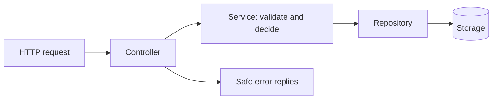
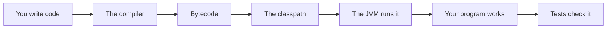

# Capstone Study Notes Service

## The big idea in plain words {#picture}

In this final project you build a real little service from start to finish: a **Study Notes service**. You can create notes, list them, change them, and delete them (CRUD). You check the input, save to storage, handle errors, and test it all.

It is like the final model you build in science class: you use every idea you learned along the way, in one project.



## What you will be able to do {#outcomes}

By the end of this lesson you will be able to:

- Build and test a small CRUD service.
- Combine validation, layers, errors, and persistence.
- Add health checks, logging, and a rollback plan.

## Words to know {#vocabulary}

- **CRUD**: Create, Read, Update, Delete.
- **capstone**: the big final project that uses all your skills.
- **persistence**: saving data so it survives a restart.
- **health check**: a quick endpoint saying "I am alive and ready".
- **error code**: a short, steady code for a type of problem.
- **request ID**: a unique number to follow one request through the logs.

## Why this idea exists {#history}

Knowing the pieces is not the same as using them together. A capstone proves that the pieces fit, and shows you what you still need to review.

## Concept 1: Plan first {#concept-1}

Write the requirements: create a note with a title and body, list notes, update, delete. Write the numbers: one user, a few hundred notes. Draw the layers. Only then write code.

## Concept 2: Build from the inside out {#concept-2}

Start with the `Note` record and its checks. Then the repository interface with an in-memory version. Then the service with tests. Last, the controller. This way, each piece works before the next sits on top of it.

## Concept 3: Handle the sad paths {#concept-3}

Blank title: `400` with a clear message. Unknown id: `404`. Storage down: `503` with "try again". Never show stack traces. Every error has a steady code and a request ID that matches a private log line.

## Concept 4: Make it ready to run {#concept-4}

Add a health endpoint, settings from the environment, a real database through a profile, and a script to build and run. Write down how to roll back, and how to restore the data from a backup.

## The first test {#example}

```java
@Test
void createsNoteAndFindsIt() {
    NoteService service = new NoteService(new InMemoryNoteRepository());
    Note saved = service.create("Math", "Fractions");
    assertEquals("Math", service.find(saved.id()).title());
}
```
This test runs in milliseconds. It proves create and find work together without any database.

## Going deeper: the technical walkthrough {#walkthrough}

### Classes and encapsulation


```java
public final class Counter {
    private int value;

    public void increment() {
        value += 1;
    }

    public int value() {
        return value;
    }
}
```

The field is private. Callers cannot change it directly. Encapsulation protects
invariants, such as never letting a counter become negative.


### Interfaces and dependency direction


```java
public interface NoteRepository {
    List<StudyNote> findByTopic(String topic);
    StudyNote save(StudyNote note);
}
```

A service can depend on this promise while one implementation uses memory and
another uses PostgreSQL. This is the basic idea behind a repository port and
adapter.

```text
Controller -> Service -> Repository interface -> Memory or database adapter
```

An interface is useful when the boundary is real. Do not create ten empty
interfaces only to make a diagram look sophisticated.


### Practice labs


1. Write a `record Book(String title, String author)` and print its accessors.
2. Implement `blankToNull` and test four input cases.
3. Create a `Map<Long, StudyNote>` and find an item safely.
4. Define a repository interface and an in-memory implementation.
5. Write a service method that rejects two conflicting member choices.
6. Read a controller and list its route, request, response, and service call.
7. Build a tiny Gradle project with one unit test.
8. Explain why a database failure should not become an empty successful list.


## Worked scenario {#worked-scenario}

A small team builds a simple CRUD app and has no separate scaling problem. What should it start with?

The justified choice is **A modular monolith with clear ports**. Select **modular-monolith** in the structured practical and explain why. Alternatives ignore a requirement, cross a trust boundary, or invent success.

### Structured decision contract

```json

{
  "decision": "modular-monolith",
  "justification": "The monolith and port boundary must preserve the declared contract and ownership.",
  "failureBehavior": "Expose a safe failure and recover through the boundary owner."
}

```

Decision selects one declared behavior. Justification explains the boundary. FailureBehavior explains the observable error and recovery owner. These fields never execute commands. Required terms and minimum lengths form a basic practice rubric, not semantic grading.

## Step-by-step flow and matching picture {#flow}




## Three real-life uses {#use-cases}

1. A student turns the capstone into a portfolio project.
2. A team uses the same structure for a different service, such as tasks.
3. A teacher uses the capstone to see which lessons a student should review.

## What can go wrong, and how to stay safe {#failure-security}

Mistakes: building everything at once with no tests, forgetting error cases, showing raw errors, and skipping the plan for running it for real. Also remember that the capstone uses made-up data. Never test with real people's information.

## Practice lab and expected observation {#practice}

1. Predict the scenario decision before opening Practical. Explain each rejected alternative.
2. Run a relevant example above in an isolated exercise project. Record the expected result, then change one input to an invalid or boundary value. A failed assertion or deliberate error should replace silent success.
3. Submit the structured decision. Initially the checks fail. After selecting modular-monolith and writing an explanation and failure plan, all three pass. Follow the indicated review section for missed checks.

### Broken example to debug

```json

{"decision":"trust-client","justification":"","failureBehavior":""}

```

This ignores the responsible boundary and gives no reasoning or recovery. Correct the fields rather than changing the validator.

## Checkpoint and definition of done {#checkpoint}

- [ ] Define monolith and port without looking.
- [ ] Trace input to owner and output.
- [ ] Explain one failure and one alternative.
- [ ] Pass at least four assignment questions.
- [ ] Pass every practical check and submit.
- [ ] Explain the concept again tomorrow.

## Sources, versions, and safe commands {#sources}

Java 17 baseline; installed validation JDK may be newer. Review date: 2026-10-02. The supplied blueprint is the teaching source; official landing pages were checked where reachable. No provider or original TM Schedule deployment was tested.

- [Official reference](https://docs.oracle.com/en/java/javase/17/)

[Course reading order](README.md) · [Previous lesson](23-java-to-spring-boot-bridge.md) · [Next lesson](25-glossary-practice-and-checklist.md)

```study-quiz

{
  "schemaVersion": 1,
  "lessonId": "java/24-capstone-study-notes-service",
  "title": "Assignment: Capstone Study Notes Service",
  "passPercentage": 80,
  "questions": [
    {
      "id": "q1",
      "sectionId": "concept-1",
      "prompt": "In Capstone Study Notes Service, what does monolith mean?",
      "options": [
        {
          "id": "a",
          "text": "an app that is built and shipped as one piece",
          "explanation": "This preserves the definition and boundary described in the lesson."
        },
        {
          "id": "b",
          "text": "A permission granted by a hidden browser control",
          "explanation": "This changes the declared meaning or bypasses the responsible boundary."
        },
        {
          "id": "c",
          "text": "An unlimited provider operation with no ownership",
          "explanation": "This changes the declared meaning or bypasses the responsible boundary."
        },
        {
          "id": "d",
          "text": "A diagnostic credential intended for public logs",
          "explanation": "This changes the declared meaning or bypasses the responsible boundary."
        }
      ],
      "correctOptionId": "a",
      "explanation": "monolith means an app that is built and shipped as one piece.",
      "reviewLabel": "Review concept 1"
    },
    {
      "id": "q2",
      "sectionId": "concept-2",
      "prompt": "In Capstone Study Notes Service, which rule is correct for checkpoint 2?",
      "options": [
        {
          "id": "a",
          "text": "Trust client-side checks instead of the server rule.",
          "explanation": "This changes the declared meaning or bypasses the responsible boundary."
        },
        {
          "id": "b",
          "text": "Split into a service only when you truly need to scale or release it separately.",
          "explanation": "This preserves the definition and boundary described in the lesson."
        },
        {
          "id": "c",
          "text": "Hide the failure by returning a fabricated successful result.",
          "explanation": "This changes the declared meaning or bypasses the responsible boundary."
        },
        {
          "id": "d",
          "text": "Skip the stated boundary, limit, or ownership check.",
          "explanation": "This changes the declared meaning or bypasses the responsible boundary."
        }
      ],
      "correctOptionId": "b",
      "explanation": "Split into a service only when you truly need to scale or release it separately.",
      "reviewLabel": "Review concept 2"
    },
    {
      "id": "q3",
      "sectionId": "concept-3",
      "prompt": "In Capstone Study Notes Service, which rule is correct for checkpoint 3?",
      "options": [
        {
          "id": "a",
          "text": "Trust client-side checks instead of the server rule.",
          "explanation": "This changes the declared meaning or bypasses the responsible boundary."
        },
        {
          "id": "b",
          "text": "Hide the failure by returning a fabricated successful result.",
          "explanation": "This changes the declared meaning or bypasses the responsible boundary."
        },
        {
          "id": "c",
          "text": "An outbox keeps messages safe until they are sent.",
          "explanation": "This preserves the definition and boundary described in the lesson."
        },
        {
          "id": "d",
          "text": "Skip the stated boundary, limit, or ownership check.",
          "explanation": "This changes the declared meaning or bypasses the responsible boundary."
        }
      ],
      "correctOptionId": "c",
      "explanation": "An outbox keeps messages safe until they are sent.",
      "reviewLabel": "Review concept 3"
    },
    {
      "id": "q4",
      "sectionId": "concept-4",
      "prompt": "In Capstone Study Notes Service, which rule is correct for checkpoint 4?",
      "options": [
        {
          "id": "a",
          "text": "Trust client-side checks instead of the server rule.",
          "explanation": "This changes the declared meaning or bypasses the responsible boundary."
        },
        {
          "id": "b",
          "text": "Hide the failure by returning a fabricated successful result.",
          "explanation": "This changes the declared meaning or bypasses the responsible boundary."
        },
        {
          "id": "c",
          "text": "Skip the stated boundary, limit, or ownership check.",
          "explanation": "This changes the declared meaning or bypasses the responsible boundary."
        },
        {
          "id": "d",
          "text": "CQRS splits reading and writing, and brings extra coordination.",
          "explanation": "This preserves the definition and boundary described in the lesson."
        }
      ],
      "correctOptionId": "d",
      "explanation": "CQRS splits reading and writing, and brings extra coordination.",
      "reviewLabel": "Review concept 4"
    },
    {
      "id": "q5",
      "sectionId": "worked-scenario",
      "prompt": "A small team builds a simple CRUD app and has no separate scaling problem. What should it start with?",
      "options": [
        {
          "id": "a",
          "text": "A modular monolith with clear ports",
          "explanation": "This preserves the definition and boundary described in the lesson."
        },
        {
          "id": "b",
          "text": "One service for every class",
          "explanation": "This changes the declared meaning or bypasses the responsible boundary."
        },
        {
          "id": "c",
          "text": "Distributed transactions for every read",
          "explanation": "This changes the declared meaning or bypasses the responsible boundary."
        },
        {
          "id": "d",
          "text": "A database that every browser can reach directly",
          "explanation": "This changes the declared meaning or bypasses the responsible boundary."
        }
      ],
      "correctOptionId": "a",
      "explanation": "A modular monolith with clear ports. A saga fixes mistakes with undo steps, not one magic rollback.",
      "reviewLabel": "Review the worked scenario"
    }
  ]
}

```

```study-practical

{
  "schemaVersion": 1,
  "challengeId": "java/24-capstone-study-notes-service/decision",
  "lessonId": "java/24-capstone-study-notes-service",
  "title": "Practical: Capstone Study Notes Service",
  "language": "json",
  "mode": "structured",
  "instructions": "A small team builds a simple CRUD app and has no separate scaling problem. What should it start with? Return an object with decision (choose from modular-monolith, skip-check, unbounded-work, trust-client), justification (at least 40 characters; include monolith and port), and failureBehavior (at least 25 characters; include failure and recover while explaining the error and recovery). These are structured reasoning checks, not code execution or an official grade.",
  "starterCode": "{\n  \"decision\": \"\",\n  \"justification\": \"\",\n  \"failureBehavior\": \"\"\n}",
  "entryPoint": "answer",
  "publicExamples": [
    {
      "input": {
        "decision": "skip-check",
        "justification": "",
        "failureBehavior": ""
      },
      "expected": {
        "passed": false
      }
    },
    {
      "input": {
        "decision": "modular-monolith",
        "justification": "The monolith and port boundary must preserve the declared contract and ownership.",
        "failureBehavior": "Show a safe failure and recover through the responsible owner."
      },
      "expected": {
        "passed": true
      }
    }
  ],
  "publicTestIds": [
    "decision",
    "explanation",
    "failure-plan"
  ],
  "reviewSections": {
    "decision": "worked-scenario",
    "explanation": "concept-2",
    "failure-plan": "failure-security"
  },
  "limits": {
    "timeMs": 2000,
    "memoryMb": 128,
    "outputBytes": 20000
  }
}

```

