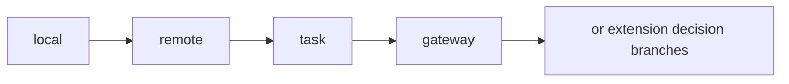
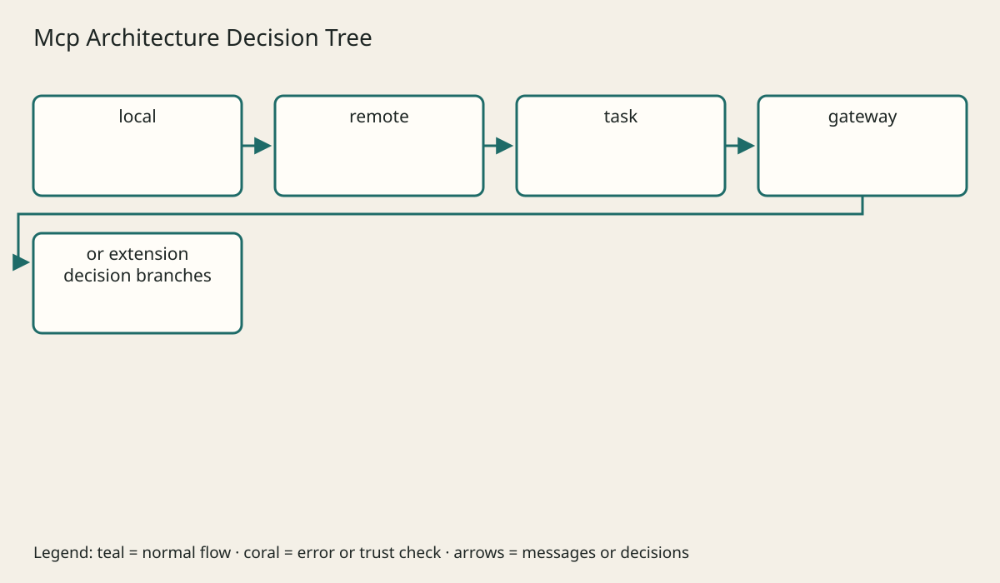

# Advanced Utilities And Extension Map

## The big idea in plain words {#picture}

Capabilities are a menu: do not order a dish that this server does not serve.

## What you will be able to do {#outcomes}

Read this after the previous numbered lesson. Use synthetic notes and local exercise data. By the end you should explain the following scope without copying:

Pagination, caching, batching, metadata, custom extensions, compatibility, and when not to extend MCP.

## Words to know {#vocabulary}

- **capability**: a supported protocol feature.

- **negotiation**: agreeing on compatible behavior.

- **metadata**: context accompanying a request.

## Why this idea exists {#history}

Protocol revisions differ. Older initialization-based connections and newer self-contained requests cannot be assumed interchangeable without an explicit compatibility plan.

## Concept 1 {#concept-1}

capability means a supported protocol feature. Pin the protocol revision used by a client and server.

Apply this rule to the Study Notes boundary before choosing syntax. Name the input, owner, and observable result. The scenario below gives a concrete decision to check.

## Concept 2 {#concept-2}

Check a capability before invoking an optional feature.

Apply this rule to the Study Notes boundary before choosing syntax. Name the input, owner, and observable result. The scenario below gives a concrete decision to check.

## Concept 3 {#concept-3}

Legacy initialization and modern request metadata are different models.

Apply this rule to the Study Notes boundary before choosing syntax. Name the input, owner, and observable result. The scenario below gives a concrete decision to check.

## Concept 4 {#concept-4}

Stateless protocol requests can still access persistent application state.

Apply this rule to the Study Notes boundary before choosing syntax. Name the input, owner, and observable result. The scenario below gives a concrete decision to check.

## Going deeper: the technical walkthrough {#walkthrough}

### Lifecycle and capability discovery


Older clients may begin with `initialize`, negotiate a protocol version, and
exchange capabilities. Modern requests carry required context explicitly. In
both cases, a client and server need a compatibility plan.

Capabilities should be narrow. A server that exposes one read tool does not
need to claim it can write files, sample models, or subscribe to every event.
Reject unsupported versions with a clear error and record the selected version.


### Progress, cancellation, subscriptions, and tasks


A short read can finish in one response. A long export may need progress updates,
cancellation, and a durable task handle:

```text
start task -> task_id
worker reports pending/running/progress
client cancels or polls
server records complete/failed/cancelled
client fetches bounded result
```

Use an explicit task store when work must survive a process restart. Do not keep
important workflow state only in memory. Make repeated cancellation and polling
safe.


### Architecture decision guide


| Situation | Start with |
| --- | --- |
| local read-only helper | stdio and one narrow tool |
| local file context | roots plus bounded resources |
| remote multi-user service | Streamable HTTP, TLS, OAuth, audit |
| long export | task handle, queue, worker, result store |
| several downstream systems | modular server with typed adapters |
| high-risk write | explicit user confirmation and idempotency |
| experimental capability | isolated server and test data |

More boxes do not automatically make an MCP design safer. Clear ownership and
small permissions matter more.


## Worked scenario {#worked-scenario}

A client does not advertise an optional feature. Choose the server behavior.

The justified choice is **Do not invoke it; use a supported path or safe error**. Select **respect-capability** in the structured practical and explain why. Alternatives ignore a requirement, cross a trust boundary, or invent success.

### Structured decision contract

```json

{
  "decision": "respect-capability",
  "justification": "The capability and negotiation boundary must preserve the declared contract and ownership.",
  "failureBehavior": "Expose a safe failure and recover through the boundary owner."
}

```

Decision selects one declared behavior. Justification explains the boundary. FailureBehavior explains the observable error and recovery owner. These fields never execute commands. Required terms and minimum lengths form a basic practice rubric, not semantic grading.

## Step-by-step flow and matching picture {#flow}





## Three real-life uses {#use-cases}

1. A personal learner applies this rule to one synthetic note and checks the result.
2. A team changes the boundary while preserving its shared request and response contract.
3. A deployed library handles concurrent requests and reports failures through safe errors and correlated signals.

## What can go wrong, and how to stay safe {#failure-security}

Reject unsupported versions rather than guessing. An external dependency needs an owner, size limit, deadline, cleanup, and recovery path. Return a stable error code rather than raw exceptions. Redact credentials and private bodies in diagnostics.

The abstraction improves capability reasoning but adds configuration and lifecycle work. Keep a simpler implementation when it meets the requirement. Measure the limiting resource before adding services, queues, or caches.

## Practice lab and expected observation {#practice}

1. Predict the scenario decision before opening Practical. Explain each rejected alternative.
2. Run a relevant example above in an isolated exercise project. Record the expected result, then change one input to an invalid or boundary value. A failed assertion or deliberate error should replace silent success.
3. Submit the structured decision. Initially the checks fail. After selecting respect-capability and writing an explanation and failure plan, all three pass. Follow the indicated review section for missed checks.

### Broken example to debug

```json

{"decision":"trust-client","justification":"","failureBehavior":""}

```

This ignores the responsible boundary and gives no reasoning or recovery. Correct the fields rather than changing the validator.

## Checkpoint and definition of done {#checkpoint}

- [ ] Define capability and negotiation without looking.
- [ ] Trace input to owner and output.
- [ ] Explain one failure and one alternative.
- [ ] Pass at least four assignment questions.
- [ ] Pass every practical check and submit.
- [ ] Explain the concept again tomorrow.

## Sources, versions, and safe commands {#sources}

MCP revision 2026-07-28; initialization-based revision 2025-11-25 is discussed separately. Review date: 2026-10-02. The supplied blueprint is the teaching source; official landing pages were checked where reachable. No provider or original TM Schedule deployment was tested.

- [Official reference](https://modelcontextprotocol.io/specification/2026-07-28)

- [Official reference](https://www.jsonrpc.org/specification)

[Course reading order](README.md) · [Previous lesson](20-sources-and-version-notes.md)

```study-quiz

{
  "schemaVersion": 1,
  "lessonId": "mcp/21-advanced-utilities-and-extension-map",
  "title": "Assignment: Advanced Utilities And Extension Map",
  "passPercentage": 80,
  "questions": [
    {
      "id": "q1",
      "sectionId": "concept-1",
      "prompt": "In Advanced Utilities And Extension Map, what does capability mean?",
      "options": [
        {
          "id": "a",
          "text": "A permission granted by a hidden browser control",
          "explanation": "This changes the declared meaning or bypasses the responsible boundary."
        },
        {
          "id": "b",
          "text": "a supported protocol feature",
          "explanation": "This preserves the definition and boundary described in the lesson."
        },
        {
          "id": "c",
          "text": "An unlimited provider operation with no ownership",
          "explanation": "This changes the declared meaning or bypasses the responsible boundary."
        },
        {
          "id": "d",
          "text": "A diagnostic credential intended for public logs",
          "explanation": "This changes the declared meaning or bypasses the responsible boundary."
        }
      ],
      "correctOptionId": "b",
      "explanation": "capability means a supported protocol feature.",
      "reviewLabel": "Review concept 1"
    },
    {
      "id": "q2",
      "sectionId": "concept-2",
      "prompt": "In Advanced Utilities And Extension Map, which rule is correct for checkpoint 2?",
      "options": [
        {
          "id": "a",
          "text": "Trust client-side checks instead of the server rule.",
          "explanation": "This changes the declared meaning or bypasses the responsible boundary."
        },
        {
          "id": "b",
          "text": "Hide the failure by returning a fabricated successful result.",
          "explanation": "This changes the declared meaning or bypasses the responsible boundary."
        },
        {
          "id": "c",
          "text": "Check a capability before invoking an optional feature.",
          "explanation": "This preserves the definition and boundary described in the lesson."
        },
        {
          "id": "d",
          "text": "Skip the stated boundary, limit, or ownership check.",
          "explanation": "This changes the declared meaning or bypasses the responsible boundary."
        }
      ],
      "correctOptionId": "c",
      "explanation": "Check a capability before invoking an optional feature.",
      "reviewLabel": "Review concept 2"
    },
    {
      "id": "q3",
      "sectionId": "concept-3",
      "prompt": "In Advanced Utilities And Extension Map, which rule is correct for checkpoint 3?",
      "options": [
        {
          "id": "a",
          "text": "Trust client-side checks instead of the server rule.",
          "explanation": "This changes the declared meaning or bypasses the responsible boundary."
        },
        {
          "id": "b",
          "text": "Hide the failure by returning a fabricated successful result.",
          "explanation": "This changes the declared meaning or bypasses the responsible boundary."
        },
        {
          "id": "c",
          "text": "Skip the stated boundary, limit, or ownership check.",
          "explanation": "This changes the declared meaning or bypasses the responsible boundary."
        },
        {
          "id": "d",
          "text": "Legacy initialization and modern request metadata are different models.",
          "explanation": "This preserves the definition and boundary described in the lesson."
        }
      ],
      "correctOptionId": "d",
      "explanation": "Legacy initialization and modern request metadata are different models.",
      "reviewLabel": "Review concept 3"
    },
    {
      "id": "q4",
      "sectionId": "concept-4",
      "prompt": "In Advanced Utilities And Extension Map, which rule is correct for checkpoint 4?",
      "options": [
        {
          "id": "a",
          "text": "Stateless protocol requests can still access persistent application state.",
          "explanation": "This preserves the definition and boundary described in the lesson."
        },
        {
          "id": "b",
          "text": "Trust client-side checks instead of the server rule.",
          "explanation": "This changes the declared meaning or bypasses the responsible boundary."
        },
        {
          "id": "c",
          "text": "Hide the failure by returning a fabricated successful result.",
          "explanation": "This changes the declared meaning or bypasses the responsible boundary."
        },
        {
          "id": "d",
          "text": "Skip the stated boundary, limit, or ownership check.",
          "explanation": "This changes the declared meaning or bypasses the responsible boundary."
        }
      ],
      "correctOptionId": "a",
      "explanation": "Stateless protocol requests can still access persistent application state.",
      "reviewLabel": "Review concept 4"
    },
    {
      "id": "q5",
      "sectionId": "worked-scenario",
      "prompt": "A client does not advertise an optional feature. Choose the server behavior.",
      "options": [
        {
          "id": "a",
          "text": "Invoke it and hope",
          "explanation": "This changes the declared meaning or bypasses the responsible boundary."
        },
        {
          "id": "b",
          "text": "Do not invoke it; use a supported path or safe error",
          "explanation": "This preserves the definition and boundary described in the lesson."
        },
        {
          "id": "c",
          "text": "Treat absence as blanket permission",
          "explanation": "This changes the declared meaning or bypasses the responsible boundary."
        },
        {
          "id": "d",
          "text": "Write a custom incompatible result without negotiation",
          "explanation": "This changes the declared meaning or bypasses the responsible boundary."
        }
      ],
      "correctOptionId": "b",
      "explanation": "Do not invoke it; use a supported path or safe error. Reject unsupported versions rather than guessing.",
      "reviewLabel": "Review the worked scenario"
    }
  ]
}

```

```study-practical

{
  "schemaVersion": 1,
  "challengeId": "mcp/21-advanced-utilities-and-extension-map/decision",
  "lessonId": "mcp/21-advanced-utilities-and-extension-map",
  "title": "Practical: Advanced Utilities And Extension Map",
  "language": "json",
  "mode": "structured",
  "instructions": "A client does not advertise an optional feature. Choose the server behavior. Return an object with decision (choose from respect-capability, skip-check, unbounded-work, trust-client), justification (at least 40 characters; include capability and negotiation), and failureBehavior (at least 25 characters; include failure and recover while explaining the error and recovery). These are structured reasoning checks, not code execution or an official grade.",
  "starterCode": "{\n  \"decision\": \"\",\n  \"justification\": \"\",\n  \"failureBehavior\": \"\"\n}",
  "entryPoint": "answer",
  "publicExamples": [
    {
      "input": {
        "decision": "skip-check",
        "justification": "",
        "failureBehavior": ""
      },
      "expected": {
        "passed": false
      }
    },
    {
      "input": {
        "decision": "respect-capability",
        "justification": "The capability and negotiation boundary must preserve the declared contract and ownership.",
        "failureBehavior": "Show a safe failure and recover through the responsible owner."
      },
      "expected": {
        "passed": true
      }
    }
  ],
  "publicTestIds": [
    "decision",
    "explanation",
    "failure-plan"
  ],
  "reviewSections": {
    "decision": "worked-scenario",
    "explanation": "concept-2",
    "failure-plan": "failure-security"
  },
  "limits": {
    "timeMs": 2000,
    "memoryMb": 128,
    "outputBytes": 20000
  }
}

```

