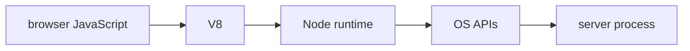

# Learning Map

## The big idea in plain words {#picture}

Learning is like climbing stairs. You can only reach the third step if the first two are solid.

## What you will be able to do {#outcomes}

Read this after the previous numbered lesson. Use synthetic notes and local exercise data. By the end you should explain the following scope without copying:

Explain prerequisites, reading order, study routine, projects, and mastery checkpoints.

## Words to know {#vocabulary}

- **prerequisite**: something you need to know first, before the next thing makes sense.

- **checkpoint**: a question you answer from memory, without peeking.

- **contract**: a clear promise about what goes in and what comes out.

## Why this idea exists {#history}

If you try to memorize a whole framework before you ever run one small example, most of it slips away. Learning in small loops (read, guess, try, check, review) shows you exactly which step you missed.

## Concept 1 {#concept-1}

prerequisite means something you need to know first, before the next thing makes sense. Read the prerequisites before you run a framework example.

Apply this rule to the Study Notes boundary before choosing syntax. Name the input, owner, and observable result. The scenario below gives a concrete decision to check.

## Concept 2 {#concept-2}

Guess the output first, then look at the answer.

Apply this rule to the Study Notes boundary before choosing syntax. Name the input, owner, and observable result. The scenario below gives a concrete decision to check.

## Concept 3 {#concept-3}

When a test fails, it points to the idea you are missing.

Apply this rule to the Study Notes boundary before choosing syntax. Name the input, owner, and observable result. The scenario below gives a concrete decision to check.

## Concept 4 {#concept-4}

A practice score in this app is just a helper, not an official exam grade.

Apply this rule to the Study Notes boundary before choosing syntax. Name the input, owner, and observable result. The scenario below gives a concrete decision to check.

## Going deeper: the technical walkthrough {#walkthrough}

### Audience and prerequisites


You need a terminal and basic programming curiosity. Knowing a little browser
JavaScript helps but is not required. Use Node.js 22 or a current LTS release,
pnpm, a text editor, and fake data.


### Outcomes


You will be able to:

- explain V8, the Node runtime, the event loop, and promises;
- use ESM modules, package scripts, and environment configuration;
- read and write files safely with asynchronous APIs;
- create an HTTP server and an Express route;
- validate requests, return safe errors, and design REST endpoints;
- keep business rules and persistence behind clear boundaries;
- use streams for bounded data movement;
- write tests and handle graceful shutdown;
- protect secrets, paths, tokens, and expensive work;
- package and deploy a small Node API.


### Recommended order


1. Install Node and run a script.
2. Learn JavaScript values, functions, objects, and arrays.
3. Learn modules, package scripts, and TypeScript types.
4. Learn promises, async/await, the event loop, and errors.
5. Build a raw HTTP server.
6. Add Express routing, middleware, validation, and JSON responses.
7. Add service, repository, database, authentication, and tests.
8. Add streams, workers, logging, shutdown, and deployment.


## Worked scenario {#worked-scenario}

You understand how to ask for data with GET, but you cannot explain how the server checks incoming data. What should you study next?

The justified choice is **Practice sending bad data and see how the server checks it**. Select **review-validation** in the structured practical and explain why. Alternatives ignore a requirement, cross a trust boundary, or invent success.

### Structured decision contract

```json

{
  "decision": "review-validation",
  "justification": "The prerequisite and checkpoint boundary must preserve the declared contract and ownership.",
  "failureBehavior": "Expose a safe failure and recover through the boundary owner."
}

```

Decision selects one declared behavior. Justification explains the boundary. FailureBehavior explains the observable error and recovery owner. These fields never execute commands. Required terms and minimum lengths form a basic practice rubric, not semantic grading.

## Step-by-step flow and matching picture {#flow}




## Three real-life uses {#use-cases}

1. A personal learner applies this rule to one synthetic note and checks the result.
2. A team changes the boundary while preserving its shared request and response contract.
3. A deployed library handles concurrent requests and reports failures through safe errors and correlated signals.

## What can go wrong, and how to stay safe {#failure-security}

Come back to a topic after a break; remembering it is better practice than just re-reading it. An external dependency needs an owner, size limit, deadline, cleanup, and recovery path. Return a stable error code rather than raw exceptions. Redact credentials and private bodies in diagnostics.

The abstraction improves prerequisite reasoning but adds configuration and lifecycle work. Keep a simpler implementation when it meets the requirement. Measure the limiting resource before adding services, queues, or caches.

## Practice lab and expected observation {#practice}

1. Predict the scenario decision before opening Practical. Explain each rejected alternative.
2. Run a relevant example above in an isolated exercise project. Record the expected result, then change one input to an invalid or boundary value. A failed assertion or deliberate error should replace silent success.
3. Submit the structured decision. Initially the checks fail. After selecting review-validation and writing an explanation and failure plan, all three pass. Follow the indicated review section for missed checks.

### Broken example to debug

```json

{"decision":"trust-client","justification":"","failureBehavior":""}

```

This ignores the responsible boundary and gives no reasoning or recovery. Correct the fields rather than changing the validator.

## Checkpoint and definition of done {#checkpoint}

- [ ] Define prerequisite and checkpoint without looking.
- [ ] Trace input to owner and output.
- [ ] Explain one failure and one alternative.
- [ ] Pass at least four assignment questions.
- [ ] Pass every practical check and submit.
- [ ] Explain the concept again tomorrow.

## Sources, versions, and safe commands {#sources}

Node 22 baseline; ESM modules. Review date: 2026-10-02. The supplied blueprint is the teaching source; official landing pages were checked where reachable. No provider or original TM Schedule deployment was tested.

- [Official reference](https://nodejs.org/api/)

[Course reading order](README.md) · [Next lesson](02-why-node-and-javascript-runtime-history.md)

```study-quiz

{
  "schemaVersion": 1,
  "lessonId": "nodejs/01-learning-map",
  "title": "Assignment: Learning Map",
  "passPercentage": 80,
  "questions": [
    {
      "id": "q1",
      "sectionId": "concept-1",
      "prompt": "In Learning Map, what does prerequisite mean?",
      "options": [
        {
          "id": "a",
          "text": "something you need to know first, before the next thing makes sense",
          "explanation": "This preserves the definition and boundary described in the lesson."
        },
        {
          "id": "b",
          "text": "A permission granted by a hidden browser control",
          "explanation": "This changes the declared meaning or bypasses the responsible boundary."
        },
        {
          "id": "c",
          "text": "An unlimited provider operation with no ownership",
          "explanation": "This changes the declared meaning or bypasses the responsible boundary."
        },
        {
          "id": "d",
          "text": "A diagnostic credential intended for public logs",
          "explanation": "This changes the declared meaning or bypasses the responsible boundary."
        }
      ],
      "correctOptionId": "a",
      "explanation": "prerequisite means something you need to know first, before the next thing makes sense.",
      "reviewLabel": "Review concept 1"
    },
    {
      "id": "q2",
      "sectionId": "concept-2",
      "prompt": "In Learning Map, which rule is correct for checkpoint 2?",
      "options": [
        {
          "id": "a",
          "text": "Trust client-side checks instead of the server rule.",
          "explanation": "This changes the declared meaning or bypasses the responsible boundary."
        },
        {
          "id": "b",
          "text": "Guess the output first, then look at the answer.",
          "explanation": "This preserves the definition and boundary described in the lesson."
        },
        {
          "id": "c",
          "text": "Hide the failure by returning a fabricated successful result.",
          "explanation": "This changes the declared meaning or bypasses the responsible boundary."
        },
        {
          "id": "d",
          "text": "Skip the stated boundary, limit, or ownership check.",
          "explanation": "This changes the declared meaning or bypasses the responsible boundary."
        }
      ],
      "correctOptionId": "b",
      "explanation": "Guess the output first, then look at the answer.",
      "reviewLabel": "Review concept 2"
    },
    {
      "id": "q3",
      "sectionId": "concept-3",
      "prompt": "In Learning Map, which rule is correct for checkpoint 3?",
      "options": [
        {
          "id": "a",
          "text": "Trust client-side checks instead of the server rule.",
          "explanation": "This changes the declared meaning or bypasses the responsible boundary."
        },
        {
          "id": "b",
          "text": "Hide the failure by returning a fabricated successful result.",
          "explanation": "This changes the declared meaning or bypasses the responsible boundary."
        },
        {
          "id": "c",
          "text": "When a test fails, it points to the idea you are missing.",
          "explanation": "This preserves the definition and boundary described in the lesson."
        },
        {
          "id": "d",
          "text": "Skip the stated boundary, limit, or ownership check.",
          "explanation": "This changes the declared meaning or bypasses the responsible boundary."
        }
      ],
      "correctOptionId": "c",
      "explanation": "When a test fails, it points to the idea you are missing.",
      "reviewLabel": "Review concept 3"
    },
    {
      "id": "q4",
      "sectionId": "concept-4",
      "prompt": "In Learning Map, which rule is correct for checkpoint 4?",
      "options": [
        {
          "id": "a",
          "text": "Trust client-side checks instead of the server rule.",
          "explanation": "This changes the declared meaning or bypasses the responsible boundary."
        },
        {
          "id": "b",
          "text": "Hide the failure by returning a fabricated successful result.",
          "explanation": "This changes the declared meaning or bypasses the responsible boundary."
        },
        {
          "id": "c",
          "text": "Skip the stated boundary, limit, or ownership check.",
          "explanation": "This changes the declared meaning or bypasses the responsible boundary."
        },
        {
          "id": "d",
          "text": "A practice score in this app is just a helper, not an official exam grade.",
          "explanation": "This preserves the definition and boundary described in the lesson."
        }
      ],
      "correctOptionId": "d",
      "explanation": "A practice score in this app is just a helper, not an official exam grade.",
      "reviewLabel": "Review concept 4"
    },
    {
      "id": "q5",
      "sectionId": "worked-scenario",
      "prompt": "You understand how to ask for data with GET, but you cannot explain how the server checks incoming data. What should you study next?",
      "options": [
        {
          "id": "a",
          "text": "Practice sending bad data and see how the server checks it",
          "explanation": "This preserves the definition and boundary described in the lesson."
        },
        {
          "id": "b",
          "text": "Jump straight to advanced deployment",
          "explanation": "This changes the declared meaning or bypasses the responsible boundary."
        },
        {
          "id": "c",
          "text": "Copy an answer without trying it",
          "explanation": "This changes the declared meaning or bypasses the responsible boundary."
        },
        {
          "id": "d",
          "text": "Switch frameworks so the problem goes away",
          "explanation": "This changes the declared meaning or bypasses the responsible boundary."
        }
      ],
      "correctOptionId": "a",
      "explanation": "Practice sending bad data and see how the server checks it. Come back to a topic after a break; remembering it is better practice than just re-reading it.",
      "reviewLabel": "Review the worked scenario"
    }
  ]
}

```

```study-practical

{
  "schemaVersion": 1,
  "challengeId": "nodejs/01-learning-map/decision",
  "lessonId": "nodejs/01-learning-map",
  "title": "Practical: Learning Map",
  "language": "json",
  "mode": "structured",
  "instructions": "You understand how to ask for data with GET, but you cannot explain how the server checks incoming data. What should you study next? Return an object with decision (choose from review-validation, skip-check, unbounded-work, trust-client), justification (at least 40 characters; include prerequisite and checkpoint), and failureBehavior (at least 25 characters; include failure and recover while explaining the error and recovery). These are structured reasoning checks, not code execution or an official grade.",
  "starterCode": "{\n  \"decision\": \"\",\n  \"justification\": \"\",\n  \"failureBehavior\": \"\"\n}",
  "entryPoint": "answer",
  "publicExamples": [
    {
      "input": {
        "decision": "skip-check",
        "justification": "",
        "failureBehavior": ""
      },
      "expected": {
        "passed": false
      }
    },
    {
      "input": {
        "decision": "review-validation",
        "justification": "The prerequisite and checkpoint boundary must preserve the declared contract and ownership.",
        "failureBehavior": "Show a safe failure and recover through the responsible owner."
      },
      "expected": {
        "passed": true
      }
    }
  ],
  "publicTestIds": [
    "decision",
    "explanation",
    "failure-plan"
  ],
  "reviewSections": {
    "decision": "worked-scenario",
    "explanation": "concept-2",
    "failure-plan": "failure-security"
  },
  "limits": {
    "timeMs": 2000,
    "memoryMb": 128,
    "outputBytes": 20000
  }
}

```

