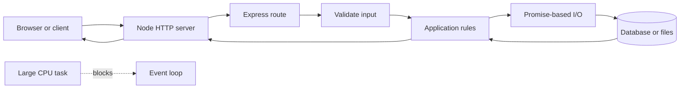
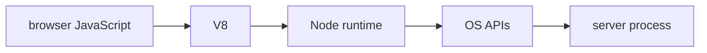

# Why Node And Javascript Runtime History

## The big idea in plain words {#picture}

A new tool is like a bicycle. It gets you there faster than walking, but now you have a bike to look after.

## What you will be able to do {#outcomes}

Read this after the previous numbered lesson. Use synthetic notes and local exercise data. By the end you should explain the following scope without copying:

Explain browser JavaScript, V8, Node's origin, event-driven I/O, thread models, Express, and alternatives.

## Words to know {#vocabulary}

- **runtime**: the helper program that actually runs your code.

- **framework**: a ready-made skeleton that calls your code at the right moments.

- **tradeoff**: a good thing you get in exchange for a cost you accept.

## Why this idea exists {#history}

Programmers got tired of repeating the same boring setup, so languages and frameworks were invented to do it for them. Each one saves time but brings something new to learn and maintain. Pick the smallest tool that really solves your problem.

## Concept 1 {#concept-1}

runtime means the helper program that actually runs your code. A runtime runs your program; a package manager downloads the libraries it needs.

Apply this rule to the Study Notes boundary before choosing syntax. Name the input, owner, and observable result. The scenario below gives a concrete decision to check.

## Concept 2 {#concept-2}

A framework saves setup work, but it does not decide who is allowed to do what.

Apply this rule to the Study Notes boundary before choosing syntax. Name the input, owner, and observable result. The scenario below gives a concrete decision to check.

## Concept 3 {#concept-3}

Code that is compiled once to portable bytecode still needs a matching runtime on each computer.

Apply this rule to the Study Notes boundary before choosing syntax. Name the input, owner, and observable result. The scenario below gives a concrete decision to check.

## Concept 4 {#concept-4}

Non-blocking input and output helps when your program mostly waits; it does not make heavy math faster.

Apply this rule to the Study Notes boundary before choosing syntax. Name the input, owner, and observable result. The scenario below gives a concrete decision to check.

## Going deeper: the technical walkthrough {#walkthrough}

### The one-minute picture


Node.js is a program that runs JavaScript using the V8 engine. It is good at
waiting for many small input/output operations without creating one blocked
thread for every request. It is not magic: CPU-heavy work can still block the
event loop and slow every request.




### The event loop and promises


Node starts work, registers an I/O operation, and later runs its callback or
promise continuation. A slow filesystem or network operation should not block
the JavaScript thread, but a large synchronous loop will.

```ts
const response = await fetch("https://example.test/health");
if (!response.ok) {
  throw new Error("Provider health check failed");
}
const body: unknown = await response.json();
```

Handle rejection. Do not create an unobserved promise and assume it will finish.
Set timeouts for remote calls and abort work that exceeds the budget.


## Worked scenario {#worked-scenario}

A small team spends most of its time writing the same route and checking code over and over. What is a good reason to add a framework?

The justified choice is **It removes repeated setup while the team still writes its own permission rules**. Select **reduce-setup** in the structured practical and explain why. Alternatives ignore a requirement, cross a trust boundary, or invent success.

### Structured decision contract

```json

{
  "decision": "reduce-setup",
  "justification": "The runtime and framework boundary must preserve the declared contract and ownership.",
  "failureBehavior": "Expose a safe failure and recover through the boundary owner."
}

```

Decision selects one declared behavior. Justification explains the boundary. FailureBehavior explains the observable error and recovery owner. These fields never execute commands. Required terms and minimum lengths form a basic practice rubric, not semantic grading.

## Step-by-step flow and matching picture {#flow}




## Three real-life uses {#use-cases}

1. A personal learner applies this rule to one synthetic note and checks the result.
2. A team changes the boundary while preserving its shared request and response contract.
3. A deployed library handles concurrent requests and reports failures through safe errors and correlated signals.

## What can go wrong, and how to stay safe {#failure-security}

When you pick a technology, say which need it meets and which cost you accept. An external dependency needs an owner, size limit, deadline, cleanup, and recovery path. Return a stable error code rather than raw exceptions. Redact credentials and private bodies in diagnostics.

The abstraction improves runtime reasoning but adds configuration and lifecycle work. Keep a simpler implementation when it meets the requirement. Measure the limiting resource before adding services, queues, or caches.

## Practice lab and expected observation {#practice}

1. Predict the scenario decision before opening Practical. Explain each rejected alternative.
2. Run a relevant example above in an isolated exercise project. Record the expected result, then change one input to an invalid or boundary value. A failed assertion or deliberate error should replace silent success.
3. Submit the structured decision. Initially the checks fail. After selecting reduce-setup and writing an explanation and failure plan, all three pass. Follow the indicated review section for missed checks.

### Broken example to debug

```json

{"decision":"trust-client","justification":"","failureBehavior":""}

```

This ignores the responsible boundary and gives no reasoning or recovery. Correct the fields rather than changing the validator.

## Checkpoint and definition of done {#checkpoint}

- [ ] Define runtime and framework without looking.
- [ ] Trace input to owner and output.
- [ ] Explain one failure and one alternative.
- [ ] Pass at least four assignment questions.
- [ ] Pass every practical check and submit.
- [ ] Explain the concept again tomorrow.

## Sources, versions, and safe commands {#sources}

Node 22 baseline; ESM modules. Review date: 2026-10-02. The supplied blueprint is the teaching source; official landing pages were checked where reachable. No provider or original TM Schedule deployment was tested.

- [Official reference](https://nodejs.org/api/)

[Course reading order](README.md) · [Previous lesson](01-learning-map.md) · [Next lesson](03-installation-npm-pnpm-and-project-layout.md)

```study-quiz

{
  "schemaVersion": 1,
  "lessonId": "nodejs/02-why-node-and-javascript-runtime-history",
  "title": "Assignment: Why Node And Javascript Runtime History",
  "passPercentage": 80,
  "questions": [
    {
      "id": "q1",
      "sectionId": "concept-1",
      "prompt": "In Why Node And Javascript Runtime History, what does runtime mean?",
      "options": [
        {
          "id": "a",
          "text": "A permission granted by a hidden browser control",
          "explanation": "This changes the declared meaning or bypasses the responsible boundary."
        },
        {
          "id": "b",
          "text": "the helper program that actually runs your code",
          "explanation": "This preserves the definition and boundary described in the lesson."
        },
        {
          "id": "c",
          "text": "An unlimited provider operation with no ownership",
          "explanation": "This changes the declared meaning or bypasses the responsible boundary."
        },
        {
          "id": "d",
          "text": "A diagnostic credential intended for public logs",
          "explanation": "This changes the declared meaning or bypasses the responsible boundary."
        }
      ],
      "correctOptionId": "b",
      "explanation": "runtime means the helper program that actually runs your code.",
      "reviewLabel": "Review concept 1"
    },
    {
      "id": "q2",
      "sectionId": "concept-2",
      "prompt": "In Why Node And Javascript Runtime History, which rule is correct for checkpoint 2?",
      "options": [
        {
          "id": "a",
          "text": "Trust client-side checks instead of the server rule.",
          "explanation": "This changes the declared meaning or bypasses the responsible boundary."
        },
        {
          "id": "b",
          "text": "Hide the failure by returning a fabricated successful result.",
          "explanation": "This changes the declared meaning or bypasses the responsible boundary."
        },
        {
          "id": "c",
          "text": "A framework saves setup work, but it does not decide who is allowed to do what.",
          "explanation": "This preserves the definition and boundary described in the lesson."
        },
        {
          "id": "d",
          "text": "Skip the stated boundary, limit, or ownership check.",
          "explanation": "This changes the declared meaning or bypasses the responsible boundary."
        }
      ],
      "correctOptionId": "c",
      "explanation": "A framework saves setup work, but it does not decide who is allowed to do what.",
      "reviewLabel": "Review concept 2"
    },
    {
      "id": "q3",
      "sectionId": "concept-3",
      "prompt": "In Why Node And Javascript Runtime History, which rule is correct for checkpoint 3?",
      "options": [
        {
          "id": "a",
          "text": "Trust client-side checks instead of the server rule.",
          "explanation": "This changes the declared meaning or bypasses the responsible boundary."
        },
        {
          "id": "b",
          "text": "Hide the failure by returning a fabricated successful result.",
          "explanation": "This changes the declared meaning or bypasses the responsible boundary."
        },
        {
          "id": "c",
          "text": "Skip the stated boundary, limit, or ownership check.",
          "explanation": "This changes the declared meaning or bypasses the responsible boundary."
        },
        {
          "id": "d",
          "text": "Code that is compiled once to portable bytecode still needs a matching runtime on each computer.",
          "explanation": "This preserves the definition and boundary described in the lesson."
        }
      ],
      "correctOptionId": "d",
      "explanation": "Code that is compiled once to portable bytecode still needs a matching runtime on each computer.",
      "reviewLabel": "Review concept 3"
    },
    {
      "id": "q4",
      "sectionId": "concept-4",
      "prompt": "In Why Node And Javascript Runtime History, which rule is correct for checkpoint 4?",
      "options": [
        {
          "id": "a",
          "text": "Non-blocking input and output helps when your program mostly waits; it does not make heavy math faster.",
          "explanation": "This preserves the definition and boundary described in the lesson."
        },
        {
          "id": "b",
          "text": "Trust client-side checks instead of the server rule.",
          "explanation": "This changes the declared meaning or bypasses the responsible boundary."
        },
        {
          "id": "c",
          "text": "Hide the failure by returning a fabricated successful result.",
          "explanation": "This changes the declared meaning or bypasses the responsible boundary."
        },
        {
          "id": "d",
          "text": "Skip the stated boundary, limit, or ownership check.",
          "explanation": "This changes the declared meaning or bypasses the responsible boundary."
        }
      ],
      "correctOptionId": "a",
      "explanation": "Non-blocking input and output helps when your program mostly waits; it does not make heavy math faster.",
      "reviewLabel": "Review concept 4"
    },
    {
      "id": "q5",
      "sectionId": "worked-scenario",
      "prompt": "A small team spends most of its time writing the same route and checking code over and over. What is a good reason to add a framework?",
      "options": [
        {
          "id": "a",
          "text": "It guarantees every database query is fast",
          "explanation": "This changes the declared meaning or bypasses the responsible boundary."
        },
        {
          "id": "b",
          "text": "It removes repeated setup while the team still writes its own permission rules",
          "explanation": "This preserves the definition and boundary described in the lesson."
        },
        {
          "id": "c",
          "text": "It means you no longer need tests",
          "explanation": "This changes the declared meaning or bypasses the responsible boundary."
        },
        {
          "id": "d",
          "text": "It automatically decides who is allowed to do what",
          "explanation": "This changes the declared meaning or bypasses the responsible boundary."
        }
      ],
      "correctOptionId": "b",
      "explanation": "It removes repeated setup while the team still writes its own permission rules. When you pick a technology, say which need it meets and which cost you accept.",
      "reviewLabel": "Review the worked scenario"
    }
  ]
}

```

```study-practical

{
  "schemaVersion": 1,
  "challengeId": "nodejs/02-why-node-and-javascript-runtime-history/decision",
  "lessonId": "nodejs/02-why-node-and-javascript-runtime-history",
  "title": "Practical: Why Node And Javascript Runtime History",
  "language": "json",
  "mode": "structured",
  "instructions": "A small team spends most of its time writing the same route and checking code over and over. What is a good reason to add a framework? Return an object with decision (choose from reduce-setup, skip-check, unbounded-work, trust-client), justification (at least 40 characters; include runtime and framework), and failureBehavior (at least 25 characters; include failure and recover while explaining the error and recovery). These are structured reasoning checks, not code execution or an official grade.",
  "starterCode": "{\n  \"decision\": \"\",\n  \"justification\": \"\",\n  \"failureBehavior\": \"\"\n}",
  "entryPoint": "answer",
  "publicExamples": [
    {
      "input": {
        "decision": "skip-check",
        "justification": "",
        "failureBehavior": ""
      },
      "expected": {
        "passed": false
      }
    },
    {
      "input": {
        "decision": "reduce-setup",
        "justification": "The runtime and framework boundary must preserve the declared contract and ownership.",
        "failureBehavior": "Show a safe failure and recover through the responsible owner."
      },
      "expected": {
        "passed": true
      }
    }
  ],
  "publicTestIds": [
    "decision",
    "explanation",
    "failure-plan"
  ],
  "reviewSections": {
    "decision": "worked-scenario",
    "explanation": "concept-2",
    "failure-plan": "failure-security"
  },
  "limits": {
    "timeMs": 2000,
    "memoryMb": 128,
    "outputBytes": 20000
  }
}

```

