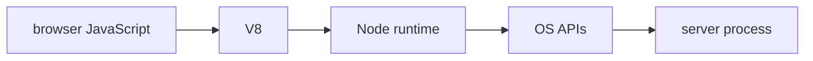

# Typescript Runtime Types And Schemas

## The big idea in plain words {#picture}

A type is the label on a box. Validation is opening the box to check that what is inside really matches the label.

## What you will be able to do {#outcomes}

Read this after the previous numbered lesson. Use synthetic notes and local exercise data. By the end you should explain the following scope without copying:

Teach static types, narrowing, unknown, unions, interfaces, generics, emitted JavaScript, and runtime schemas.

## Words to know {#vocabulary}

- **type**: a description of what kind of values are allowed.

- **reference**: a pointer to an object, not the object itself.

- **validation**: checking real data against a rule.

## Why this idea exists {#history}

Data from outside your program can have any shape, and a wrong shape can cause strange problems far away from where it entered. Types help you reason about your own code, but you still have to check data when it arrives from the outside.

## Concept 1 {#concept-1}

type means a description of what kind of values are allowed. A type annotation does not check the JSON that actually arrives.

Apply this rule to the Study Notes boundary before choosing syntax. Name the input, owner, and observable result. The scenario below gives a concrete decision to check.

## Concept 2 {#concept-2}

Check unknown input before you use it.

Apply this rule to the Study Notes boundary before choosing syntax. Name the input, owner, and observable result. The scenario below gives a concrete decision to check.

## Concept 3 {#concept-3}

Equal values have the same content; the same object is the very same thing in memory.

Apply this rule to the Study Notes boundary before choosing syntax. Name the input, owner, and observable result. The scenario below gives a concrete decision to check.

## Concept 4 {#concept-4}

Missing, null, blank, and zero can all mean different things.

Apply this rule to the Study Notes boundary before choosing syntax. Name the input, owner, and observable result. The scenario below gives a concrete decision to check.

## Going deeper: the technical walkthrough {#walkthrough}

### JavaScript and TypeScript basics


```ts
const title: string = "Node basics";
const lessonNumber: number = 1;
const topics: string[] = ["HTTP", "JSON"];

function cleanText(value: string | undefined): string | undefined {
  const cleaned = value?.trim();
  return cleaned || undefined;
}
```

TypeScript catches many mistakes before runtime, but request data is still
untrusted at runtime. Validate bodies, query strings, headers, and environment
values with a schema library or explicit checks.


### REST routes and request validation


```ts
type NoteCreate = {
  title: string;
  body: string;
  topic: string;
};

function parseNoteCreate(value: unknown): NoteCreate {
  if (!value || typeof value !== "object") {
    throw new Error("Invalid request body");
  }
  const body = value as Record<string, unknown>;
  if (typeof body.title !== "string" || body.title.trim().length === 0) {
    throw new Error("Title is required");
  }
  if (typeof body.body !== "string" || typeof body.topic !== "string") {
    throw new Error("Body and topic are required");
  }
  return {
    title: body.title.trim(),
    body: body.body,
    topic: body.topic.trim(),
  };
}
```

The example uses a narrow assertion only after checking the outer value. In a
real project, prefer a schema validator such as Zod when it fits the team's
conventions. Never trust `req.body` merely because TypeScript has a type alias.


## Worked scenario {#worked-scenario}

Someone sends a note title that is only spaces. What should the API do?

The justified choice is **Trim it, see it is empty, and reject it**. Select **reject-blank** in the structured practical and explain why. Alternatives ignore a requirement, cross a trust boundary, or invent success.

### Structured decision contract

```json

{
  "decision": "reject-blank",
  "justification": "The type and reference boundary must preserve the declared contract and ownership.",
  "failureBehavior": "Expose a safe failure and recover through the boundary owner."
}

```

Decision selects one declared behavior. Justification explains the boundary. FailureBehavior explains the observable error and recovery owner. These fields never execute commands. Required terms and minimum lengths form a basic practice rubric, not semantic grading.

## Step-by-step flow and matching picture {#flow}




## Three real-life uses {#use-cases}

1. A personal learner applies this rule to one synthetic note and checks the result.
2. A team changes the boundary while preserving its shared request and response contract.
3. A deployed library handles concurrent requests and reports failures through safe errors and correlated signals.

## What can go wrong, and how to stay safe {#failure-security}

Refuse bad input before you save it. An external dependency needs an owner, size limit, deadline, cleanup, and recovery path. Return a stable error code rather than raw exceptions. Redact credentials and private bodies in diagnostics.

The abstraction improves type reasoning but adds configuration and lifecycle work. Keep a simpler implementation when it meets the requirement. Measure the limiting resource before adding services, queues, or caches.

## Practice lab and expected observation {#practice}

Implement classify to return read for GET, write for POST/PUT/PATCH/DELETE, and unsupported for any other method. The input contract uses uppercase method strings. Do not perform an actual HTTP request.

The language starter and public examples appear in Practical. Run is unavailable until a trusted isolated worker is configured. Reading and assignment review still work; this lesson does not claim code-test completion.

1. Predict the scenario decision before opening Practical. Explain each rejected alternative.
2. Run a relevant example above in an isolated exercise project. Record the expected result, then change one input to an invalid or boundary value. A failed assertion or deliberate error should replace silent success.
3. Submit the structured decision. Initially the checks fail. After selecting reject-blank and writing an explanation and failure plan, all three pass. Follow the indicated review section for missed checks.

### Broken example to debug

```json

{"decision":"trust-client","justification":"","failureBehavior":""}

```

This ignores the responsible boundary and gives no reasoning or recovery. Correct the fields rather than changing the validator.

## Checkpoint and definition of done {#checkpoint}

- [ ] Define type and reference without looking.
- [ ] Trace input to owner and output.
- [ ] Explain one failure and one alternative.
- [ ] Pass at least four assignment questions.
- [ ] Pass every practical check and submit.
- [ ] Explain the concept again tomorrow.

## Sources, versions, and safe commands {#sources}

Node 22 baseline; ESM modules. Review date: 2026-10-02. The supplied blueprint is the teaching source; official landing pages were checked where reachable. No provider or original TM Schedule deployment was tested.

- [Official reference](https://nodejs.org/api/)

[Course reading order](README.md) · [Previous lesson](04-javascript-values-functions-and-objects.md) · [Next lesson](06-esm-commonjs-modules-and-packages.md)

```study-quiz

{
  "schemaVersion": 1,
  "lessonId": "nodejs/05-typescript-runtime-types-and-schemas",
  "title": "Assignment: Typescript Runtime Types And Schemas",
  "passPercentage": 80,
  "questions": [
    {
      "id": "q1",
      "sectionId": "concept-1",
      "prompt": "In Typescript Runtime Types And Schemas, what does type mean?",
      "options": [
        {
          "id": "a",
          "text": "a description of what kind of values are allowed",
          "explanation": "This preserves the definition and boundary described in the lesson."
        },
        {
          "id": "b",
          "text": "A permission granted by a hidden browser control",
          "explanation": "This changes the declared meaning or bypasses the responsible boundary."
        },
        {
          "id": "c",
          "text": "An unlimited provider operation with no ownership",
          "explanation": "This changes the declared meaning or bypasses the responsible boundary."
        },
        {
          "id": "d",
          "text": "A diagnostic credential intended for public logs",
          "explanation": "This changes the declared meaning or bypasses the responsible boundary."
        }
      ],
      "correctOptionId": "a",
      "explanation": "type means a description of what kind of values are allowed.",
      "reviewLabel": "Review concept 1"
    },
    {
      "id": "q2",
      "sectionId": "concept-2",
      "prompt": "In Typescript Runtime Types And Schemas, which rule is correct for checkpoint 2?",
      "options": [
        {
          "id": "a",
          "text": "Trust client-side checks instead of the server rule.",
          "explanation": "This changes the declared meaning or bypasses the responsible boundary."
        },
        {
          "id": "b",
          "text": "Check unknown input before you use it.",
          "explanation": "This preserves the definition and boundary described in the lesson."
        },
        {
          "id": "c",
          "text": "Hide the failure by returning a fabricated successful result.",
          "explanation": "This changes the declared meaning or bypasses the responsible boundary."
        },
        {
          "id": "d",
          "text": "Skip the stated boundary, limit, or ownership check.",
          "explanation": "This changes the declared meaning or bypasses the responsible boundary."
        }
      ],
      "correctOptionId": "b",
      "explanation": "Check unknown input before you use it.",
      "reviewLabel": "Review concept 2"
    },
    {
      "id": "q3",
      "sectionId": "concept-3",
      "prompt": "In Typescript Runtime Types And Schemas, which rule is correct for checkpoint 3?",
      "options": [
        {
          "id": "a",
          "text": "Trust client-side checks instead of the server rule.",
          "explanation": "This changes the declared meaning or bypasses the responsible boundary."
        },
        {
          "id": "b",
          "text": "Hide the failure by returning a fabricated successful result.",
          "explanation": "This changes the declared meaning or bypasses the responsible boundary."
        },
        {
          "id": "c",
          "text": "Equal values have the same content; the same object is the very same thing in memory.",
          "explanation": "This preserves the definition and boundary described in the lesson."
        },
        {
          "id": "d",
          "text": "Skip the stated boundary, limit, or ownership check.",
          "explanation": "This changes the declared meaning or bypasses the responsible boundary."
        }
      ],
      "correctOptionId": "c",
      "explanation": "Equal values have the same content; the same object is the very same thing in memory.",
      "reviewLabel": "Review concept 3"
    },
    {
      "id": "q4",
      "sectionId": "concept-4",
      "prompt": "In Typescript Runtime Types And Schemas, which rule is correct for checkpoint 4?",
      "options": [
        {
          "id": "a",
          "text": "Trust client-side checks instead of the server rule.",
          "explanation": "This changes the declared meaning or bypasses the responsible boundary."
        },
        {
          "id": "b",
          "text": "Hide the failure by returning a fabricated successful result.",
          "explanation": "This changes the declared meaning or bypasses the responsible boundary."
        },
        {
          "id": "c",
          "text": "Skip the stated boundary, limit, or ownership check.",
          "explanation": "This changes the declared meaning or bypasses the responsible boundary."
        },
        {
          "id": "d",
          "text": "Missing, null, blank, and zero can all mean different things.",
          "explanation": "This preserves the definition and boundary described in the lesson."
        }
      ],
      "correctOptionId": "d",
      "explanation": "Missing, null, blank, and zero can all mean different things.",
      "reviewLabel": "Review concept 4"
    },
    {
      "id": "q5",
      "sectionId": "worked-scenario",
      "prompt": "Someone sends a note title that is only spaces. What should the API do?",
      "options": [
        {
          "id": "a",
          "text": "Trim it, see it is empty, and reject it",
          "explanation": "This preserves the definition and boundary described in the lesson."
        },
        {
          "id": "b",
          "text": "Trust the type label and accept it",
          "explanation": "This changes the declared meaning or bypasses the responsible boundary."
        },
        {
          "id": "c",
          "text": "Save the spaces as a real title",
          "explanation": "This changes the declared meaning or bypasses the responsible boundary."
        },
        {
          "id": "d",
          "text": "Crash and show a scary error",
          "explanation": "This changes the declared meaning or bypasses the responsible boundary."
        }
      ],
      "correctOptionId": "a",
      "explanation": "Trim it, see it is empty, and reject it. Refuse bad input before you save it.",
      "reviewLabel": "Review the worked scenario"
    }
  ]
}

```

```study-practical

{
  "schemaVersion": 1,
  "challengeId": "nodejs/05-typescript-runtime-types-and-schemas/coding",
  "lessonId": "nodejs/05-typescript-runtime-types-and-schemas",
  "title": "Practical: Classify an HTTP method",
  "language": "typescript",
  "mode": "function",
  "instructions": "Implement classify to return read for GET, write for POST/PUT/PATCH/DELETE, and unsupported for any other method. The input contract uses uppercase method strings. Do not perform an actual HTTP request. A disposable isolated code runner is required; this installation never executes learner code on the host.",
  "starterCode": "export function classify(method: string): string {\n  return '';\n}\n",
  "entryPoint": "classify",
  "publicExamples": [
    {
      "input": "GET",
      "expected": "read"
    },
    {
      "input": "POST",
      "expected": "write"
    },
    {
      "input": "INVALID",
      "expected": "unsupported"
    }
  ],
  "publicTestIds": [
    "read-method",
    "write-methods",
    "invalid-method"
  ],
  "reviewSections": {
    "read-method": "worked-scenario",
    "write-methods": "worked-scenario",
    "invalid-method": "worked-scenario"
  },
  "limits": {
    "timeMs": 2000,
    "memoryMb": 128,
    "outputBytes": 20000
  }
}

```

