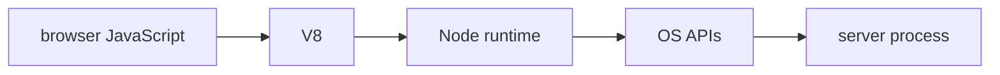

# Rest Api Contracts And Pagination

## The big idea in plain words {#picture}

An HTTP request is a letter. It has an address, a word saying what you want done, and sometimes a form inside.

## What you will be able to do {#outcomes}

Read this after the previous numbered lesson. Use synthetic notes and local exercise data. By the end you should explain the following scope without copying:

Teach resources, CRUD, status codes, OpenAPI, pagination, filtering, idempotency, versioning, and webhooks.

## Words to know {#vocabulary}

- **method**: the action word of a request, like GET or POST.

- **header**: extra information that travels with a message.

- **status**: a number in the reply that says how it went.

## Why this idea exists {#history}

If every app invented its own message style, nothing could talk to anything else. Shared methods, headers, and status codes let different programs understand each other.

## Concept 1 {#concept-1}

method means the action word of a request, like GET or POST. GET reads data and should not create anything new.

Apply this rule to the Study Notes boundary before choosing syntax. Name the input, owner, and observable result. The scenario below gives a concrete decision to check.

## Concept 2 {#concept-2}

Creating something with POST usually answers 201 and points to the new item.

Apply this rule to the Study Notes boundary before choosing syntax. Name the input, owner, and observable result. The scenario below gives a concrete decision to check.

## Concept 3 {#concept-3}

Content-Type tells what kind of data is in the body.

Apply this rule to the Study Notes boundary before choosing syntax. Name the input, owner, and observable result. The scenario below gives a concrete decision to check.

## Concept 4 {#concept-4}

Before retrying a write, decide how to avoid doing it twice.

Apply this rule to the Study Notes boundary before choosing syntax. Name the input, owner, and observable result. The scenario below gives a concrete decision to check.

## Going deeper: the technical walkthrough {#walkthrough}

### REST routes and request validation


```ts
type NoteCreate = {
  title: string;
  body: string;
  topic: string;
};

function parseNoteCreate(value: unknown): NoteCreate {
  if (!value || typeof value !== "object") {
    throw new Error("Invalid request body");
  }
  const body = value as Record<string, unknown>;
  if (typeof body.title !== "string" || body.title.trim().length === 0) {
    throw new Error("Title is required");
  }
  if (typeof body.body !== "string" || typeof body.topic !== "string") {
    throw new Error("Body and topic are required");
  }
  return {
    title: body.title.trim(),
    body: body.body,
    topic: body.topic.trim(),
  };
}
```

The example uses a narrow assertion only after checking the outer value. In a
real project, prefer a schema validator such as Zod when it fits the team's
conventions. Never trust `req.body` merely because TypeScript has a type alias.


## Worked scenario {#worked-scenario}

A client wants a page of notes and must not change anything. Which request fits?

The justified choice is **GET /notes?limit=20 returning a limited list**. Select **bounded-get** in the structured practical and explain why. Alternatives ignore a requirement, cross a trust boundary, or invent success.

### Structured decision contract

```json

{
  "decision": "bounded-get",
  "justification": "The method and header boundary must preserve the declared contract and ownership.",
  "failureBehavior": "Expose a safe failure and recover through the boundary owner."
}

```

Decision selects one declared behavior. Justification explains the boundary. FailureBehavior explains the observable error and recovery owner. These fields never execute commands. Required terms and minimum lengths form a basic practice rubric, not semantic grading.

## Step-by-step flow and matching picture {#flow}




## Three real-life uses {#use-cases}

1. A personal learner applies this rule to one synthetic note and checks the result.
2. A team changes the boundary while preserving its shared request and response contract.
3. A deployed library handles concurrent requests and reports failures through safe errors and correlated signals.

## What can go wrong, and how to stay safe {#failure-security}

A list answer should be a limited page in a steady order. An external dependency needs an owner, size limit, deadline, cleanup, and recovery path. Return a stable error code rather than raw exceptions. Redact credentials and private bodies in diagnostics.

The abstraction improves method reasoning but adds configuration and lifecycle work. Keep a simpler implementation when it meets the requirement. Measure the limiting resource before adding services, queues, or caches.

## Practice lab and expected observation {#practice}

Implement classify to return read for GET, write for POST/PUT/PATCH/DELETE, and unsupported for any other method. The input contract uses uppercase method strings. Do not perform an actual HTTP request.

The language starter and public examples appear in Practical. Run is unavailable until a trusted isolated worker is configured. Reading and assignment review still work; this lesson does not claim code-test completion.

1. Predict the scenario decision before opening Practical. Explain each rejected alternative.
2. Run a relevant example above in an isolated exercise project. Record the expected result, then change one input to an invalid or boundary value. A failed assertion or deliberate error should replace silent success.
3. Submit the structured decision. Initially the checks fail. After selecting bounded-get and writing an explanation and failure plan, all three pass. Follow the indicated review section for missed checks.

### Broken example to debug

```json

{"decision":"trust-client","justification":"","failureBehavior":""}

```

This ignores the responsible boundary and gives no reasoning or recovery. Correct the fields rather than changing the validator.

## Checkpoint and definition of done {#checkpoint}

- [ ] Define method and header without looking.
- [ ] Trace input to owner and output.
- [ ] Explain one failure and one alternative.
- [ ] Pass at least four assignment questions.
- [ ] Pass every practical check and submit.
- [ ] Explain the concept again tomorrow.

## Sources, versions, and safe commands {#sources}

Node 22 baseline; ESM modules. Review date: 2026-10-02. The supplied blueprint is the teaching source; official landing pages were checked where reachable. No provider or original TM Schedule deployment was tested.

- [Official reference](https://nodejs.org/api/)

[Course reading order](README.md) · [Previous lesson](14-runtime-validation-and-configuration.md) · [Next lesson](16-databases-pools-and-repositories.md)

```study-quiz

{
  "schemaVersion": 1,
  "lessonId": "nodejs/15-rest-api-contracts-and-pagination",
  "title": "Assignment: Rest Api Contracts And Pagination",
  "passPercentage": 80,
  "questions": [
    {
      "id": "q1",
      "sectionId": "concept-1",
      "prompt": "In Rest Api Contracts And Pagination, what does method mean?",
      "options": [
        {
          "id": "a",
          "text": "A permission granted by a hidden browser control",
          "explanation": "This changes the declared meaning or bypasses the responsible boundary."
        },
        {
          "id": "b",
          "text": "An unlimited provider operation with no ownership",
          "explanation": "This changes the declared meaning or bypasses the responsible boundary."
        },
        {
          "id": "c",
          "text": "the action word of a request, like GET or POST",
          "explanation": "This preserves the definition and boundary described in the lesson."
        },
        {
          "id": "d",
          "text": "A diagnostic credential intended for public logs",
          "explanation": "This changes the declared meaning or bypasses the responsible boundary."
        }
      ],
      "correctOptionId": "c",
      "explanation": "method means the action word of a request, like GET or POST.",
      "reviewLabel": "Review concept 1"
    },
    {
      "id": "q2",
      "sectionId": "concept-2",
      "prompt": "In Rest Api Contracts And Pagination, which rule is correct for checkpoint 2?",
      "options": [
        {
          "id": "a",
          "text": "Trust client-side checks instead of the server rule.",
          "explanation": "This changes the declared meaning or bypasses the responsible boundary."
        },
        {
          "id": "b",
          "text": "Hide the failure by returning a fabricated successful result.",
          "explanation": "This changes the declared meaning or bypasses the responsible boundary."
        },
        {
          "id": "c",
          "text": "Skip the stated boundary, limit, or ownership check.",
          "explanation": "This changes the declared meaning or bypasses the responsible boundary."
        },
        {
          "id": "d",
          "text": "Creating something with POST usually answers 201 and points to the new item.",
          "explanation": "This preserves the definition and boundary described in the lesson."
        }
      ],
      "correctOptionId": "d",
      "explanation": "Creating something with POST usually answers 201 and points to the new item.",
      "reviewLabel": "Review concept 2"
    },
    {
      "id": "q3",
      "sectionId": "concept-3",
      "prompt": "In Rest Api Contracts And Pagination, which rule is correct for checkpoint 3?",
      "options": [
        {
          "id": "a",
          "text": "Content-Type tells what kind of data is in the body.",
          "explanation": "This preserves the definition and boundary described in the lesson."
        },
        {
          "id": "b",
          "text": "Trust client-side checks instead of the server rule.",
          "explanation": "This changes the declared meaning or bypasses the responsible boundary."
        },
        {
          "id": "c",
          "text": "Hide the failure by returning a fabricated successful result.",
          "explanation": "This changes the declared meaning or bypasses the responsible boundary."
        },
        {
          "id": "d",
          "text": "Skip the stated boundary, limit, or ownership check.",
          "explanation": "This changes the declared meaning or bypasses the responsible boundary."
        }
      ],
      "correctOptionId": "a",
      "explanation": "Content-Type tells what kind of data is in the body.",
      "reviewLabel": "Review concept 3"
    },
    {
      "id": "q4",
      "sectionId": "concept-4",
      "prompt": "In Rest Api Contracts And Pagination, which rule is correct for checkpoint 4?",
      "options": [
        {
          "id": "a",
          "text": "Trust client-side checks instead of the server rule.",
          "explanation": "This changes the declared meaning or bypasses the responsible boundary."
        },
        {
          "id": "b",
          "text": "Before retrying a write, decide how to avoid doing it twice.",
          "explanation": "This preserves the definition and boundary described in the lesson."
        },
        {
          "id": "c",
          "text": "Hide the failure by returning a fabricated successful result.",
          "explanation": "This changes the declared meaning or bypasses the responsible boundary."
        },
        {
          "id": "d",
          "text": "Skip the stated boundary, limit, or ownership check.",
          "explanation": "This changes the declared meaning or bypasses the responsible boundary."
        }
      ],
      "correctOptionId": "b",
      "explanation": "Before retrying a write, decide how to avoid doing it twice.",
      "reviewLabel": "Review concept 4"
    },
    {
      "id": "q5",
      "sectionId": "worked-scenario",
      "prompt": "A client wants a page of notes and must not change anything. Which request fits?",
      "options": [
        {
          "id": "a",
          "text": "POST /delete-everything",
          "explanation": "This changes the declared meaning or bypasses the responsible boundary."
        },
        {
          "id": "b",
          "text": "A GET that secretly changes data",
          "explanation": "This changes the declared meaning or bypasses the responsible boundary."
        },
        {
          "id": "c",
          "text": "GET /notes?limit=20 returning a limited list",
          "explanation": "This preserves the definition and boundary described in the lesson."
        },
        {
          "id": "d",
          "text": "A database password inside the URL",
          "explanation": "This changes the declared meaning or bypasses the responsible boundary."
        }
      ],
      "correctOptionId": "c",
      "explanation": "GET /notes?limit=20 returning a limited list. A list answer should be a limited page in a steady order.",
      "reviewLabel": "Review the worked scenario"
    }
  ]
}

```

```study-practical

{
  "schemaVersion": 1,
  "challengeId": "nodejs/15-rest-api-contracts-and-pagination/coding",
  "lessonId": "nodejs/15-rest-api-contracts-and-pagination",
  "title": "Practical: Classify an HTTP method",
  "language": "typescript",
  "mode": "function",
  "instructions": "Implement classify to return read for GET, write for POST/PUT/PATCH/DELETE, and unsupported for any other method. The input contract uses uppercase method strings. Do not perform an actual HTTP request. A disposable isolated code runner is required; this installation never executes learner code on the host.",
  "starterCode": "export function classify(method: string): string {\n  return '';\n}\n",
  "entryPoint": "classify",
  "publicExamples": [
    {
      "input": "GET",
      "expected": "read"
    },
    {
      "input": "POST",
      "expected": "write"
    },
    {
      "input": "INVALID",
      "expected": "unsupported"
    }
  ],
  "publicTestIds": [
    "read-method",
    "write-methods",
    "invalid-method"
  ],
  "reviewSections": {
    "read-method": "worked-scenario",
    "write-methods": "worked-scenario",
    "invalid-method": "worked-scenario"
  },
  "limits": {
    "timeMs": 2000,
    "memoryMb": 128,
    "outputBytes": 20000
  }
}

```

