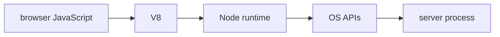

# Glossary Practice And Checklist

## The big idea in plain words {#picture}

Learning is like climbing stairs. You can only reach the third step if the first two are solid.

## What you will be able to do {#outcomes}

Read this after the previous numbered lesson. Use synthetic notes and local exercise data. By the end you should explain the following scope without copying:

Define every Node/JavaScript/TypeScript word and give worked exercises and mastery checks.

## Words to know {#vocabulary}

- **prerequisite**: something you need to know first, before the next thing makes sense.

- **checkpoint**: a question you answer from memory, without peeking.

- **contract**: a clear promise about what goes in and what comes out.

## Why this idea exists {#history}

If you try to memorize a whole framework before you ever run one small example, most of it slips away. Learning in small loops (read, guess, try, check, review) shows you exactly which step you missed.

## Concept 1 {#concept-1}

prerequisite means something you need to know first, before the next thing makes sense. Read the prerequisites before you run a framework example.

Apply this rule to the Study Notes boundary before choosing syntax. Name the input, owner, and observable result. The scenario below gives a concrete decision to check.

## Concept 2 {#concept-2}

Guess the output first, then look at the answer.

Apply this rule to the Study Notes boundary before choosing syntax. Name the input, owner, and observable result. The scenario below gives a concrete decision to check.

## Concept 3 {#concept-3}

When a test fails, it points to the idea you are missing.

Apply this rule to the Study Notes boundary before choosing syntax. Name the input, owner, and observable result. The scenario below gives a concrete decision to check.

## Concept 4 {#concept-4}

A practice score in this app is just a helper, not an official exam grade.

Apply this rule to the Study Notes boundary before choosing syntax. Name the input, owner, and observable result. The scenario below gives a concrete decision to check.

## Going deeper: the technical walkthrough {#walkthrough}

- **prerequisite**: something you need to know first, before the next thing makes sense.

- **checkpoint**: a question you answer from memory, without peeking.

- **contract**: a clear promise about what goes in and what comes out.

- **runtime**: the helper program that actually runs your code.

- **framework**: a ready-made skeleton that calls your code at the right moments.

- **tradeoff**: a good thing you get in exchange for a cost you accept.

- **type**: a description of what kind of values are allowed.

- **reference**: a pointer to an object, not the object itself.

- **validation**: checking real data against a rule.

- **parameter**: a named slot where a function receives an input.

- **return**: the answer a function hands back.

- **scope**: the part of the program where a name can be seen.

- **list**: items in order; the same item can appear twice.

- **set**: a bag of items where each one appears only once.

- **map**: a lookup table that connects each key to one value.

- **class**: a blueprint that describes the data and actions of something.

- **object**: one real thing built from a class.

- **invariant**: a rule that must always be true for the object.

- **interface**: a list of actions that something promises to offer.

- **adapter**: a piece that connects the promise to a real tool.

- **substitutability**: swapping one piece for another without breaking the promise.

- **null**: a marker meaning 'there is no value here'.

- **optional**: a box that may hold a value or may be empty.

- **normalization**: turning different ways of writing the same thing into one standard form.

- **exception**: a problem that interrupts the normal flow of a program.

- **safeError**: a short message that is safe to show to the person who asked.

- **cause**: the deeper problem that explains a surface problem.

- **instant**: one exact moment on the world's timeline.

- **localDate**: a calendar day with no time zone attached.

- **encoding**: the rule for turning text into bytes and back.

- **module**: one piece of code with clear things it takes in and gives out.

- **package**: a bundle of modules with a version number.

- **lockfile**: a file that records the exact versions you installed.

- **environment**: the settings given to a program by the place it runs.

- **profile**: a named set of settings, such as dev or production.

- **secret**: a password or key that must never be made public.

- **method**: the action word of a request, like GET or POST.

- **header**: extra information that travels with a message.

- **status**: a number in the reply that says how it went.

- **route**: a rule that sends a method and a path to a piece of code.

- **binding**: turning parts of a request into inputs for your code.

- **middleware**: a step that runs around every request.

- **schema**: a written description of the shape and limits of data.

- **businessRule**: a rule about what is allowed in your app.

- **authorization**: deciding what a person is allowed to do.

- **transaction**: a group of changes that all succeed or all get undone.

- **index**: a quick-lookup list a database keeps beside your data.

- **parameter**: a value sent separately from the SQL text.

- **idempotency**: doing the same action again has no extra effect.

- **outbox**: a to-do note saved in the same step as the main change.

- **isolation**: how separate changes at the same time are kept from tangling.

- **authentication**: proving who someone is.

- **authorization**: checking what that person may do with specific data.

- **leastPrivilege**: giving only the access a job really needs.

- **fixture**: prepared test data or setup.

- **unitTest**: a small test of one rule.

- **integrationTest**: a test that checks several real parts together.

- **log**: a written note about something that happened.

- **metric**: a number that counts or measures something over time.

- **trace**: the path one request took through many parts.

- **artifact**: the finished, versioned package made by a build.

- **rollback**: going back to the last version that worked.

- **restore**: bringing data back from a backup.

- **eventLoop**: the manager that decides what runs next while others wait.

- **queue**: a waiting line for jobs, with a size limit.

- **cancellation**: asking work to stop and clean up after itself.

- **path**: the address that points to a file.

- **buffer**: a chunk of raw data held in memory.

- **backpressure**: telling the sender to slow down when the receiver is full.

- **race**: a result that depends on lucky timing.

- **executor**: a manager that runs a limited number of tasks.

- **interruption**: a polite request for a running task to stop.

- **heap**: the big area of memory where objects live.

- **stack**: the small tidy area that tracks the calls happening right now.

- **leak**: holding on to something long after it is useful.

- **DNS**: the phone book that turns a name into an address.

- **TLS**: the lock that scrambles messages and proves who the server is.

- **deadline**: the total time allowed for the whole job.

- **functionalRequirement**: something the system must do.

- **qualityRequirement**: how fast, safe, or reliable it must be while doing it.

- **RPS**: requests per second.

- **TTL**: how long a saved copy is allowed to be used.

- **cacheAside**: check the cache, fetch from the source on a miss, then save a copy.

- **stampede**: many requests all rebuilding the same missing value at once.

- **replica**: an extra copy of data or of a running service.

- **shard**: one slice of a dataset that is split across machines.

- **hotKey**: one popular key that gets far more traffic than the rest.

- **backoff**: waiting longer and longer between retries.

- **circuitBreaker**: a switch that stops calling something that keeps failing.

- **bulkhead**: separate compartments so one failure cannot sink the whole ship.

- **monolith**: an app that is built and shipped as one piece.

- **port**: a doorway where your app talks to the outside.

- **saga**: a chain of steps where each step has an 'undo' step.

- **host**: the application managing the model and user experience.

- **client**: the connector maintaining access to an MCP server.

- **server**: the program exposing controlled tools and context.

- **requestId**: the value matching a response to a request.

- **notification**: a message with no ID and no matching response.

- **method**: the declared operation being requested.

- **capability**: a supported protocol feature.

- **negotiation**: agreeing on compatible behavior.

- **metadata**: context accompanying a request.

- **stdio**: a process input/output message channel.

- **StreamableHTTP**: an HTTP transport for MCP request/response and optional streaming.

- **framing**: rules separating complete messages.

- **tool**: a named operation with a checked input schema.

- **resource**: context chosen and read through a controlled URI.

- **prompt**: a user-selected reusable message template.

- **workflowState**: a durable task’s progress and result.

- **connectionState**: the lifetime of a pipe or stream.

- **applicationState**: persistent records used by business rules.

### Definition of done


- [ ] I can explain Node, V8, the event loop, promises, and async/await.
- [ ] I can use ESM modules and a lockfile-backed package script.
- [ ] I can create an HTTP route and parse JSON safely.
- [ ] I can validate runtime input instead of trusting TypeScript alone.
- [ ] I can separate route, service, repository, and provider code.
- [ ] I can use safe paths and bounded streams.
- [ ] I can explain authentication, authorization, and common Node risks.
- [ ] I can test success and failure paths.
- [ ] I can shut down without abandoning work.
- [ ] I can deploy with secrets and storage configured outside source code.


## Worked scenario {#worked-scenario}

You understand how to ask for data with GET, but you cannot explain how the server checks incoming data. What should you study next?

The justified choice is **Practice sending bad data and see how the server checks it**. Select **review-validation** in the structured practical and explain why. Alternatives ignore a requirement, cross a trust boundary, or invent success.

### Structured decision contract

```json

{
  "decision": "review-validation",
  "justification": "The prerequisite and checkpoint boundary must preserve the declared contract and ownership.",
  "failureBehavior": "Expose a safe failure and recover through the boundary owner."
}

```

Decision selects one declared behavior. Justification explains the boundary. FailureBehavior explains the observable error and recovery owner. These fields never execute commands. Required terms and minimum lengths form a basic practice rubric, not semantic grading.

## Step-by-step flow and matching picture {#flow}




## Three real-life uses {#use-cases}

1. A personal learner applies this rule to one synthetic note and checks the result.
2. A team changes the boundary while preserving its shared request and response contract.
3. A deployed library handles concurrent requests and reports failures through safe errors and correlated signals.

## What can go wrong, and how to stay safe {#failure-security}

Come back to a topic after a break; remembering it is better practice than just re-reading it. An external dependency needs an owner, size limit, deadline, cleanup, and recovery path. Return a stable error code rather than raw exceptions. Redact credentials and private bodies in diagnostics.

The abstraction improves prerequisite reasoning but adds configuration and lifecycle work. Keep a simpler implementation when it meets the requirement. Measure the limiting resource before adding services, queues, or caches.

## Practice lab and expected observation {#practice}

1. Predict the scenario decision before opening Practical. Explain each rejected alternative.
2. Run a relevant example above in an isolated exercise project. Record the expected result, then change one input to an invalid or boundary value. A failed assertion or deliberate error should replace silent success.
3. Submit the structured decision. Initially the checks fail. After selecting review-validation and writing an explanation and failure plan, all three pass. Follow the indicated review section for missed checks.

### Broken example to debug

```json

{"decision":"trust-client","justification":"","failureBehavior":""}

```

This ignores the responsible boundary and gives no reasoning or recovery. Correct the fields rather than changing the validator.

## Checkpoint and definition of done {#checkpoint}

- [ ] Define prerequisite and checkpoint without looking.
- [ ] Trace input to owner and output.
- [ ] Explain one failure and one alternative.
- [ ] Pass at least four assignment questions.
- [ ] Pass every practical check and submit.
- [ ] Explain the concept again tomorrow.

## Sources, versions, and safe commands {#sources}

Node 22 baseline; ESM modules. Review date: 2026-10-02. The supplied blueprint is the teaching source; official landing pages were checked where reachable. No provider or original TM Schedule deployment was tested.

- [Official reference](https://nodejs.org/api/)

[Course reading order](README.md) · [Previous lesson](24-capstone-study-notes-api.md)

```study-quiz

{
  "schemaVersion": 1,
  "lessonId": "nodejs/25-glossary-practice-and-checklist",
  "title": "Assignment: Glossary Practice And Checklist",
  "passPercentage": 80,
  "questions": [
    {
      "id": "q1",
      "sectionId": "concept-1",
      "prompt": "In Glossary Practice And Checklist, what does prerequisite mean?",
      "options": [
        {
          "id": "a",
          "text": "something you need to know first, before the next thing makes sense",
          "explanation": "This preserves the definition and boundary described in the lesson."
        },
        {
          "id": "b",
          "text": "A permission granted by a hidden browser control",
          "explanation": "This changes the declared meaning or bypasses the responsible boundary."
        },
        {
          "id": "c",
          "text": "An unlimited provider operation with no ownership",
          "explanation": "This changes the declared meaning or bypasses the responsible boundary."
        },
        {
          "id": "d",
          "text": "A diagnostic credential intended for public logs",
          "explanation": "This changes the declared meaning or bypasses the responsible boundary."
        }
      ],
      "correctOptionId": "a",
      "explanation": "prerequisite means something you need to know first, before the next thing makes sense.",
      "reviewLabel": "Review concept 1"
    },
    {
      "id": "q2",
      "sectionId": "concept-2",
      "prompt": "In Glossary Practice And Checklist, which rule is correct for checkpoint 2?",
      "options": [
        {
          "id": "a",
          "text": "Trust client-side checks instead of the server rule.",
          "explanation": "This changes the declared meaning or bypasses the responsible boundary."
        },
        {
          "id": "b",
          "text": "Guess the output first, then look at the answer.",
          "explanation": "This preserves the definition and boundary described in the lesson."
        },
        {
          "id": "c",
          "text": "Hide the failure by returning a fabricated successful result.",
          "explanation": "This changes the declared meaning or bypasses the responsible boundary."
        },
        {
          "id": "d",
          "text": "Skip the stated boundary, limit, or ownership check.",
          "explanation": "This changes the declared meaning or bypasses the responsible boundary."
        }
      ],
      "correctOptionId": "b",
      "explanation": "Guess the output first, then look at the answer.",
      "reviewLabel": "Review concept 2"
    },
    {
      "id": "q3",
      "sectionId": "concept-3",
      "prompt": "In Glossary Practice And Checklist, which rule is correct for checkpoint 3?",
      "options": [
        {
          "id": "a",
          "text": "Trust client-side checks instead of the server rule.",
          "explanation": "This changes the declared meaning or bypasses the responsible boundary."
        },
        {
          "id": "b",
          "text": "Hide the failure by returning a fabricated successful result.",
          "explanation": "This changes the declared meaning or bypasses the responsible boundary."
        },
        {
          "id": "c",
          "text": "When a test fails, it points to the idea you are missing.",
          "explanation": "This preserves the definition and boundary described in the lesson."
        },
        {
          "id": "d",
          "text": "Skip the stated boundary, limit, or ownership check.",
          "explanation": "This changes the declared meaning or bypasses the responsible boundary."
        }
      ],
      "correctOptionId": "c",
      "explanation": "When a test fails, it points to the idea you are missing.",
      "reviewLabel": "Review concept 3"
    },
    {
      "id": "q4",
      "sectionId": "concept-4",
      "prompt": "In Glossary Practice And Checklist, which rule is correct for checkpoint 4?",
      "options": [
        {
          "id": "a",
          "text": "Trust client-side checks instead of the server rule.",
          "explanation": "This changes the declared meaning or bypasses the responsible boundary."
        },
        {
          "id": "b",
          "text": "Hide the failure by returning a fabricated successful result.",
          "explanation": "This changes the declared meaning or bypasses the responsible boundary."
        },
        {
          "id": "c",
          "text": "Skip the stated boundary, limit, or ownership check.",
          "explanation": "This changes the declared meaning or bypasses the responsible boundary."
        },
        {
          "id": "d",
          "text": "A practice score in this app is just a helper, not an official exam grade.",
          "explanation": "This preserves the definition and boundary described in the lesson."
        }
      ],
      "correctOptionId": "d",
      "explanation": "A practice score in this app is just a helper, not an official exam grade.",
      "reviewLabel": "Review concept 4"
    },
    {
      "id": "q5",
      "sectionId": "worked-scenario",
      "prompt": "You understand how to ask for data with GET, but you cannot explain how the server checks incoming data. What should you study next?",
      "options": [
        {
          "id": "a",
          "text": "Practice sending bad data and see how the server checks it",
          "explanation": "This preserves the definition and boundary described in the lesson."
        },
        {
          "id": "b",
          "text": "Jump straight to advanced deployment",
          "explanation": "This changes the declared meaning or bypasses the responsible boundary."
        },
        {
          "id": "c",
          "text": "Copy an answer without trying it",
          "explanation": "This changes the declared meaning or bypasses the responsible boundary."
        },
        {
          "id": "d",
          "text": "Switch frameworks so the problem goes away",
          "explanation": "This changes the declared meaning or bypasses the responsible boundary."
        }
      ],
      "correctOptionId": "a",
      "explanation": "Practice sending bad data and see how the server checks it. Come back to a topic after a break; remembering it is better practice than just re-reading it.",
      "reviewLabel": "Review the worked scenario"
    }
  ]
}

```

```study-practical

{
  "schemaVersion": 1,
  "challengeId": "nodejs/25-glossary-practice-and-checklist/decision",
  "lessonId": "nodejs/25-glossary-practice-and-checklist",
  "title": "Practical: Glossary Practice And Checklist",
  "language": "json",
  "mode": "structured",
  "instructions": "You understand how to ask for data with GET, but you cannot explain how the server checks incoming data. What should you study next? Return an object with decision (choose from review-validation, skip-check, unbounded-work, trust-client), justification (at least 40 characters; include prerequisite and checkpoint), and failureBehavior (at least 25 characters; include failure and recover while explaining the error and recovery). These are structured reasoning checks, not code execution or an official grade.",
  "starterCode": "{\n  \"decision\": \"\",\n  \"justification\": \"\",\n  \"failureBehavior\": \"\"\n}",
  "entryPoint": "answer",
  "publicExamples": [
    {
      "input": {
        "decision": "skip-check",
        "justification": "",
        "failureBehavior": ""
      },
      "expected": {
        "passed": false
      }
    },
    {
      "input": {
        "decision": "review-validation",
        "justification": "The prerequisite and checkpoint boundary must preserve the declared contract and ownership.",
        "failureBehavior": "Show a safe failure and recover through the responsible owner."
      },
      "expected": {
        "passed": true
      }
    }
  ],
  "publicTestIds": [
    "decision",
    "explanation",
    "failure-plan"
  ],
  "reviewSections": {
    "decision": "worked-scenario",
    "explanation": "concept-2",
    "failure-plan": "failure-security"
  },
  "limits": {
    "timeMs": 2000,
    "memoryMb": 128,
    "outputBytes": 20000
  }
}

```

