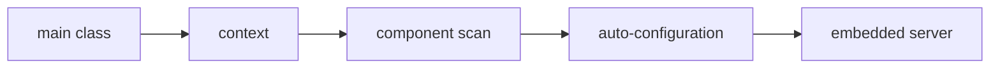

# Startup Application Context And Auto Configuration

## The big idea in plain words {#picture}

Configuration is the address label on a parcel. You change where it goes without changing what is inside.

## What you will be able to do {#outcomes}

Read this after the previous numbered lesson. Use synthetic notes and local exercise data. By the end you should explain the following scope without copying:

Main class, application context, component scan, conditions, auto-configuration reports, and startup lifecycle.

## Words to know {#vocabulary}

- **environment**: the settings given to a program by the place it runs.

- **profile**: a named set of settings, such as dev or production.

- **secret**: a password or key that must never be made public.

## Why this idea exists {#history}

If addresses and passwords are typed into the code, you must edit the code for every place it runs. Settings kept outside the code, and checked at startup, let the same program run anywhere.

## Concept 1 {#concept-1}

environment means the settings given to a program by the place it runs. Check that required settings exist when the program starts.

Apply this rule to the Study Notes boundary before choosing syntax. Name the input, owner, and observable result. The scenario below gives a concrete decision to check.

## Concept 2 {#concept-2}

Keep secrets on the server, never in browser code.

Apply this rule to the Study Notes boundary before choosing syntax. Name the input, owner, and observable result. The scenario below gives a concrete decision to check.

## Concept 3 {#concept-3}

A profile can switch which helper is used without changing the service's promise.

Apply this rule to the Study Notes boundary before choosing syntax. Name the input, owner, and observable result. The scenario below gives a concrete decision to check.

## Concept 4 {#concept-4}

Write down which setting wins when two places disagree.

Apply this rule to the Study Notes boundary before choosing syntax. Name the input, owner, and observable result. The scenario below gives a concrete decision to check.

## Going deeper: the technical walkthrough {#walkthrough}

### Create the application


Use Spring Initializr or a version-pinned Gradle project. Typical dependencies
for a learning REST service are:

- Spring Web;
- Validation;
- Spring JDBC or Spring Data JPA;
- an H2 or PostgreSQL driver for the chosen environment;
- Actuator;
- a test starter;
- Spring Security only when authentication is part of the exercise.

A main class looks like this:

```java
@SpringBootApplication
public class StudyApiApplication {
    public static void main(String[] args) {
        SpringApplication.run(StudyApiApplication.class, args);
    }
}
```

`@SpringBootApplication` combines component scanning, auto-configuration, and
application configuration. The package of the main class should be above the
components you expect Spring to find.


### Beans and dependency injection


A bean is an object managed by Spring. Constructor injection makes the required
collaborator visible:

```java
@Service
public class NoteService {
    private final NoteRepository repository;

    public NoteService(NoteRepository repository) {
        this.repository = repository;
    }
}
```

Useful stereotypes include:

| Annotation | Job |
| --- | --- |
| `@RestController` | handles HTTP and returns data |
| `@Service` | owns application or business operations |
| `@Repository` | marks data access code |
| `@Configuration` | declares setup and beans |
| `@RestControllerAdvice` | translates controller errors |
| `@Profile` | limits a bean to an environment |

Avoid field injection because it hides required dependencies and makes focused
tests harder to construct.


### Focused implementation

SpringApplication creates the application context, selects configuration, discovers components, and starts the embedded server. Auto-configuration is conditional on the classpath, environment, and existing beans. Inspect the conditions report when behavior surprises you. Constructor injection declares required dependencies; starting workers in a constructor hides lifecycle ownership.

```java

// Inside the generated Boot project:
@SpringBootApplication
public class StudyApplication {
  public static void main(String[] args) {
    SpringApplication.run(StudyApplication.class, args);
  }
}

```

Read the imports, then the values and checks, then the operation, and finally the result or cleanup. Java Example programs compile as Example.java. Python uses Python 3.11+. JavaScript ESM runs as example.mjs. Framework snippets run inside the generated project.

## Worked scenario {#worked-scenario}

In production, the storage password is missing. What should the app do when it starts?

The justified choice is **Say it is not ready and show a safe configuration error**. Select **fail-config** in the structured practical and explain why. Alternatives ignore a requirement, cross a trust boundary, or invent success.

### Structured decision contract

```json

{
  "decision": "fail-config",
  "justification": "The environment and profile boundary must preserve the declared contract and ownership.",
  "failureBehavior": "Expose a safe failure and recover through the boundary owner."
}

```

Decision selects one declared behavior. Justification explains the boundary. FailureBehavior explains the observable error and recovery owner. These fields never execute commands. Required terms and minimum lengths form a basic practice rubric, not semantic grading.

## Step-by-step flow and matching picture {#flow}




## Three real-life uses {#use-cases}

1. A personal learner applies this rule to one synthetic note and checks the result.
2. A team changes the boundary while preserving its shared request and response contract.
3. A deployed library handles concurrent requests and reports failures through safe errors and correlated signals.

## What can go wrong, and how to stay safe {#failure-security}

A missing database password is a problem to report, not an empty catalog. An external dependency needs an owner, size limit, deadline, cleanup, and recovery path. Return a stable error code rather than raw exceptions. Redact credentials and private bodies in diagnostics.

The abstraction improves environment reasoning but adds configuration and lifecycle work. Keep a simpler implementation when it meets the requirement. Measure the limiting resource before adding services, queues, or caches.

## Practice lab and expected observation {#practice}

1. Predict the scenario decision before opening Practical. Explain each rejected alternative.
2. Run a relevant example above in an isolated exercise project. Record the expected result, then change one input to an invalid or boundary value. A failed assertion or deliberate error should replace silent success.
3. Submit the structured decision. Initially the checks fail. After selecting fail-config and writing an explanation and failure plan, all three pass. Follow the indicated review section for missed checks.

### Broken example to debug

```json

{"decision":"trust-client","justification":"","failureBehavior":""}

```

This ignores the responsible boundary and gives no reasoning or recovery. Correct the fields rather than changing the validator.

## Checkpoint and definition of done {#checkpoint}

- [ ] Define environment and profile without looking.
- [ ] Trace input to owner and output.
- [ ] Explain one failure and one alternative.
- [ ] Pass at least four assignment questions.
- [ ] Pass every practical check and submit.
- [ ] Explain the concept again tomorrow.

## Sources, versions, and safe commands {#sources}

Java 17; runnable project pins Spring Boot 3.1.3 for the supplied course baseline. Review date: 2026-10-02. The supplied blueprint is the teaching source; official landing pages were checked where reachable. No provider or original TM Schedule deployment was tested.

- [Official reference](https://docs.spring.io/spring-boot/index.html)

[Course reading order](README.md) · [Previous lesson](03-create-a-versioned-boot-project.md) · [Next lesson](05-beans-component-scanning-and-lifecycle.md)

```study-quiz

{
  "schemaVersion": 1,
  "lessonId": "spring-boot/04-startup-application-context-and-auto-configuration",
  "title": "Assignment: Startup Application Context And Auto Configuration",
  "passPercentage": 80,
  "questions": [
    {
      "id": "q1",
      "sectionId": "concept-1",
      "prompt": "In Startup Application Context And Auto Configuration, what does environment mean?",
      "options": [
        {
          "id": "a",
          "text": "A permission granted by a hidden browser control",
          "explanation": "This changes the declared meaning or bypasses the responsible boundary."
        },
        {
          "id": "b",
          "text": "An unlimited provider operation with no ownership",
          "explanation": "This changes the declared meaning or bypasses the responsible boundary."
        },
        {
          "id": "c",
          "text": "A diagnostic credential intended for public logs",
          "explanation": "This changes the declared meaning or bypasses the responsible boundary."
        },
        {
          "id": "d",
          "text": "the settings given to a program by the place it runs",
          "explanation": "This preserves the definition and boundary described in the lesson."
        }
      ],
      "correctOptionId": "d",
      "explanation": "environment means the settings given to a program by the place it runs.",
      "reviewLabel": "Review concept 1"
    },
    {
      "id": "q2",
      "sectionId": "concept-2",
      "prompt": "In Startup Application Context And Auto Configuration, which rule is correct for checkpoint 2?",
      "options": [
        {
          "id": "a",
          "text": "Keep secrets on the server, never in browser code.",
          "explanation": "This preserves the definition and boundary described in the lesson."
        },
        {
          "id": "b",
          "text": "Trust client-side checks instead of the server rule.",
          "explanation": "This changes the declared meaning or bypasses the responsible boundary."
        },
        {
          "id": "c",
          "text": "Hide the failure by returning a fabricated successful result.",
          "explanation": "This changes the declared meaning or bypasses the responsible boundary."
        },
        {
          "id": "d",
          "text": "Skip the stated boundary, limit, or ownership check.",
          "explanation": "This changes the declared meaning or bypasses the responsible boundary."
        }
      ],
      "correctOptionId": "a",
      "explanation": "Keep secrets on the server, never in browser code.",
      "reviewLabel": "Review concept 2"
    },
    {
      "id": "q3",
      "sectionId": "concept-3",
      "prompt": "In Startup Application Context And Auto Configuration, which rule is correct for checkpoint 3?",
      "options": [
        {
          "id": "a",
          "text": "Trust client-side checks instead of the server rule.",
          "explanation": "This changes the declared meaning or bypasses the responsible boundary."
        },
        {
          "id": "b",
          "text": "A profile can switch which helper is used without changing the service's promise.",
          "explanation": "This preserves the definition and boundary described in the lesson."
        },
        {
          "id": "c",
          "text": "Hide the failure by returning a fabricated successful result.",
          "explanation": "This changes the declared meaning or bypasses the responsible boundary."
        },
        {
          "id": "d",
          "text": "Skip the stated boundary, limit, or ownership check.",
          "explanation": "This changes the declared meaning or bypasses the responsible boundary."
        }
      ],
      "correctOptionId": "b",
      "explanation": "A profile can switch which helper is used without changing the service's promise.",
      "reviewLabel": "Review concept 3"
    },
    {
      "id": "q4",
      "sectionId": "concept-4",
      "prompt": "In Startup Application Context And Auto Configuration, which rule is correct for checkpoint 4?",
      "options": [
        {
          "id": "a",
          "text": "Trust client-side checks instead of the server rule.",
          "explanation": "This changes the declared meaning or bypasses the responsible boundary."
        },
        {
          "id": "b",
          "text": "Hide the failure by returning a fabricated successful result.",
          "explanation": "This changes the declared meaning or bypasses the responsible boundary."
        },
        {
          "id": "c",
          "text": "Write down which setting wins when two places disagree.",
          "explanation": "This preserves the definition and boundary described in the lesson."
        },
        {
          "id": "d",
          "text": "Skip the stated boundary, limit, or ownership check.",
          "explanation": "This changes the declared meaning or bypasses the responsible boundary."
        }
      ],
      "correctOptionId": "c",
      "explanation": "Write down which setting wins when two places disagree.",
      "reviewLabel": "Review concept 4"
    },
    {
      "id": "q5",
      "sectionId": "worked-scenario",
      "prompt": "In production, the storage password is missing. What should the app do when it starts?",
      "options": [
        {
          "id": "a",
          "text": "Start with a fake full library",
          "explanation": "This changes the declared meaning or bypasses the responsible boundary."
        },
        {
          "id": "b",
          "text": "Put a private key into browser JavaScript",
          "explanation": "This changes the declared meaning or bypasses the responsible boundary."
        },
        {
          "id": "c",
          "text": "Quietly pretend the storage is empty",
          "explanation": "This changes the declared meaning or bypasses the responsible boundary."
        },
        {
          "id": "d",
          "text": "Say it is not ready and show a safe configuration error",
          "explanation": "This preserves the definition and boundary described in the lesson."
        }
      ],
      "correctOptionId": "d",
      "explanation": "Say it is not ready and show a safe configuration error. A missing database password is a problem to report, not an empty catalog.",
      "reviewLabel": "Review the worked scenario"
    }
  ]
}

```

```study-practical

{
  "schemaVersion": 1,
  "challengeId": "spring-boot/04-startup-application-context-and-auto-configuration/decision",
  "lessonId": "spring-boot/04-startup-application-context-and-auto-configuration",
  "title": "Practical: Startup Application Context And Auto Configuration",
  "language": "json",
  "mode": "structured",
  "instructions": "In production, the storage password is missing. What should the app do when it starts? Return an object with decision (choose from fail-config, skip-check, unbounded-work, trust-client), justification (at least 40 characters; include environment and profile), and failureBehavior (at least 25 characters; include failure and recover while explaining the error and recovery). These are structured reasoning checks, not code execution or an official grade.",
  "starterCode": "{\n  \"decision\": \"\",\n  \"justification\": \"\",\n  \"failureBehavior\": \"\"\n}",
  "entryPoint": "answer",
  "publicExamples": [
    {
      "input": {
        "decision": "skip-check",
        "justification": "",
        "failureBehavior": ""
      },
      "expected": {
        "passed": false
      }
    },
    {
      "input": {
        "decision": "fail-config",
        "justification": "The environment and profile boundary must preserve the declared contract and ownership.",
        "failureBehavior": "Show a safe failure and recover through the responsible owner."
      },
      "expected": {
        "passed": true
      }
    }
  ],
  "publicTestIds": [
    "decision",
    "explanation",
    "failure-plan"
  ],
  "reviewSections": {
    "decision": "worked-scenario",
    "explanation": "concept-2",
    "failure-plan": "failure-security"
  },
  "limits": {
    "timeMs": 2000,
    "memoryMb": 128,
    "outputBytes": 20000
  }
}

```

