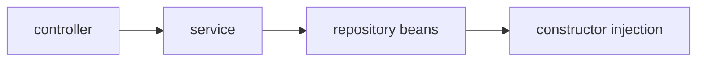

# Beans Component Scanning And Lifecycle

## The big idea in plain words {#picture}

A class is a blueprint. An object is one real house built from it, with its own paint color and furniture.

## What you will be able to do {#outcomes}

Read this after the previous numbered lesson. Use synthetic notes and local exercise data. By the end you should explain the following scope without copying:

Bean definition, scopes, stereotypes, lifecycle callbacks, profiles, proxies, and avoiding hidden magic.

## Words to know {#vocabulary}

- **class**: a blueprint that describes the data and actions of something.

- **object**: one real thing built from a class.

- **invariant**: a rule that must always be true for the object.

## Why this idea exists {#history}

If anyone can change any field at any time, rules get broken. Putting data and the actions that use it together, and guarding the data, keeps every object valid.

## Concept 1 {#concept-1}

class means a blueprint that describes the data and actions of something. A constructor should create an object that is already valid.

Apply this rule to the Study Notes boundary before choosing syntax. Name the input, owner, and observable result. The scenario below gives a concrete decision to check.

## Concept 2 {#concept-2}

Private data is changed only through carefully written methods.

Apply this rule to the Study Notes boundary before choosing syntax. Name the input, owner, and observable result. The scenario below gives a concrete decision to check.

## Concept 3 {#concept-3}

Composition means one object uses another object to help it.

Apply this rule to the Study Notes boundary before choosing syntax. Name the input, owner, and observable result. The scenario below gives a concrete decision to check.

## Concept 4 {#concept-4}

A child class should keep the promises of its parent class.

Apply this rule to the Study Notes boundary before choosing syntax. Name the input, owner, and observable result. The scenario below gives a concrete decision to check.

## Going deeper: the technical walkthrough {#walkthrough}

### Beans and dependency injection


A bean is an object managed by Spring. Constructor injection makes the required
collaborator visible:

```java
@Service
public class NoteService {
    private final NoteRepository repository;

    public NoteService(NoteRepository repository) {
        this.repository = repository;
    }
}
```

Useful stereotypes include:

| Annotation | Job |
| --- | --- |
| `@RestController` | handles HTTP and returns data |
| `@Service` | owns application or business operations |
| `@Repository` | marks data access code |
| `@Configuration` | declares setup and beans |
| `@RestControllerAdvice` | translates controller errors |
| `@Profile` | limits a bean to an environment |

Avoid field injection because it hides required dependencies and makes focused
tests harder to construct.


### Focused implementation

A bean is managed by the Spring context. Singleton means one instance per context, not per world-wide deployment. Component scanning starts at declared packages. Lifecycle callbacks define initialization and cleanup. Proxies implement concerns such as transactions; calling through this can bypass interception. Prototype beans need explicit cleanup ownership.

```java

@Configuration
class NotesConfig {
  @Bean
  Clock applicationClock() { return Clock.systemUTC(); }
}
// Inject Clock in a constructor; replace with Clock.fixed in tests.

```

Read the imports, then the values and checks, then the operation, and finally the result or cleanup. Java Example programs compile as Example.java. Python uses Python 3.11+. JavaScript ESM runs as example.mjs. Framework snippets run inside the generated project.

## Worked scenario {#worked-scenario}

A note must never have an empty title. Where should the object protect that rule?

The justified choice is **When it is created and whenever the title changes**. Select **protect-invariant** in the structured practical and explain why. Alternatives ignore a requirement, cross a trust boundary, or invent success.

### Structured decision contract

```json

{
  "decision": "protect-invariant",
  "justification": "The class and object boundary must preserve the declared contract and ownership.",
  "failureBehavior": "Expose a safe failure and recover through the boundary owner."
}

```

Decision selects one declared behavior. Justification explains the boundary. FailureBehavior explains the observable error and recovery owner. These fields never execute commands. Required terms and minimum lengths form a basic practice rubric, not semantic grading.

## Step-by-step flow and matching picture {#flow}




## Three real-life uses {#use-cases}

1. A personal learner applies this rule to one synthetic note and checks the result.
2. A team changes the boundary while preserving its shared request and response contract.
3. A deployed library handles concurrent requests and reports failures through safe errors and correlated signals.

## What can go wrong, and how to stay safe {#failure-security}

A record is a simple value holder, but things inside it can still be changeable. An external dependency needs an owner, size limit, deadline, cleanup, and recovery path. Return a stable error code rather than raw exceptions. Redact credentials and private bodies in diagnostics.

The abstraction improves class reasoning but adds configuration and lifecycle work. Keep a simpler implementation when it meets the requirement. Measure the limiting resource before adding services, queues, or caches.

## Practice lab and expected observation {#practice}

1. Predict the scenario decision before opening Practical. Explain each rejected alternative.
2. Run a relevant example above in an isolated exercise project. Record the expected result, then change one input to an invalid or boundary value. A failed assertion or deliberate error should replace silent success.
3. Submit the structured decision. Initially the checks fail. After selecting protect-invariant and writing an explanation and failure plan, all three pass. Follow the indicated review section for missed checks.

### Broken example to debug

```json

{"decision":"trust-client","justification":"","failureBehavior":""}

```

This ignores the responsible boundary and gives no reasoning or recovery. Correct the fields rather than changing the validator.

## Checkpoint and definition of done {#checkpoint}

- [ ] Define class and object without looking.
- [ ] Trace input to owner and output.
- [ ] Explain one failure and one alternative.
- [ ] Pass at least four assignment questions.
- [ ] Pass every practical check and submit.
- [ ] Explain the concept again tomorrow.

## Sources, versions, and safe commands {#sources}

Java 17; runnable project pins Spring Boot 3.1.3 for the supplied course baseline. Review date: 2026-10-02. The supplied blueprint is the teaching source; official landing pages were checked where reachable. No provider or original TM Schedule deployment was tested.

- [Official reference](https://docs.spring.io/spring-boot/index.html)

[Course reading order](README.md) · [Previous lesson](04-startup-application-context-and-auto-configuration.md) · [Next lesson](06-dependency-injection-and-configuration.md)

```study-quiz

{
  "schemaVersion": 1,
  "lessonId": "spring-boot/05-beans-component-scanning-and-lifecycle",
  "title": "Assignment: Beans Component Scanning And Lifecycle",
  "passPercentage": 80,
  "questions": [
    {
      "id": "q1",
      "sectionId": "concept-1",
      "prompt": "In Beans Component Scanning And Lifecycle, what does class mean?",
      "options": [
        {
          "id": "a",
          "text": "a blueprint that describes the data and actions of something",
          "explanation": "This preserves the definition and boundary described in the lesson."
        },
        {
          "id": "b",
          "text": "A permission granted by a hidden browser control",
          "explanation": "This changes the declared meaning or bypasses the responsible boundary."
        },
        {
          "id": "c",
          "text": "An unlimited provider operation with no ownership",
          "explanation": "This changes the declared meaning or bypasses the responsible boundary."
        },
        {
          "id": "d",
          "text": "A diagnostic credential intended for public logs",
          "explanation": "This changes the declared meaning or bypasses the responsible boundary."
        }
      ],
      "correctOptionId": "a",
      "explanation": "class means a blueprint that describes the data and actions of something.",
      "reviewLabel": "Review concept 1"
    },
    {
      "id": "q2",
      "sectionId": "concept-2",
      "prompt": "In Beans Component Scanning And Lifecycle, which rule is correct for checkpoint 2?",
      "options": [
        {
          "id": "a",
          "text": "Trust client-side checks instead of the server rule.",
          "explanation": "This changes the declared meaning or bypasses the responsible boundary."
        },
        {
          "id": "b",
          "text": "Private data is changed only through carefully written methods.",
          "explanation": "This preserves the definition and boundary described in the lesson."
        },
        {
          "id": "c",
          "text": "Hide the failure by returning a fabricated successful result.",
          "explanation": "This changes the declared meaning or bypasses the responsible boundary."
        },
        {
          "id": "d",
          "text": "Skip the stated boundary, limit, or ownership check.",
          "explanation": "This changes the declared meaning or bypasses the responsible boundary."
        }
      ],
      "correctOptionId": "b",
      "explanation": "Private data is changed only through carefully written methods.",
      "reviewLabel": "Review concept 2"
    },
    {
      "id": "q3",
      "sectionId": "concept-3",
      "prompt": "In Beans Component Scanning And Lifecycle, which rule is correct for checkpoint 3?",
      "options": [
        {
          "id": "a",
          "text": "Trust client-side checks instead of the server rule.",
          "explanation": "This changes the declared meaning or bypasses the responsible boundary."
        },
        {
          "id": "b",
          "text": "Hide the failure by returning a fabricated successful result.",
          "explanation": "This changes the declared meaning or bypasses the responsible boundary."
        },
        {
          "id": "c",
          "text": "Composition means one object uses another object to help it.",
          "explanation": "This preserves the definition and boundary described in the lesson."
        },
        {
          "id": "d",
          "text": "Skip the stated boundary, limit, or ownership check.",
          "explanation": "This changes the declared meaning or bypasses the responsible boundary."
        }
      ],
      "correctOptionId": "c",
      "explanation": "Composition means one object uses another object to help it.",
      "reviewLabel": "Review concept 3"
    },
    {
      "id": "q4",
      "sectionId": "concept-4",
      "prompt": "In Beans Component Scanning And Lifecycle, which rule is correct for checkpoint 4?",
      "options": [
        {
          "id": "a",
          "text": "Trust client-side checks instead of the server rule.",
          "explanation": "This changes the declared meaning or bypasses the responsible boundary."
        },
        {
          "id": "b",
          "text": "Hide the failure by returning a fabricated successful result.",
          "explanation": "This changes the declared meaning or bypasses the responsible boundary."
        },
        {
          "id": "c",
          "text": "Skip the stated boundary, limit, or ownership check.",
          "explanation": "This changes the declared meaning or bypasses the responsible boundary."
        },
        {
          "id": "d",
          "text": "A child class should keep the promises of its parent class.",
          "explanation": "This preserves the definition and boundary described in the lesson."
        }
      ],
      "correctOptionId": "d",
      "explanation": "A child class should keep the promises of its parent class.",
      "reviewLabel": "Review concept 4"
    },
    {
      "id": "q5",
      "sectionId": "worked-scenario",
      "prompt": "A note must never have an empty title. Where should the object protect that rule?",
      "options": [
        {
          "id": "a",
          "text": "When it is created and whenever the title changes",
          "explanation": "This preserves the definition and boundary described in the lesson."
        },
        {
          "id": "b",
          "text": "Only in a color on the screen",
          "explanation": "This changes the declared meaning or bypasses the responsible boundary."
        },
        {
          "id": "c",
          "text": "Only in a comment in the database",
          "explanation": "This changes the declared meaning or bypasses the responsible boundary."
        },
        {
          "id": "d",
          "text": "Only in a log message",
          "explanation": "This changes the declared meaning or bypasses the responsible boundary."
        }
      ],
      "correctOptionId": "a",
      "explanation": "When it is created and whenever the title changes. A record is a simple value holder, but things inside it can still be changeable.",
      "reviewLabel": "Review the worked scenario"
    }
  ]
}

```

```study-practical

{
  "schemaVersion": 1,
  "challengeId": "spring-boot/05-beans-component-scanning-and-lifecycle/decision",
  "lessonId": "spring-boot/05-beans-component-scanning-and-lifecycle",
  "title": "Practical: Beans Component Scanning And Lifecycle",
  "language": "json",
  "mode": "structured",
  "instructions": "A note must never have an empty title. Where should the object protect that rule? Return an object with decision (choose from protect-invariant, skip-check, unbounded-work, trust-client), justification (at least 40 characters; include class and object), and failureBehavior (at least 25 characters; include failure and recover while explaining the error and recovery). These are structured reasoning checks, not code execution or an official grade.",
  "starterCode": "{\n  \"decision\": \"\",\n  \"justification\": \"\",\n  \"failureBehavior\": \"\"\n}",
  "entryPoint": "answer",
  "publicExamples": [
    {
      "input": {
        "decision": "skip-check",
        "justification": "",
        "failureBehavior": ""
      },
      "expected": {
        "passed": false
      }
    },
    {
      "input": {
        "decision": "protect-invariant",
        "justification": "The class and object boundary must preserve the declared contract and ownership.",
        "failureBehavior": "Show a safe failure and recover through the responsible owner."
      },
      "expected": {
        "passed": true
      }
    }
  ],
  "publicTestIds": [
    "decision",
    "explanation",
    "failure-plan"
  ],
  "reviewSections": {
    "decision": "worked-scenario",
    "explanation": "concept-2",
    "failure-plan": "failure-security"
  },
  "limits": {
    "timeMs": 2000,
    "memoryMb": 128,
    "outputBytes": 20000
  }
}

```

