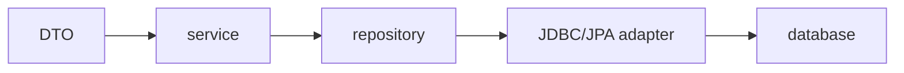
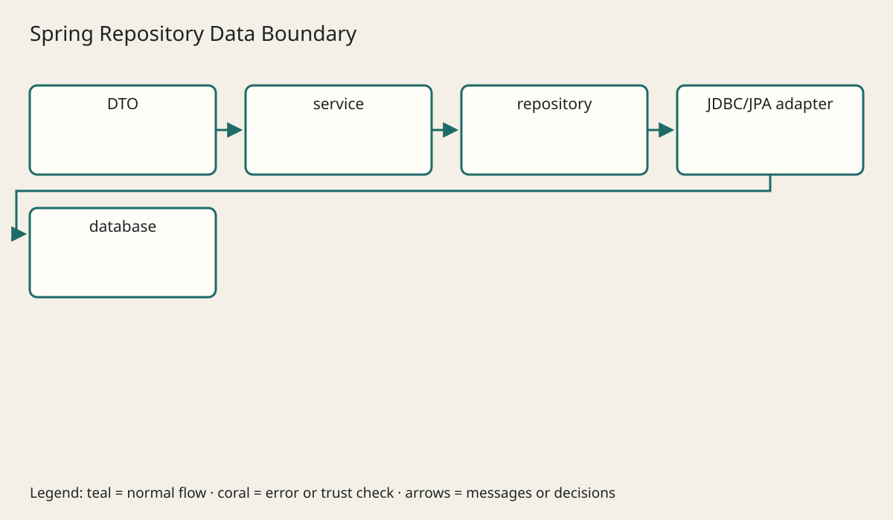

# Services Domain Rules And Repositories

## The big idea in plain words {#picture}

An interface is the shape of a wall socket. Any plug that fits the shape works, no matter which brand made it.

## What you will be able to do {#outcomes}

Read this after the previous numbered lesson. Use synthetic notes and local exercise data. By the end you should explain the following scope without copying:

Application services, domain decisions, repository ports, adapters, transaction ownership, and dependency direction.

## Words to know {#vocabulary}

- **interface**: a list of actions that something promises to offer.

- **adapter**: a piece that connects the promise to a real tool.

- **substitutability**: swapping one piece for another without breaking the promise.

## Why this idea exists {#history}

If your business rules talk straight to one specific database, they are hard to test and hard to change. A small contract says what is needed, and different helpers can fill that role.

## Concept 1 {#concept-1}

interface means a list of actions that something promises to offer. The service should rely on the repository's promise, not on a specific database.

Apply this rule to the Study Notes boundary before choosing syntax. Name the input, owner, and observable result. The scenario below gives a concrete decision to check.

## Concept 2 {#concept-2}

A fake in-memory version is handy for fast, safe tests.

Apply this rule to the Study Notes boundary before choosing syntax. Name the input, owner, and observable result. The scenario below gives a concrete decision to check.

## Concept 3 {#concept-3}

A real database version must behave the same way as the fake one.

Apply this rule to the Study Notes boundary before choosing syntax. Name the input, owner, and observable result. The scenario below gives a concrete decision to check.

## Concept 4 {#concept-4}

A test double stands in for the outside world, not for the rule you are testing.

Apply this rule to the Study Notes boundary before choosing syntax. Name the input, owner, and observable result. The scenario below gives a concrete decision to check.

## Going deeper: the technical walkthrough {#walkthrough}

### The service boundary


A service can normalize text, check ownership, choose a transaction, and call a
repository:

```java
@Service
public class NoteService {
    private final NoteRepository repository;

    public NoteResponse create(NoteRequest request) {
        String title = request.title().trim();
        if (title.isEmpty()) {
            throw new IllegalArgumentException("Title is required");
        }
        return repository.save(new Note(title, request.body())).toResponse();
    }
}
```

Keep this example small. In a real feature, test the service without starting
an HTTP server, then add an HTTP test for binding and status codes.


### Repository and persistence choices


A repository interface protects the service from a particular storage engine:

```java
public interface NoteRepository {
    Optional<Note> findById(long id);
    Note save(Note note);
}
```

JDBC makes SQL visible and explicit. JPA maps objects to tables and can reduce
repetition, but it brings persistence-context behavior that must be understood.
Choose one intentionally. Do not put database entities directly into every
public response without considering coupling and data exposure.

Use parameterized SQL. Put schema changes in migrations. Store large documents
in private object storage and store metadata or a safe relative key in the
database.


## Worked scenario {#worked-scenario}

You want to test your service while the PostgreSQL database is switched off. What helps?

The justified choice is **Give the service an in-memory stand-in for its repository**. Select **inject-repository** in the structured practical and explain why. Alternatives ignore a requirement, cross a trust boundary, or invent success.

### Structured decision contract

```json

{
  "decision": "inject-repository",
  "justification": "The interface and adapter boundary must preserve the declared contract and ownership.",
  "failureBehavior": "Expose a safe failure and recover through the boundary owner."
}

```

Decision selects one declared behavior. Justification explains the boundary. FailureBehavior explains the observable error and recovery owner. These fields never execute commands. Required terms and minimum lengths form a basic practice rubric, not semantic grading.

## Step-by-step flow and matching picture {#flow}





## Three real-life uses {#use-cases}

1. A personal learner applies this rule to one synthetic note and checks the result.
2. A team changes the boundary while preserving its shared request and response contract.
3. A deployed library handles concurrent requests and reports failures through safe errors and correlated signals.

## What can go wrong, and how to stay safe {#failure-security}

An interface cannot fix pieces that behave differently from the promise. An external dependency needs an owner, size limit, deadline, cleanup, and recovery path. Return a stable error code rather than raw exceptions. Redact credentials and private bodies in diagnostics.

The abstraction improves interface reasoning but adds configuration and lifecycle work. Keep a simpler implementation when it meets the requirement. Measure the limiting resource before adding services, queues, or caches.

## Practice lab and expected observation {#practice}

1. Predict the scenario decision before opening Practical. Explain each rejected alternative.
2. Run a relevant example above in an isolated exercise project. Record the expected result, then change one input to an invalid or boundary value. A failed assertion or deliberate error should replace silent success.
3. Submit the structured decision. Initially the checks fail. After selecting inject-repository and writing an explanation and failure plan, all three pass. Follow the indicated review section for missed checks.

### Broken example to debug

```json

{"decision":"trust-client","justification":"","failureBehavior":""}

```

This ignores the responsible boundary and gives no reasoning or recovery. Correct the fields rather than changing the validator.

## Checkpoint and definition of done {#checkpoint}

- [ ] Define interface and adapter without looking.
- [ ] Trace input to owner and output.
- [ ] Explain one failure and one alternative.
- [ ] Pass at least four assignment questions.
- [ ] Pass every practical check and submit.
- [ ] Explain the concept again tomorrow.

## Sources, versions, and safe commands {#sources}

Java 17; runnable project pins Spring Boot 3.1.3 for the supplied course baseline. Review date: 2026-10-02. The supplied blueprint is the teaching source; official landing pages were checked where reachable. No provider or original TM Schedule deployment was tested.

- [Official reference](https://docs.spring.io/spring-boot/index.html)

[Course reading order](README.md) · [Previous lesson](10-validation-and-boundary-rules.md) · [Next lesson](12-jdbc-jpa-and-persistence-choices.md)

```study-quiz

{
  "schemaVersion": 1,
  "lessonId": "spring-boot/11-services-domain-rules-and-repositories",
  "title": "Assignment: Services Domain Rules And Repositories",
  "passPercentage": 80,
  "questions": [
    {
      "id": "q1",
      "sectionId": "concept-1",
      "prompt": "In Services Domain Rules And Repositories, what does interface mean?",
      "options": [
        {
          "id": "a",
          "text": "A permission granted by a hidden browser control",
          "explanation": "This changes the declared meaning or bypasses the responsible boundary."
        },
        {
          "id": "b",
          "text": "An unlimited provider operation with no ownership",
          "explanation": "This changes the declared meaning or bypasses the responsible boundary."
        },
        {
          "id": "c",
          "text": "a list of actions that something promises to offer",
          "explanation": "This preserves the definition and boundary described in the lesson."
        },
        {
          "id": "d",
          "text": "A diagnostic credential intended for public logs",
          "explanation": "This changes the declared meaning or bypasses the responsible boundary."
        }
      ],
      "correctOptionId": "c",
      "explanation": "interface means a list of actions that something promises to offer.",
      "reviewLabel": "Review concept 1"
    },
    {
      "id": "q2",
      "sectionId": "concept-2",
      "prompt": "In Services Domain Rules And Repositories, which rule is correct for checkpoint 2?",
      "options": [
        {
          "id": "a",
          "text": "Trust client-side checks instead of the server rule.",
          "explanation": "This changes the declared meaning or bypasses the responsible boundary."
        },
        {
          "id": "b",
          "text": "Hide the failure by returning a fabricated successful result.",
          "explanation": "This changes the declared meaning or bypasses the responsible boundary."
        },
        {
          "id": "c",
          "text": "Skip the stated boundary, limit, or ownership check.",
          "explanation": "This changes the declared meaning or bypasses the responsible boundary."
        },
        {
          "id": "d",
          "text": "A fake in-memory version is handy for fast, safe tests.",
          "explanation": "This preserves the definition and boundary described in the lesson."
        }
      ],
      "correctOptionId": "d",
      "explanation": "A fake in-memory version is handy for fast, safe tests.",
      "reviewLabel": "Review concept 2"
    },
    {
      "id": "q3",
      "sectionId": "concept-3",
      "prompt": "In Services Domain Rules And Repositories, which rule is correct for checkpoint 3?",
      "options": [
        {
          "id": "a",
          "text": "A real database version must behave the same way as the fake one.",
          "explanation": "This preserves the definition and boundary described in the lesson."
        },
        {
          "id": "b",
          "text": "Trust client-side checks instead of the server rule.",
          "explanation": "This changes the declared meaning or bypasses the responsible boundary."
        },
        {
          "id": "c",
          "text": "Hide the failure by returning a fabricated successful result.",
          "explanation": "This changes the declared meaning or bypasses the responsible boundary."
        },
        {
          "id": "d",
          "text": "Skip the stated boundary, limit, or ownership check.",
          "explanation": "This changes the declared meaning or bypasses the responsible boundary."
        }
      ],
      "correctOptionId": "a",
      "explanation": "A real database version must behave the same way as the fake one.",
      "reviewLabel": "Review concept 3"
    },
    {
      "id": "q4",
      "sectionId": "concept-4",
      "prompt": "In Services Domain Rules And Repositories, which rule is correct for checkpoint 4?",
      "options": [
        {
          "id": "a",
          "text": "Trust client-side checks instead of the server rule.",
          "explanation": "This changes the declared meaning or bypasses the responsible boundary."
        },
        {
          "id": "b",
          "text": "A test double stands in for the outside world, not for the rule you are testing.",
          "explanation": "This preserves the definition and boundary described in the lesson."
        },
        {
          "id": "c",
          "text": "Hide the failure by returning a fabricated successful result.",
          "explanation": "This changes the declared meaning or bypasses the responsible boundary."
        },
        {
          "id": "d",
          "text": "Skip the stated boundary, limit, or ownership check.",
          "explanation": "This changes the declared meaning or bypasses the responsible boundary."
        }
      ],
      "correctOptionId": "b",
      "explanation": "A test double stands in for the outside world, not for the rule you are testing.",
      "reviewLabel": "Review concept 4"
    },
    {
      "id": "q5",
      "sectionId": "worked-scenario",
      "prompt": "You want to test your service while the PostgreSQL database is switched off. What helps?",
      "options": [
        {
          "id": "a",
          "text": "Catch every error and pretend the catalog is empty",
          "explanation": "This changes the declared meaning or bypasses the responsible boundary."
        },
        {
          "id": "b",
          "text": "Put the database password inside the test",
          "explanation": "This changes the declared meaning or bypasses the responsible boundary."
        },
        {
          "id": "c",
          "text": "Give the service an in-memory stand-in for its repository",
          "explanation": "This preserves the definition and boundary described in the lesson."
        },
        {
          "id": "d",
          "text": "Delete the service rules",
          "explanation": "This changes the declared meaning or bypasses the responsible boundary."
        }
      ],
      "correctOptionId": "c",
      "explanation": "Give the service an in-memory stand-in for its repository. An interface cannot fix pieces that behave differently from the promise.",
      "reviewLabel": "Review the worked scenario"
    }
  ]
}

```

```study-practical

{
  "schemaVersion": 1,
  "challengeId": "spring-boot/11-services-domain-rules-and-repositories/decision",
  "lessonId": "spring-boot/11-services-domain-rules-and-repositories",
  "title": "Practical: Services Domain Rules And Repositories",
  "language": "json",
  "mode": "structured",
  "instructions": "You want to test your service while the PostgreSQL database is switched off. What helps? Return an object with decision (choose from inject-repository, skip-check, unbounded-work, trust-client), justification (at least 40 characters; include interface and adapter), and failureBehavior (at least 25 characters; include failure and recover while explaining the error and recovery). These are structured reasoning checks, not code execution or an official grade.",
  "starterCode": "{\n  \"decision\": \"\",\n  \"justification\": \"\",\n  \"failureBehavior\": \"\"\n}",
  "entryPoint": "answer",
  "publicExamples": [
    {
      "input": {
        "decision": "skip-check",
        "justification": "",
        "failureBehavior": ""
      },
      "expected": {
        "passed": false
      }
    },
    {
      "input": {
        "decision": "inject-repository",
        "justification": "The interface and adapter boundary must preserve the declared contract and ownership.",
        "failureBehavior": "Show a safe failure and recover through the responsible owner."
      },
      "expected": {
        "passed": true
      }
    }
  ],
  "publicTestIds": [
    "decision",
    "explanation",
    "failure-plan"
  ],
  "reviewSections": {
    "decision": "worked-scenario",
    "explanation": "concept-2",
    "failure-plan": "failure-security"
  },
  "limits": {
    "timeMs": 2000,
    "memoryMb": 128,
    "outputBytes": 20000
  }
}

```

