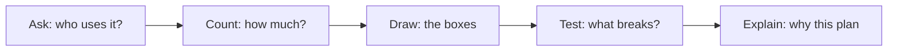
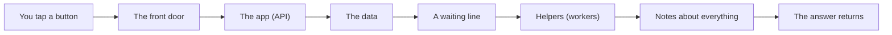
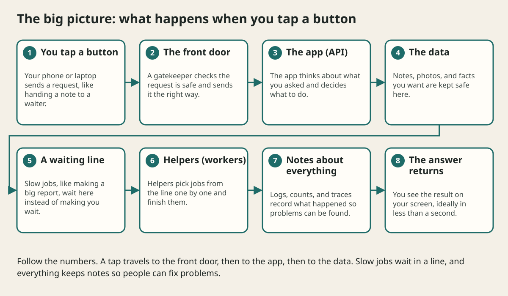

# Learning Map

## The big idea in plain words {#picture}

Imagine you are going to build a lemonade stand. Before you buy a single lemon, you would ask some questions. Who will buy lemonade? How many cups will we sell on a hot day? What if we run out of cups? What if it rains?

System design is exactly this, but for apps and websites. Instead of lemons and cups, we think about screens, servers, and data. We ask the questions first, and we draw the plan before we build.

This course is like a ladder. Each lesson is one step, and every step is small. If you go in order, you will never be lost.



## What you will be able to do {#outcomes}

By the end of this lesson you will be able to:

- Name the five questions you ask before building anything.
- Follow the study routine: read, draw, explain, review.
- Know what "good enough" looks like at the end of the course.

## Words to know {#vocabulary}

- **system**: a group of parts that work together to do a job, like the parts of a bicycle.
- **component**: one part of a system, such as the database or the app.
- **trade-off**: you get something good and you give up something else.

## Why this idea exists {#history}

Big apps are built by many people over many months. If everyone just starts typing code, the pieces do not fit together. A plan on paper is cheap to change; a finished app is expensive to change.

## Concept 1: The five questions {#concept-1}

Every design starts with the same five questions. **Who** is using it? **What** do they need to do? **How much** will they do it? **What can go wrong?** And finally, **what is the simplest plan that works?** If you can answer these five, you already think like a system designer.

## Concept 2: Draw before you build {#concept-2}

A drawing of boxes and arrows is the cheapest way to find a mistake. Erasing an arrow takes one second. Rewriting a month of code takes a month. So we draw first, argue about the drawing, and only then build.

## Concept 3: Use a notebook {#concept-3}

Keep a design notebook. For every lesson write three things: a picture, a number, and one sentence that begins with "I chose this because...". Looking back at your notebook next week is the best way to remember.

## Concept 4: Practice in small loops {#concept-4}

Read a little, close the page, and explain it out loud like you are teaching a friend. If you get stuck, that is the exact spot to read again. Come back after a day, a week, and a month. Remembering gets stronger each time you try.

## A lemonade stand plan {#example}

Ten friends will visit your stand each hour. Each person buys one cup. That is 10 cups per hour, so one pitcher (8 cups) lasts about 48 minutes. Now you know when to refill. You did a design with only counting! Real systems do the same thing with bigger numbers: users, requests, and storage.

## Going deeper: the technical walkthrough {#walkthrough}

### The design method


Use this order for every problem:

1. Name the users and their jobs.
2. Write functional requirements as actions.
3. Write non-functional requirements as measurable promises.
4. State assumptions about traffic, data, regions, and budget.
5. Estimate requests per second, storage, and bandwidth.
6. Draw the simplest request and write flow.
7. Choose data stores and ownership.
8. Add caches, queues, replicas, or partitions only when a requirement needs
   them.
9. Draw failure paths, security boundaries, and observability.
10. Choose deployment, backup, restore, and rollback steps.
11. List trade-offs and the evidence that would change the design.


## Worked scenario {#worked-scenario}

You understand how to ask for data with GET, but you cannot explain how the server checks incoming data. What should you study next?

The justified choice is **Practice sending bad data and see how the server checks it**. Select **review-validation** in the structured practical and explain why. Alternatives ignore a requirement, cross a trust boundary, or invent success.

### Structured decision contract

```json

{
  "decision": "review-validation",
  "justification": "The prerequisite and checkpoint boundary must preserve the declared contract and ownership.",
  "failureBehavior": "Expose a safe failure and recover through the boundary owner."
}

```

Decision selects one declared behavior. Justification explains the boundary. FailureBehavior explains the observable error and recovery owner. These fields never execute commands. Required terms and minimum lengths form a basic practice rubric, not semantic grading.

## Step-by-step flow and matching picture {#flow}





## Three real-life uses {#use-cases}

1. A student plans a school notes app: who will use it, how many notes, what could break.
2. A small shop owner decides whether their online store needs one server or many.
3. A team reviews a drawing together and finds a missing "what if the database is down?" box before writing code.

## What can go wrong, and how to stay safe {#failure-security}

The most common mistake is to skip the questions and jump to fancy tools. Another is to draw a giant plan with every box you have ever heard of. Big plans are harder to build and harder to fix. If a simple plan answers the five questions, stop there.

## Practice lab and expected observation {#practice}

1. Predict the scenario decision before opening Practical. Explain each rejected alternative.
2. Run a relevant example above in an isolated exercise project. Record the expected result, then change one input to an invalid or boundary value. A failed assertion or deliberate error should replace silent success.
3. Submit the structured decision. Initially the checks fail. After selecting review-validation and writing an explanation and failure plan, all three pass. Follow the indicated review section for missed checks.

### Broken example to debug

```json

{"decision":"trust-client","justification":"","failureBehavior":""}

```

This ignores the responsible boundary and gives no reasoning or recovery. Correct the fields rather than changing the validator.

## Checkpoint and definition of done {#checkpoint}

- [ ] Define prerequisite and checkpoint without looking.
- [ ] Trace input to owner and output.
- [ ] Explain one failure and one alternative.
- [ ] Pass at least four assignment questions.
- [ ] Pass every practical check and submit.
- [ ] Explain the concept again tomorrow.

## Sources, versions, and safe commands {#sources}

Workload figures are assumptions until measured. Review date: 2026-10-02. The supplied blueprint is the teaching source; official landing pages were checked where reachable. No provider or original TM Schedule deployment was tested.

- [Official reference](https://www.postgresql.org/docs/current/)

- [Official reference](https://opentelemetry.io/docs/)

[Course reading order](README.md) · [Next lesson](01-system-design-foundations.md)

```study-quiz

{
  "schemaVersion": 1,
  "lessonId": "system-design/00-learning-map",
  "title": "Assignment: Learning Map",
  "passPercentage": 80,
  "questions": [
    {
      "id": "q1",
      "sectionId": "concept-1",
      "prompt": "In Learning Map, what does prerequisite mean?",
      "options": [
        {
          "id": "a",
          "text": "something you need to know first, before the next thing makes sense",
          "explanation": "This preserves the definition and boundary described in the lesson."
        },
        {
          "id": "b",
          "text": "A permission granted by a hidden browser control",
          "explanation": "This changes the declared meaning or bypasses the responsible boundary."
        },
        {
          "id": "c",
          "text": "An unlimited provider operation with no ownership",
          "explanation": "This changes the declared meaning or bypasses the responsible boundary."
        },
        {
          "id": "d",
          "text": "A diagnostic credential intended for public logs",
          "explanation": "This changes the declared meaning or bypasses the responsible boundary."
        }
      ],
      "correctOptionId": "a",
      "explanation": "prerequisite means something you need to know first, before the next thing makes sense.",
      "reviewLabel": "Review concept 1"
    },
    {
      "id": "q2",
      "sectionId": "concept-2",
      "prompt": "In Learning Map, which rule is correct for checkpoint 2?",
      "options": [
        {
          "id": "a",
          "text": "Trust client-side checks instead of the server rule.",
          "explanation": "This changes the declared meaning or bypasses the responsible boundary."
        },
        {
          "id": "b",
          "text": "Guess the output first, then look at the answer.",
          "explanation": "This preserves the definition and boundary described in the lesson."
        },
        {
          "id": "c",
          "text": "Hide the failure by returning a fabricated successful result.",
          "explanation": "This changes the declared meaning or bypasses the responsible boundary."
        },
        {
          "id": "d",
          "text": "Skip the stated boundary, limit, or ownership check.",
          "explanation": "This changes the declared meaning or bypasses the responsible boundary."
        }
      ],
      "correctOptionId": "b",
      "explanation": "Guess the output first, then look at the answer.",
      "reviewLabel": "Review concept 2"
    },
    {
      "id": "q3",
      "sectionId": "concept-3",
      "prompt": "In Learning Map, which rule is correct for checkpoint 3?",
      "options": [
        {
          "id": "a",
          "text": "Trust client-side checks instead of the server rule.",
          "explanation": "This changes the declared meaning or bypasses the responsible boundary."
        },
        {
          "id": "b",
          "text": "Hide the failure by returning a fabricated successful result.",
          "explanation": "This changes the declared meaning or bypasses the responsible boundary."
        },
        {
          "id": "c",
          "text": "When a test fails, it points to the idea you are missing.",
          "explanation": "This preserves the definition and boundary described in the lesson."
        },
        {
          "id": "d",
          "text": "Skip the stated boundary, limit, or ownership check.",
          "explanation": "This changes the declared meaning or bypasses the responsible boundary."
        }
      ],
      "correctOptionId": "c",
      "explanation": "When a test fails, it points to the idea you are missing.",
      "reviewLabel": "Review concept 3"
    },
    {
      "id": "q4",
      "sectionId": "concept-4",
      "prompt": "In Learning Map, which rule is correct for checkpoint 4?",
      "options": [
        {
          "id": "a",
          "text": "Trust client-side checks instead of the server rule.",
          "explanation": "This changes the declared meaning or bypasses the responsible boundary."
        },
        {
          "id": "b",
          "text": "Hide the failure by returning a fabricated successful result.",
          "explanation": "This changes the declared meaning or bypasses the responsible boundary."
        },
        {
          "id": "c",
          "text": "Skip the stated boundary, limit, or ownership check.",
          "explanation": "This changes the declared meaning or bypasses the responsible boundary."
        },
        {
          "id": "d",
          "text": "A practice score in this app is just a helper, not an official exam grade.",
          "explanation": "This preserves the definition and boundary described in the lesson."
        }
      ],
      "correctOptionId": "d",
      "explanation": "A practice score in this app is just a helper, not an official exam grade.",
      "reviewLabel": "Review concept 4"
    },
    {
      "id": "q5",
      "sectionId": "worked-scenario",
      "prompt": "You understand how to ask for data with GET, but you cannot explain how the server checks incoming data. What should you study next?",
      "options": [
        {
          "id": "a",
          "text": "Practice sending bad data and see how the server checks it",
          "explanation": "This preserves the definition and boundary described in the lesson."
        },
        {
          "id": "b",
          "text": "Jump straight to advanced deployment",
          "explanation": "This changes the declared meaning or bypasses the responsible boundary."
        },
        {
          "id": "c",
          "text": "Copy an answer without trying it",
          "explanation": "This changes the declared meaning or bypasses the responsible boundary."
        },
        {
          "id": "d",
          "text": "Switch frameworks so the problem goes away",
          "explanation": "This changes the declared meaning or bypasses the responsible boundary."
        }
      ],
      "correctOptionId": "a",
      "explanation": "Practice sending bad data and see how the server checks it. Come back to a topic after a break; remembering it is better practice than just re-reading it.",
      "reviewLabel": "Review the worked scenario"
    }
  ]
}

```

```study-practical

{
  "schemaVersion": 1,
  "challengeId": "system-design/00-learning-map/decision",
  "lessonId": "system-design/00-learning-map",
  "title": "Practical: Learning Map",
  "language": "json",
  "mode": "structured",
  "instructions": "You understand how to ask for data with GET, but you cannot explain how the server checks incoming data. What should you study next? Return an object with decision (choose from review-validation, skip-check, unbounded-work, trust-client), justification (at least 40 characters; include prerequisite and checkpoint), and failureBehavior (at least 25 characters; include failure and recover while explaining the error and recovery). These are structured reasoning checks, not code execution or an official grade.",
  "starterCode": "{\n  \"decision\": \"\",\n  \"justification\": \"\",\n  \"failureBehavior\": \"\"\n}",
  "entryPoint": "answer",
  "publicExamples": [
    {
      "input": {
        "decision": "skip-check",
        "justification": "",
        "failureBehavior": ""
      },
      "expected": {
        "passed": false
      }
    },
    {
      "input": {
        "decision": "review-validation",
        "justification": "The prerequisite and checkpoint boundary must preserve the declared contract and ownership.",
        "failureBehavior": "Show a safe failure and recover through the responsible owner."
      },
      "expected": {
        "passed": true
      }
    }
  ],
  "publicTestIds": [
    "decision",
    "explanation",
    "failure-plan"
  ],
  "reviewSections": {
    "decision": "worked-scenario",
    "explanation": "concept-2",
    "failure-plan": "failure-security"
  },
  "limits": {
    "timeMs": 2000,
    "memoryMb": 128,
    "outputBytes": 20000
  }
}

```

