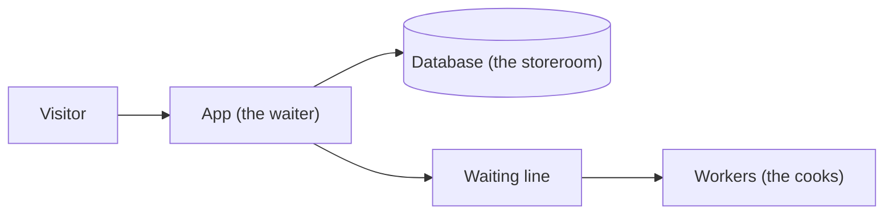
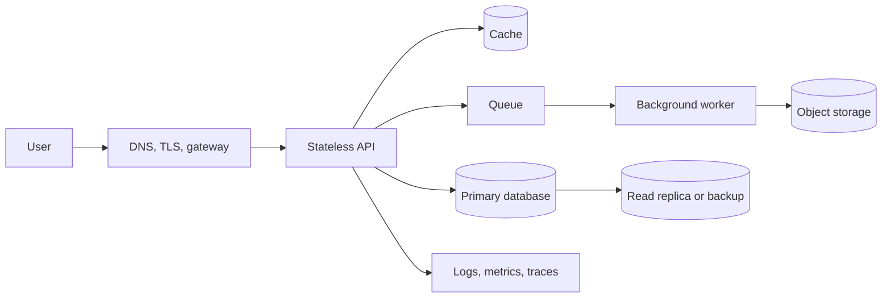
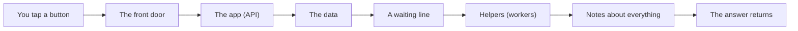

# System Design Foundations

## The big idea in plain words {#picture}

Think of a restaurant. There is a front door where people come in, a waiter who takes orders, a kitchen that makes food, and a storeroom for ingredients. Each place has its own job, and each one knows who it talks to.

A software system is a restaurant for data. The **screen** is the front door, the **app** is the waiter, the **database** is the storeroom, and the **workers** are the cooks. If we know who owns each room, nothing gets lost.



## What you will be able to do {#outcomes}

By the end of this lesson you will be able to:

- Explain what a system, a component, and a boundary are.
- Trace one request from the screen to the data and back.
- Tell the difference between "simple" and "complicated" designs.

## Words to know {#vocabulary}

- **system**: many parts working together to do one job.
- **component**: one part of the system with one clear job.
- **boundary**: the line between two parts, like a door. Things cross it only in agreed ways.
- **request**: a message that asks the system to do something.
- **state**: the information the system remembers, like your saved notes.
- **owner**: the one part that is in charge of a piece of data.

## Why this idea exists {#history}

When everything is tangled in one pile, changing one thing breaks another thing. Giving each part a clear job and a clear door makes changes safer. But splitting too much has a cost too: more doors means more walking. We want just enough parts.

## Concept 1: A monolith is one big building {#concept-1}

A monolith is an app that is built and shipped as one piece. It is not bad! A school with all classrooms under one roof is easy to run. A well-organized monolith has tidy rooms inside, so each part has clear owners, and nobody needs to cross a street to talk.

## Concept 2: Split only for a real reason {#concept-2}

We pull a part out into its own service when it needs to grow alone or be released alone. For example, a photo-resizing helper that needs ten times more computers than the rest. If there is no such reason, keeping it inside is easier and cheaper.

## Concept 3: An outbox is a safe to-do note {#concept-3}

Imagine you save a new note and must also tell another team. If the telling fails, the note exists but nobody knows. An outbox is a sticky note you put in the same drawer, in the same moment, as the note itself. Later a helper reads the sticky notes and sends the messages.

## Concept 4: Reading and writing can be separated {#concept-4}

Some apps read data a million times for each write. CQRS is a fancy name for using one path for reading and another for writing, so each can be built for its job. It is helpful in a few cases and extra work in most, so start without it.

## Follow one tap {#example}

You tap "Save note". 1) The screen sends a request. 2) The app checks that the title is not empty. 3) The app writes the note to the database. 4) The app puts a message "note saved" in the waiting line. 5) A worker sends a notification. 6) The app tells you "Saved!". Each step has one owner, and each arrow is a door.

## Going deeper: the technical walkthrough {#walkthrough}

### The one-minute picture


System design is planning a digital shop. You decide who enters, what the
workers do, where the orders live, how requests travel, what happens when a
worker is sick, and how the shop grows.



A good design is not the one with the most boxes. It is the smallest design
that meets the real requirements and can be operated by real people.


## Worked scenario {#worked-scenario}

A small team builds a simple CRUD app and has no separate scaling problem. What should it start with?

The justified choice is **A modular monolith with clear ports**. Select **modular-monolith** in the structured practical and explain why. Alternatives ignore a requirement, cross a trust boundary, or invent success.

### Structured decision contract

```json

{
  "decision": "modular-monolith",
  "justification": "The monolith and port boundary must preserve the declared contract and ownership.",
  "failureBehavior": "Expose a safe failure and recover through the boundary owner."
}

```

Decision selects one declared behavior. Justification explains the boundary. FailureBehavior explains the observable error and recovery owner. These fields never execute commands. Required terms and minimum lengths form a basic practice rubric, not semantic grading.

## Step-by-step flow and matching picture {#flow}




## Three real-life uses {#use-cases}

1. A to-do app with one app and one database, organized in tidy folders.
2. A shop that moves "send email receipts" into a worker so checkout stays fast.
3. A game company that puts chat in a separate service because chat needs to grow much faster than the rest.

## What can go wrong, and how to stay safe {#failure-security}

A common mistake is to build ten tiny services before you have ten problems. Each service needs its own setup, monitoring, and release. Another mistake is two parts both thinking they own the same data, so they overwrite each other. Give every piece of data exactly one owner.

## Practice lab and expected observation {#practice}

1. Predict the scenario decision before opening Practical. Explain each rejected alternative.
2. Run a relevant example above in an isolated exercise project. Record the expected result, then change one input to an invalid or boundary value. A failed assertion or deliberate error should replace silent success.
3. Submit the structured decision. Initially the checks fail. After selecting modular-monolith and writing an explanation and failure plan, all three pass. Follow the indicated review section for missed checks.

### Broken example to debug

```json

{"decision":"trust-client","justification":"","failureBehavior":""}

```

This ignores the responsible boundary and gives no reasoning or recovery. Correct the fields rather than changing the validator.

## Checkpoint and definition of done {#checkpoint}

- [ ] Define monolith and port without looking.
- [ ] Trace input to owner and output.
- [ ] Explain one failure and one alternative.
- [ ] Pass at least four assignment questions.
- [ ] Pass every practical check and submit.
- [ ] Explain the concept again tomorrow.

## Sources, versions, and safe commands {#sources}

Workload figures are assumptions until measured. Review date: 2026-10-02. The supplied blueprint is the teaching source; official landing pages were checked where reachable. No provider or original TM Schedule deployment was tested.

- [Official reference](https://www.postgresql.org/docs/current/)

- [Official reference](https://opentelemetry.io/docs/)

[Course reading order](README.md) · [Previous lesson](00-learning-map.md) · [Next lesson](02-requirements-and-capacity-estimation.md)

```study-quiz

{
  "schemaVersion": 1,
  "lessonId": "system-design/01-system-design-foundations",
  "title": "Assignment: System Design Foundations",
  "passPercentage": 80,
  "questions": [
    {
      "id": "q1",
      "sectionId": "concept-1",
      "prompt": "In System Design Foundations, what does monolith mean?",
      "options": [
        {
          "id": "a",
          "text": "A permission granted by a hidden browser control",
          "explanation": "This changes the declared meaning or bypasses the responsible boundary."
        },
        {
          "id": "b",
          "text": "an app that is built and shipped as one piece",
          "explanation": "This preserves the definition and boundary described in the lesson."
        },
        {
          "id": "c",
          "text": "An unlimited provider operation with no ownership",
          "explanation": "This changes the declared meaning or bypasses the responsible boundary."
        },
        {
          "id": "d",
          "text": "A diagnostic credential intended for public logs",
          "explanation": "This changes the declared meaning or bypasses the responsible boundary."
        }
      ],
      "correctOptionId": "b",
      "explanation": "monolith means an app that is built and shipped as one piece.",
      "reviewLabel": "Review concept 1"
    },
    {
      "id": "q2",
      "sectionId": "concept-2",
      "prompt": "In System Design Foundations, which rule is correct for checkpoint 2?",
      "options": [
        {
          "id": "a",
          "text": "Trust client-side checks instead of the server rule.",
          "explanation": "This changes the declared meaning or bypasses the responsible boundary."
        },
        {
          "id": "b",
          "text": "Hide the failure by returning a fabricated successful result.",
          "explanation": "This changes the declared meaning or bypasses the responsible boundary."
        },
        {
          "id": "c",
          "text": "Split into a service only when you truly need to scale or release it separately.",
          "explanation": "This preserves the definition and boundary described in the lesson."
        },
        {
          "id": "d",
          "text": "Skip the stated boundary, limit, or ownership check.",
          "explanation": "This changes the declared meaning or bypasses the responsible boundary."
        }
      ],
      "correctOptionId": "c",
      "explanation": "Split into a service only when you truly need to scale or release it separately.",
      "reviewLabel": "Review concept 2"
    },
    {
      "id": "q3",
      "sectionId": "concept-3",
      "prompt": "In System Design Foundations, which rule is correct for checkpoint 3?",
      "options": [
        {
          "id": "a",
          "text": "Trust client-side checks instead of the server rule.",
          "explanation": "This changes the declared meaning or bypasses the responsible boundary."
        },
        {
          "id": "b",
          "text": "Hide the failure by returning a fabricated successful result.",
          "explanation": "This changes the declared meaning or bypasses the responsible boundary."
        },
        {
          "id": "c",
          "text": "Skip the stated boundary, limit, or ownership check.",
          "explanation": "This changes the declared meaning or bypasses the responsible boundary."
        },
        {
          "id": "d",
          "text": "An outbox keeps messages safe until they are sent.",
          "explanation": "This preserves the definition and boundary described in the lesson."
        }
      ],
      "correctOptionId": "d",
      "explanation": "An outbox keeps messages safe until they are sent.",
      "reviewLabel": "Review concept 3"
    },
    {
      "id": "q4",
      "sectionId": "concept-4",
      "prompt": "In System Design Foundations, which rule is correct for checkpoint 4?",
      "options": [
        {
          "id": "a",
          "text": "CQRS splits reading and writing, and brings extra coordination.",
          "explanation": "This preserves the definition and boundary described in the lesson."
        },
        {
          "id": "b",
          "text": "Trust client-side checks instead of the server rule.",
          "explanation": "This changes the declared meaning or bypasses the responsible boundary."
        },
        {
          "id": "c",
          "text": "Hide the failure by returning a fabricated successful result.",
          "explanation": "This changes the declared meaning or bypasses the responsible boundary."
        },
        {
          "id": "d",
          "text": "Skip the stated boundary, limit, or ownership check.",
          "explanation": "This changes the declared meaning or bypasses the responsible boundary."
        }
      ],
      "correctOptionId": "a",
      "explanation": "CQRS splits reading and writing, and brings extra coordination.",
      "reviewLabel": "Review concept 4"
    },
    {
      "id": "q5",
      "sectionId": "worked-scenario",
      "prompt": "A small team builds a simple CRUD app and has no separate scaling problem. What should it start with?",
      "options": [
        {
          "id": "a",
          "text": "One service for every class",
          "explanation": "This changes the declared meaning or bypasses the responsible boundary."
        },
        {
          "id": "b",
          "text": "A modular monolith with clear ports",
          "explanation": "This preserves the definition and boundary described in the lesson."
        },
        {
          "id": "c",
          "text": "Distributed transactions for every read",
          "explanation": "This changes the declared meaning or bypasses the responsible boundary."
        },
        {
          "id": "d",
          "text": "A database that every browser can reach directly",
          "explanation": "This changes the declared meaning or bypasses the responsible boundary."
        }
      ],
      "correctOptionId": "b",
      "explanation": "A modular monolith with clear ports. A saga fixes mistakes with undo steps, not one magic rollback.",
      "reviewLabel": "Review the worked scenario"
    }
  ]
}

```

```study-practical

{
  "schemaVersion": 1,
  "challengeId": "system-design/01-system-design-foundations/decision",
  "lessonId": "system-design/01-system-design-foundations",
  "title": "Practical: System Design Foundations",
  "language": "json",
  "mode": "structured",
  "instructions": "A small team builds a simple CRUD app and has no separate scaling problem. What should it start with? Return an object with decision (choose from modular-monolith, skip-check, unbounded-work, trust-client), justification (at least 40 characters; include monolith and port), and failureBehavior (at least 25 characters; include failure and recover while explaining the error and recovery). These are structured reasoning checks, not code execution or an official grade.",
  "starterCode": "{\n  \"decision\": \"\",\n  \"justification\": \"\",\n  \"failureBehavior\": \"\"\n}",
  "entryPoint": "answer",
  "publicExamples": [
    {
      "input": {
        "decision": "skip-check",
        "justification": "",
        "failureBehavior": ""
      },
      "expected": {
        "passed": false
      }
    },
    {
      "input": {
        "decision": "modular-monolith",
        "justification": "The monolith and port boundary must preserve the declared contract and ownership.",
        "failureBehavior": "Show a safe failure and recover through the responsible owner."
      },
      "expected": {
        "passed": true
      }
    }
  ],
  "publicTestIds": [
    "decision",
    "explanation",
    "failure-plan"
  ],
  "reviewSections": {
    "decision": "worked-scenario",
    "explanation": "concept-2",
    "failure-plan": "failure-security"
  },
  "limits": {
    "timeMs": 2000,
    "memoryMb": 128,
    "outputBytes": 20000
  }
}

```

