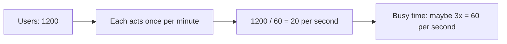
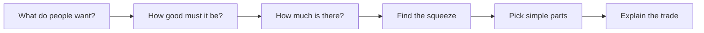
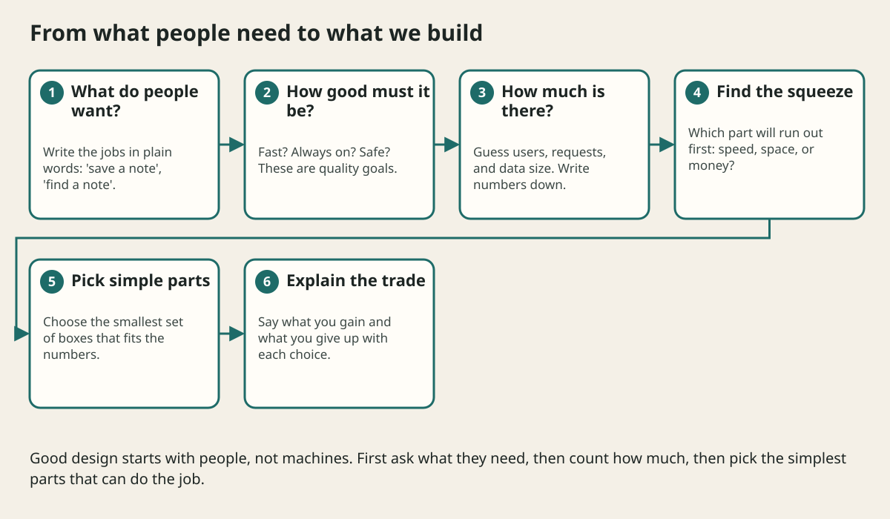

# Requirements And Capacity Estimation

## The big idea in plain words {#picture}

Planning a school bus route is a lot like planning an app. You ask: how many children ride? What time do they have to arrive? How many seats does one bus have? From the answers you learn how many buses you need.

For apps we do the same with **requests**. If 1,200 people each press a button once a minute, that is 1,200 divided by 60, so 20 requests every second. You did not need to build anything to learn that number!



## What you will be able to do {#outcomes}

By the end of this lesson you will be able to:

- Tell "what it must do" apart from "how well it must do it".
- Turn users and actions into requests per second.
- Estimate storage and write down which numbers are guesses.

## Words to know {#vocabulary}

- **functional requirement**: something the system must do, like "save a note".
- **quality requirement**: how well it must do it, like "answer in under half a second".
- **RPS**: requests per second, a measure of how busy the system is.
- **latency**: how long one request takes, from start to finish.
- **availability**: the part of the time the system is up and working.
- **peak**: the busiest moment, which is usually much higher than average.

## Why this idea exists {#history}

If you guess wrong about size, you either build a giant machine nobody needs or a tiny one that falls over on day one. A few minutes of counting makes the guess much smarter.

## Concept 1: Two kinds of requirements {#concept-1}

"The app lets me save a note" is what it does. "Saving takes less than one second and works 99.9 percent of the time" is how well it does it. Always write both kinds, because a note app that takes 30 seconds to save is technically working but nobody will use it.

## Concept 2: Average is not peak {#concept-2}

If a shop sells 100 cups all day, that is not 100 every hour. Most might be sold between noon and 1 pm. Systems must survive the busy hour, not the quiet average. A good rule is to multiply the average by two or three to guess the peak, and then measure the real number later.

## Concept 3: Estimate storage with multiplication {#concept-3}

Storage is how many things times how big each one is times how long you keep it. One million notes at 2 kilobytes each is 2 gigabytes. Write down your numbers and say which are guesses. Guesses are fine, as long as you label them as guesses.

## Concept 4: Start with the smallest plan {#concept-4}

After you count, ask: can one normal machine do this? One machine can often handle hundreds of requests per second. If your number is 20, you probably do not need ten servers. The best plan is the smallest one that meets the numbers you wrote down.

## Counting a notes app {#example}

Say 10,000 students use the app. On a school day, 1,000 are online at the same time. Each one saves or reads a note about once every 20 seconds. That is 1,000 divided by 20, or 50 requests per second. If a note is 2 KB and each student keeps 200 notes, storage is 10,000 times 200 times 2 KB, which is 4 GB. One database server can hold that comfortably.

## Going deeper: the technical walkthrough {#walkthrough}

### Requirements and capacity


Functional requirements say what people can do. Quality requirements say how
well the system must do it.

Example:

```text
functional: a manager reads a schedule for one store and date
quality: normal reads finish under 300 ms at the 95th percentile
quality: committed writes are not lost
quality: a database outage is visible instead of an empty success
```

Use simple arithmetic:

```text
average RPS = requests per day / 86,400
peak RPS = average RPS * peak multiplier
storage per year = objects per day * average object size * 365
bandwidth = requests per second * bytes per response
```

State whether a number is an estimate. The point is to find the first likely
bottleneck, not to pretend that a guess is a measurement.


### Focused implementation

Assume 1,200 active readers, one read per minute, and a peak multiplier of five. Average reads are 1200 / 60 = 20 RPS; assumed peak is 100 RPS. At 10 KiB per response, this is roughly 1 MiB/s before overhead. These are planning assumptions, not measured throughput. Measure tail latency and errors before promising capacity.

```json

{ "activeReaders": 1200, "readsPerMinute": 1, "averageRps": 20, "assumedPeakMultiplier": 5, "assumedPeakRps": 100 }

```

Read the imports, then the values and checks, then the operation, and finally the result or cleanup. Java Example programs compile as Example.java. Python uses Python 3.11+. JavaScript ESM runs as example.mjs. Framework snippets run inside the generated project.

## Worked scenario {#worked-scenario}

Imagine 1200 active users each read once per minute. What is the average read load?

The justified choice is **About 20 requests per second before adding a busy-time factor**. Select **twenty-rps** in the structured practical and explain why. Alternatives ignore a requirement, cross a trust boundary, or invent success.

### Structured decision contract

```json

{
  "decision": "twenty-rps",
  "justification": "The functionalRequirement and qualityRequirement boundary must preserve the declared contract and ownership.",
  "failureBehavior": "Expose a safe failure and recover through the boundary owner."
}

```

Decision selects one declared behavior. Justification explains the boundary. FailureBehavior explains the observable error and recovery owner. These fields never execute commands. Required terms and minimum lengths form a basic practice rubric, not semantic grading.

## Step-by-step flow and matching picture {#flow}





## Three real-life uses {#use-cases}

1. A concert ticket site counts how many people click "buy" in the first minute.
2. A photo app estimates storage, because photos are much bigger than text.
3. A school app checks that exam-day traffic is not 10 times higher than normal.

## What can go wrong, and how to stay safe {#failure-security}

Mistake one: using the average and forgetting the busy hour. Mistake two: writing a number with no unit, such as "1000" (per second? per day?). Mistake three: presenting a guess as a fact. Always write the unit, and write "assumption" next to numbers you did not measure.

## Practice lab and expected observation {#practice}

1. Predict the scenario decision before opening Practical. Explain each rejected alternative.
2. Run a relevant example above in an isolated exercise project. Record the expected result, then change one input to an invalid or boundary value. A failed assertion or deliberate error should replace silent success.
3. Submit the structured decision. Initially the checks fail. After selecting twenty-rps and writing an explanation and failure plan, all three pass. Follow the indicated review section for missed checks.

### Broken example to debug

```json

{"decision":"trust-client","justification":"","failureBehavior":""}

```

This ignores the responsible boundary and gives no reasoning or recovery. Correct the fields rather than changing the validator.

## Checkpoint and definition of done {#checkpoint}

- [ ] Define functionalRequirement and qualityRequirement without looking.
- [ ] Trace input to owner and output.
- [ ] Explain one failure and one alternative.
- [ ] Pass at least four assignment questions.
- [ ] Pass every practical check and submit.
- [ ] Explain the concept again tomorrow.

## Sources, versions, and safe commands {#sources}

Workload figures are assumptions until measured. Review date: 2026-10-02. The supplied blueprint is the teaching source; official landing pages were checked where reachable. No provider or original TM Schedule deployment was tested.

- [Official reference](https://www.postgresql.org/docs/current/)

- [Official reference](https://opentelemetry.io/docs/)

[Course reading order](README.md) · [Previous lesson](01-system-design-foundations.md) · [Next lesson](03-architecture-building-blocks.md)

```study-quiz

{
  "schemaVersion": 1,
  "lessonId": "system-design/02-requirements-and-capacity-estimation",
  "title": "Assignment: Requirements And Capacity Estimation",
  "passPercentage": 80,
  "questions": [
    {
      "id": "q1",
      "sectionId": "concept-1",
      "prompt": "In Requirements And Capacity Estimation, what does functionalRequirement mean?",
      "options": [
        {
          "id": "a",
          "text": "A permission granted by a hidden browser control",
          "explanation": "This changes the declared meaning or bypasses the responsible boundary."
        },
        {
          "id": "b",
          "text": "An unlimited provider operation with no ownership",
          "explanation": "This changes the declared meaning or bypasses the responsible boundary."
        },
        {
          "id": "c",
          "text": "something the system must do",
          "explanation": "This preserves the definition and boundary described in the lesson."
        },
        {
          "id": "d",
          "text": "A diagnostic credential intended for public logs",
          "explanation": "This changes the declared meaning or bypasses the responsible boundary."
        }
      ],
      "correctOptionId": "c",
      "explanation": "functionalRequirement means something the system must do.",
      "reviewLabel": "Review concept 1"
    },
    {
      "id": "q2",
      "sectionId": "concept-2",
      "prompt": "In Requirements And Capacity Estimation, which rule is correct for checkpoint 2?",
      "options": [
        {
          "id": "a",
          "text": "Trust client-side checks instead of the server rule.",
          "explanation": "This changes the declared meaning or bypasses the responsible boundary."
        },
        {
          "id": "b",
          "text": "Hide the failure by returning a fabricated successful result.",
          "explanation": "This changes the declared meaning or bypasses the responsible boundary."
        },
        {
          "id": "c",
          "text": "Skip the stated boundary, limit, or ownership check.",
          "explanation": "This changes the declared meaning or bypasses the responsible boundary."
        },
        {
          "id": "d",
          "text": "Average load is not the same as the busiest moment.",
          "explanation": "This preserves the definition and boundary described in the lesson."
        }
      ],
      "correctOptionId": "d",
      "explanation": "Average load is not the same as the busiest moment.",
      "reviewLabel": "Review concept 2"
    },
    {
      "id": "q3",
      "sectionId": "concept-3",
      "prompt": "In Requirements And Capacity Estimation, which rule is correct for checkpoint 3?",
      "options": [
        {
          "id": "a",
          "text": "Estimate storage as number of items times size times how long you keep them.",
          "explanation": "This preserves the definition and boundary described in the lesson."
        },
        {
          "id": "b",
          "text": "Trust client-side checks instead of the server rule.",
          "explanation": "This changes the declared meaning or bypasses the responsible boundary."
        },
        {
          "id": "c",
          "text": "Hide the failure by returning a fabricated successful result.",
          "explanation": "This changes the declared meaning or bypasses the responsible boundary."
        },
        {
          "id": "d",
          "text": "Skip the stated boundary, limit, or ownership check.",
          "explanation": "This changes the declared meaning or bypasses the responsible boundary."
        }
      ],
      "correctOptionId": "a",
      "explanation": "Estimate storage as number of items times size times how long you keep them.",
      "reviewLabel": "Review concept 3"
    },
    {
      "id": "q4",
      "sectionId": "concept-4",
      "prompt": "In Requirements And Capacity Estimation, which rule is correct for checkpoint 4?",
      "options": [
        {
          "id": "a",
          "text": "Trust client-side checks instead of the server rule.",
          "explanation": "This changes the declared meaning or bypasses the responsible boundary."
        },
        {
          "id": "b",
          "text": "Speed, uptime, and cost are different goals.",
          "explanation": "This preserves the definition and boundary described in the lesson."
        },
        {
          "id": "c",
          "text": "Hide the failure by returning a fabricated successful result.",
          "explanation": "This changes the declared meaning or bypasses the responsible boundary."
        },
        {
          "id": "d",
          "text": "Skip the stated boundary, limit, or ownership check.",
          "explanation": "This changes the declared meaning or bypasses the responsible boundary."
        }
      ],
      "correctOptionId": "b",
      "explanation": "Speed, uptime, and cost are different goals.",
      "reviewLabel": "Review concept 4"
    },
    {
      "id": "q5",
      "sectionId": "worked-scenario",
      "prompt": "Imagine 1200 active users each read once per minute. What is the average read load?",
      "options": [
        {
          "id": "a",
          "text": "1200 requests per millisecond",
          "explanation": "This changes the declared meaning or bypasses the responsible boundary."
        },
        {
          "id": "b",
          "text": "Zero because reading is free",
          "explanation": "This changes the declared meaning or bypasses the responsible boundary."
        },
        {
          "id": "c",
          "text": "About 20 requests per second before adding a busy-time factor",
          "explanation": "This preserves the definition and boundary described in the lesson."
        },
        {
          "id": "d",
          "text": "A peak of 20 that nobody measured",
          "explanation": "This changes the declared meaning or bypasses the responsible boundary."
        }
      ],
      "correctOptionId": "c",
      "explanation": "About 20 requests per second before adding a busy-time factor. Start with the simplest design that fits the stated workload.",
      "reviewLabel": "Review the worked scenario"
    }
  ]
}

```

```study-practical

{
  "schemaVersion": 1,
  "challengeId": "system-design/02-requirements-and-capacity-estimation/decision",
  "lessonId": "system-design/02-requirements-and-capacity-estimation",
  "title": "Practical: Requirements And Capacity Estimation",
  "language": "json",
  "mode": "structured",
  "instructions": "Imagine 1200 active users each read once per minute. What is the average read load? Return an object with decision (choose from twenty-rps, skip-check, unbounded-work, trust-client), justification (at least 40 characters; include functionalRequirement and qualityRequirement), and failureBehavior (at least 25 characters; include failure and recover while explaining the error and recovery). These are structured reasoning checks, not code execution or an official grade.",
  "starterCode": "{\n  \"decision\": \"\",\n  \"justification\": \"\",\n  \"failureBehavior\": \"\"\n}",
  "entryPoint": "answer",
  "publicExamples": [
    {
      "input": {
        "decision": "skip-check",
        "justification": "",
        "failureBehavior": ""
      },
      "expected": {
        "passed": false
      }
    },
    {
      "input": {
        "decision": "twenty-rps",
        "justification": "The functionalRequirement and qualityRequirement boundary must preserve the declared contract and ownership.",
        "failureBehavior": "Show a safe failure and recover through the responsible owner."
      },
      "expected": {
        "passed": true
      }
    }
  ],
  "publicTestIds": [
    "decision",
    "explanation",
    "failure-plan"
  ],
  "reviewSections": {
    "decision": "worked-scenario",
    "explanation": "concept-2",
    "failure-plan": "failure-security"
  },
  "limits": {
    "timeMs": 2000,
    "memoryMb": 128,
    "outputBytes": 20000
  }
}

```

