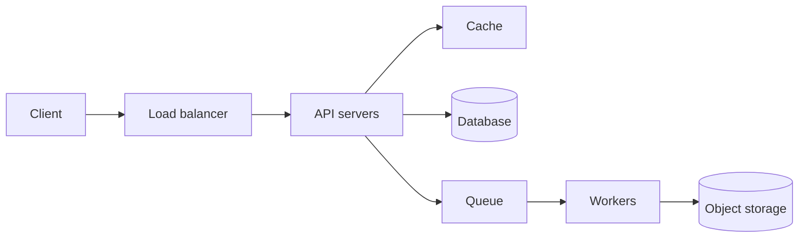
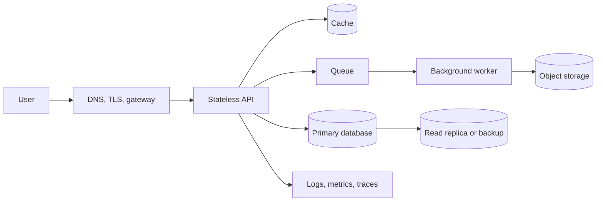
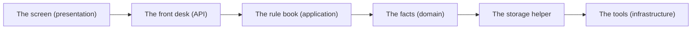
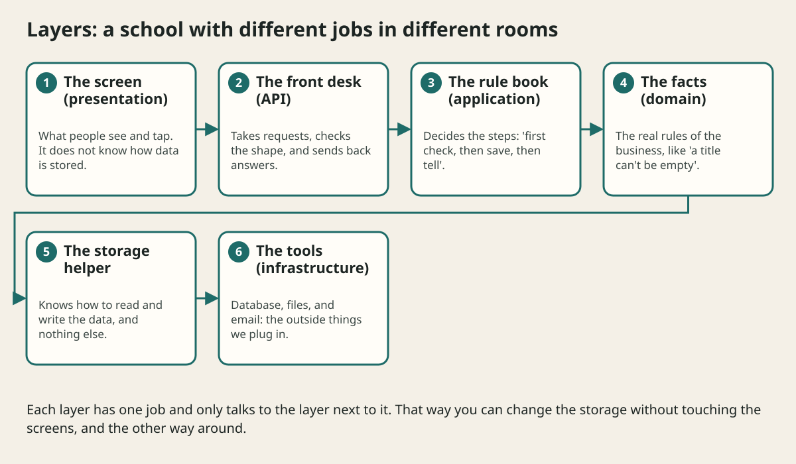

# Architecture Building Blocks

## The big idea in plain words {#picture}

A big app is made of the same few building blocks, like a box of LEGO. There is the **client** (the screen), the **API** (the front desk), a **database** (the storeroom), a **cache** (a sticky note), a **queue** (a waiting line), **workers** (helpers), a **load balancer** (a traffic guard), and **object storage** (a garage for big files).

Once you know what each block is for, a big diagram stops being scary. It is just these blocks, in different places.



## What you will be able to do {#outcomes}

By the end of this lesson you will be able to:

- Say what each building block is for in one sentence.
- Pick the blocks a simple app really needs.
- Draw a basic system from memory.

## Words to know {#vocabulary}

- **client**: the app or website a person uses.
- **API**: the front desk that takes requests and gives answers.
- **database**: the storeroom where information is kept for a long time.
- **cache**: a quick copy of data that is nearby.
- **queue**: a waiting line for jobs.
- **load balancer**: a guard that spreads visitors across servers.

## Why this idea exists {#history}

Without common names for the blocks, two people can never agree on a plan. With them, one drawing explains a whole system in a minute.

## Concept 1: API and database: the core pair {#concept-1}

Most apps need only these two. The API receives requests and applies rules. The database remembers things after the app restarts. A notes app with only an API and a database can serve thousands of people.

## Concept 2: Cache and queue: fast and patient {#concept-2}

A cache makes repeat questions fast. A queue makes slow jobs patient. Add a cache when reading is slow. Add a queue when a job takes too long to finish before the user leaves the page.

## Concept 3: Load balancer and many servers {#concept-3}

When one server is not enough, we run several copies and put a load balancer in front. It is like a host at a restaurant who sends each group to a table with free seats. If one server breaks, the host just stops sending people there.

## Concept 4: Object storage for big files {#concept-4}

Photos, videos, and PDFs are big. We keep them in object storage, which is like a huge garage built for big things, and keep only a short address (a link) in the database. This keeps the database small and fast.

## Which blocks does a photo-sharing app need? {#example}

Users upload photos: **object storage** for the pictures. Users see their feed: **API** and **database** for the list. The feed is read much more than written: add a **cache**. Photos need small thumbnails: put the job in a **queue** and let **workers** resize them. Many users: a **load balancer** in front of several API servers.

## Going deeper: the technical walkthrough {#walkthrough}

### The one-minute picture


System design is planning a digital shop. You decide who enters, what the
workers do, where the orders live, how requests travel, what happens when a
worker is sick, and how the shop grows.



A good design is not the one with the most boxes. It is the smallest design
that meets the real requirements and can be operated by real people.


### Architecture patterns


| Problem | Starting design | Add when evidence requires it |
| --- | --- | --- |
| small CRUD product | layered modular monolith | indexes, audit, measured cache |
| repeated reads | indexed API | cache-aside and invalidation |
| long export | job record and worker | queue, retries, dead letters |
| many reactions to a write | transaction plus outbox | event consumers |
| legacy migration | strangler adapter | route-by-route replacement |
| payment workflow | state machine and idempotency | saga or provider boundary |
| large text search | database search | dedicated search index |
| multiple teams | modular monolith | service split by ownership |

Microservices are a deployment and ownership choice, not a synonym for quality.
Start with a modular monolith when the product is small and the boundaries are
still changing.


## Worked scenario {#worked-scenario}

A small team builds a simple CRUD app and has no separate scaling problem. What should it start with?

The justified choice is **A modular monolith with clear ports**. Select **modular-monolith** in the structured practical and explain why. Alternatives ignore a requirement, cross a trust boundary, or invent success.

### Structured decision contract

```json

{
  "decision": "modular-monolith",
  "justification": "The monolith and port boundary must preserve the declared contract and ownership.",
  "failureBehavior": "Expose a safe failure and recover through the boundary owner."
}

```

Decision selects one declared behavior. Justification explains the boundary. FailureBehavior explains the observable error and recovery owner. These fields never execute commands. Required terms and minimum lengths form a basic practice rubric, not semantic grading.

## Step-by-step flow and matching picture {#flow}





## Three real-life uses {#use-cases}

1. A blog uses just an API and a database.
2. An online shop adds a queue so emails are sent after checkout.
3. A video site stores videos in object storage and shows them from a nearby copy.

## What can go wrong, and how to stay safe {#failure-security}

It is tempting to add every block "just in case". Each block is something that can break, costs money, and must be watched. A cache with bad rules can show old data. A queue with no size limit can fill up memory. Add a block only when you can name the problem it solves.

## Practice lab and expected observation {#practice}

1. Predict the scenario decision before opening Practical. Explain each rejected alternative.
2. Run a relevant example above in an isolated exercise project. Record the expected result, then change one input to an invalid or boundary value. A failed assertion or deliberate error should replace silent success.
3. Submit the structured decision. Initially the checks fail. After selecting modular-monolith and writing an explanation and failure plan, all three pass. Follow the indicated review section for missed checks.

### Broken example to debug

```json

{"decision":"trust-client","justification":"","failureBehavior":""}

```

This ignores the responsible boundary and gives no reasoning or recovery. Correct the fields rather than changing the validator.

## Checkpoint and definition of done {#checkpoint}

- [ ] Define monolith and port without looking.
- [ ] Trace input to owner and output.
- [ ] Explain one failure and one alternative.
- [ ] Pass at least four assignment questions.
- [ ] Pass every practical check and submit.
- [ ] Explain the concept again tomorrow.

## Sources, versions, and safe commands {#sources}

Workload figures are assumptions until measured. Review date: 2026-10-02. The supplied blueprint is the teaching source; official landing pages were checked where reachable. No provider or original TM Schedule deployment was tested.

- [Official reference](https://www.postgresql.org/docs/current/)

- [Official reference](https://opentelemetry.io/docs/)

[Course reading order](README.md) · [Previous lesson](02-requirements-and-capacity-estimation.md) · [Next lesson](04-networking-and-web-requests.md)

```study-quiz

{
  "schemaVersion": 1,
  "lessonId": "system-design/03-architecture-building-blocks",
  "title": "Assignment: Architecture Building Blocks",
  "passPercentage": 80,
  "questions": [
    {
      "id": "q1",
      "sectionId": "concept-1",
      "prompt": "In Architecture Building Blocks, what does monolith mean?",
      "options": [
        {
          "id": "a",
          "text": "A permission granted by a hidden browser control",
          "explanation": "This changes the declared meaning or bypasses the responsible boundary."
        },
        {
          "id": "b",
          "text": "An unlimited provider operation with no ownership",
          "explanation": "This changes the declared meaning or bypasses the responsible boundary."
        },
        {
          "id": "c",
          "text": "A diagnostic credential intended for public logs",
          "explanation": "This changes the declared meaning or bypasses the responsible boundary."
        },
        {
          "id": "d",
          "text": "an app that is built and shipped as one piece",
          "explanation": "This preserves the definition and boundary described in the lesson."
        }
      ],
      "correctOptionId": "d",
      "explanation": "monolith means an app that is built and shipped as one piece.",
      "reviewLabel": "Review concept 1"
    },
    {
      "id": "q2",
      "sectionId": "concept-2",
      "prompt": "In Architecture Building Blocks, which rule is correct for checkpoint 2?",
      "options": [
        {
          "id": "a",
          "text": "Split into a service only when you truly need to scale or release it separately.",
          "explanation": "This preserves the definition and boundary described in the lesson."
        },
        {
          "id": "b",
          "text": "Trust client-side checks instead of the server rule.",
          "explanation": "This changes the declared meaning or bypasses the responsible boundary."
        },
        {
          "id": "c",
          "text": "Hide the failure by returning a fabricated successful result.",
          "explanation": "This changes the declared meaning or bypasses the responsible boundary."
        },
        {
          "id": "d",
          "text": "Skip the stated boundary, limit, or ownership check.",
          "explanation": "This changes the declared meaning or bypasses the responsible boundary."
        }
      ],
      "correctOptionId": "a",
      "explanation": "Split into a service only when you truly need to scale or release it separately.",
      "reviewLabel": "Review concept 2"
    },
    {
      "id": "q3",
      "sectionId": "concept-3",
      "prompt": "In Architecture Building Blocks, which rule is correct for checkpoint 3?",
      "options": [
        {
          "id": "a",
          "text": "Trust client-side checks instead of the server rule.",
          "explanation": "This changes the declared meaning or bypasses the responsible boundary."
        },
        {
          "id": "b",
          "text": "An outbox keeps messages safe until they are sent.",
          "explanation": "This preserves the definition and boundary described in the lesson."
        },
        {
          "id": "c",
          "text": "Hide the failure by returning a fabricated successful result.",
          "explanation": "This changes the declared meaning or bypasses the responsible boundary."
        },
        {
          "id": "d",
          "text": "Skip the stated boundary, limit, or ownership check.",
          "explanation": "This changes the declared meaning or bypasses the responsible boundary."
        }
      ],
      "correctOptionId": "b",
      "explanation": "An outbox keeps messages safe until they are sent.",
      "reviewLabel": "Review concept 3"
    },
    {
      "id": "q4",
      "sectionId": "concept-4",
      "prompt": "In Architecture Building Blocks, which rule is correct for checkpoint 4?",
      "options": [
        {
          "id": "a",
          "text": "Trust client-side checks instead of the server rule.",
          "explanation": "This changes the declared meaning or bypasses the responsible boundary."
        },
        {
          "id": "b",
          "text": "Hide the failure by returning a fabricated successful result.",
          "explanation": "This changes the declared meaning or bypasses the responsible boundary."
        },
        {
          "id": "c",
          "text": "CQRS splits reading and writing, and brings extra coordination.",
          "explanation": "This preserves the definition and boundary described in the lesson."
        },
        {
          "id": "d",
          "text": "Skip the stated boundary, limit, or ownership check.",
          "explanation": "This changes the declared meaning or bypasses the responsible boundary."
        }
      ],
      "correctOptionId": "c",
      "explanation": "CQRS splits reading and writing, and brings extra coordination.",
      "reviewLabel": "Review concept 4"
    },
    {
      "id": "q5",
      "sectionId": "worked-scenario",
      "prompt": "A small team builds a simple CRUD app and has no separate scaling problem. What should it start with?",
      "options": [
        {
          "id": "a",
          "text": "One service for every class",
          "explanation": "This changes the declared meaning or bypasses the responsible boundary."
        },
        {
          "id": "b",
          "text": "Distributed transactions for every read",
          "explanation": "This changes the declared meaning or bypasses the responsible boundary."
        },
        {
          "id": "c",
          "text": "A database that every browser can reach directly",
          "explanation": "This changes the declared meaning or bypasses the responsible boundary."
        },
        {
          "id": "d",
          "text": "A modular monolith with clear ports",
          "explanation": "This preserves the definition and boundary described in the lesson."
        }
      ],
      "correctOptionId": "d",
      "explanation": "A modular monolith with clear ports. A saga fixes mistakes with undo steps, not one magic rollback.",
      "reviewLabel": "Review the worked scenario"
    }
  ]
}

```

```study-practical

{
  "schemaVersion": 1,
  "challengeId": "system-design/03-architecture-building-blocks/decision",
  "lessonId": "system-design/03-architecture-building-blocks",
  "title": "Practical: Architecture Building Blocks",
  "language": "json",
  "mode": "structured",
  "instructions": "A small team builds a simple CRUD app and has no separate scaling problem. What should it start with? Return an object with decision (choose from modular-monolith, skip-check, unbounded-work, trust-client), justification (at least 40 characters; include monolith and port), and failureBehavior (at least 25 characters; include failure and recover while explaining the error and recovery). These are structured reasoning checks, not code execution or an official grade.",
  "starterCode": "{\n  \"decision\": \"\",\n  \"justification\": \"\",\n  \"failureBehavior\": \"\"\n}",
  "entryPoint": "answer",
  "publicExamples": [
    {
      "input": {
        "decision": "skip-check",
        "justification": "",
        "failureBehavior": ""
      },
      "expected": {
        "passed": false
      }
    },
    {
      "input": {
        "decision": "modular-monolith",
        "justification": "The monolith and port boundary must preserve the declared contract and ownership.",
        "failureBehavior": "Show a safe failure and recover through the responsible owner."
      },
      "expected": {
        "passed": true
      }
    }
  ],
  "publicTestIds": [
    "decision",
    "explanation",
    "failure-plan"
  ],
  "reviewSections": {
    "decision": "worked-scenario",
    "explanation": "concept-2",
    "failure-plan": "failure-security"
  },
  "limits": {
    "timeMs": 2000,
    "memoryMb": 128,
    "outputBytes": 20000
  }
}

```

