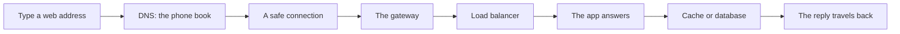
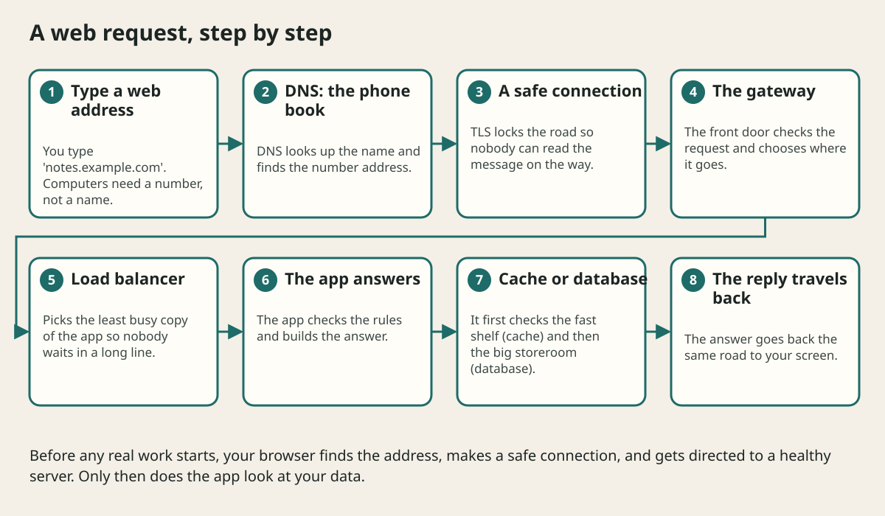

# Networking And Web Requests

## The big idea in plain words {#picture}

When you type a web address, a lot happens in a split second, like a relay race. First your computer looks up the number for the name, the way you look up a phone number. Then it makes a safe connection, and then it sends your message.

Each runner in this race has a different job, and each one can be slow or break. A good designer knows who the runners are and sets a time limit so the race never goes on forever.


## What you will be able to do {#outcomes}

By the end of this lesson you will be able to:

- Explain DNS, TCP, TLS, and HTTP as steps of one trip.
- Say why every call needs a time limit.
- Explain why retries must be careful.

## Words to know {#vocabulary}

- **DNS**: the phone book that turns a name into a number address.
- **TCP**: a careful way to send data so nothing is lost or mixed up.
- **TLS**: a lock that scrambles messages so strangers cannot read them.
- **HTTP**: the language browsers and servers use to ask and answer.
- **timeout**: the longest we are willing to wait.
- **retry**: trying again after a failure.

## Why this idea exists {#history}

Each step in the trip solves a different problem: finding, connecting, hiding, and asking. If you do not know the steps, a slow web page is a mystery. If you do, you can say exactly where the time went.

## Concept 1: DNS is the phone book {#concept-1}

Computers find each other by numbers like 203.0.113.7, but people remember names. DNS is the service that turns the name into the number. It does not decide who may see your data. It only finds the address.

## Concept 2: TLS is the lock {#concept-2}

The little padlock in the browser means TLS is on. It scrambles the message so nobody in the middle can read it, and it proves the server is the real one. But TLS does not know if you are allowed to read a certain note. That is still the app's job.

## Concept 3: Always set a timeout {#concept-3}

Imagine waiting at a door for a friend who never comes. A timeout is a rule that says "I will wait five seconds, then I go on." Without it, one slow helper can freeze the whole app, because everyone is stuck waiting.

## Concept 4: Retry carefully {#concept-4}

If a call fails, trying again can help. But if a thousand callers all retry at the same moment, they can knock the helper down again. So we wait a little longer each time (backoff) and add a bit of randomness (jitter). We also only retry actions that are safe to do twice.

## Why does the page take 3 seconds? {#example}

Looking at the trip: DNS 50 ms, connection 100 ms, TLS 100 ms, the server thinks 2,500 ms, the reply 250 ms. The slow part is clearly the server. Without breaking the trip into steps, you might have blamed the internet.

## Going deeper: the technical walkthrough {#walkthrough}

### Networking and request flow


A browser request may cross DNS, TLS, a gateway, a load balancer, an API,
cache, database, and external service. Every network hop can be delayed,
retried, or disconnected.

Set a timeout for every remote call. Do not let a request wait forever. Track a
correlation ID across services. Keep internal databases private and expose only
the intended API or media delivery boundary.


## Worked scenario {#worked-scenario}

A helper service does not answer within the time budget. What should you do?

The justified choice is **Time out safely and keep the number of retries limited**. Select **bounded-timeout** in the structured practical and explain why. Alternatives ignore a requirement, cross a trust boundary, or invent success.

### Structured decision contract

```json

{
  "decision": "bounded-timeout",
  "justification": "The DNS and TLS boundary must preserve the declared contract and ownership.",
  "failureBehavior": "Expose a safe failure and recover through the boundary owner."
}

```

Decision selects one declared behavior. Justification explains the boundary. FailureBehavior explains the observable error and recovery owner. These fields never execute commands. Required terms and minimum lengths form a basic practice rubric, not semantic grading.

## Step-by-step flow and matching picture {#flow}





## Three real-life uses {#use-cases}

1. A phone app sets a 10-second limit for loading a feed and then shows "try again".
2. A server calls a payment helper with a 3-second timeout and a safe retry.
3. A team measures each step of a slow page to find the real slow step.

## What can go wrong, and how to stay safe {#failure-security}

Waiting forever is the biggest mistake. Retrying instantly and without limit is the second. And the third is believing TLS makes a request safe. TLS protects the road, not the destination. The app must still check who is asking and what they may do.

## Practice lab and expected observation {#practice}

1. Predict the scenario decision before opening Practical. Explain each rejected alternative.
2. Run a relevant example above in an isolated exercise project. Record the expected result, then change one input to an invalid or boundary value. A failed assertion or deliberate error should replace silent success.
3. Submit the structured decision. Initially the checks fail. After selecting bounded-timeout and writing an explanation and failure plan, all three pass. Follow the indicated review section for missed checks.

### Broken example to debug

```json

{"decision":"trust-client","justification":"","failureBehavior":""}

```

This ignores the responsible boundary and gives no reasoning or recovery. Correct the fields rather than changing the validator.

## Checkpoint and definition of done {#checkpoint}

- [ ] Define DNS and TLS without looking.
- [ ] Trace input to owner and output.
- [ ] Explain one failure and one alternative.
- [ ] Pass at least four assignment questions.
- [ ] Pass every practical check and submit.
- [ ] Explain the concept again tomorrow.

## Sources, versions, and safe commands {#sources}

Workload figures are assumptions until measured. Review date: 2026-10-02. The supplied blueprint is the teaching source; official landing pages were checked where reachable. No provider or original TM Schedule deployment was tested.

- [Official reference](https://www.postgresql.org/docs/current/)

- [Official reference](https://opentelemetry.io/docs/)

[Course reading order](README.md) · [Previous lesson](03-architecture-building-blocks.md) · [Next lesson](04a-load-balancers-cdns-and-api-gateways.md)

```study-quiz

{
  "schemaVersion": 1,
  "lessonId": "system-design/04-networking-and-web-requests",
  "title": "Assignment: Networking And Web Requests",
  "passPercentage": 80,
  "questions": [
    {
      "id": "q1",
      "sectionId": "concept-1",
      "prompt": "In Networking And Web Requests, what does DNS mean?",
      "options": [
        {
          "id": "a",
          "text": "the phone book that turns a name into an address",
          "explanation": "This preserves the definition and boundary described in the lesson."
        },
        {
          "id": "b",
          "text": "A permission granted by a hidden browser control",
          "explanation": "This changes the declared meaning or bypasses the responsible boundary."
        },
        {
          "id": "c",
          "text": "An unlimited provider operation with no ownership",
          "explanation": "This changes the declared meaning or bypasses the responsible boundary."
        },
        {
          "id": "d",
          "text": "A diagnostic credential intended for public logs",
          "explanation": "This changes the declared meaning or bypasses the responsible boundary."
        }
      ],
      "correctOptionId": "a",
      "explanation": "DNS means the phone book that turns a name into an address.",
      "reviewLabel": "Review concept 1"
    },
    {
      "id": "q2",
      "sectionId": "concept-2",
      "prompt": "In Networking And Web Requests, which rule is correct for checkpoint 2?",
      "options": [
        {
          "id": "a",
          "text": "Trust client-side checks instead of the server rule.",
          "explanation": "This changes the declared meaning or bypasses the responsible boundary."
        },
        {
          "id": "b",
          "text": "TLS protects the road, but the app still checks permissions.",
          "explanation": "This preserves the definition and boundary described in the lesson."
        },
        {
          "id": "c",
          "text": "Hide the failure by returning a fabricated successful result.",
          "explanation": "This changes the declared meaning or bypasses the responsible boundary."
        },
        {
          "id": "d",
          "text": "Skip the stated boundary, limit, or ownership check.",
          "explanation": "This changes the declared meaning or bypasses the responsible boundary."
        }
      ],
      "correctOptionId": "b",
      "explanation": "TLS protects the road, but the app still checks permissions.",
      "reviewLabel": "Review concept 2"
    },
    {
      "id": "q3",
      "sectionId": "concept-3",
      "prompt": "In Networking And Web Requests, which rule is correct for checkpoint 3?",
      "options": [
        {
          "id": "a",
          "text": "Trust client-side checks instead of the server rule.",
          "explanation": "This changes the declared meaning or bypasses the responsible boundary."
        },
        {
          "id": "b",
          "text": "Hide the failure by returning a fabricated successful result.",
          "explanation": "This changes the declared meaning or bypasses the responsible boundary."
        },
        {
          "id": "c",
          "text": "A timeout needs a clear message for the user.",
          "explanation": "This preserves the definition and boundary described in the lesson."
        },
        {
          "id": "d",
          "text": "Skip the stated boundary, limit, or ownership check.",
          "explanation": "This changes the declared meaning or bypasses the responsible boundary."
        }
      ],
      "correctOptionId": "c",
      "explanation": "A timeout needs a clear message for the user.",
      "reviewLabel": "Review concept 3"
    },
    {
      "id": "q4",
      "sectionId": "concept-4",
      "prompt": "In Networking And Web Requests, which rule is correct for checkpoint 4?",
      "options": [
        {
          "id": "a",
          "text": "Trust client-side checks instead of the server rule.",
          "explanation": "This changes the declared meaning or bypasses the responsible boundary."
        },
        {
          "id": "b",
          "text": "Hide the failure by returning a fabricated successful result.",
          "explanation": "This changes the declared meaning or bypasses the responsible boundary."
        },
        {
          "id": "c",
          "text": "Skip the stated boundary, limit, or ownership check.",
          "explanation": "This changes the declared meaning or bypasses the responsible boundary."
        },
        {
          "id": "d",
          "text": "Retry with growing waits and a bit of randomness, only when it is safe.",
          "explanation": "This preserves the definition and boundary described in the lesson."
        }
      ],
      "correctOptionId": "d",
      "explanation": "Retry with growing waits and a bit of randomness, only when it is safe.",
      "reviewLabel": "Review concept 4"
    },
    {
      "id": "q5",
      "sectionId": "worked-scenario",
      "prompt": "A helper service does not answer within the time budget. What should you do?",
      "options": [
        {
          "id": "a",
          "text": "Time out safely and keep the number of retries limited",
          "explanation": "This preserves the definition and boundary described in the lesson."
        },
        {
          "id": "b",
          "text": "Wait forever",
          "explanation": "This changes the declared meaning or bypasses the responsible boundary."
        },
        {
          "id": "c",
          "text": "Retry right away without any limit",
          "explanation": "This changes the declared meaning or bypasses the responsible boundary."
        },
        {
          "id": "d",
          "text": "Invent an answer",
          "explanation": "This changes the declared meaning or bypasses the responsible boundary."
        }
      ],
      "correctOptionId": "a",
      "explanation": "Time out safely and keep the number of retries limited. One request that fans out into many multiplies the load behind it.",
      "reviewLabel": "Review the worked scenario"
    }
  ]
}

```

```study-practical

{
  "schemaVersion": 1,
  "challengeId": "system-design/04-networking-and-web-requests/decision",
  "lessonId": "system-design/04-networking-and-web-requests",
  "title": "Practical: Networking And Web Requests",
  "language": "json",
  "mode": "structured",
  "instructions": "A helper service does not answer within the time budget. What should you do? Return an object with decision (choose from bounded-timeout, skip-check, unbounded-work, trust-client), justification (at least 40 characters; include DNS and TLS), and failureBehavior (at least 25 characters; include failure and recover while explaining the error and recovery). These are structured reasoning checks, not code execution or an official grade.",
  "starterCode": "{\n  \"decision\": \"\",\n  \"justification\": \"\",\n  \"failureBehavior\": \"\"\n}",
  "entryPoint": "answer",
  "publicExamples": [
    {
      "input": {
        "decision": "skip-check",
        "justification": "",
        "failureBehavior": ""
      },
      "expected": {
        "passed": false
      }
    },
    {
      "input": {
        "decision": "bounded-timeout",
        "justification": "The DNS and TLS boundary must preserve the declared contract and ownership.",
        "failureBehavior": "Show a safe failure and recover through the responsible owner."
      },
      "expected": {
        "passed": true
      }
    }
  ],
  "publicTestIds": [
    "decision",
    "explanation",
    "failure-plan"
  ],
  "reviewSections": {
    "decision": "worked-scenario",
    "explanation": "concept-2",
    "failure-plan": "failure-security"
  },
  "limits": {
    "timeMs": 2000,
    "memoryMb": 128,
    "outputBytes": 20000
  }
}

```

