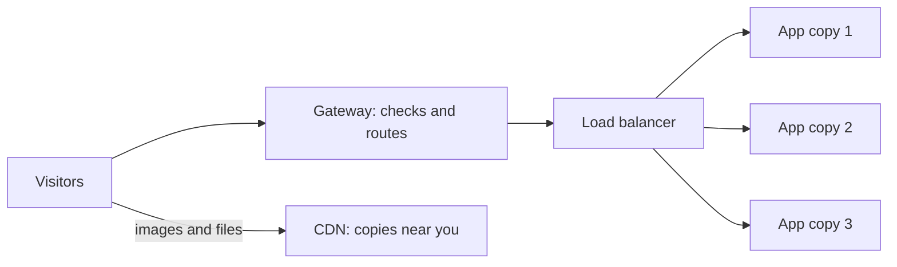
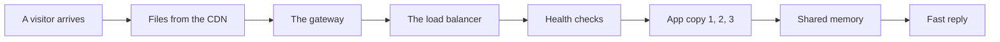
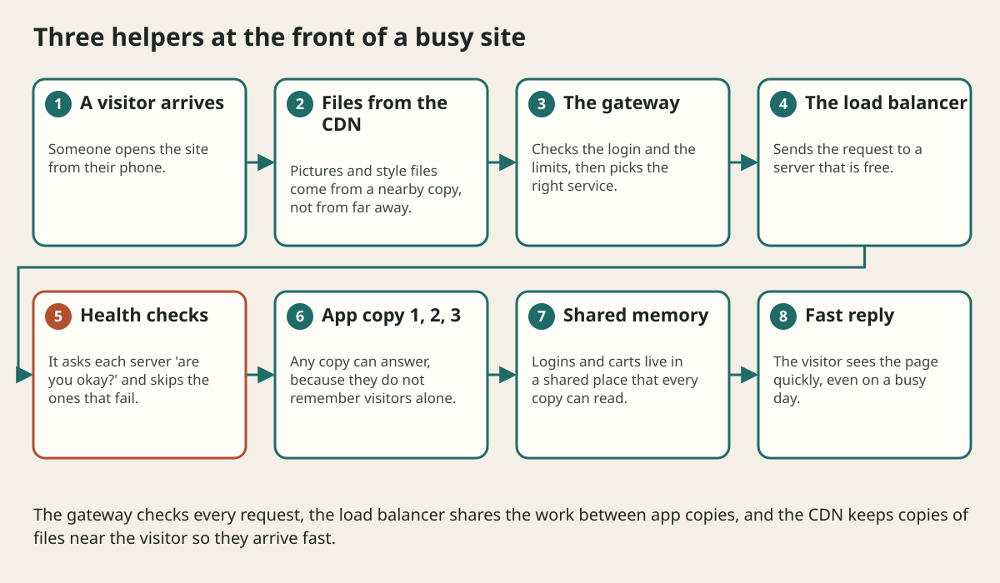

# Load Balancers Cdns And Api Gateways

## The big idea in plain words {#picture}

Imagine a supermarket with ten checkout lanes and one person at the door pointing shoppers to the shortest line. If a lane closes because the cashier is sick, the pointing person stops sending people there. That person is a **load balancer**.

Now imagine you live in Australia and the only copy of a popular poster is in a shop in Canada. Every time you want to see it, it travels around the world. A **CDN** is like putting a copy of that poster in a shop in your own city.

And a **gateway** is the receptionist at the front of a building: she checks who you are and tells you which floor to go to.



## What you will be able to do {#outcomes}

By the end of this lesson you will be able to:

- Say what a load balancer, a CDN, and a gateway each do.
- Explain health checks and why servers should not "remember" visitors alone.
- Choose which of the three solves a given traffic problem.

## Words to know {#vocabulary}

- **load balancer**: a guard that spreads visitors across servers.
- **health check**: a quick "are you okay?" question sent to each server.
- **CDN**: a world-wide set of helpers that keep copies of files near people.
- **edge**: the place close to the visitor, far from your main servers.
- **gateway**: the single front door for all requests.
- **stateless**: a server that does not remember visitors between requests.

## Why this idea exists {#history}

When a site becomes popular, one server gets tired and slow. Adding more servers helps only if something shares the work, and sending large files from far away makes pages feel slow.

## Concept 1: The load balancer shares the work {#concept-1}

Visitors talk to the load balancer, not directly to servers. It picks a server using a simple rule, like "the one with the fewest people" or "take turns". Every few seconds it asks each server "are you okay?" (a health check). A server that does not answer is skipped until it recovers.

## Concept 2: Servers should be forgetful {#concept-2}

If server A remembers that you logged in, and the next request goes to server B, B does not know you. So we keep the memory somewhere shared (a database or a shared cache) and let servers be "stateless". Then any server can answer any visitor.

## Concept 3: A CDN puts copies near people {#concept-3}

Images, videos, and style files are the same for everybody. A CDN keeps copies in many cities. A visitor in Paris gets the file from Paris, not from a server far away. It is faster and your own servers get a rest. Private, personal data should not be put on a public CDN.

## Concept 4: The gateway is the front door {#concept-4}

All requests come through one door where we check the login, apply limits, and send each request to the right place. This keeps rules in one spot instead of copying them into every service. Run two or more load balancers and gateways, so that the door itself is never the single thing that can break.

## Sale day {#example}

Normally 100 people visit each minute. On sale day, 1,000 do. You add four more app servers behind the load balancer. Product pictures, which are 80 percent of the data sent, come from the CDN. The app servers only handle the 20 percent that is personal: carts and orders. The site stays fast.

## Going deeper: the technical walkthrough {#walkthrough}

## Worked scenario {#worked-scenario}

A big sale makes traffic jump to ten times the normal level, mostly for product images. What helps most?

The justified choice is **Run several app copies behind a load balancer and serve images from a CDN**. Select **balance-and-cdn** in the structured practical and explain why. Alternatives ignore a requirement, cross a trust boundary, or invent success.

### Structured decision contract

```json

{
  "decision": "balance-and-cdn",
  "justification": "The loadBalancer and CDN boundary must preserve the declared contract and ownership.",
  "failureBehavior": "Expose a safe failure and recover through the boundary owner."
}

```

Decision selects one declared behavior. Justification explains the boundary. FailureBehavior explains the observable error and recovery owner. These fields never execute commands. Required terms and minimum lengths form a basic practice rubric, not semantic grading.

## Step-by-step flow and matching picture {#flow}





## Three real-life uses {#use-cases}

1. A news site puts its pictures on a CDN so readers anywhere get them quickly.
2. A shop adds app servers before a holiday and removes them afterwards.
3. A company puts login checks in a gateway so every service is protected the same way.

## What can go wrong, and how to stay safe {#failure-security}

Mistakes: keeping a login only in one server's memory, forgetting health checks so visitors get sent to a dead server, putting private files on a public CDN, and having just one load balancer. Also remember that a CDN can show an old copy until it expires or is cleared.

## Practice lab and expected observation {#practice}

1. Predict the scenario decision before opening Practical. Explain each rejected alternative.
2. Run a relevant example above in an isolated exercise project. Record the expected result, then change one input to an invalid or boundary value. A failed assertion or deliberate error should replace silent success.
3. Submit the structured decision. Initially the checks fail. After selecting balance-and-cdn and writing an explanation and failure plan, all three pass. Follow the indicated review section for missed checks.

### Broken example to debug

```json

{"decision":"trust-client","justification":"","failureBehavior":""}

```

This ignores the responsible boundary and gives no reasoning or recovery. Correct the fields rather than changing the validator.

## Checkpoint and definition of done {#checkpoint}

- [ ] Define loadBalancer and CDN without looking.
- [ ] Trace input to owner and output.
- [ ] Explain one failure and one alternative.
- [ ] Pass at least four assignment questions.
- [ ] Pass every practical check and submit.
- [ ] Explain the concept again tomorrow.

## Sources, versions, and safe commands {#sources}

Workload figures are assumptions until measured. Review date: 2026-10-02. The supplied blueprint is the teaching source; official landing pages were checked where reachable. No provider or original TM Schedule deployment was tested.

- [Official reference](https://www.postgresql.org/docs/current/)

- [Official reference](https://opentelemetry.io/docs/)

[Course reading order](README.md) · [Previous lesson](04-networking-and-web-requests.md) · [Next lesson](05-apis-and-contracts.md)

```study-quiz

{
  "schemaVersion": 1,
  "lessonId": "system-design/04a-load-balancers-cdns-and-api-gateways",
  "title": "Assignment: Load Balancers Cdns And Api Gateways",
  "passPercentage": 80,
  "questions": [
    {
      "id": "q1",
      "sectionId": "concept-1",
      "prompt": "In Load Balancers Cdns And Api Gateways, what does loadBalancer mean?",
      "options": [
        {
          "id": "a",
          "text": "A permission granted by a hidden browser control",
          "explanation": "This changes the declared meaning or bypasses the responsible boundary."
        },
        {
          "id": "b",
          "text": "a traffic guard that sends each visitor to a server that is free",
          "explanation": "This preserves the definition and boundary described in the lesson."
        },
        {
          "id": "c",
          "text": "An unlimited provider operation with no ownership",
          "explanation": "This changes the declared meaning or bypasses the responsible boundary."
        },
        {
          "id": "d",
          "text": "A diagnostic credential intended for public logs",
          "explanation": "This changes the declared meaning or bypasses the responsible boundary."
        }
      ],
      "correctOptionId": "b",
      "explanation": "loadBalancer means a traffic guard that sends each visitor to a server that is free.",
      "reviewLabel": "Review concept 1"
    },
    {
      "id": "q2",
      "sectionId": "concept-2",
      "prompt": "In Load Balancers Cdns And Api Gateways, which rule is correct for checkpoint 2?",
      "options": [
        {
          "id": "a",
          "text": "Trust client-side checks instead of the server rule.",
          "explanation": "This changes the declared meaning or bypasses the responsible boundary."
        },
        {
          "id": "b",
          "text": "Hide the failure by returning a fabricated successful result.",
          "explanation": "This changes the declared meaning or bypasses the responsible boundary."
        },
        {
          "id": "c",
          "text": "A CDN is best for files that look the same for everyone, like images and style sheets.",
          "explanation": "This preserves the definition and boundary described in the lesson."
        },
        {
          "id": "d",
          "text": "Skip the stated boundary, limit, or ownership check.",
          "explanation": "This changes the declared meaning or bypasses the responsible boundary."
        }
      ],
      "correctOptionId": "c",
      "explanation": "A CDN is best for files that look the same for everyone, like images and style sheets.",
      "reviewLabel": "Review concept 2"
    },
    {
      "id": "q3",
      "sectionId": "concept-3",
      "prompt": "In Load Balancers Cdns And Api Gateways, which rule is correct for checkpoint 3?",
      "options": [
        {
          "id": "a",
          "text": "Trust client-side checks instead of the server rule.",
          "explanation": "This changes the declared meaning or bypasses the responsible boundary."
        },
        {
          "id": "b",
          "text": "Hide the failure by returning a fabricated successful result.",
          "explanation": "This changes the declared meaning or bypasses the responsible boundary."
        },
        {
          "id": "c",
          "text": "Skip the stated boundary, limit, or ownership check.",
          "explanation": "This changes the declared meaning or bypasses the responsible boundary."
        },
        {
          "id": "d",
          "text": "A gateway can check logins and apply limits before a request reaches the app.",
          "explanation": "This preserves the definition and boundary described in the lesson."
        }
      ],
      "correctOptionId": "d",
      "explanation": "A gateway can check logins and apply limits before a request reaches the app.",
      "reviewLabel": "Review concept 3"
    },
    {
      "id": "q4",
      "sectionId": "concept-4",
      "prompt": "In Load Balancers Cdns And Api Gateways, which rule is correct for checkpoint 4?",
      "options": [
        {
          "id": "a",
          "text": "If a server remembers a visitor only in its own memory, a load balancer can send that visitor to a server that has forgotten them.",
          "explanation": "This preserves the definition and boundary described in the lesson."
        },
        {
          "id": "b",
          "text": "Trust client-side checks instead of the server rule.",
          "explanation": "This changes the declared meaning or bypasses the responsible boundary."
        },
        {
          "id": "c",
          "text": "Hide the failure by returning a fabricated successful result.",
          "explanation": "This changes the declared meaning or bypasses the responsible boundary."
        },
        {
          "id": "d",
          "text": "Skip the stated boundary, limit, or ownership check.",
          "explanation": "This changes the declared meaning or bypasses the responsible boundary."
        }
      ],
      "correctOptionId": "a",
      "explanation": "If a server remembers a visitor only in its own memory, a load balancer can send that visitor to a server that has forgotten them.",
      "reviewLabel": "Review concept 4"
    },
    {
      "id": "q5",
      "sectionId": "worked-scenario",
      "prompt": "A big sale makes traffic jump to ten times the normal level, mostly for product images. What helps most?",
      "options": [
        {
          "id": "a",
          "text": "Buy one giant server and hope",
          "explanation": "This changes the declared meaning or bypasses the responsible boundary."
        },
        {
          "id": "b",
          "text": "Run several app copies behind a load balancer and serve images from a CDN",
          "explanation": "This preserves the definition and boundary described in the lesson."
        },
        {
          "id": "c",
          "text": "Make every visitor wait in a single line",
          "explanation": "This changes the declared meaning or bypasses the responsible boundary."
        },
        {
          "id": "d",
          "text": "Store images inside each database row",
          "explanation": "This changes the declared meaning or bypasses the responsible boundary."
        }
      ],
      "correctOptionId": "b",
      "explanation": "Run several app copies behind a load balancer and serve images from a CDN. The load balancer itself must not become the one single point of failure, so there are usually at least two.",
      "reviewLabel": "Review the worked scenario"
    }
  ]
}

```

```study-practical

{
  "schemaVersion": 1,
  "challengeId": "system-design/04a-load-balancers-cdns-and-api-gateways/decision",
  "lessonId": "system-design/04a-load-balancers-cdns-and-api-gateways",
  "title": "Practical: Load Balancers Cdns And Api Gateways",
  "language": "json",
  "mode": "structured",
  "instructions": "A big sale makes traffic jump to ten times the normal level, mostly for product images. What helps most? Return an object with decision (choose from balance-and-cdn, skip-check, unbounded-work, trust-client), justification (at least 40 characters; include loadBalancer and CDN), and failureBehavior (at least 25 characters; include failure and recover while explaining the error and recovery). These are structured reasoning checks, not code execution or an official grade.",
  "starterCode": "{\n  \"decision\": \"\",\n  \"justification\": \"\",\n  \"failureBehavior\": \"\"\n}",
  "entryPoint": "answer",
  "publicExamples": [
    {
      "input": {
        "decision": "skip-check",
        "justification": "",
        "failureBehavior": ""
      },
      "expected": {
        "passed": false
      }
    },
    {
      "input": {
        "decision": "balance-and-cdn",
        "justification": "The loadBalancer and CDN boundary must preserve the declared contract and ownership.",
        "failureBehavior": "Show a safe failure and recover through the responsible owner."
      },
      "expected": {
        "passed": true
      }
    }
  ],
  "publicTestIds": [
    "decision",
    "explanation",
    "failure-plan"
  ],
  "reviewSections": {
    "decision": "worked-scenario",
    "explanation": "concept-2",
    "failure-plan": "failure-security"
  },
  "limits": {
    "timeMs": 2000,
    "memoryMb": 128,
    "outputBytes": 20000
  }
}

```

