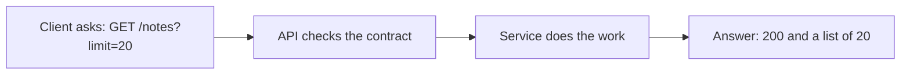
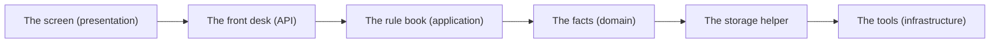

# Apis And Contracts

## The big idea in plain words {#picture}

An API is a menu in a restaurant. The menu lists what you can order, and how to ask for it. You do not walk into the kitchen. You say "I would like the soup" and the waiter brings it.

For an app, the menu is a list of **endpoints** like "GET /notes" (show me the notes) and "POST /notes" (make a new note). The rules about what to send and what comes back are called a **contract**. If both sides keep the contract, different people can build different parts and everything still fits.



## What you will be able to do {#outcomes}

By the end of this lesson you will be able to:

- Read and write a simple API contract.
- Pick the right method and status code.
- Explain pagination, versioning, and idempotency in plain words.

## Words to know {#vocabulary}

- **endpoint**: one address on the API that does one job.
- **method**: the action word: GET reads, POST creates, PUT or PATCH changes, DELETE removes.
- **status code**: a number that tells how the request went, like 200 (ok) or 404 (not found).
- **pagination**: giving a long list in small pages.
- **idempotent**: doing it twice gives the same result as doing it once.
- **contract**: the written promise about what is sent and what comes back.

## Why this idea exists {#history}

When many apps use the same API, a surprise change breaks them all. A clear contract, written down and tested, lets people change what is inside without breaking those outside.

## Concept 1: Pick the right method {#concept-1}

GET only looks, never changes. POST creates something new. PUT replaces the whole thing, PATCH changes part of it, and DELETE removes it. Using the right word helps everyone guess how it behaves, and helps computers decide what is safe to repeat.

## Concept 2: Status codes are traffic lights {#concept-2}

200 means ok. 201 means "created". 400 means "your request is wrong". 401 means "who are you?". 403 means "I know you, but no". 404 means "I cannot find it". 500 means "my fault, something broke". A good API uses the right one, so the caller knows what to do next.

## Concept 3: Give lists in pages {#concept-3}

If you have a million notes, you do not send a million in one answer. You send 20 at a time and say how to get the next 20. This keeps answers small and fast. Always have a limit, and always sort in a steady order so pages do not repeat.

## Concept 4: Make retries safe with a key {#concept-4}

Suppose a "create order" call times out. Did it work or not? If the client retries and it worked, you now have two orders! An idempotency key is a unique number the client sends with the request. The server remembers it, and if it sees the same key again, it returns the first answer instead of creating a new order.

## Creating a note safely {#example}

The client sends POST /notes with a title and an idempotency key "abc-123". The server saves the note and replies 201 with the new note's address. The reply gets lost. The client retries with the same key "abc-123". The server sees it already did that, and replies with the same note. One note, no duplicate.

## Going deeper: the technical walkthrough {#walkthrough}

### The design method


Use this order for every problem:

1. Name the users and their jobs.
2. Write functional requirements as actions.
3. Write non-functional requirements as measurable promises.
4. State assumptions about traffic, data, regions, and budget.
5. Estimate requests per second, storage, and bandwidth.
6. Draw the simplest request and write flow.
7. Choose data stores and ownership.
8. Add caches, queues, replicas, or partitions only when a requirement needs
   them.
9. Draw failure paths, security boundaries, and observability.
10. Choose deployment, backup, restore, and rollback steps.
11. List trade-offs and the evidence that would change the design.


## Worked scenario {#worked-scenario}

A client wants a page of notes and must not change anything. Which request fits?

The justified choice is **GET /notes?limit=20 returning a limited list**. Select **bounded-get** in the structured practical and explain why. Alternatives ignore a requirement, cross a trust boundary, or invent success.

### Structured decision contract

```json

{
  "decision": "bounded-get",
  "justification": "The method and header boundary must preserve the declared contract and ownership.",
  "failureBehavior": "Expose a safe failure and recover through the boundary owner."
}

```

Decision selects one declared behavior. Justification explains the boundary. FailureBehavior explains the observable error and recovery owner. These fields never execute commands. Required terms and minimum lengths form a basic practice rubric, not semantic grading.

## Step-by-step flow and matching picture {#flow}




## Three real-life uses {#use-cases}

1. A weather app calls GET /forecast?city=Paris.
2. A payment page uses an idempotency key so you are never charged twice.
3. A mobile app keeps using version 1 of the API while a new version 2 is being tested.

## What can go wrong, and how to stay safe {#failure-security}

Mistakes: a GET that secretly changes data, a list with no limit, an error that shows the raw database message, and a change that removes a field old apps still use. Add new things, and remove old things only after telling everyone.

## Practice lab and expected observation {#practice}

1. Predict the scenario decision before opening Practical. Explain each rejected alternative.
2. Run a relevant example above in an isolated exercise project. Record the expected result, then change one input to an invalid or boundary value. A failed assertion or deliberate error should replace silent success.
3. Submit the structured decision. Initially the checks fail. After selecting bounded-get and writing an explanation and failure plan, all three pass. Follow the indicated review section for missed checks.

### Broken example to debug

```json

{"decision":"trust-client","justification":"","failureBehavior":""}

```

This ignores the responsible boundary and gives no reasoning or recovery. Correct the fields rather than changing the validator.

## Checkpoint and definition of done {#checkpoint}

- [ ] Define method and header without looking.
- [ ] Trace input to owner and output.
- [ ] Explain one failure and one alternative.
- [ ] Pass at least four assignment questions.
- [ ] Pass every practical check and submit.
- [ ] Explain the concept again tomorrow.

## Sources, versions, and safe commands {#sources}

Workload figures are assumptions until measured. Review date: 2026-10-02. The supplied blueprint is the teaching source; official landing pages were checked where reachable. No provider or original TM Schedule deployment was tested.

- [Official reference](https://www.postgresql.org/docs/current/)

- [Official reference](https://opentelemetry.io/docs/)

[Course reading order](README.md) · [Previous lesson](04a-load-balancers-cdns-and-api-gateways.md) · [Next lesson](05a-rate-limiting-and-fair-sharing.md)

```study-quiz

{
  "schemaVersion": 1,
  "lessonId": "system-design/05-apis-and-contracts",
  "title": "Assignment: Apis And Contracts",
  "passPercentage": 80,
  "questions": [
    {
      "id": "q1",
      "sectionId": "concept-1",
      "prompt": "In Apis And Contracts, what does method mean?",
      "options": [
        {
          "id": "a",
          "text": "A permission granted by a hidden browser control",
          "explanation": "This changes the declared meaning or bypasses the responsible boundary."
        },
        {
          "id": "b",
          "text": "An unlimited provider operation with no ownership",
          "explanation": "This changes the declared meaning or bypasses the responsible boundary."
        },
        {
          "id": "c",
          "text": "the action word of a request, like GET or POST",
          "explanation": "This preserves the definition and boundary described in the lesson."
        },
        {
          "id": "d",
          "text": "A diagnostic credential intended for public logs",
          "explanation": "This changes the declared meaning or bypasses the responsible boundary."
        }
      ],
      "correctOptionId": "c",
      "explanation": "method means the action word of a request, like GET or POST.",
      "reviewLabel": "Review concept 1"
    },
    {
      "id": "q2",
      "sectionId": "concept-2",
      "prompt": "In Apis And Contracts, which rule is correct for checkpoint 2?",
      "options": [
        {
          "id": "a",
          "text": "Trust client-side checks instead of the server rule.",
          "explanation": "This changes the declared meaning or bypasses the responsible boundary."
        },
        {
          "id": "b",
          "text": "Hide the failure by returning a fabricated successful result.",
          "explanation": "This changes the declared meaning or bypasses the responsible boundary."
        },
        {
          "id": "c",
          "text": "Skip the stated boundary, limit, or ownership check.",
          "explanation": "This changes the declared meaning or bypasses the responsible boundary."
        },
        {
          "id": "d",
          "text": "Creating something with POST usually answers 201 and points to the new item.",
          "explanation": "This preserves the definition and boundary described in the lesson."
        }
      ],
      "correctOptionId": "d",
      "explanation": "Creating something with POST usually answers 201 and points to the new item.",
      "reviewLabel": "Review concept 2"
    },
    {
      "id": "q3",
      "sectionId": "concept-3",
      "prompt": "In Apis And Contracts, which rule is correct for checkpoint 3?",
      "options": [
        {
          "id": "a",
          "text": "Content-Type tells what kind of data is in the body.",
          "explanation": "This preserves the definition and boundary described in the lesson."
        },
        {
          "id": "b",
          "text": "Trust client-side checks instead of the server rule.",
          "explanation": "This changes the declared meaning or bypasses the responsible boundary."
        },
        {
          "id": "c",
          "text": "Hide the failure by returning a fabricated successful result.",
          "explanation": "This changes the declared meaning or bypasses the responsible boundary."
        },
        {
          "id": "d",
          "text": "Skip the stated boundary, limit, or ownership check.",
          "explanation": "This changes the declared meaning or bypasses the responsible boundary."
        }
      ],
      "correctOptionId": "a",
      "explanation": "Content-Type tells what kind of data is in the body.",
      "reviewLabel": "Review concept 3"
    },
    {
      "id": "q4",
      "sectionId": "concept-4",
      "prompt": "In Apis And Contracts, which rule is correct for checkpoint 4?",
      "options": [
        {
          "id": "a",
          "text": "Trust client-side checks instead of the server rule.",
          "explanation": "This changes the declared meaning or bypasses the responsible boundary."
        },
        {
          "id": "b",
          "text": "Before retrying a write, decide how to avoid doing it twice.",
          "explanation": "This preserves the definition and boundary described in the lesson."
        },
        {
          "id": "c",
          "text": "Hide the failure by returning a fabricated successful result.",
          "explanation": "This changes the declared meaning or bypasses the responsible boundary."
        },
        {
          "id": "d",
          "text": "Skip the stated boundary, limit, or ownership check.",
          "explanation": "This changes the declared meaning or bypasses the responsible boundary."
        }
      ],
      "correctOptionId": "b",
      "explanation": "Before retrying a write, decide how to avoid doing it twice.",
      "reviewLabel": "Review concept 4"
    },
    {
      "id": "q5",
      "sectionId": "worked-scenario",
      "prompt": "A client wants a page of notes and must not change anything. Which request fits?",
      "options": [
        {
          "id": "a",
          "text": "POST /delete-everything",
          "explanation": "This changes the declared meaning or bypasses the responsible boundary."
        },
        {
          "id": "b",
          "text": "A GET that secretly changes data",
          "explanation": "This changes the declared meaning or bypasses the responsible boundary."
        },
        {
          "id": "c",
          "text": "GET /notes?limit=20 returning a limited list",
          "explanation": "This preserves the definition and boundary described in the lesson."
        },
        {
          "id": "d",
          "text": "A database password inside the URL",
          "explanation": "This changes the declared meaning or bypasses the responsible boundary."
        }
      ],
      "correctOptionId": "c",
      "explanation": "GET /notes?limit=20 returning a limited list. A list answer should be a limited page in a steady order.",
      "reviewLabel": "Review the worked scenario"
    }
  ]
}

```

```study-practical

{
  "schemaVersion": 1,
  "challengeId": "system-design/05-apis-and-contracts/decision",
  "lessonId": "system-design/05-apis-and-contracts",
  "title": "Practical: Apis And Contracts",
  "language": "json",
  "mode": "structured",
  "instructions": "A client wants a page of notes and must not change anything. Which request fits? Return an object with decision (choose from bounded-get, skip-check, unbounded-work, trust-client), justification (at least 40 characters; include method and header), and failureBehavior (at least 25 characters; include failure and recover while explaining the error and recovery). These are structured reasoning checks, not code execution or an official grade.",
  "starterCode": "{\n  \"decision\": \"\",\n  \"justification\": \"\",\n  \"failureBehavior\": \"\"\n}",
  "entryPoint": "answer",
  "publicExamples": [
    {
      "input": {
        "decision": "skip-check",
        "justification": "",
        "failureBehavior": ""
      },
      "expected": {
        "passed": false
      }
    },
    {
      "input": {
        "decision": "bounded-get",
        "justification": "The method and header boundary must preserve the declared contract and ownership.",
        "failureBehavior": "Show a safe failure and recover through the responsible owner."
      },
      "expected": {
        "passed": true
      }
    }
  ],
  "publicTestIds": [
    "decision",
    "explanation",
    "failure-plan"
  ],
  "reviewSections": {
    "decision": "worked-scenario",
    "explanation": "concept-2",
    "failure-plan": "failure-security"
  },
  "limits": {
    "timeMs": 2000,
    "memoryMb": 128,
    "outputBytes": 20000
  }
}

```

