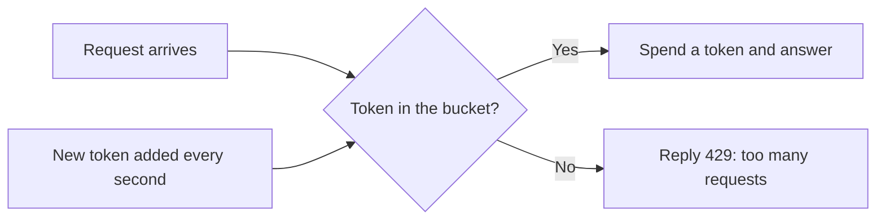
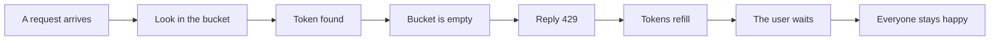
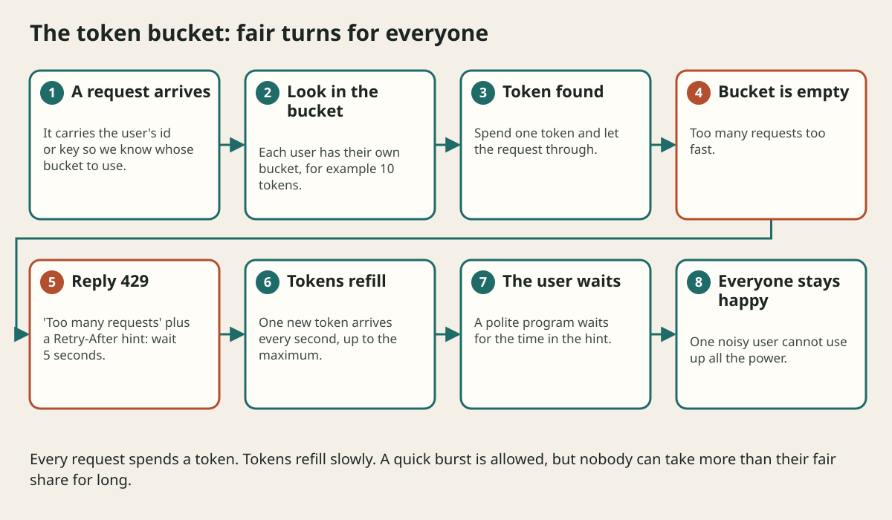

# Rate Limiting And Fair Sharing

## The big idea in plain words {#picture}

At a water fountain at school, if one kid drinks and drinks, the others wait forever. So the teacher says: "Everyone gets one drink, then goes to the back of the line." That is **rate limiting**: a fair rule that stops one person from using all of something.

A good way to picture it is a **bucket of tokens**. Every second the bucket gets a new token, up to a maximum. Each request spends one token. If the bucket is empty, you wait until it fills a little.



## What you will be able to do {#outcomes}

By the end of this lesson you will be able to:

- Explain why we limit how often someone can ask.
- Describe a token bucket with numbers.
- Reply to over-limit callers politely with 429 and Retry-After.

## Words to know {#vocabulary}

- **rate limit**: the most requests a visitor may make in a certain time.
- **token bucket**: a bucket that refills with tokens over time. Each request costs one.
- **burst**: a short quick rush of requests.
- **429**: the status code meaning "too many requests".
- **Retry-After**: a hint that says how long to wait.
- **throttle**: slow someone down instead of blocking them.

## Why this idea exists {#history}

Without limits, a bug, a bot, or a greedy user can take all the power and everyone else suffers. Limits also protect your database and your bill.

## Concept 1: Fair shares for all {#concept-1}

We count requests for each visitor separately, for example per user account or per API key. One heavy user hits only their own limit, and everyone else carries on normally.

## Concept 2: The token bucket {#concept-2}

Say the bucket holds 10 tokens and gets 1 new token each second. You can make 10 quick requests (a burst) and then about one per second. The average stays under the limit but short rushes are allowed, like a real person clicking quickly.

## Concept 3: Say "slow down", politely {#concept-3}

When the bucket is empty, answer with 429 and add a Retry-After hint, for example "wait 5 seconds". Well-behaved programs wait. Without the hint, they might retry right away and make things worse.

## Concept 4: Where to put the limit {#concept-4}

Put it at the front door (the gateway) so a flood is stopped before it uses the app. Keep the counters in something fast and shared, like a cache, so every server agrees on how many tokens a visitor has left. Some actions, like logging in or sending a text message, need much stricter limits than normal reading.

## A login limit {#example}

You allow 5 login attempts per minute for each account. A robot tries a password 1,000 times. After 5 tries the server says 429. The robot is stuck, and the real owner of the account can still log in after a short wait.

## Going deeper: the technical walkthrough {#walkthrough}

## Worked scenario {#worked-scenario}

A buggy program sends 5,000 requests per second from a single account. What should the API do?

The justified choice is **Answer 429 with a Retry-After hint for that account only**. Select **limit-per-account** in the structured practical and explain why. Alternatives ignore a requirement, cross a trust boundary, or invent success.

### Structured decision contract

```json

{
  "decision": "limit-per-account",
  "justification": "The rateLimit and tokenBucket boundary must preserve the declared contract and ownership.",
  "failureBehavior": "Expose a safe failure and recover through the boundary owner."
}

```

Decision selects one declared behavior. Justification explains the boundary. FailureBehavior explains the observable error and recovery owner. These fields never execute commands. Required terms and minimum lengths form a basic practice rubric, not semantic grading.

## Step-by-step flow and matching picture {#flow}





## Three real-life uses {#use-cases}

1. A weather API gives free users 60 requests per minute.
2. A bank limits password guesses to stop people from trying many passwords.
3. A chat app limits messages per second to stop spam.

## What can go wrong, and how to stay safe {#failure-security}

Mistakes: one global limit for all visitors, so one person slows everyone, limits that are only in the browser, and no hint about when to retry. Also be careful: if many visitors share one address (like a school network), counting by address can be unfair. Prefer counting by account or key.

## Practice lab and expected observation {#practice}

1. Predict the scenario decision before opening Practical. Explain each rejected alternative.
2. Run a relevant example above in an isolated exercise project. Record the expected result, then change one input to an invalid or boundary value. A failed assertion or deliberate error should replace silent success.
3. Submit the structured decision. Initially the checks fail. After selecting limit-per-account and writing an explanation and failure plan, all three pass. Follow the indicated review section for missed checks.

### Broken example to debug

```json

{"decision":"trust-client","justification":"","failureBehavior":""}

```

This ignores the responsible boundary and gives no reasoning or recovery. Correct the fields rather than changing the validator.

## Checkpoint and definition of done {#checkpoint}

- [ ] Define rateLimit and tokenBucket without looking.
- [ ] Trace input to owner and output.
- [ ] Explain one failure and one alternative.
- [ ] Pass at least four assignment questions.
- [ ] Pass every practical check and submit.
- [ ] Explain the concept again tomorrow.

## Sources, versions, and safe commands {#sources}

Workload figures are assumptions until measured. Review date: 2026-10-02. The supplied blueprint is the teaching source; official landing pages were checked where reachable. No provider or original TM Schedule deployment was tested.

- [Official reference](https://www.postgresql.org/docs/current/)

- [Official reference](https://opentelemetry.io/docs/)

[Course reading order](README.md) · [Previous lesson](05-apis-and-contracts.md) · [Next lesson](06-data-modeling-and-databases.md)

```study-quiz

{
  "schemaVersion": 1,
  "lessonId": "system-design/05a-rate-limiting-and-fair-sharing",
  "title": "Assignment: Rate Limiting And Fair Sharing",
  "passPercentage": 80,
  "questions": [
    {
      "id": "q1",
      "sectionId": "concept-1",
      "prompt": "In Rate Limiting And Fair Sharing, what does rateLimit mean?",
      "options": [
        {
          "id": "a",
          "text": "A permission granted by a hidden browser control",
          "explanation": "This changes the declared meaning or bypasses the responsible boundary."
        },
        {
          "id": "b",
          "text": "An unlimited provider operation with no ownership",
          "explanation": "This changes the declared meaning or bypasses the responsible boundary."
        },
        {
          "id": "c",
          "text": "A diagnostic credential intended for public logs",
          "explanation": "This changes the declared meaning or bypasses the responsible boundary."
        },
        {
          "id": "d",
          "text": "a rule that says how many requests someone may make in a period of time",
          "explanation": "This preserves the definition and boundary described in the lesson."
        }
      ],
      "correctOptionId": "d",
      "explanation": "rateLimit means a rule that says how many requests someone may make in a period of time.",
      "reviewLabel": "Review concept 1"
    },
    {
      "id": "q2",
      "sectionId": "concept-2",
      "prompt": "In Rate Limiting And Fair Sharing, which rule is correct for checkpoint 2?",
      "options": [
        {
          "id": "a",
          "text": "A token bucket allows a short burst of requests but keeps the average rate under the limit.",
          "explanation": "This preserves the definition and boundary described in the lesson."
        },
        {
          "id": "b",
          "text": "Trust client-side checks instead of the server rule.",
          "explanation": "This changes the declared meaning or bypasses the responsible boundary."
        },
        {
          "id": "c",
          "text": "Hide the failure by returning a fabricated successful result.",
          "explanation": "This changes the declared meaning or bypasses the responsible boundary."
        },
        {
          "id": "d",
          "text": "Skip the stated boundary, limit, or ownership check.",
          "explanation": "This changes the declared meaning or bypasses the responsible boundary."
        }
      ],
      "correctOptionId": "a",
      "explanation": "A token bucket allows a short burst of requests but keeps the average rate under the limit.",
      "reviewLabel": "Review concept 2"
    },
    {
      "id": "q3",
      "sectionId": "concept-3",
      "prompt": "In Rate Limiting And Fair Sharing, which rule is correct for checkpoint 3?",
      "options": [
        {
          "id": "a",
          "text": "Trust client-side checks instead of the server rule.",
          "explanation": "This changes the declared meaning or bypasses the responsible boundary."
        },
        {
          "id": "b",
          "text": "When a visitor goes over the limit, the API answers with status 429, which means too many requests.",
          "explanation": "This preserves the definition and boundary described in the lesson."
        },
        {
          "id": "c",
          "text": "Hide the failure by returning a fabricated successful result.",
          "explanation": "This changes the declared meaning or bypasses the responsible boundary."
        },
        {
          "id": "d",
          "text": "Skip the stated boundary, limit, or ownership check.",
          "explanation": "This changes the declared meaning or bypasses the responsible boundary."
        }
      ],
      "correctOptionId": "b",
      "explanation": "When a visitor goes over the limit, the API answers with status 429, which means too many requests.",
      "reviewLabel": "Review concept 3"
    },
    {
      "id": "q4",
      "sectionId": "concept-4",
      "prompt": "In Rate Limiting And Fair Sharing, which rule is correct for checkpoint 4?",
      "options": [
        {
          "id": "a",
          "text": "Trust client-side checks instead of the server rule.",
          "explanation": "This changes the declared meaning or bypasses the responsible boundary."
        },
        {
          "id": "b",
          "text": "Hide the failure by returning a fabricated successful result.",
          "explanation": "This changes the declared meaning or bypasses the responsible boundary."
        },
        {
          "id": "c",
          "text": "The reply can include a Retry-After hint so well-behaved clients wait the right time.",
          "explanation": "This preserves the definition and boundary described in the lesson."
        },
        {
          "id": "d",
          "text": "Skip the stated boundary, limit, or ownership check.",
          "explanation": "This changes the declared meaning or bypasses the responsible boundary."
        }
      ],
      "correctOptionId": "c",
      "explanation": "The reply can include a Retry-After hint so well-behaved clients wait the right time.",
      "reviewLabel": "Review concept 4"
    },
    {
      "id": "q5",
      "sectionId": "worked-scenario",
      "prompt": "A buggy program sends 5,000 requests per second from a single account. What should the API do?",
      "options": [
        {
          "id": "a",
          "text": "Slow down everyone else too",
          "explanation": "This changes the declared meaning or bypasses the responsible boundary."
        },
        {
          "id": "b",
          "text": "Crash so the problem goes away",
          "explanation": "This changes the declared meaning or bypasses the responsible boundary."
        },
        {
          "id": "c",
          "text": "Ignore the limit because the account is signed in",
          "explanation": "This changes the declared meaning or bypasses the responsible boundary."
        },
        {
          "id": "d",
          "text": "Answer 429 with a Retry-After hint for that account only",
          "explanation": "This preserves the definition and boundary described in the lesson."
        }
      ],
      "correctOptionId": "d",
      "explanation": "Answer 429 with a Retry-After hint for that account only. The limit must be counted per visitor, such as per user or per key, not for everyone together.",
      "reviewLabel": "Review the worked scenario"
    }
  ]
}

```

```study-practical

{
  "schemaVersion": 1,
  "challengeId": "system-design/05a-rate-limiting-and-fair-sharing/decision",
  "lessonId": "system-design/05a-rate-limiting-and-fair-sharing",
  "title": "Practical: Rate Limiting And Fair Sharing",
  "language": "json",
  "mode": "structured",
  "instructions": "A buggy program sends 5,000 requests per second from a single account. What should the API do? Return an object with decision (choose from limit-per-account, skip-check, unbounded-work, trust-client), justification (at least 40 characters; include rateLimit and tokenBucket), and failureBehavior (at least 25 characters; include failure and recover while explaining the error and recovery). These are structured reasoning checks, not code execution or an official grade.",
  "starterCode": "{\n  \"decision\": \"\",\n  \"justification\": \"\",\n  \"failureBehavior\": \"\"\n}",
  "entryPoint": "answer",
  "publicExamples": [
    {
      "input": {
        "decision": "skip-check",
        "justification": "",
        "failureBehavior": ""
      },
      "expected": {
        "passed": false
      }
    },
    {
      "input": {
        "decision": "limit-per-account",
        "justification": "The rateLimit and tokenBucket boundary must preserve the declared contract and ownership.",
        "failureBehavior": "Show a safe failure and recover through the responsible owner."
      },
      "expected": {
        "passed": true
      }
    }
  ],
  "publicTestIds": [
    "decision",
    "explanation",
    "failure-plan"
  ],
  "reviewSections": {
    "decision": "worked-scenario",
    "explanation": "concept-2",
    "failure-plan": "failure-security"
  },
  "limits": {
    "timeMs": 2000,
    "memoryMb": 128,
    "outputBytes": 20000
  }
}

```

