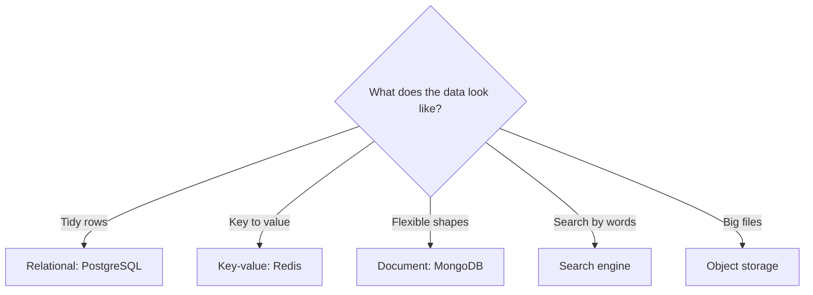
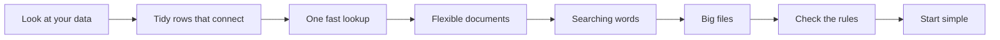
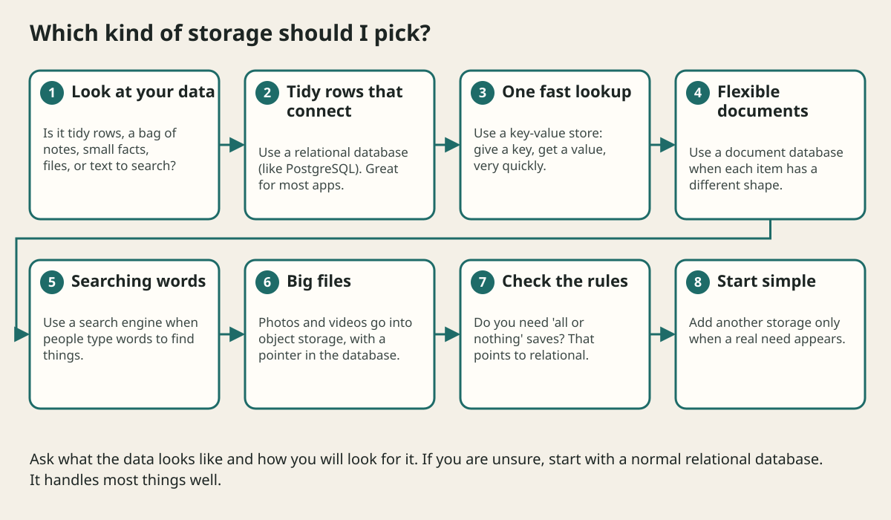

# Data Modeling And Databases

## The big idea in plain words {#picture}

A database is like a very organized school office. Every student has a file card with the same boxes: name, class, birthday. Cards are kept in drawers, each card has a unique number, and a rule says you cannot write two cards with the same number.

Choosing a database is choosing which kind of office you need. Most of the time, the tidy office with file cards (a relational database) is the right pick.



## What you will be able to do {#outcomes}

By the end of this lesson you will be able to:

- Describe tables, rows, keys, and indexes in plain words.
- Choose between relational, key-value, document, search, and object storage.
- Explain who owns data and why migrations matter.

## Words to know {#vocabulary}

- **table**: a grid of rows and columns, like a spreadsheet.
- **primary key**: the unique number that identifies one row.
- **foreign key**: a number in one table that points to a row in another table.
- **index**: a quick-lookup list, like the index at the back of a book.
- **constraint**: a rule the database enforces, like "no two users with the same email".
- **migration**: a numbered step that changes the table design safely.

## Why this idea exists {#history}

Data lives longer than code. People will still want their notes next year. A good data design keeps the facts correct and makes the questions we ask quick to answer.

## Concept 1: Tables, keys, and links {#concept-1}

A "users" table has one row per person. A "notes" table has one row per note, and each note stores the user's id. That id is a foreign key. It lets the database say "this note belongs to that user" without copying the user's name into every note.

## Concept 2: Indexes make searching quick {#concept-2}

Without an index, finding a note by title means reading every note. With an index, the database jumps straight to it, like using the back-of-book index. But an index costs space, and every write must update it too. So add indexes for the searches you really do.

## Concept 3: Constraints guard the data {#concept-3}

Rules in the app can be forgotten or skipped. Rules in the database cannot. Mark a column "not null" or "unique" and the database will refuse bad data, even if two requests arrive at the exact same time.

## Concept 4: Pick the store for the job {#concept-4}

Tidy facts: relational. Fast lookups of small values: key-value. Flexible, changing shapes: document. Searching words: a search engine. Photos and videos: object storage. When unsure, start relational. It can do most jobs and you can add other stores later.

## Where does a photo go? {#example}

A user uploads a profile picture. The picture file goes to object storage and gets an address like "photos/42.jpg". The database row for the user stores only that short address. The database stays small and fast, and the photo can be served by a system built for big files.

## Going deeper: the technical walkthrough {#walkthrough}

### Data modeling and databases


Start with nouns and questions:

```text
User, Note, Topic, Bookmark, Progress
Who owns a note?
Which fields are required?
Which reads need an index?
Which changes must commit together?
```

Relational databases are a good default for metadata, relationships, constraints,
transactions, and stable queries. Document stores, key-value stores, search
indexes, and object storage may solve different measured problems.

Keep large PDFs, EPUBs, images, and videos in private object storage. Store
metadata, checksums, size, ownership, and a safe relative key in the database.
Do not put a 500 MB binary in a row just because the database accepts a blob.


### Indexes, transactions, and consistency


An index helps the database find rows without reading everything. It costs
storage and write work, so choose it from real queries.

A transaction groups changes that must be all-or-nothing. Strong consistency is
useful when a user must see a committed write immediately. Eventual consistency
is acceptable when a notification or search index may catch up later.

Ask:

- Which store is authoritative?
- Can a replica be behind?
- What happens if a client retries a write?
- Which state transition is legal?
- How will two writers avoid overwriting each other?


## Worked scenario {#worked-scenario}

A note and its bookmark must be created together. How should storage behave?

The justified choice is **One transaction that undoes both if either fails**. Select **atomic-write** in the structured practical and explain why. Alternatives ignore a requirement, cross a trust boundary, or invent success.

### Structured decision contract

```json

{
  "decision": "atomic-write",
  "justification": "The transaction and index boundary must preserve the declared contract and ownership.",
  "failureBehavior": "Expose a safe failure and recover through the boundary owner."
}

```

Decision selects one declared behavior. Justification explains the boundary. FailureBehavior explains the observable error and recovery owner. These fields never execute commands. Required terms and minimum lengths form a basic practice rubric, not semantic grading.

## Step-by-step flow and matching picture {#flow}





## Three real-life uses {#use-cases}

1. A school stores students and classes in related tables.
2. A game keeps current scores in a key-value store because it must be fast.
3. A shop uses a search engine so customers can type "red shoes" and find them.

## What can go wrong, and how to stay safe {#failure-security}

Mistakes: copying the same fact into many tables so they disagree, forgetting an index and making searches crawl, putting huge files inside database rows, and changing table designs by hand in production. Use migrations: numbered, reviewed steps that can be repeated on every computer.

## Practice lab and expected observation {#practice}

1. Predict the scenario decision before opening Practical. Explain each rejected alternative.
2. Run a relevant example above in an isolated exercise project. Record the expected result, then change one input to an invalid or boundary value. A failed assertion or deliberate error should replace silent success.
3. Submit the structured decision. Initially the checks fail. After selecting atomic-write and writing an explanation and failure plan, all three pass. Follow the indicated review section for missed checks.

### Broken example to debug

```json

{"decision":"trust-client","justification":"","failureBehavior":""}

```

This ignores the responsible boundary and gives no reasoning or recovery. Correct the fields rather than changing the validator.

## Checkpoint and definition of done {#checkpoint}

- [ ] Define transaction and index without looking.
- [ ] Trace input to owner and output.
- [ ] Explain one failure and one alternative.
- [ ] Pass at least four assignment questions.
- [ ] Pass every practical check and submit.
- [ ] Explain the concept again tomorrow.

## Sources, versions, and safe commands {#sources}

Workload figures are assumptions until measured. Review date: 2026-10-02. The supplied blueprint is the teaching source; official landing pages were checked where reachable. No provider or original TM Schedule deployment was tested.

- [Official reference](https://www.postgresql.org/docs/current/)

- [Official reference](https://opentelemetry.io/docs/)

[Course reading order](README.md) · [Previous lesson](05a-rate-limiting-and-fair-sharing.md) · [Next lesson](06a-search-and-indexing-explained.md)

```study-quiz

{
  "schemaVersion": 1,
  "lessonId": "system-design/06-data-modeling-and-databases",
  "title": "Assignment: Data Modeling And Databases",
  "passPercentage": 80,
  "questions": [
    {
      "id": "q1",
      "sectionId": "concept-1",
      "prompt": "In Data Modeling And Databases, what does transaction mean?",
      "options": [
        {
          "id": "a",
          "text": "a group of changes that all succeed or all get undone",
          "explanation": "This preserves the definition and boundary described in the lesson."
        },
        {
          "id": "b",
          "text": "A permission granted by a hidden browser control",
          "explanation": "This changes the declared meaning or bypasses the responsible boundary."
        },
        {
          "id": "c",
          "text": "An unlimited provider operation with no ownership",
          "explanation": "This changes the declared meaning or bypasses the responsible boundary."
        },
        {
          "id": "d",
          "text": "A diagnostic credential intended for public logs",
          "explanation": "This changes the declared meaning or bypasses the responsible boundary."
        }
      ],
      "correctOptionId": "a",
      "explanation": "transaction means a group of changes that all succeed or all get undone.",
      "reviewLabel": "Review concept 1"
    },
    {
      "id": "q2",
      "sectionId": "concept-2",
      "prompt": "In Data Modeling And Databases, which rule is correct for checkpoint 2?",
      "options": [
        {
          "id": "a",
          "text": "Trust client-side checks instead of the server rule.",
          "explanation": "This changes the declared meaning or bypasses the responsible boundary."
        },
        {
          "id": "b",
          "text": "A database rule keeps data safe even when many writes happen at once.",
          "explanation": "This preserves the definition and boundary described in the lesson."
        },
        {
          "id": "c",
          "text": "Hide the failure by returning a fabricated successful result.",
          "explanation": "This changes the declared meaning or bypasses the responsible boundary."
        },
        {
          "id": "d",
          "text": "Skip the stated boundary, limit, or ownership check.",
          "explanation": "This changes the declared meaning or bypasses the responsible boundary."
        }
      ],
      "correctOptionId": "b",
      "explanation": "A database rule keeps data safe even when many writes happen at once.",
      "reviewLabel": "Review concept 2"
    },
    {
      "id": "q3",
      "sectionId": "concept-3",
      "prompt": "In Data Modeling And Databases, which rule is correct for checkpoint 3?",
      "options": [
        {
          "id": "a",
          "text": "Trust client-side checks instead of the server rule.",
          "explanation": "This changes the declared meaning or bypasses the responsible boundary."
        },
        {
          "id": "b",
          "text": "Hide the failure by returning a fabricated successful result.",
          "explanation": "This changes the declared meaning or bypasses the responsible boundary."
        },
        {
          "id": "c",
          "text": "An index speeds some reads but costs space and slows writes a little.",
          "explanation": "This preserves the definition and boundary described in the lesson."
        },
        {
          "id": "d",
          "text": "Skip the stated boundary, limit, or ownership check.",
          "explanation": "This changes the declared meaning or bypasses the responsible boundary."
        }
      ],
      "correctOptionId": "c",
      "explanation": "An index speeds some reads but costs space and slows writes a little.",
      "reviewLabel": "Review concept 3"
    },
    {
      "id": "q4",
      "sectionId": "concept-4",
      "prompt": "In Data Modeling And Databases, which rule is correct for checkpoint 4?",
      "options": [
        {
          "id": "a",
          "text": "Trust client-side checks instead of the server rule.",
          "explanation": "This changes the declared meaning or bypasses the responsible boundary."
        },
        {
          "id": "b",
          "text": "Hide the failure by returning a fabricated successful result.",
          "explanation": "This changes the declared meaning or bypasses the responsible boundary."
        },
        {
          "id": "c",
          "text": "Skip the stated boundary, limit, or ownership check.",
          "explanation": "This changes the declared meaning or bypasses the responsible boundary."
        },
        {
          "id": "d",
          "text": "Give a borrowed connection back when the request ends.",
          "explanation": "This preserves the definition and boundary described in the lesson."
        }
      ],
      "correctOptionId": "d",
      "explanation": "Give a borrowed connection back when the request ends.",
      "reviewLabel": "Review concept 4"
    },
    {
      "id": "q5",
      "sectionId": "worked-scenario",
      "prompt": "A note and its bookmark must be created together. How should storage behave?",
      "options": [
        {
          "id": "a",
          "text": "One transaction that undoes both if either fails",
          "explanation": "This preserves the definition and boundary described in the lesson."
        },
        {
          "id": "b",
          "text": "Two separate writes with no recovery plan",
          "explanation": "This changes the declared meaning or bypasses the responsible boundary."
        },
        {
          "id": "c",
          "text": "Send the database password to the browser",
          "explanation": "This changes the declared meaning or bypasses the responsible boundary."
        },
        {
          "id": "d",
          "text": "A giant global list that only pretends to save",
          "explanation": "This changes the declared meaning or bypasses the responsible boundary."
        }
      ],
      "correctOptionId": "a",
      "explanation": "One transaction that undoes both if either fails. Keep big files outside the database rows and store only a pointer.",
      "reviewLabel": "Review the worked scenario"
    }
  ]
}

```

```study-practical

{
  "schemaVersion": 1,
  "challengeId": "system-design/06-data-modeling-and-databases/decision",
  "lessonId": "system-design/06-data-modeling-and-databases",
  "title": "Practical: Data Modeling And Databases",
  "language": "json",
  "mode": "structured",
  "instructions": "A note and its bookmark must be created together. How should storage behave? Return an object with decision (choose from atomic-write, skip-check, unbounded-work, trust-client), justification (at least 40 characters; include transaction and index), and failureBehavior (at least 25 characters; include failure and recover while explaining the error and recovery). These are structured reasoning checks, not code execution or an official grade.",
  "starterCode": "{\n  \"decision\": \"\",\n  \"justification\": \"\",\n  \"failureBehavior\": \"\"\n}",
  "entryPoint": "answer",
  "publicExamples": [
    {
      "input": {
        "decision": "skip-check",
        "justification": "",
        "failureBehavior": ""
      },
      "expected": {
        "passed": false
      }
    },
    {
      "input": {
        "decision": "atomic-write",
        "justification": "The transaction and index boundary must preserve the declared contract and ownership.",
        "failureBehavior": "Show a safe failure and recover through the responsible owner."
      },
      "expected": {
        "passed": true
      }
    }
  ],
  "publicTestIds": [
    "decision",
    "explanation",
    "failure-plan"
  ],
  "reviewSections": {
    "decision": "worked-scenario",
    "explanation": "concept-2",
    "failure-plan": "failure-security"
  },
  "limits": {
    "timeMs": 2000,
    "memoryMb": 128,
    "outputBytes": 20000
  }
}

```

