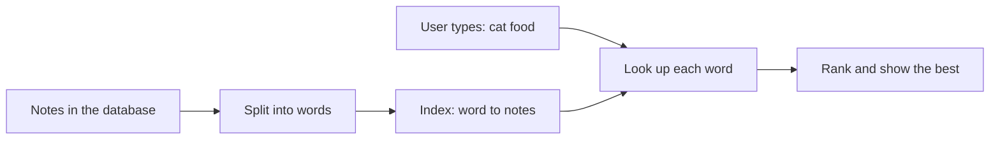
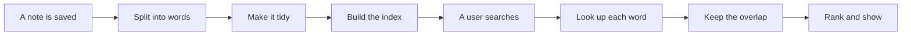
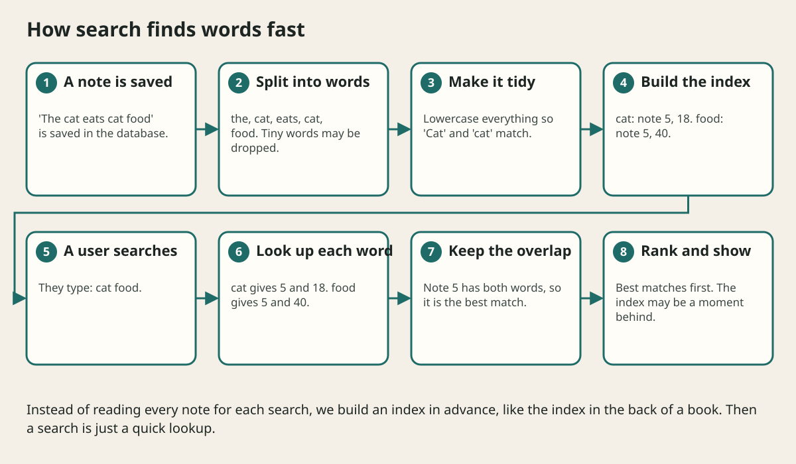

# Search And Indexing Explained

## The big idea in plain words {#picture}

Look at the back of a school book. There is an index: "volcano: pages 12, 45, 101". If you want to know where volcanoes are mentioned, you do not read the whole book. You look up "volcano" and jump straight to the pages.

A search engine builds exactly that kind of index for all your notes, products, or messages. It lists every word and the places where it appears. Then searching is just a quick look-up.



## What you will be able to do {#outcomes}

By the end of this lesson you will be able to:

- Explain an inverted index with a book-index analogy.
- Describe tokens, ranking, and "a moment behind".
- Decide when you need a search engine and when a normal database search is enough.

## Words to know {#vocabulary}

- **index**: a quick-lookup list.
- **inverted index**: for every word, the list of places it appears.
- **token**: one word after the text is split up.
- **ranking**: sorting results so the best match is first.
- **typo tolerance**: finding "banana" even when someone types "bananna".
- **reindex**: rebuilding the index after changes.

## Why this idea exists {#history}

Normal databases are great at exact matches ("find user 42"). People search with messy words ("cheap red shoes"). Search engines are built for that.

## Concept 1: Build the index in advance {#concept-1}

When a note is saved, the search system splits the text into words, makes them lowercase, and removes tiny words like "the". For each word it remembers the note ids. Doing the hard work in advance makes the search itself fast.

## Concept 2: Look up each word {#concept-2}

For "cat food", find the notes for "cat" and the notes for "food", then keep the ones that appear in both. This is like finding the pages in a book where both words appear.

## Concept 3: Rank the results {#concept-3}

Of 5,000 matches, people look only at the first few. Ranking decides the order: notes that use the word many times, have it in the title, or are newer might come first. Good ranking is what makes search feel smart.

## Concept 4: The index is a copy {#concept-4}

The main database stays the source of truth. The search index is a copy built for searching. After a change, the index updates a moment later. If the index is broken, you can rebuild it from the database. For small apps, a simple database search is often enough. Add a search engine only when you need speed on lots of text.

## Searching notes {#example}

A student searches "photosynthesis diagram". The search finds notes containing "photosynthesis" (notes 5, 18, 77) and "diagram" (notes 18, 40, 77). Notes 18 and 77 have both, and 77 has the words in its title, so 77 is shown first.

## Going deeper: the technical walkthrough {#walkthrough}

## Worked scenario {#worked-scenario}

Customers type words to find products among ten million items, and the database search is too slow. What helps?

The justified choice is **Add a search index that is fed from the database**. Select **add-search-index** in the structured practical and explain why. Alternatives ignore a requirement, cross a trust boundary, or invent success.

### Structured decision contract

```json

{
  "decision": "add-search-index",
  "justification": "The invertedIndex and token boundary must preserve the declared contract and ownership.",
  "failureBehavior": "Expose a safe failure and recover through the boundary owner."
}

```

Decision selects one declared behavior. Justification explains the boundary. FailureBehavior explains the observable error and recovery owner. These fields never execute commands. Required terms and minimum lengths form a basic practice rubric, not semantic grading.

## Step-by-step flow and matching picture {#flow}





## Three real-life uses {#use-cases}

1. An online shop lets people search for products by words.
2. A mail app lets you search all your old emails quickly.
3. A help site suggests articles as you type your question.

## What can go wrong, and how to stay safe {#failure-security}

Mistakes: using the search index as the only copy of the data, forgetting to update it when data changes, and showing private notes of other users in results. Search results must follow the same permission rules as everything else.

## Practice lab and expected observation {#practice}

1. Predict the scenario decision before opening Practical. Explain each rejected alternative.
2. Run a relevant example above in an isolated exercise project. Record the expected result, then change one input to an invalid or boundary value. A failed assertion or deliberate error should replace silent success.
3. Submit the structured decision. Initially the checks fail. After selecting add-search-index and writing an explanation and failure plan, all three pass. Follow the indicated review section for missed checks.

### Broken example to debug

```json

{"decision":"trust-client","justification":"","failureBehavior":""}

```

This ignores the responsible boundary and gives no reasoning or recovery. Correct the fields rather than changing the validator.

## Checkpoint and definition of done {#checkpoint}

- [ ] Define invertedIndex and token without looking.
- [ ] Trace input to owner and output.
- [ ] Explain one failure and one alternative.
- [ ] Pass at least four assignment questions.
- [ ] Pass every practical check and submit.
- [ ] Explain the concept again tomorrow.

## Sources, versions, and safe commands {#sources}

Workload figures are assumptions until measured. Review date: 2026-10-02. The supplied blueprint is the teaching source; official landing pages were checked where reachable. No provider or original TM Schedule deployment was tested.

- [Official reference](https://www.postgresql.org/docs/current/)

- [Official reference](https://opentelemetry.io/docs/)

[Course reading order](README.md) · [Previous lesson](06-data-modeling-and-databases.md) · [Next lesson](07-caching.md)

```study-quiz

{
  "schemaVersion": 1,
  "lessonId": "system-design/06a-search-and-indexing-explained",
  "title": "Assignment: Search And Indexing Explained",
  "passPercentage": 80,
  "questions": [
    {
      "id": "q1",
      "sectionId": "concept-1",
      "prompt": "In Search And Indexing Explained, what does invertedIndex mean?",
      "options": [
        {
          "id": "a",
          "text": "A permission granted by a hidden browser control",
          "explanation": "This changes the declared meaning or bypasses the responsible boundary."
        },
        {
          "id": "b",
          "text": "a list that shows, for each word, which documents contain it",
          "explanation": "This preserves the definition and boundary described in the lesson."
        },
        {
          "id": "c",
          "text": "An unlimited provider operation with no ownership",
          "explanation": "This changes the declared meaning or bypasses the responsible boundary."
        },
        {
          "id": "d",
          "text": "A diagnostic credential intended for public logs",
          "explanation": "This changes the declared meaning or bypasses the responsible boundary."
        }
      ],
      "correctOptionId": "b",
      "explanation": "invertedIndex means a list that shows, for each word, which documents contain it.",
      "reviewLabel": "Review concept 1"
    },
    {
      "id": "q2",
      "sectionId": "concept-2",
      "prompt": "In Search And Indexing Explained, which rule is correct for checkpoint 2?",
      "options": [
        {
          "id": "a",
          "text": "Trust client-side checks instead of the server rule.",
          "explanation": "This changes the declared meaning or bypasses the responsible boundary."
        },
        {
          "id": "b",
          "text": "Hide the failure by returning a fabricated successful result.",
          "explanation": "This changes the declared meaning or bypasses the responsible boundary."
        },
        {
          "id": "c",
          "text": "Text is split into tokens and cleaned up, for example made lowercase, before it is indexed.",
          "explanation": "This preserves the definition and boundary described in the lesson."
        },
        {
          "id": "d",
          "text": "Skip the stated boundary, limit, or ownership check.",
          "explanation": "This changes the declared meaning or bypasses the responsible boundary."
        }
      ],
      "correctOptionId": "c",
      "explanation": "Text is split into tokens and cleaned up, for example made lowercase, before it is indexed.",
      "reviewLabel": "Review concept 2"
    },
    {
      "id": "q3",
      "sectionId": "concept-3",
      "prompt": "In Search And Indexing Explained, which rule is correct for checkpoint 3?",
      "options": [
        {
          "id": "a",
          "text": "Trust client-side checks instead of the server rule.",
          "explanation": "This changes the declared meaning or bypasses the responsible boundary."
        },
        {
          "id": "b",
          "text": "Hide the failure by returning a fabricated successful result.",
          "explanation": "This changes the declared meaning or bypasses the responsible boundary."
        },
        {
          "id": "c",
          "text": "Skip the stated boundary, limit, or ownership check.",
          "explanation": "This changes the declared meaning or bypasses the responsible boundary."
        },
        {
          "id": "d",
          "text": "Ranking puts the most useful results first, using ideas such as how often a word appears.",
          "explanation": "This preserves the definition and boundary described in the lesson."
        }
      ],
      "correctOptionId": "d",
      "explanation": "Ranking puts the most useful results first, using ideas such as how often a word appears.",
      "reviewLabel": "Review concept 3"
    },
    {
      "id": "q4",
      "sectionId": "concept-4",
      "prompt": "In Search And Indexing Explained, which rule is correct for checkpoint 4?",
      "options": [
        {
          "id": "a",
          "text": "The search index is a copy of the data; the main database is still the true source.",
          "explanation": "This preserves the definition and boundary described in the lesson."
        },
        {
          "id": "b",
          "text": "Trust client-side checks instead of the server rule.",
          "explanation": "This changes the declared meaning or bypasses the responsible boundary."
        },
        {
          "id": "c",
          "text": "Hide the failure by returning a fabricated successful result.",
          "explanation": "This changes the declared meaning or bypasses the responsible boundary."
        },
        {
          "id": "d",
          "text": "Skip the stated boundary, limit, or ownership check.",
          "explanation": "This changes the declared meaning or bypasses the responsible boundary."
        }
      ],
      "correctOptionId": "a",
      "explanation": "The search index is a copy of the data; the main database is still the true source.",
      "reviewLabel": "Review concept 4"
    },
    {
      "id": "q5",
      "sectionId": "worked-scenario",
      "prompt": "Customers type words to find products among ten million items, and the database search is too slow. What helps?",
      "options": [
        {
          "id": "a",
          "text": "Read every product description on every search",
          "explanation": "This changes the declared meaning or bypasses the responsible boundary."
        },
        {
          "id": "b",
          "text": "Add a search index that is fed from the database",
          "explanation": "This preserves the definition and boundary described in the lesson."
        },
        {
          "id": "c",
          "text": "Ask customers to type exact product IDs",
          "explanation": "This changes the declared meaning or bypasses the responsible boundary."
        },
        {
          "id": "d",
          "text": "Remove the database",
          "explanation": "This changes the declared meaning or bypasses the responsible boundary."
        }
      ],
      "correctOptionId": "b",
      "explanation": "Add a search index that is fed from the database. When data changes, the search index must be updated, so it may be a moment behind.",
      "reviewLabel": "Review the worked scenario"
    }
  ]
}

```

```study-practical

{
  "schemaVersion": 1,
  "challengeId": "system-design/06a-search-and-indexing-explained/decision",
  "lessonId": "system-design/06a-search-and-indexing-explained",
  "title": "Practical: Search And Indexing Explained",
  "language": "json",
  "mode": "structured",
  "instructions": "Customers type words to find products among ten million items, and the database search is too slow. What helps? Return an object with decision (choose from add-search-index, skip-check, unbounded-work, trust-client), justification (at least 40 characters; include invertedIndex and token), and failureBehavior (at least 25 characters; include failure and recover while explaining the error and recovery). These are structured reasoning checks, not code execution or an official grade.",
  "starterCode": "{\n  \"decision\": \"\",\n  \"justification\": \"\",\n  \"failureBehavior\": \"\"\n}",
  "entryPoint": "answer",
  "publicExamples": [
    {
      "input": {
        "decision": "skip-check",
        "justification": "",
        "failureBehavior": ""
      },
      "expected": {
        "passed": false
      }
    },
    {
      "input": {
        "decision": "add-search-index",
        "justification": "The invertedIndex and token boundary must preserve the declared contract and ownership.",
        "failureBehavior": "Show a safe failure and recover through the responsible owner."
      },
      "expected": {
        "passed": true
      }
    }
  ],
  "publicTestIds": [
    "decision",
    "explanation",
    "failure-plan"
  ],
  "reviewSections": {
    "decision": "worked-scenario",
    "explanation": "concept-2",
    "failure-plan": "failure-security"
  },
  "limits": {
    "timeMs": 2000,
    "memoryMb": 128,
    "outputBytes": 20000
  }
}

```

