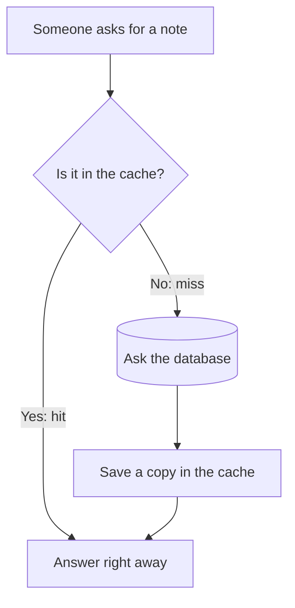
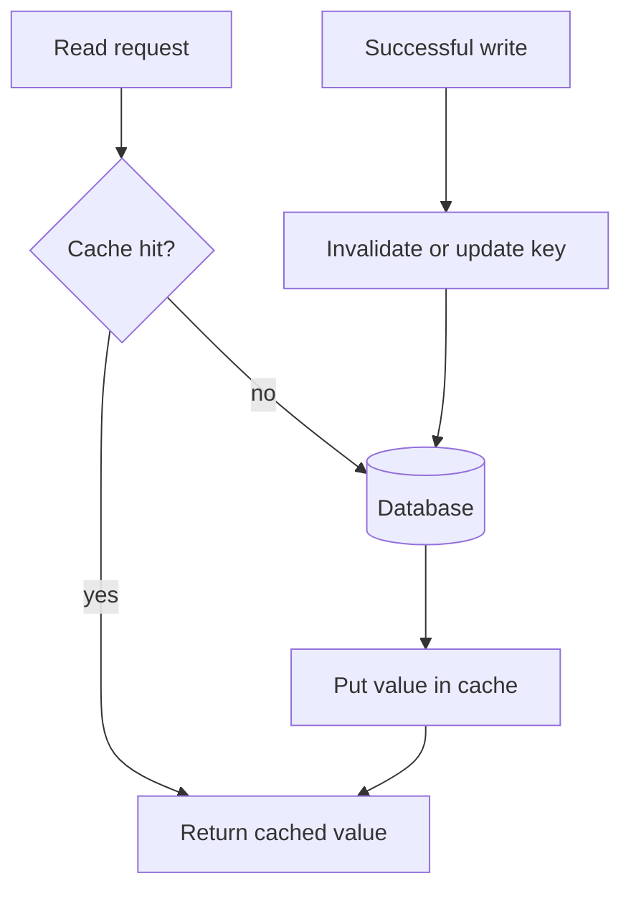
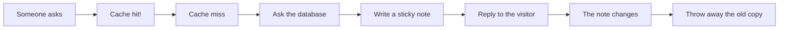
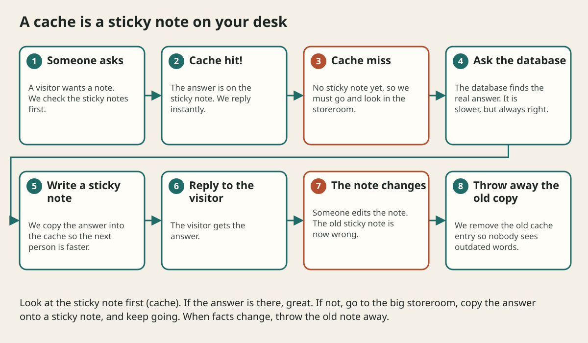

# Caching

## The big idea in plain words {#picture}

Suppose your teacher keeps asking you, "What is 12 times 12?" The first time you work it out. After that you write "144" on a sticky note and stick it on your desk. Now you do not need to calculate again. You just look at the note.

A cache is that sticky note. The slow place (the database) holds the true answer. The cache holds a quick copy. The only risk is that the answer changes and your sticky note says the old thing.



## What you will be able to do {#outcomes}

By the end of this lesson you will be able to:

- Explain cache hit, miss, and "stale" (out of date).
- Describe cache-aside: look, fetch, fill.
- Pick a sensible freshness time (TTL) and know when to throw a copy away.

## Words to know {#vocabulary}

- **cache**: a quick copy of data kept close to where it is needed.
- **hit**: the copy was in the cache.
- **miss**: the copy was not in the cache.
- **TTL**: "time to live", how long a copy is allowed to be used.
- **stale**: out of date.
- **invalidation**: removing or refreshing a copy when the real data changes.

## Why this idea exists {#history}

Some questions are asked again and again and the answer rarely changes: a product page, a profile picture, a list of countries. Doing the slow work every time is wasteful. A quick copy saves time and lets the database rest.

## Concept 1: A cache is only a copy {#concept-1}

The database is the boss. The cache is the helper. If the cache is wiped, nothing is lost; we just fetch from the database again. Never keep the only copy of something important in a cache.

## Concept 2: The key must include who may see it {#concept-2}

A cache stores things under a name, called a key. If the key is just "my-notes", then Maria could get Tom's notes! Always include the user (or any other rule that decides who may see it) in the key, like "notes:user42".

## Concept 3: TTL: how old is too old? {#concept-3}

A TTL says "this copy is good for 60 seconds, then we fetch fresh". A short TTL means fresher data but more database work. A long TTL means faster but older data. Pick it by asking: what is the worst thing that happens if someone sees a one-minute-old answer?

## Concept 4: Throw the copy away when data changes {#concept-4}

When someone edits a note, remove its cache entry right away. The next reader gets a miss and fills in a fresh copy. Waiting for the TTL to run out would be okay for some data, but for a bank balance it is not.

## The popular video {#example}

A video is watched 100,000 times an hour. Its title and description rarely change. The first viewer causes a miss and the app loads it from the database and saves a copy for 5 minutes. The next 99,999 viewers get the copy instantly. The database did one job instead of 100,000.

## Going deeper: the technical walkthrough {#walkthrough}

### Caches


A cache stores a result closer to the caller. Cache-aside is a common pattern:



A cache key must contain every value that changes the result. Decide freshness,
invalidation, eviction, and what happens when the cache is unavailable. Measure
before adding a cache to hide a slow query.


## Worked scenario {#worked-scenario}

A cached note changes in the database. How do you keep readers from seeing old data too long?

The justified choice is **Remove that cached key or use a clear TTL rule**. Select **invalidate-cache** in the structured practical and explain why. Alternatives ignore a requirement, cross a trust boundary, or invent success.

### Structured decision contract

```json

{
  "decision": "invalidate-cache",
  "justification": "The TTL and cacheAside boundary must preserve the declared contract and ownership.",
  "failureBehavior": "Expose a safe failure and recover through the boundary owner."
}

```

Decision selects one declared behavior. Justification explains the boundary. FailureBehavior explains the observable error and recovery owner. These fields never execute commands. Required terms and minimum lengths form a basic practice rubric, not semantic grading.

## Step-by-step flow and matching picture {#flow}





## Three real-life uses {#use-cases}

1. A news site caches the front page for 30 seconds.
2. An online shop caches product details but never caches the "items in your cart" for other people.
3. A game caches the top-10 scoreboard and refreshes it every few seconds.

## What can go wrong, and how to stay safe {#failure-security}

Danger 1: stale data, when a cache keeps old information too long. Danger 2: a stampede, when a popular copy expires and thousands of people ask the database at the same instant. A fix is to let just one request rebuild it while the others wait or use the slightly old copy. Danger 3: a cache with no size limit that eats all the memory. Pick a size and a rule for what to remove first.

## Practice lab and expected observation {#practice}

1. Predict the scenario decision before opening Practical. Explain each rejected alternative.
2. Run a relevant example above in an isolated exercise project. Record the expected result, then change one input to an invalid or boundary value. A failed assertion or deliberate error should replace silent success.
3. Submit the structured decision. Initially the checks fail. After selecting invalidate-cache and writing an explanation and failure plan, all three pass. Follow the indicated review section for missed checks.

### Broken example to debug

```json

{"decision":"trust-client","justification":"","failureBehavior":""}

```

This ignores the responsible boundary and gives no reasoning or recovery. Correct the fields rather than changing the validator.

## Checkpoint and definition of done {#checkpoint}

- [ ] Define TTL and cacheAside without looking.
- [ ] Trace input to owner and output.
- [ ] Explain one failure and one alternative.
- [ ] Pass at least four assignment questions.
- [ ] Pass every practical check and submit.
- [ ] Explain the concept again tomorrow.

## Sources, versions, and safe commands {#sources}

Workload figures are assumptions until measured. Review date: 2026-10-02. The supplied blueprint is the teaching source; official landing pages were checked where reachable. No provider or original TM Schedule deployment was tested.

- [Official reference](https://www.postgresql.org/docs/current/)

- [Official reference](https://opentelemetry.io/docs/)

[Course reading order](README.md) · [Previous lesson](06a-search-and-indexing-explained.md) · [Next lesson](08-queues-events-and-background-work.md)

```study-quiz

{
  "schemaVersion": 1,
  "lessonId": "system-design/07-caching",
  "title": "Assignment: Caching",
  "passPercentage": 80,
  "questions": [
    {
      "id": "q1",
      "sectionId": "concept-1",
      "prompt": "In Caching, what does TTL mean?",
      "options": [
        {
          "id": "a",
          "text": "A permission granted by a hidden browser control",
          "explanation": "This changes the declared meaning or bypasses the responsible boundary."
        },
        {
          "id": "b",
          "text": "An unlimited provider operation with no ownership",
          "explanation": "This changes the declared meaning or bypasses the responsible boundary."
        },
        {
          "id": "c",
          "text": "how long a saved copy is allowed to be used",
          "explanation": "This preserves the definition and boundary described in the lesson."
        },
        {
          "id": "d",
          "text": "A diagnostic credential intended for public logs",
          "explanation": "This changes the declared meaning or bypasses the responsible boundary."
        }
      ],
      "correctOptionId": "c",
      "explanation": "TTL means how long a saved copy is allowed to be used.",
      "reviewLabel": "Review concept 1"
    },
    {
      "id": "q2",
      "sectionId": "concept-2",
      "prompt": "In Caching, which rule is correct for checkpoint 2?",
      "options": [
        {
          "id": "a",
          "text": "Trust client-side checks instead of the server rule.",
          "explanation": "This changes the declared meaning or bypasses the responsible boundary."
        },
        {
          "id": "b",
          "text": "Hide the failure by returning a fabricated successful result.",
          "explanation": "This changes the declared meaning or bypasses the responsible boundary."
        },
        {
          "id": "c",
          "text": "Skip the stated boundary, limit, or ownership check.",
          "explanation": "This changes the declared meaning or bypasses the responsible boundary."
        },
        {
          "id": "d",
          "text": "A cache key must include whatever decides who may see the data.",
          "explanation": "This preserves the definition and boundary described in the lesson."
        }
      ],
      "correctOptionId": "d",
      "explanation": "A cache key must include whatever decides who may see the data.",
      "reviewLabel": "Review concept 2"
    },
    {
      "id": "q3",
      "sectionId": "concept-3",
      "prompt": "In Caching, which rule is correct for checkpoint 3?",
      "options": [
        {
          "id": "a",
          "text": "A TTL limits how old data can get; it does not promise the newest data.",
          "explanation": "This preserves the definition and boundary described in the lesson."
        },
        {
          "id": "b",
          "text": "Trust client-side checks instead of the server rule.",
          "explanation": "This changes the declared meaning or bypasses the responsible boundary."
        },
        {
          "id": "c",
          "text": "Hide the failure by returning a fabricated successful result.",
          "explanation": "This changes the declared meaning or bypasses the responsible boundary."
        },
        {
          "id": "d",
          "text": "Skip the stated boundary, limit, or ownership check.",
          "explanation": "This changes the declared meaning or bypasses the responsible boundary."
        }
      ],
      "correctOptionId": "a",
      "explanation": "A TTL limits how old data can get; it does not promise the newest data.",
      "reviewLabel": "Review concept 3"
    },
    {
      "id": "q4",
      "sectionId": "concept-4",
      "prompt": "In Caching, which rule is correct for checkpoint 4?",
      "options": [
        {
          "id": "a",
          "text": "Trust client-side checks instead of the server rule.",
          "explanation": "This changes the declared meaning or bypasses the responsible boundary."
        },
        {
          "id": "b",
          "text": "On a miss, read the source in a controlled way.",
          "explanation": "This preserves the definition and boundary described in the lesson."
        },
        {
          "id": "c",
          "text": "Hide the failure by returning a fabricated successful result.",
          "explanation": "This changes the declared meaning or bypasses the responsible boundary."
        },
        {
          "id": "d",
          "text": "Skip the stated boundary, limit, or ownership check.",
          "explanation": "This changes the declared meaning or bypasses the responsible boundary."
        }
      ],
      "correctOptionId": "b",
      "explanation": "On a miss, read the source in a controlled way.",
      "reviewLabel": "Review concept 4"
    },
    {
      "id": "q5",
      "sectionId": "worked-scenario",
      "prompt": "A cached note changes in the database. How do you keep readers from seeing old data too long?",
      "options": [
        {
          "id": "a",
          "text": "Keep it forever with no freshness rule",
          "explanation": "This changes the declared meaning or bypasses the responsible boundary."
        },
        {
          "id": "b",
          "text": "Share every user's private cache key",
          "explanation": "This changes the declared meaning or bypasses the responsible boundary."
        },
        {
          "id": "c",
          "text": "Remove that cached key or use a clear TTL rule",
          "explanation": "This preserves the definition and boundary described in the lesson."
        },
        {
          "id": "d",
          "text": "Delete the real record",
          "explanation": "This changes the declared meaning or bypasses the responsible boundary."
        }
      ],
      "correctOptionId": "c",
      "explanation": "Remove that cached key or use a clear TTL rule. When data changes, remove or update the old copy.",
      "reviewLabel": "Review the worked scenario"
    }
  ]
}

```

```study-practical

{
  "schemaVersion": 1,
  "challengeId": "system-design/07-caching/decision",
  "lessonId": "system-design/07-caching",
  "title": "Practical: Caching",
  "language": "json",
  "mode": "structured",
  "instructions": "A cached note changes in the database. How do you keep readers from seeing old data too long? Return an object with decision (choose from invalidate-cache, skip-check, unbounded-work, trust-client), justification (at least 40 characters; include TTL and cacheAside), and failureBehavior (at least 25 characters; include failure and recover while explaining the error and recovery). These are structured reasoning checks, not code execution or an official grade.",
  "starterCode": "{\n  \"decision\": \"\",\n  \"justification\": \"\",\n  \"failureBehavior\": \"\"\n}",
  "entryPoint": "answer",
  "publicExamples": [
    {
      "input": {
        "decision": "skip-check",
        "justification": "",
        "failureBehavior": ""
      },
      "expected": {
        "passed": false
      }
    },
    {
      "input": {
        "decision": "invalidate-cache",
        "justification": "The TTL and cacheAside boundary must preserve the declared contract and ownership.",
        "failureBehavior": "Show a safe failure and recover through the responsible owner."
      },
      "expected": {
        "passed": true
      }
    }
  ],
  "publicTestIds": [
    "decision",
    "explanation",
    "failure-plan"
  ],
  "reviewSections": {
    "decision": "worked-scenario",
    "explanation": "concept-2",
    "failure-plan": "failure-security"
  },
  "limits": {
    "timeMs": 2000,
    "memoryMb": 128,
    "outputBytes": 20000
  }
}

```

