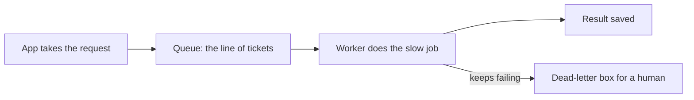
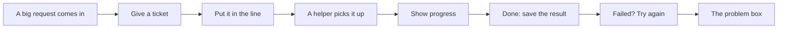
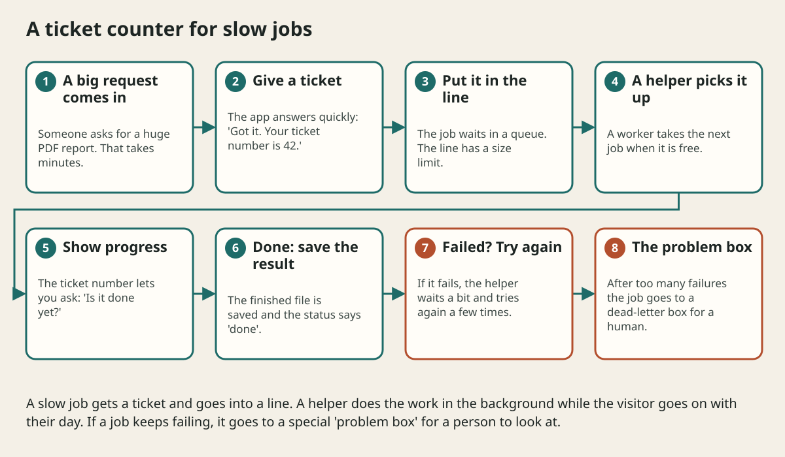

# Queues Events And Background Work

## The big idea in plain words {#picture}

At a busy bakery you place an order, get a number, and sit down. You do not stand at the counter blocking everyone while the cake bakes. When your number is called, you collect it.

A queue works like that number system. The app takes your request, writes it on a ticket, and puts the ticket in a line. Workers pick tickets one at a time and do the slow job. Visitors are never stuck waiting.



## What you will be able to do {#outcomes}

By the end of this lesson you will be able to:

- Explain producer, queue, and worker.
- Tell a command from an event.
- Know why retries, a dead-letter box, and a size limit are needed.

## Words to know {#vocabulary}

- **queue**: a line of jobs waiting their turn.
- **producer**: whoever puts jobs in the line.
- **worker**: whoever takes jobs out and does them.
- **event**: a message saying "this happened", like "note saved".
- **command**: a message saying "please do this".
- **dead-letter queue**: a special box for jobs that failed too many times.

## Why this idea exists {#history}

Some jobs are slow: making a report, sending a thousand emails, resizing photos. If the visitor must wait for them, the page feels broken. And when traffic suddenly spikes, a queue lets the workers work at a steady pace instead of falling over.

## Concept 1: Hand off the slow part {#concept-1}

The visitor needs only a quick "we got it" answer. The slow part happens in the background. The API replies with status 202, which means "accepted", and a ticket number for checking progress.

## Concept 2: Commands and events {#concept-2}

"Send the welcome email" is a command: someone is asked to do something. "User signed up" is an event: a fact that other parts may care about. Events are great because many listeners can react without the sender knowing about them.

## Concept 3: Failures are normal {#concept-3}

A worker might crash, or an email server might be down. So the job goes back into the line and tries again after a wait. If it fails five times, it moves to the dead-letter box and an alert tells a human. Jobs are never silently lost.

## Concept 4: Keep the line short on purpose {#concept-4}

If jobs arrive faster than workers can finish, the line grows forever and memory runs out. Set a size limit. When the line is full, say "please try later" instead of crashing. This is called backpressure: pushing back gently when we are too busy.

## Resizing photos {#example}

You upload a picture. The app saves the original and puts a ticket "resize photo 42" in the queue. It replies "uploaded!" in a blink. A worker later makes the small, medium, and large versions. If the worker crashes halfway, the ticket returns to the line and another worker finishes it.

## Going deeper: the technical walkthrough {#walkthrough}

### Queues, events, and workers


Use a queue when a user should not wait for slow work:

```text
POST /export -> 202 + job ID
producer -> queue -> worker -> object storage
GET /export/{jobId} -> progress or result
```

At-least-once delivery means a worker may see the same message twice. Make the
operation idempotent. Add retries with limits, dead letters, backpressure,
visibility into queue age, and a recovery process.

An event says something happened. A command asks someone to do something. Keep
that distinction clear.


## Worked scenario {#worked-scenario}

A PDF export takes minutes and blocks quick requests. What is a good design?

The justified choice is **Put it in a limited queue and give a status ID to check**. Select **queue-job** in the structured practical and explain why. Alternatives ignore a requirement, cross a trust boundary, or invent success.

### Structured decision contract

```json

{
  "decision": "queue-job",
  "justification": "The eventLoop and queue boundary must preserve the declared contract and ownership.",
  "failureBehavior": "Expose a safe failure and recover through the boundary owner."
}

```

Decision selects one declared behavior. Justification explains the boundary. FailureBehavior explains the observable error and recovery owner. These fields never execute commands. Required terms and minimum lengths form a basic practice rubric, not semantic grading.

## Step-by-step flow and matching picture {#flow}





## Three real-life uses {#use-cases}

1. A store sends order emails from a queue after checkout.
2. A video site converts uploads into different qualities in the background.
3. A bank sends daily statements as thousands of small jobs, not one giant job.

## What can go wrong, and how to stay safe {#failure-security}

Mistakes: a retry that makes the same job happen twice (so jobs must be safe to repeat), a queue with no size limit, forgetting the dead-letter box so failing jobs retry forever, and not showing any status so users wonder "did it work?".

## Practice lab and expected observation {#practice}

1. Predict the scenario decision before opening Practical. Explain each rejected alternative.
2. Run a relevant example above in an isolated exercise project. Record the expected result, then change one input to an invalid or boundary value. A failed assertion or deliberate error should replace silent success.
3. Submit the structured decision. Initially the checks fail. After selecting queue-job and writing an explanation and failure plan, all three pass. Follow the indicated review section for missed checks.

### Broken example to debug

```json

{"decision":"trust-client","justification":"","failureBehavior":""}

```

This ignores the responsible boundary and gives no reasoning or recovery. Correct the fields rather than changing the validator.

## Checkpoint and definition of done {#checkpoint}

- [ ] Define eventLoop and queue without looking.
- [ ] Trace input to owner and output.
- [ ] Explain one failure and one alternative.
- [ ] Pass at least four assignment questions.
- [ ] Pass every practical check and submit.
- [ ] Explain the concept again tomorrow.

## Sources, versions, and safe commands {#sources}

Workload figures are assumptions until measured. Review date: 2026-10-02. The supplied blueprint is the teaching source; official landing pages were checked where reachable. No provider or original TM Schedule deployment was tested.

- [Official reference](https://www.postgresql.org/docs/current/)

- [Official reference](https://opentelemetry.io/docs/)

[Course reading order](README.md) · [Previous lesson](07-caching.md) · [Next lesson](09-consistency-transactions-and-distributed-data.md)

```study-quiz

{
  "schemaVersion": 1,
  "lessonId": "system-design/08-queues-events-and-background-work",
  "title": "Assignment: Queues Events And Background Work",
  "passPercentage": 80,
  "questions": [
    {
      "id": "q1",
      "sectionId": "concept-1",
      "prompt": "In Queues Events And Background Work, what does eventLoop mean?",
      "options": [
        {
          "id": "a",
          "text": "A permission granted by a hidden browser control",
          "explanation": "This changes the declared meaning or bypasses the responsible boundary."
        },
        {
          "id": "b",
          "text": "An unlimited provider operation with no ownership",
          "explanation": "This changes the declared meaning or bypasses the responsible boundary."
        },
        {
          "id": "c",
          "text": "A diagnostic credential intended for public logs",
          "explanation": "This changes the declared meaning or bypasses the responsible boundary."
        },
        {
          "id": "d",
          "text": "the manager that decides what runs next while others wait",
          "explanation": "This preserves the definition and boundary described in the lesson."
        }
      ],
      "correctOptionId": "d",
      "explanation": "eventLoop means the manager that decides what runs next while others wait.",
      "reviewLabel": "Review concept 1"
    },
    {
      "id": "q2",
      "sectionId": "concept-2",
      "prompt": "In Queues Events And Background Work, which rule is correct for checkpoint 2?",
      "options": [
        {
          "id": "a",
          "text": "For work done later, answer 202 with a task ID.",
          "explanation": "This preserves the definition and boundary described in the lesson."
        },
        {
          "id": "b",
          "text": "Trust client-side checks instead of the server rule.",
          "explanation": "This changes the declared meaning or bypasses the responsible boundary."
        },
        {
          "id": "c",
          "text": "Hide the failure by returning a fabricated successful result.",
          "explanation": "This changes the declared meaning or bypasses the responsible boundary."
        },
        {
          "id": "d",
          "text": "Skip the stated boundary, limit, or ownership check.",
          "explanation": "This changes the declared meaning or bypasses the responsible boundary."
        }
      ],
      "correctOptionId": "a",
      "explanation": "For work done later, answer 202 with a task ID.",
      "reviewLabel": "Review concept 2"
    },
    {
      "id": "q3",
      "sectionId": "concept-3",
      "prompt": "In Queues Events And Background Work, which rule is correct for checkpoint 3?",
      "options": [
        {
          "id": "a",
          "text": "Trust client-side checks instead of the server rule.",
          "explanation": "This changes the declared meaning or bypasses the responsible boundary."
        },
        {
          "id": "b",
          "text": "Workers need a retry limit and a place for jobs that keep failing.",
          "explanation": "This preserves the definition and boundary described in the lesson."
        },
        {
          "id": "c",
          "text": "Hide the failure by returning a fabricated successful result.",
          "explanation": "This changes the declared meaning or bypasses the responsible boundary."
        },
        {
          "id": "d",
          "text": "Skip the stated boundary, limit, or ownership check.",
          "explanation": "This changes the declared meaning or bypasses the responsible boundary."
        }
      ],
      "correctOptionId": "b",
      "explanation": "Workers need a retry limit and a place for jobs that keep failing.",
      "reviewLabel": "Review concept 3"
    },
    {
      "id": "q4",
      "sectionId": "concept-4",
      "prompt": "In Queues Events And Background Work, which rule is correct for checkpoint 4?",
      "options": [
        {
          "id": "a",
          "text": "Trust client-side checks instead of the server rule.",
          "explanation": "This changes the declared meaning or bypasses the responsible boundary."
        },
        {
          "id": "b",
          "text": "Hide the failure by returning a fabricated successful result.",
          "explanation": "This changes the declared meaning or bypasses the responsible boundary."
        },
        {
          "id": "c",
          "text": "Cancelling must release whatever the job was holding.",
          "explanation": "This preserves the definition and boundary described in the lesson."
        },
        {
          "id": "d",
          "text": "Skip the stated boundary, limit, or ownership check.",
          "explanation": "This changes the declared meaning or bypasses the responsible boundary."
        }
      ],
      "correctOptionId": "c",
      "explanation": "Cancelling must release whatever the job was holding.",
      "reviewLabel": "Review concept 4"
    },
    {
      "id": "q5",
      "sectionId": "worked-scenario",
      "prompt": "A PDF export takes minutes and blocks quick requests. What is a good design?",
      "options": [
        {
          "id": "a",
          "text": "Add the async keyword to a heavy loop",
          "explanation": "This changes the declared meaning or bypasses the responsible boundary."
        },
        {
          "id": "b",
          "text": "Keep unlimited requests waiting forever",
          "explanation": "This changes the declared meaning or bypasses the responsible boundary."
        },
        {
          "id": "c",
          "text": "Install random packages on every request",
          "explanation": "This changes the declared meaning or bypasses the responsible boundary."
        },
        {
          "id": "d",
          "text": "Put it in a limited queue and give a status ID to check",
          "explanation": "This preserves the definition and boundary described in the lesson."
        }
      ],
      "correctOptionId": "d",
      "explanation": "Put it in a limited queue and give a status ID to check. Limit the queue so memory does not grow forever.",
      "reviewLabel": "Review the worked scenario"
    }
  ]
}

```

```study-practical

{
  "schemaVersion": 1,
  "challengeId": "system-design/08-queues-events-and-background-work/decision",
  "lessonId": "system-design/08-queues-events-and-background-work",
  "title": "Practical: Queues Events And Background Work",
  "language": "json",
  "mode": "structured",
  "instructions": "A PDF export takes minutes and blocks quick requests. What is a good design? Return an object with decision (choose from queue-job, skip-check, unbounded-work, trust-client), justification (at least 40 characters; include eventLoop and queue), and failureBehavior (at least 25 characters; include failure and recover while explaining the error and recovery). These are structured reasoning checks, not code execution or an official grade.",
  "starterCode": "{\n  \"decision\": \"\",\n  \"justification\": \"\",\n  \"failureBehavior\": \"\"\n}",
  "entryPoint": "answer",
  "publicExamples": [
    {
      "input": {
        "decision": "skip-check",
        "justification": "",
        "failureBehavior": ""
      },
      "expected": {
        "passed": false
      }
    },
    {
      "input": {
        "decision": "queue-job",
        "justification": "The eventLoop and queue boundary must preserve the declared contract and ownership.",
        "failureBehavior": "Show a safe failure and recover through the responsible owner."
      },
      "expected": {
        "passed": true
      }
    }
  ],
  "publicTestIds": [
    "decision",
    "explanation",
    "failure-plan"
  ],
  "reviewSections": {
    "decision": "worked-scenario",
    "explanation": "concept-2",
    "failure-plan": "failure-security"
  },
  "limits": {
    "timeMs": 2000,
    "memoryMb": 128,
    "outputBytes": 20000
  }
}

```

