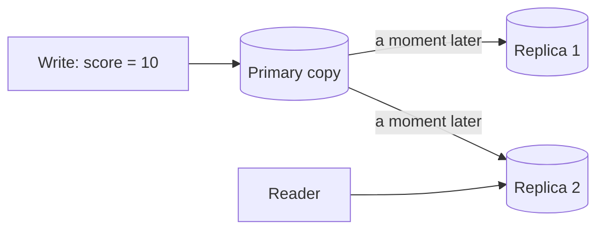
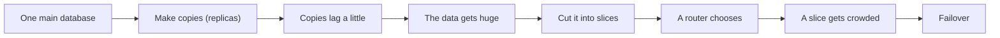
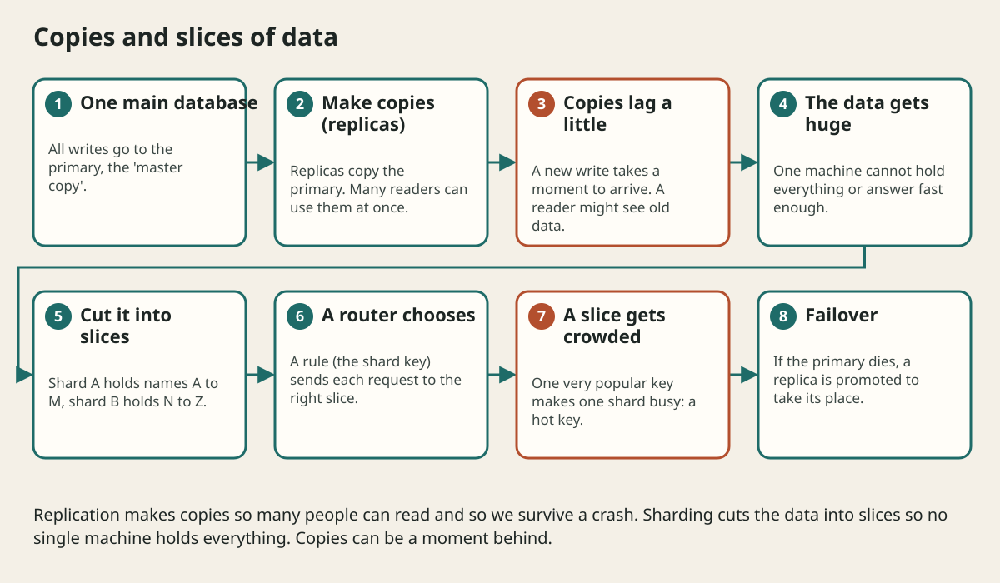

# Consistency Transactions And Distributed Data

## The big idea in plain words {#picture}

Imagine a class has one big whiteboard with the score, and many students copy the score into their notebooks. When the teacher changes the score, the notebooks are a few seconds behind. If you look at a notebook, you might see the old score.

Databases with copies are the same. A write goes to the main copy first and reaches the others slightly later. This delay is the heart of this whole lesson.



## What you will be able to do {#outcomes}

By the end of this lesson you will be able to:

- Explain what a transaction (all-or-nothing) is.
- Tell strong consistency from eventual consistency.
- Explain why we cannot "undo everything" across many services.

## Words to know {#vocabulary}

- **transaction**: a group of changes that all happen or none happen.
- **ACID**: four promises of a safe transaction: all-or-nothing, correct, separate, and saved.
- **replica**: a copy of the data on another machine.
- **replication lag**: the small delay before a copy catches up.
- **strong consistency**: everyone always sees the newest data.
- **eventual consistency**: everyone will see the newest data soon, but maybe not instantly.

## Why this idea exists {#history}

When many people change data at the same time, or the data lives on many machines, strange things can happen: lost updates, double charges, old answers. Consistency rules tell us what to expect.

## Concept 1: A transaction is a sealed envelope {#concept-1}

Moving 10 dollars from Ann to Ben is two steps: take from Ann, give to Ben. If the computer stops between the steps, 10 dollars vanish! A transaction packs both steps into one sealed envelope. Either both happen, or neither does.

## Concept 2: Copies can be behind {#concept-2}

Read copies help many people read at once. But right after you save a note, a read from a copy that has not caught up might not show it. A common fix: for a short time after a write, send that user's reads to the main copy ("read your own writes").

## Concept 3: Two people, one thing {#concept-3}

If Ann and Ben both edit the same note, the second save can silently erase the first. A version number helps: "I am editing version 3". If the note is now version 4, the save is refused and Ben is asked to look again.

## Concept 4: Across services there is no magic rollback {#concept-4}

A transaction works inside one database. When an order touches payments, shipping, and email (three services), no single rollback exists. Instead we use a saga: each step has an "undo step". If shipping fails, we run "refund payment". It is more work, so use one database when you can.

## A bank transfer {#example}

Ann sends 10 dollars to Ben. The bank starts a transaction. It subtracts 10 from Ann, adds 10 to Ben, and then commits. If the power fails between the steps, the database rolls back and both balances stay as they were. Nobody loses money.

## Going deeper: the technical walkthrough {#walkthrough}

### Indexes, transactions, and consistency


An index helps the database find rows without reading everything. It costs
storage and write work, so choose it from real queries.

A transaction groups changes that must be all-or-nothing. Strong consistency is
useful when a user must see a committed write immediately. Eventual consistency
is acceptable when a notification or search index may catch up later.

Ask:

- Which store is authoritative?
- Can a replica be behind?
- What happens if a client retries a write?
- Which state transition is legal?
- How will two writers avoid overwriting each other?


## Worked scenario {#worked-scenario}

A create request times out, and the client tries again. How do you avoid a duplicate?

The justified choice is **Use the same unique request key and store it only once**. Select **deduplicate-write** in the structured practical and explain why. Alternatives ignore a requirement, cross a trust boundary, or invent success.

### Structured decision contract

```json

{
  "decision": "deduplicate-write",
  "justification": "The idempotency and outbox boundary must preserve the declared contract and ownership.",
  "failureBehavior": "Expose a safe failure and recover through the boundary owner."
}

```

Decision selects one declared behavior. Justification explains the boundary. FailureBehavior explains the observable error and recovery owner. These fields never execute commands. Required terms and minimum lengths form a basic practice rubric, not semantic grading.

## Step-by-step flow and matching picture {#flow}





## Three real-life uses {#use-cases}

1. A shop reduces stock and creates an order in one transaction.
2. A social app shows a "like" count that may be a few seconds behind, which is fine.
3. A travel site uses a saga: book flight, book hotel, and if the hotel fails, cancel the flight.

## What can go wrong, and how to stay safe {#failure-security}

Mistakes: assuming a replica is always current, assuming a timeout means a write failed (it may have succeeded!), and assuming you can wrap many services in one transaction. Decide for each feature: must it be exactly current, or is "soon" good enough? Then write that choice down.

## Practice lab and expected observation {#practice}

1. Predict the scenario decision before opening Practical. Explain each rejected alternative.
2. Run a relevant example above in an isolated exercise project. Record the expected result, then change one input to an invalid or boundary value. A failed assertion or deliberate error should replace silent success.
3. Submit the structured decision. Initially the checks fail. After selecting deduplicate-write and writing an explanation and failure plan, all three pass. Follow the indicated review section for missed checks.

### Broken example to debug

```json

{"decision":"trust-client","justification":"","failureBehavior":""}

```

This ignores the responsible boundary and gives no reasoning or recovery. Correct the fields rather than changing the validator.

## Checkpoint and definition of done {#checkpoint}

- [ ] Define idempotency and outbox without looking.
- [ ] Trace input to owner and output.
- [ ] Explain one failure and one alternative.
- [ ] Pass at least four assignment questions.
- [ ] Pass every practical check and submit.
- [ ] Explain the concept again tomorrow.

## Sources, versions, and safe commands {#sources}

Workload figures are assumptions until measured. Review date: 2026-10-02. The supplied blueprint is the teaching source; official landing pages were checked where reachable. No provider or original TM Schedule deployment was tested.

- [Official reference](https://www.postgresql.org/docs/current/)

- [Official reference](https://opentelemetry.io/docs/)

[Course reading order](README.md) · [Previous lesson](08-queues-events-and-background-work.md) · [Next lesson](09a-cap-theorem-and-picking-sides.md)

```study-quiz

{
  "schemaVersion": 1,
  "lessonId": "system-design/09-consistency-transactions-and-distributed-data",
  "title": "Assignment: Consistency Transactions And Distributed Data",
  "passPercentage": 80,
  "questions": [
    {
      "id": "q1",
      "sectionId": "concept-1",
      "prompt": "In Consistency Transactions And Distributed Data, what does idempotency mean?",
      "options": [
        {
          "id": "a",
          "text": "doing the same action again has no extra effect",
          "explanation": "This preserves the definition and boundary described in the lesson."
        },
        {
          "id": "b",
          "text": "A permission granted by a hidden browser control",
          "explanation": "This changes the declared meaning or bypasses the responsible boundary."
        },
        {
          "id": "c",
          "text": "An unlimited provider operation with no ownership",
          "explanation": "This changes the declared meaning or bypasses the responsible boundary."
        },
        {
          "id": "d",
          "text": "A diagnostic credential intended for public logs",
          "explanation": "This changes the declared meaning or bypasses the responsible boundary."
        }
      ],
      "correctOptionId": "a",
      "explanation": "idempotency means doing the same action again has no extra effect.",
      "reviewLabel": "Review concept 1"
    },
    {
      "id": "q2",
      "sectionId": "concept-2",
      "prompt": "In Consistency Transactions And Distributed Data, which rule is correct for checkpoint 2?",
      "options": [
        {
          "id": "a",
          "text": "Trust client-side checks instead of the server rule.",
          "explanation": "This changes the declared meaning or bypasses the responsible boundary."
        },
        {
          "id": "b",
          "text": "An idempotency key needs a place that stores each key only once.",
          "explanation": "This preserves the definition and boundary described in the lesson."
        },
        {
          "id": "c",
          "text": "Hide the failure by returning a fabricated successful result.",
          "explanation": "This changes the declared meaning or bypasses the responsible boundary."
        },
        {
          "id": "d",
          "text": "Skip the stated boundary, limit, or ownership check.",
          "explanation": "This changes the declared meaning or bypasses the responsible boundary."
        }
      ],
      "correctOptionId": "b",
      "explanation": "An idempotency key needs a place that stores each key only once.",
      "reviewLabel": "Review concept 2"
    },
    {
      "id": "q3",
      "sectionId": "concept-3",
      "prompt": "In Consistency Transactions And Distributed Data, which rule is correct for checkpoint 3?",
      "options": [
        {
          "id": "a",
          "text": "Trust client-side checks instead of the server rule.",
          "explanation": "This changes the declared meaning or bypasses the responsible boundary."
        },
        {
          "id": "b",
          "text": "Hide the failure by returning a fabricated successful result.",
          "explanation": "This changes the declared meaning or bypasses the responsible boundary."
        },
        {
          "id": "c",
          "text": "The outbox note is saved in the same commit as the real data.",
          "explanation": "This preserves the definition and boundary described in the lesson."
        },
        {
          "id": "d",
          "text": "Skip the stated boundary, limit, or ownership check.",
          "explanation": "This changes the declared meaning or bypasses the responsible boundary."
        }
      ],
      "correctOptionId": "c",
      "explanation": "The outbox note is saved in the same commit as the real data.",
      "reviewLabel": "Review concept 3"
    },
    {
      "id": "q4",
      "sectionId": "concept-4",
      "prompt": "In Consistency Transactions And Distributed Data, which rule is correct for checkpoint 4?",
      "options": [
        {
          "id": "a",
          "text": "Trust client-side checks instead of the server rule.",
          "explanation": "This changes the declared meaning or bypasses the responsible boundary."
        },
        {
          "id": "b",
          "text": "Hide the failure by returning a fabricated successful result.",
          "explanation": "This changes the declared meaning or bypasses the responsible boundary."
        },
        {
          "id": "c",
          "text": "Skip the stated boundary, limit, or ownership check.",
          "explanation": "This changes the declared meaning or bypasses the responsible boundary."
        },
        {
          "id": "d",
          "text": "Retry only actions where doing them twice is safe.",
          "explanation": "This preserves the definition and boundary described in the lesson."
        }
      ],
      "correctOptionId": "d",
      "explanation": "Retry only actions where doing them twice is safe.",
      "reviewLabel": "Review concept 4"
    },
    {
      "id": "q5",
      "sectionId": "worked-scenario",
      "prompt": "A create request times out, and the client tries again. How do you avoid a duplicate?",
      "options": [
        {
          "id": "a",
          "text": "Use the same unique request key and store it only once",
          "explanation": "This preserves the definition and boundary described in the lesson."
        },
        {
          "id": "b",
          "text": "Make a new key for every retry",
          "explanation": "This changes the declared meaning or bypasses the responsible boundary."
        },
        {
          "id": "c",
          "text": "Assume a timeout always means nothing happened",
          "explanation": "This changes the declared meaning or bypasses the responsible boundary."
        },
        {
          "id": "d",
          "text": "Turn off all error messages",
          "explanation": "This changes the declared meaning or bypasses the responsible boundary."
        }
      ],
      "correctOptionId": "a",
      "explanation": "Use the same unique request key and store it only once. A version check can spot two people changing the same thing.",
      "reviewLabel": "Review the worked scenario"
    }
  ]
}

```

```study-practical

{
  "schemaVersion": 1,
  "challengeId": "system-design/09-consistency-transactions-and-distributed-data/decision",
  "lessonId": "system-design/09-consistency-transactions-and-distributed-data",
  "title": "Practical: Consistency Transactions And Distributed Data",
  "language": "json",
  "mode": "structured",
  "instructions": "A create request times out, and the client tries again. How do you avoid a duplicate? Return an object with decision (choose from deduplicate-write, skip-check, unbounded-work, trust-client), justification (at least 40 characters; include idempotency and outbox), and failureBehavior (at least 25 characters; include failure and recover while explaining the error and recovery). These are structured reasoning checks, not code execution or an official grade.",
  "starterCode": "{\n  \"decision\": \"\",\n  \"justification\": \"\",\n  \"failureBehavior\": \"\"\n}",
  "entryPoint": "answer",
  "publicExamples": [
    {
      "input": {
        "decision": "skip-check",
        "justification": "",
        "failureBehavior": ""
      },
      "expected": {
        "passed": false
      }
    },
    {
      "input": {
        "decision": "deduplicate-write",
        "justification": "The idempotency and outbox boundary must preserve the declared contract and ownership.",
        "failureBehavior": "Show a safe failure and recover through the responsible owner."
      },
      "expected": {
        "passed": true
      }
    }
  ],
  "publicTestIds": [
    "decision",
    "explanation",
    "failure-plan"
  ],
  "reviewSections": {
    "decision": "worked-scenario",
    "explanation": "concept-2",
    "failure-plan": "failure-security"
  },
  "limits": {
    "timeMs": 2000,
    "memoryMb": 128,
    "outputBytes": 20000
  }
}

```

