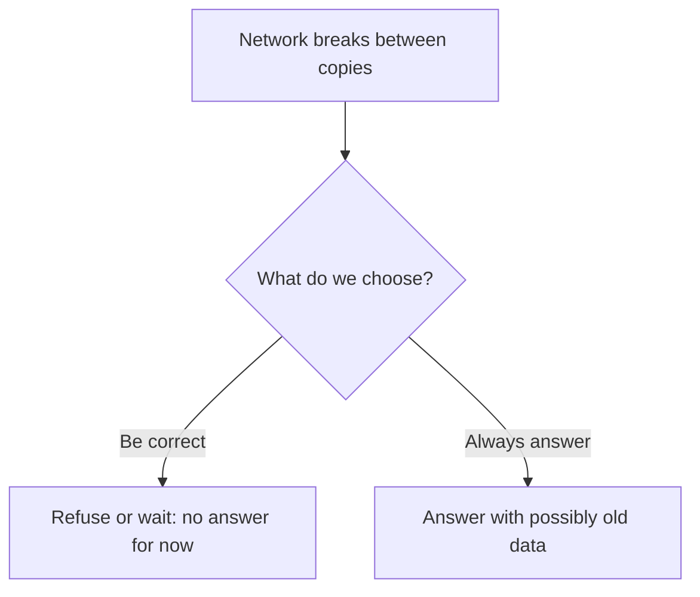
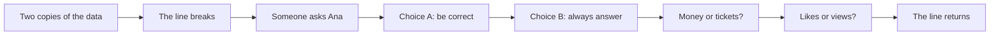
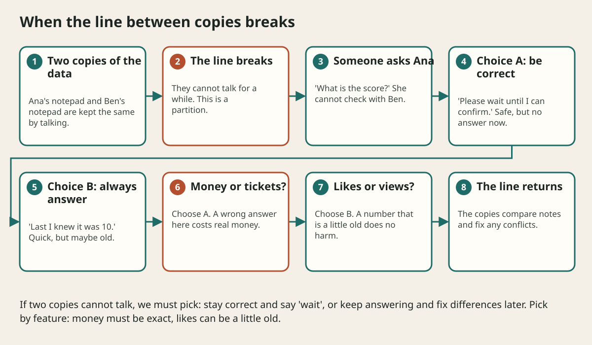

# Cap Theorem And Picking Sides

## The big idea in plain words {#picture}

Two friends, Ana and Ben, each keep a copy of the class score on a notepad. They talk on walkie-talkies to keep the notepads the same. Suddenly the walkie-talkies stop working! Now someone asks Ana for the score, but she cannot check with Ben.

Ana has two choices. She can say, "I am not sure, wait until we can talk" (correct, but no answer). Or she can say, "Last time I knew it was 10" (an answer, but maybe old). This tiny story is the whole idea behind the CAP theorem.



## What you will be able to do {#outcomes}

By the end of this lesson you will be able to:

- Explain a network partition with a simple story.
- Describe the choice between being correct and always answering.
- Pick a side for different features and say why.

## Words to know {#vocabulary}

- **partition**: the connection between machines breaks.
- **consistency**: everyone sees the same, newest data.
- **availability**: every request gets some answer.
- **CAP**: a short name for the rule: during a partition, choose consistency or availability.
- **eventual consistency**: copies will agree soon, not instantly.
- **conflict**: two different changes to the same thing at the same time.

## Why this idea exists {#history}

Networks do break. When your data is on several machines, you will one day face the choice. It is much better to decide calmly in advance than to find out in the middle of an outage.

## Concept 1: Partitions happen {#concept-1}

Cables fail, a data center loses power, a software bug blocks traffic. For a while, some machines cannot reach others. Systems with copies must be ready for this.

## Concept 2: Choose correct or answering {#concept-2}

If you choose **correct**, a machine that cannot confirm the latest data says "try again later". If you choose **always answering**, it answers with what it knows and fixes any differences afterwards. Neither is right for everything.

## Concept 3: Different features, different choices {#concept-3}

Money, tickets, and stock counts must be exact, so choose correct. Likes, view counts, and "last seen" can be a bit old, so choose answering. Many apps use both, feature by feature.

## Concept 4: Fix the differences later {#concept-4}

When you choose to keep answering, the two sides may accept different changes. Later, when they talk again, they must fix conflicts: perhaps "the newest change wins", or the two changes are merged, or a person decides. Plan this ahead.

## The last concert ticket {#example}

One ticket remains. The connection between two data centers breaks. If both sides keep selling, two people buy the same ticket. A ticket shop should choose correctness: one side sells, the other says "please try again in a moment". A few people wait, but nobody is double-charged.

## Going deeper: the technical walkthrough {#walkthrough}

## Worked scenario {#worked-scenario}

Two data centers lose their connection. A bank app must show an account balance. What should it prefer?

The justified choice is **Stay correct: refuse or delay until the balance is certain**. Select **prefer-correct** in the structured practical and explain why. Alternatives ignore a requirement, cross a trust boundary, or invent success.

### Structured decision contract

```json

{
  "decision": "prefer-correct",
  "justification": "The partition and consistency boundary must preserve the declared contract and ownership.",
  "failureBehavior": "Expose a safe failure and recover through the boundary owner."
}

```

Decision selects one declared behavior. Justification explains the boundary. FailureBehavior explains the observable error and recovery owner. These fields never execute commands. Required terms and minimum lengths form a basic practice rubric, not semantic grading.

## Step-by-step flow and matching picture {#flow}





## Three real-life uses {#use-cases}

1. Banks choose correctness for balances and transfers.
2. Social apps choose answering for like counts.
3. Shopping carts often choose answering, then merge items later so nothing is lost.

## What can go wrong, and how to stay safe {#failure-security}

Mistakes: believing you can always have everything, never deciding, and using one choice for every feature. Also, do not forget the happy case: when the network is fine, you can usually give both fast and correct answers. The choice only matters during a break.

## Practice lab and expected observation {#practice}

1. Predict the scenario decision before opening Practical. Explain each rejected alternative.
2. Run a relevant example above in an isolated exercise project. Record the expected result, then change one input to an invalid or boundary value. A failed assertion or deliberate error should replace silent success.
3. Submit the structured decision. Initially the checks fail. After selecting prefer-correct and writing an explanation and failure plan, all three pass. Follow the indicated review section for missed checks.

### Broken example to debug

```json

{"decision":"trust-client","justification":"","failureBehavior":""}

```

This ignores the responsible boundary and gives no reasoning or recovery. Correct the fields rather than changing the validator.

## Checkpoint and definition of done {#checkpoint}

- [ ] Define partition and consistency without looking.
- [ ] Trace input to owner and output.
- [ ] Explain one failure and one alternative.
- [ ] Pass at least four assignment questions.
- [ ] Pass every practical check and submit.
- [ ] Explain the concept again tomorrow.

## Sources, versions, and safe commands {#sources}

Workload figures are assumptions until measured. Review date: 2026-10-02. The supplied blueprint is the teaching source; official landing pages were checked where reachable. No provider or original TM Schedule deployment was tested.

- [Official reference](https://www.postgresql.org/docs/current/)

- [Official reference](https://opentelemetry.io/docs/)

[Course reading order](README.md) · [Previous lesson](09-consistency-transactions-and-distributed-data.md) · [Next lesson](10-scaling-and-partitioning.md)

```study-quiz

{
  "schemaVersion": 1,
  "lessonId": "system-design/09a-cap-theorem-and-picking-sides",
  "title": "Assignment: Cap Theorem And Picking Sides",
  "passPercentage": 80,
  "questions": [
    {
      "id": "q1",
      "sectionId": "concept-1",
      "prompt": "In Cap Theorem And Picking Sides, what does partition mean?",
      "options": [
        {
          "id": "a",
          "text": "A permission granted by a hidden browser control",
          "explanation": "This changes the declared meaning or bypasses the responsible boundary."
        },
        {
          "id": "b",
          "text": "a break in the network so machines cannot talk to each other",
          "explanation": "This preserves the definition and boundary described in the lesson."
        },
        {
          "id": "c",
          "text": "An unlimited provider operation with no ownership",
          "explanation": "This changes the declared meaning or bypasses the responsible boundary."
        },
        {
          "id": "d",
          "text": "A diagnostic credential intended for public logs",
          "explanation": "This changes the declared meaning or bypasses the responsible boundary."
        }
      ],
      "correctOptionId": "b",
      "explanation": "partition means a break in the network so machines cannot talk to each other.",
      "reviewLabel": "Review concept 1"
    },
    {
      "id": "q2",
      "sectionId": "concept-2",
      "prompt": "In Cap Theorem And Picking Sides, which rule is correct for checkpoint 2?",
      "options": [
        {
          "id": "a",
          "text": "Trust client-side checks instead of the server rule.",
          "explanation": "This changes the declared meaning or bypasses the responsible boundary."
        },
        {
          "id": "b",
          "text": "Hide the failure by returning a fabricated successful result.",
          "explanation": "This changes the declared meaning or bypasses the responsible boundary."
        },
        {
          "id": "c",
          "text": "During a partition you must choose: refuse some requests to stay correct, or answer with possibly old data.",
          "explanation": "This preserves the definition and boundary described in the lesson."
        },
        {
          "id": "d",
          "text": "Skip the stated boundary, limit, or ownership check.",
          "explanation": "This changes the declared meaning or bypasses the responsible boundary."
        }
      ],
      "correctOptionId": "c",
      "explanation": "During a partition you must choose: refuse some requests to stay correct, or answer with possibly old data.",
      "reviewLabel": "Review concept 2"
    },
    {
      "id": "q3",
      "sectionId": "concept-3",
      "prompt": "In Cap Theorem And Picking Sides, which rule is correct for checkpoint 3?",
      "options": [
        {
          "id": "a",
          "text": "Trust client-side checks instead of the server rule.",
          "explanation": "This changes the declared meaning or bypasses the responsible boundary."
        },
        {
          "id": "b",
          "text": "Hide the failure by returning a fabricated successful result.",
          "explanation": "This changes the declared meaning or bypasses the responsible boundary."
        },
        {
          "id": "c",
          "text": "Skip the stated boundary, limit, or ownership check.",
          "explanation": "This changes the declared meaning or bypasses the responsible boundary."
        },
        {
          "id": "d",
          "text": "A bank balance should choose being correct, even if some requests are refused.",
          "explanation": "This preserves the definition and boundary described in the lesson."
        }
      ],
      "correctOptionId": "d",
      "explanation": "A bank balance should choose being correct, even if some requests are refused.",
      "reviewLabel": "Review concept 3"
    },
    {
      "id": "q4",
      "sectionId": "concept-4",
      "prompt": "In Cap Theorem And Picking Sides, which rule is correct for checkpoint 4?",
      "options": [
        {
          "id": "a",
          "text": "A social media like-counter can choose being available, because a slightly old number is harmless.",
          "explanation": "This preserves the definition and boundary described in the lesson."
        },
        {
          "id": "b",
          "text": "Trust client-side checks instead of the server rule.",
          "explanation": "This changes the declared meaning or bypasses the responsible boundary."
        },
        {
          "id": "c",
          "text": "Hide the failure by returning a fabricated successful result.",
          "explanation": "This changes the declared meaning or bypasses the responsible boundary."
        },
        {
          "id": "d",
          "text": "Skip the stated boundary, limit, or ownership check.",
          "explanation": "This changes the declared meaning or bypasses the responsible boundary."
        }
      ],
      "correctOptionId": "a",
      "explanation": "A social media like-counter can choose being available, because a slightly old number is harmless.",
      "reviewLabel": "Review concept 4"
    },
    {
      "id": "q5",
      "sectionId": "worked-scenario",
      "prompt": "Two data centers lose their connection. A bank app must show an account balance. What should it prefer?",
      "options": [
        {
          "id": "a",
          "text": "Show any number, even a wrong one",
          "explanation": "This changes the declared meaning or bypasses the responsible boundary."
        },
        {
          "id": "b",
          "text": "Stay correct: refuse or delay until the balance is certain",
          "explanation": "This preserves the definition and boundary described in the lesson."
        },
        {
          "id": "c",
          "text": "Allow withdrawals on both sides with no checks",
          "explanation": "This changes the declared meaning or bypasses the responsible boundary."
        },
        {
          "id": "d",
          "text": "Pretend nothing is wrong",
          "explanation": "This changes the declared meaning or bypasses the responsible boundary."
        }
      ],
      "correctOptionId": "b",
      "explanation": "Stay correct: refuse or delay until the balance is certain. When there is no partition, you can usually have both good speed and good data.",
      "reviewLabel": "Review the worked scenario"
    }
  ]
}

```

```study-practical

{
  "schemaVersion": 1,
  "challengeId": "system-design/09a-cap-theorem-and-picking-sides/decision",
  "lessonId": "system-design/09a-cap-theorem-and-picking-sides",
  "title": "Practical: Cap Theorem And Picking Sides",
  "language": "json",
  "mode": "structured",
  "instructions": "Two data centers lose their connection. A bank app must show an account balance. What should it prefer? Return an object with decision (choose from prefer-correct, skip-check, unbounded-work, trust-client), justification (at least 40 characters; include partition and consistency), and failureBehavior (at least 25 characters; include failure and recover while explaining the error and recovery). These are structured reasoning checks, not code execution or an official grade.",
  "starterCode": "{\n  \"decision\": \"\",\n  \"justification\": \"\",\n  \"failureBehavior\": \"\"\n}",
  "entryPoint": "answer",
  "publicExamples": [
    {
      "input": {
        "decision": "skip-check",
        "justification": "",
        "failureBehavior": ""
      },
      "expected": {
        "passed": false
      }
    },
    {
      "input": {
        "decision": "prefer-correct",
        "justification": "The partition and consistency boundary must preserve the declared contract and ownership.",
        "failureBehavior": "Show a safe failure and recover through the responsible owner."
      },
      "expected": {
        "passed": true
      }
    }
  ],
  "publicTestIds": [
    "decision",
    "explanation",
    "failure-plan"
  ],
  "reviewSections": {
    "decision": "worked-scenario",
    "explanation": "concept-2",
    "failure-plan": "failure-security"
  },
  "limits": {
    "timeMs": 2000,
    "memoryMb": 128,
    "outputBytes": 20000
  }
}

```

