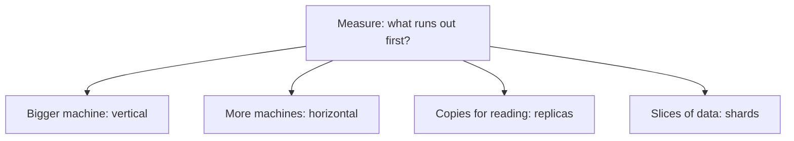
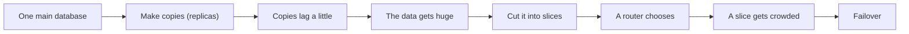

# Scaling And Partitioning

## The big idea in plain words {#picture}

When a lunch line gets too long, a school has two choices. It can hire a faster lunch lady (bigger machine), or it can open more serving lines (more machines). Opening more lines is cheaper and can go on and on, but now kids must be sent to the right line.

That is scaling. A bigger machine is called **vertical** scaling. More machines is **horizontal** scaling. Splitting the data across machines is called **sharding**.



## What you will be able to do {#outcomes}

By the end of this lesson you will be able to:

- Tell vertical from horizontal scaling.
- Explain replicas and shards in simple words.
- Spot a hot key and know that autoscaling is not magic.

## Words to know {#vocabulary}

- **vertical scaling**: giving one machine more power.
- **horizontal scaling**: adding more machines.
- **replica**: an extra copy of data or a running app.
- **shard**: one slice of a big dataset.
- **partition key**: the value that decides which shard a piece of data goes to.
- **hot key**: one key that gets far more traffic than the others.

## Why this idea exists {#history}

One machine has a limit. Before it gets full, we need a plan. But scaling adds cost and complication, so we only do it when measurement says we must.

## Concept 1: Bigger or more? {#concept-1}

Making one machine bigger is the easiest first step. It has a limit, though, and if it breaks everything stops. Adding more machines has no hard limit and survives failures, but your app must be built so any machine can answer any request (stateless).

## Concept 2: Copies help reading {#concept-2}

If most people only read, add replicas. They share the reading work. But remember lag: replicas can be a moment behind. Replicas do not help if the problem is too many writes.

## Concept 3: Shards slice the data {#concept-3}

When one database cannot hold all the data, we slice it. For example, users A to M go to shard 1 and N to Z go to shard 2. A rule called the partition key decides where each row goes. Pick a key that spreads people out evenly.

## Concept 4: Beware of the hot key {#concept-4}

If one celebrity has ten million followers, the shard that holds them is busy while the others nap. This is a hot key. Adding machines will not fix it. We need to spread that one popular key, for example by caching it or splitting it into several keys.

## Slicing a user table {#example}

A table with 100 million users is too big for one machine. We shard by user id: id modulo 4 gives 0, 1, 2, or 3, and each number is one shard. User 42 goes to shard 2 (because 42 divided by 4 leaves 2). A small router remembers the rule.

## Going deeper: the technical walkthrough {#walkthrough}

### Scaling and partitioning


Vertical scaling uses a bigger machine. Horizontal scaling uses more instances.
Start with the bottleneck:

- CPU-bound work may need more CPU or workers;
- slow reads may need indexes, a cache, or read replicas;
- large files need object storage and range reads;
- bursts may need a queue and backpressure;
- a hot key may need a different partition strategy.

Partitioning or sharding splits data. It can improve scale but makes joins,
rebalancing, transactions, and operations harder. Replication improves read
capacity or availability but introduces lag and failover decisions.


## Worked scenario {#worked-scenario}

A user reads from a copy that is behind right after saving. What should the design say?

The justified choice is **Explain how read-your-own-writes works, or say it is eventually consistent**. Select **explain-replica-lag** in the structured practical and explain why. Alternatives ignore a requirement, cross a trust boundary, or invent success.

### Structured decision contract

```json

{
  "decision": "explain-replica-lag",
  "justification": "The replica and shard boundary must preserve the declared contract and ownership.",
  "failureBehavior": "Expose a safe failure and recover through the boundary owner."
}

```

Decision selects one declared behavior. Justification explains the boundary. FailureBehavior explains the observable error and recovery owner. These fields never execute commands. Required terms and minimum lengths form a basic practice rubric, not semantic grading.

## Step-by-step flow and matching picture {#flow}




## Three real-life uses {#use-cases}

1. A website adds three more app servers behind a load balancer on sale day.
2. A report page reads from replicas so the main database stays free for writes.
3. A chat service shards messages by conversation id.

## What can go wrong, and how to stay safe {#failure-security}

Mistakes: scaling before measuring, picking a shard key that puts everything in one shard, forgetting how to move data when you add a shard, and forgetting that a bigger machine still has one point of failure. Measure first, then change one thing, then measure again.

## Practice lab and expected observation {#practice}

1. Predict the scenario decision before opening Practical. Explain each rejected alternative.
2. Run a relevant example above in an isolated exercise project. Record the expected result, then change one input to an invalid or boundary value. A failed assertion or deliberate error should replace silent success.
3. Submit the structured decision. Initially the checks fail. After selecting explain-replica-lag and writing an explanation and failure plan, all three pass. Follow the indicated review section for missed checks.

### Broken example to debug

```json

{"decision":"trust-client","justification":"","failureBehavior":""}

```

This ignores the responsible boundary and gives no reasoning or recovery. Correct the fields rather than changing the validator.

## Checkpoint and definition of done {#checkpoint}

- [ ] Define replica and shard without looking.
- [ ] Trace input to owner and output.
- [ ] Explain one failure and one alternative.
- [ ] Pass at least four assignment questions.
- [ ] Pass every practical check and submit.
- [ ] Explain the concept again tomorrow.

## Sources, versions, and safe commands {#sources}

Workload figures are assumptions until measured. Review date: 2026-10-02. The supplied blueprint is the teaching source; official landing pages were checked where reachable. No provider or original TM Schedule deployment was tested.

- [Official reference](https://www.postgresql.org/docs/current/)

- [Official reference](https://opentelemetry.io/docs/)

[Course reading order](README.md) · [Previous lesson](09a-cap-theorem-and-picking-sides.md) · [Next lesson](10a-unique-ids-and-consistent-hashing.md)

```study-quiz

{
  "schemaVersion": 1,
  "lessonId": "system-design/10-scaling-and-partitioning",
  "title": "Assignment: Scaling And Partitioning",
  "passPercentage": 80,
  "questions": [
    {
      "id": "q1",
      "sectionId": "concept-1",
      "prompt": "In Scaling And Partitioning, what does replica mean?",
      "options": [
        {
          "id": "a",
          "text": "A permission granted by a hidden browser control",
          "explanation": "This changes the declared meaning or bypasses the responsible boundary."
        },
        {
          "id": "b",
          "text": "An unlimited provider operation with no ownership",
          "explanation": "This changes the declared meaning or bypasses the responsible boundary."
        },
        {
          "id": "c",
          "text": "an extra copy of data or of a running service",
          "explanation": "This preserves the definition and boundary described in the lesson."
        },
        {
          "id": "d",
          "text": "A diagnostic credential intended for public logs",
          "explanation": "This changes the declared meaning or bypasses the responsible boundary."
        }
      ],
      "correctOptionId": "c",
      "explanation": "replica means an extra copy of data or of a running service.",
      "reviewLabel": "Review concept 1"
    },
    {
      "id": "q2",
      "sectionId": "concept-2",
      "prompt": "In Scaling And Partitioning, which rule is correct for checkpoint 2?",
      "options": [
        {
          "id": "a",
          "text": "Trust client-side checks instead of the server rule.",
          "explanation": "This changes the declared meaning or bypasses the responsible boundary."
        },
        {
          "id": "b",
          "text": "Hide the failure by returning a fabricated successful result.",
          "explanation": "This changes the declared meaning or bypasses the responsible boundary."
        },
        {
          "id": "c",
          "text": "Skip the stated boundary, limit, or ownership check.",
          "explanation": "This changes the declared meaning or bypasses the responsible boundary."
        },
        {
          "id": "d",
          "text": "Horizontal scaling means more machines.",
          "explanation": "This preserves the definition and boundary described in the lesson."
        }
      ],
      "correctOptionId": "d",
      "explanation": "Horizontal scaling means more machines.",
      "reviewLabel": "Review concept 2"
    },
    {
      "id": "q3",
      "sectionId": "concept-3",
      "prompt": "In Scaling And Partitioning, which rule is correct for checkpoint 3?",
      "options": [
        {
          "id": "a",
          "text": "A read copy can be a little behind the latest write.",
          "explanation": "This preserves the definition and boundary described in the lesson."
        },
        {
          "id": "b",
          "text": "Trust client-side checks instead of the server rule.",
          "explanation": "This changes the declared meaning or bypasses the responsible boundary."
        },
        {
          "id": "c",
          "text": "Hide the failure by returning a fabricated successful result.",
          "explanation": "This changes the declared meaning or bypasses the responsible boundary."
        },
        {
          "id": "d",
          "text": "Skip the stated boundary, limit, or ownership check.",
          "explanation": "This changes the declared meaning or bypasses the responsible boundary."
        }
      ],
      "correctOptionId": "a",
      "explanation": "A read copy can be a little behind the latest write.",
      "reviewLabel": "Review concept 3"
    },
    {
      "id": "q4",
      "sectionId": "concept-4",
      "prompt": "In Scaling And Partitioning, which rule is correct for checkpoint 4?",
      "options": [
        {
          "id": "a",
          "text": "Trust client-side checks instead of the server rule.",
          "explanation": "This changes the declared meaning or bypasses the responsible boundary."
        },
        {
          "id": "b",
          "text": "Sharding needs a key for routing and a plan for moving data.",
          "explanation": "This preserves the definition and boundary described in the lesson."
        },
        {
          "id": "c",
          "text": "Hide the failure by returning a fabricated successful result.",
          "explanation": "This changes the declared meaning or bypasses the responsible boundary."
        },
        {
          "id": "d",
          "text": "Skip the stated boundary, limit, or ownership check.",
          "explanation": "This changes the declared meaning or bypasses the responsible boundary."
        }
      ],
      "correctOptionId": "b",
      "explanation": "Sharding needs a key for routing and a plan for moving data.",
      "reviewLabel": "Review concept 4"
    },
    {
      "id": "q5",
      "sectionId": "worked-scenario",
      "prompt": "A user reads from a copy that is behind right after saving. What should the design say?",
      "options": [
        {
          "id": "a",
          "text": "That every copy is always current",
          "explanation": "This changes the declared meaning or bypasses the responsible boundary."
        },
        {
          "id": "b",
          "text": "That copies mean you never need backups",
          "explanation": "This changes the declared meaning or bypasses the responsible boundary."
        },
        {
          "id": "c",
          "text": "Explain how read-your-own-writes works, or say it is eventually consistent",
          "explanation": "This preserves the definition and boundary described in the lesson."
        },
        {
          "id": "d",
          "text": "That the browser can commit copy state",
          "explanation": "This changes the declared meaning or bypasses the responsible boundary."
        }
      ],
      "correctOptionId": "c",
      "explanation": "Explain how read-your-own-writes works, or say it is eventually consistent. Autoscaling cannot fix a single over-popular key.",
      "reviewLabel": "Review the worked scenario"
    }
  ]
}

```

```study-practical

{
  "schemaVersion": 1,
  "challengeId": "system-design/10-scaling-and-partitioning/decision",
  "lessonId": "system-design/10-scaling-and-partitioning",
  "title": "Practical: Scaling And Partitioning",
  "language": "json",
  "mode": "structured",
  "instructions": "A user reads from a copy that is behind right after saving. What should the design say? Return an object with decision (choose from explain-replica-lag, skip-check, unbounded-work, trust-client), justification (at least 40 characters; include replica and shard), and failureBehavior (at least 25 characters; include failure and recover while explaining the error and recovery). These are structured reasoning checks, not code execution or an official grade.",
  "starterCode": "{\n  \"decision\": \"\",\n  \"justification\": \"\",\n  \"failureBehavior\": \"\"\n}",
  "entryPoint": "answer",
  "publicExamples": [
    {
      "input": {
        "decision": "skip-check",
        "justification": "",
        "failureBehavior": ""
      },
      "expected": {
        "passed": false
      }
    },
    {
      "input": {
        "decision": "explain-replica-lag",
        "justification": "The replica and shard boundary must preserve the declared contract and ownership.",
        "failureBehavior": "Show a safe failure and recover through the responsible owner."
      },
      "expected": {
        "passed": true
      }
    }
  ],
  "publicTestIds": [
    "decision",
    "explanation",
    "failure-plan"
  ],
  "reviewSections": {
    "decision": "worked-scenario",
    "explanation": "concept-2",
    "failure-plan": "failure-security"
  },
  "limits": {
    "timeMs": 2000,
    "memoryMb": 128,
    "outputBytes": 20000
  }
}

```

