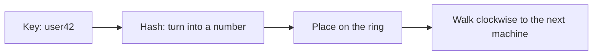
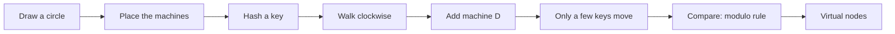
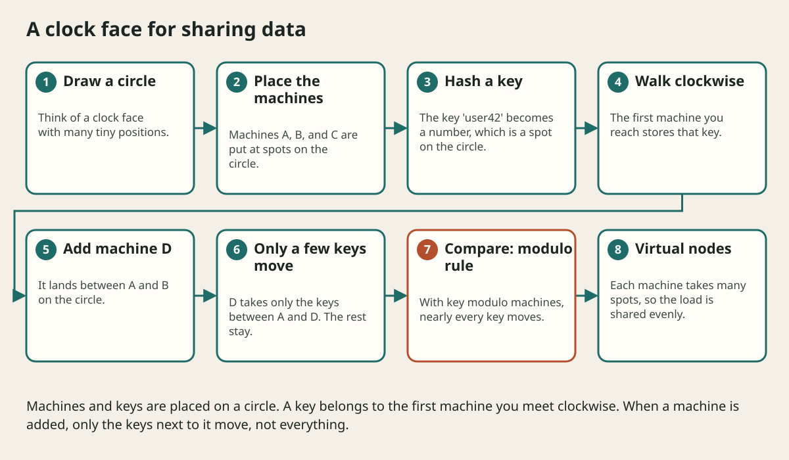

# Unique Ids And Consistent Hashing

## The big idea in plain words {#picture}

When a classroom of 30 students lines up, each one gets a unique number. But what if ten classrooms line up at once, in different places? How do we make sure two students in different rooms do not get the same number? And when a new classroom joins, how do we move as few students as possible?

These are two real problems in big systems: **making unique ids** and **sharing data among machines in a way that is easy to change**.



## What you will be able to do {#outcomes}

By the end of this lesson you will be able to:

- Explain UUIDs and time-ordered ids simply.
- Explain a hash and why "modulo" moves too much data.
- Describe consistent hashing with a clock face.

## Words to know {#vocabulary}

- **UUID**: a long random id that is practically never repeated.
- **hash**: a repeatable way to turn any value into a number.
- **modulo**: the remainder after division, such as 10 mod 4 is 2.
- **hash ring**: a circle of numbers used to place machines and keys.
- **rebalance**: moving data when machines change.
- **virtual node**: a machine placed at many spots on the ring to share data more evenly.

## Why this idea exists {#history}

Giving ids and placing data are tasks every big system does. If we choose a poor rule, adding a single machine can cause a huge, slow reshuffle and an outage.

## Concept 1: Unique ids without a boss {#concept-1}

If every machine had to ask one central machine for the next number, that machine would be a bottleneck. A UUID is a long random number that machines can make alone. The chance of two being the same is so small that we ignore it.

## Concept 2: Time-ordered ids are friendlier {#concept-2}

Totally random ids spread new records all over the database, which can be slower. Ids that start with the time (and then have random parts) keep new records near each other. Some systems also include a machine number so ids never clash.

## Concept 3: A hash turns keys into numbers {#concept-3}

A hash function takes "user42" and gives a number, always the same one. Using "hash modulo number of machines", you pick a machine: with 4 machines, key number 47 goes to machine 3 (47 mod 4 is 3). Add a fifth machine and 47 mod 5 is 2, so that key must move to machine 2. For most keys the answer changes, so most data must move!

## Concept 4: The ring: move only what is needed {#concept-4}

Imagine a clock face. Put each machine at some spot on the clock. Put each key on the clock using its hash. A key belongs to the first machine you meet going clockwise. If you add a machine, it takes over only the keys between it and the machine before it. Everything else stays. Putting each machine at many spots (virtual nodes) makes the sharing more even.

## Adding a cache machine {#example}

Four cache machines hold 1,000,000 keys. With the modulo rule, adding a fifth machine moves about 800,000 keys, and the cache is nearly empty, so the database gets flooded. With the ring, the new machine takes about 200,000 keys, one fifth, and the rest stay put.

## Going deeper: the technical walkthrough {#walkthrough}

## Worked scenario {#worked-scenario}

You have 4 cache machines and add a 5th. You do not want almost every key to move. What helps?

The justified choice is **Consistent hashing, so only a small part of the keys move**. Select **consistent-hashing** in the structured practical and explain why. Alternatives ignore a requirement, cross a trust boundary, or invent success.

### Structured decision contract

```json

{
  "decision": "consistent-hashing",
  "justification": "The uuid and hashing boundary must preserve the declared contract and ownership.",
  "failureBehavior": "Expose a safe failure and recover through the boundary owner."
}

```

Decision selects one declared behavior. Justification explains the boundary. FailureBehavior explains the observable error and recovery owner. These fields never execute commands. Required terms and minimum lengths form a basic practice rubric, not semantic grading.

## Step-by-step flow and matching picture {#flow}





## Three real-life uses {#use-cases}

1. A distributed cache uses a ring to decide which machine stores each key.
2. A database creates unique order ids with the time, a machine number, and a counter.
3. A file storage system spreads files across many disks and adds disks easily.

## What can go wrong, and how to stay safe {#failure-security}

Mistakes: using one central counter for all ids, using the modulo rule when machines change often, and having the hash put too many keys on one machine (a hot spot). Virtual nodes and good key choices help to spread things evenly.

## Practice lab and expected observation {#practice}

1. Predict the scenario decision before opening Practical. Explain each rejected alternative.
2. Run a relevant example above in an isolated exercise project. Record the expected result, then change one input to an invalid or boundary value. A failed assertion or deliberate error should replace silent success.
3. Submit the structured decision. Initially the checks fail. After selecting consistent-hashing and writing an explanation and failure plan, all three pass. Follow the indicated review section for missed checks.

### Broken example to debug

```json

{"decision":"trust-client","justification":"","failureBehavior":""}

```

This ignores the responsible boundary and gives no reasoning or recovery. Correct the fields rather than changing the validator.

## Checkpoint and definition of done {#checkpoint}

- [ ] Define uuid and hashing without looking.
- [ ] Trace input to owner and output.
- [ ] Explain one failure and one alternative.
- [ ] Pass at least four assignment questions.
- [ ] Pass every practical check and submit.
- [ ] Explain the concept again tomorrow.

## Sources, versions, and safe commands {#sources}

Workload figures are assumptions until measured. Review date: 2026-10-02. The supplied blueprint is the teaching source; official landing pages were checked where reachable. No provider or original TM Schedule deployment was tested.

- [Official reference](https://www.postgresql.org/docs/current/)

- [Official reference](https://opentelemetry.io/docs/)

[Course reading order](README.md) · [Previous lesson](10-scaling-and-partitioning.md) · [Next lesson](11-reliability-and-failure-handling.md)

```study-quiz

{
  "schemaVersion": 1,
  "lessonId": "system-design/10a-unique-ids-and-consistent-hashing",
  "title": "Assignment: Unique Ids And Consistent Hashing",
  "passPercentage": 80,
  "questions": [
    {
      "id": "q1",
      "sectionId": "concept-1",
      "prompt": "In Unique Ids And Consistent Hashing, what does uuid mean?",
      "options": [
        {
          "id": "a",
          "text": "A permission granted by a hidden browser control",
          "explanation": "This changes the declared meaning or bypasses the responsible boundary."
        },
        {
          "id": "b",
          "text": "An unlimited provider operation with no ownership",
          "explanation": "This changes the declared meaning or bypasses the responsible boundary."
        },
        {
          "id": "c",
          "text": "A diagnostic credential intended for public logs",
          "explanation": "This changes the declared meaning or bypasses the responsible boundary."
        },
        {
          "id": "d",
          "text": "a very long random id that is almost impossible to repeat",
          "explanation": "This preserves the definition and boundary described in the lesson."
        }
      ],
      "correctOptionId": "d",
      "explanation": "uuid means a very long random id that is almost impossible to repeat.",
      "reviewLabel": "Review concept 1"
    },
    {
      "id": "q2",
      "sectionId": "concept-2",
      "prompt": "In Unique Ids And Consistent Hashing, which rule is correct for checkpoint 2?",
      "options": [
        {
          "id": "a",
          "text": "A hash turns a key into a number, and the same key always gives the same number.",
          "explanation": "This preserves the definition and boundary described in the lesson."
        },
        {
          "id": "b",
          "text": "Trust client-side checks instead of the server rule.",
          "explanation": "This changes the declared meaning or bypasses the responsible boundary."
        },
        {
          "id": "c",
          "text": "Hide the failure by returning a fabricated successful result.",
          "explanation": "This changes the declared meaning or bypasses the responsible boundary."
        },
        {
          "id": "d",
          "text": "Skip the stated boundary, limit, or ownership check.",
          "explanation": "This changes the declared meaning or bypasses the responsible boundary."
        }
      ],
      "correctOptionId": "a",
      "explanation": "A hash turns a key into a number, and the same key always gives the same number.",
      "reviewLabel": "Review concept 2"
    },
    {
      "id": "q3",
      "sectionId": "concept-3",
      "prompt": "In Unique Ids And Consistent Hashing, which rule is correct for checkpoint 3?",
      "options": [
        {
          "id": "a",
          "text": "Trust client-side checks instead of the server rule.",
          "explanation": "This changes the declared meaning or bypasses the responsible boundary."
        },
        {
          "id": "b",
          "text": "With a simple 'number modulo machines' rule, adding one machine moves almost all the data.",
          "explanation": "This preserves the definition and boundary described in the lesson."
        },
        {
          "id": "c",
          "text": "Hide the failure by returning a fabricated successful result.",
          "explanation": "This changes the declared meaning or bypasses the responsible boundary."
        },
        {
          "id": "d",
          "text": "Skip the stated boundary, limit, or ownership check.",
          "explanation": "This changes the declared meaning or bypasses the responsible boundary."
        }
      ],
      "correctOptionId": "b",
      "explanation": "With a simple 'number modulo machines' rule, adding one machine moves almost all the data.",
      "reviewLabel": "Review concept 3"
    },
    {
      "id": "q4",
      "sectionId": "concept-4",
      "prompt": "In Unique Ids And Consistent Hashing, which rule is correct for checkpoint 4?",
      "options": [
        {
          "id": "a",
          "text": "Trust client-side checks instead of the server rule.",
          "explanation": "This changes the declared meaning or bypasses the responsible boundary."
        },
        {
          "id": "b",
          "text": "Hide the failure by returning a fabricated successful result.",
          "explanation": "This changes the declared meaning or bypasses the responsible boundary."
        },
        {
          "id": "c",
          "text": "Consistent hashing places machines and keys on a circle so only a small part of the data moves when machines change.",
          "explanation": "This preserves the definition and boundary described in the lesson."
        },
        {
          "id": "d",
          "text": "Skip the stated boundary, limit, or ownership check.",
          "explanation": "This changes the declared meaning or bypasses the responsible boundary."
        }
      ],
      "correctOptionId": "c",
      "explanation": "Consistent hashing places machines and keys on a circle so only a small part of the data moves when machines change.",
      "reviewLabel": "Review concept 4"
    },
    {
      "id": "q5",
      "sectionId": "worked-scenario",
      "prompt": "You have 4 cache machines and add a 5th. You do not want almost every key to move. What helps?",
      "options": [
        {
          "id": "a",
          "text": "Rename every key",
          "explanation": "This changes the declared meaning or bypasses the responsible boundary."
        },
        {
          "id": "b",
          "text": "Use the 'key modulo machines' rule and accept the move",
          "explanation": "This changes the declared meaning or bypasses the responsible boundary."
        },
        {
          "id": "c",
          "text": "Turn off the cache",
          "explanation": "This changes the declared meaning or bypasses the responsible boundary."
        },
        {
          "id": "d",
          "text": "Consistent hashing, so only a small part of the keys move",
          "explanation": "This preserves the definition and boundary described in the lesson."
        }
      ],
      "correctOptionId": "d",
      "explanation": "Consistent hashing, so only a small part of the keys move. Ids that are in time order are easier for databases to store than fully random ones.",
      "reviewLabel": "Review the worked scenario"
    }
  ]
}

```

```study-practical

{
  "schemaVersion": 1,
  "challengeId": "system-design/10a-unique-ids-and-consistent-hashing/decision",
  "lessonId": "system-design/10a-unique-ids-and-consistent-hashing",
  "title": "Practical: Unique Ids And Consistent Hashing",
  "language": "json",
  "mode": "structured",
  "instructions": "You have 4 cache machines and add a 5th. You do not want almost every key to move. What helps? Return an object with decision (choose from consistent-hashing, skip-check, unbounded-work, trust-client), justification (at least 40 characters; include uuid and hashing), and failureBehavior (at least 25 characters; include failure and recover while explaining the error and recovery). These are structured reasoning checks, not code execution or an official grade.",
  "starterCode": "{\n  \"decision\": \"\",\n  \"justification\": \"\",\n  \"failureBehavior\": \"\"\n}",
  "entryPoint": "answer",
  "publicExamples": [
    {
      "input": {
        "decision": "skip-check",
        "justification": "",
        "failureBehavior": ""
      },
      "expected": {
        "passed": false
      }
    },
    {
      "input": {
        "decision": "consistent-hashing",
        "justification": "The uuid and hashing boundary must preserve the declared contract and ownership.",
        "failureBehavior": "Show a safe failure and recover through the responsible owner."
      },
      "expected": {
        "passed": true
      }
    }
  ],
  "publicTestIds": [
    "decision",
    "explanation",
    "failure-plan"
  ],
  "reviewSections": {
    "decision": "worked-scenario",
    "explanation": "concept-2",
    "failure-plan": "failure-security"
  },
  "limits": {
    "timeMs": 2000,
    "memoryMb": 128,
    "outputBytes": 20000
  }
}

```

