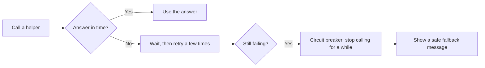
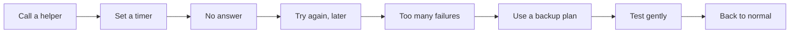
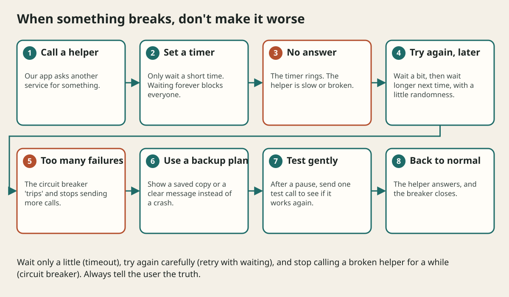

# Reliability And Failure Handling

## The big idea in plain words {#picture}

When a car gets a flat tire, a careful driver has a spare, knows how to change it, and stops driving on a bad tire. A system that is reliable does the same: it expects things to break and has a plan.

Reliable does not mean "never breaks". It means "when it breaks, it breaks gently, tells the truth, and recovers fast".



## What you will be able to do {#outcomes}

By the end of this lesson you will be able to:

- Use timeouts, retries, backoff, and jitter correctly.
- Explain a circuit breaker and a bulkhead.
- Describe a fallback that is honest, not a fake success.

## Words to know {#vocabulary}

- **timeout**: the longest time we wait.
- **backoff**: waiting longer between each retry.
- **jitter**: adding a random bit to the wait so everyone does not retry together.
- **circuit breaker**: a switch that stops calls to something that keeps failing.
- **bulkhead**: separate compartments so one leak cannot sink the whole ship.
- **graceful degradation**: working a little less well instead of not at all.

## Why this idea exists {#history}

In a system with many parts, something is always broken somewhere. A tiny failure can grow into a big outage if everyone keeps pounding on the broken part. Good habits stop the spread.

## Concept 1: Retry, but not forever {#concept-1}

Retry when the problem might go away, like a short network hiccup. Stop after a few tries. Only retry actions that are safe to repeat, or give them a unique key so repeating is harmless.

## Concept 2: Add waiting and a pinch of randomness {#concept-2}

First retry after 1 second, then 2, then 4. Adding a random bit means ten thousand clients do not all retry at the exact same moment. This is the difference between a gentle knock and a stampede.

## Concept 3: The circuit breaker {#concept-3}

At home, a circuit breaker switches off power when something is wrong so the wires do not burn. In software, when a helper fails again and again, the breaker "opens" and calls stop for a while. Every so often one test call checks if the helper is better. If so, the breaker closes.

## Concept 4: Fallback, but be honest {#concept-4}

If the recommendations helper is down, show popular items instead. That is a good fallback. But if the database is down, do not show an empty list that looks like "you have no notes". That would frighten people. Say clearly: "We cannot load your notes right now. Please try again."

## The weather widget {#example}

A news site shows weather from another service. One day the weather service is slow. Without a timeout, every news page waits and the entire site slows down. With a 1-second timeout and a breaker, the site shows "weather unavailable" in the corner and everything else loads at normal speed.

## Going deeper: the technical walkthrough {#walkthrough}

### Reliability and failure handling


Every dependency can be slow, unavailable, inconsistent, or wrong. Use:

- bounded timeouts;
- retries only for safe or idempotent work;
- exponential backoff with jitter;
- circuit breaking for repeatedly failing remote calls;
- bulkheads so one workload cannot consume all resources;
- graceful degradation when a secondary feature is unavailable;
- durable queues and dead-letter handling;
- clear health and readiness checks.

Do not retry a payment or create blindly. Decide how a caller learns whether the
first write committed.


## Worked scenario {#worked-scenario}

Storage is down when someone asks for the catalog. What is the honest answer?

The justified choice is **A safe, retryable error instead of a fake empty catalog**. Select **report-outage** in the structured practical and explain why. Alternatives ignore a requirement, cross a trust boundary, or invent success.

### Structured decision contract

```json

{
  "decision": "report-outage",
  "justification": "The backoff and circuitBreaker boundary must preserve the declared contract and ownership.",
  "failureBehavior": "Expose a safe failure and recover through the boundary owner."
}

```

Decision selects one declared behavior. Justification explains the boundary. FailureBehavior explains the observable error and recovery owner. These fields never execute commands. Required terms and minimum lengths form a basic practice rubric, not semantic grading.

## Step-by-step flow and matching picture {#flow}





## Three real-life uses {#use-cases}

1. A shop retries payments carefully using a unique request key.
2. A video site shows lower quality when the network is poor.
3. An app keeps a separate pool of workers for emails so a flood of emails cannot block checkout.

## What can go wrong, and how to stay safe {#failure-security}

Mistakes: no timeout, unlimited retries, retrying actions that are not safe to repeat, and fallbacks that hide real failure. A "successful" empty answer can be worse than an error, because nobody knows anything went wrong.

## Practice lab and expected observation {#practice}

1. Predict the scenario decision before opening Practical. Explain each rejected alternative.
2. Run a relevant example above in an isolated exercise project. Record the expected result, then change one input to an invalid or boundary value. A failed assertion or deliberate error should replace silent success.
3. Submit the structured decision. Initially the checks fail. After selecting report-outage and writing an explanation and failure plan, all three pass. Follow the indicated review section for missed checks.

### Broken example to debug

```json

{"decision":"trust-client","justification":"","failureBehavior":""}

```

This ignores the responsible boundary and gives no reasoning or recovery. Correct the fields rather than changing the validator.

## Checkpoint and definition of done {#checkpoint}

- [ ] Define backoff and circuitBreaker without looking.
- [ ] Trace input to owner and output.
- [ ] Explain one failure and one alternative.
- [ ] Pass at least four assignment questions.
- [ ] Pass every practical check and submit.
- [ ] Explain the concept again tomorrow.

## Sources, versions, and safe commands {#sources}

Workload figures are assumptions until measured. Review date: 2026-10-02. The supplied blueprint is the teaching source; official landing pages were checked where reachable. No provider or original TM Schedule deployment was tested.

- [Official reference](https://www.postgresql.org/docs/current/)

- [Official reference](https://opentelemetry.io/docs/)

[Course reading order](README.md) · [Previous lesson](10a-unique-ids-and-consistent-hashing.md) · [Next lesson](12-security-and-privacy.md)

```study-quiz

{
  "schemaVersion": 1,
  "lessonId": "system-design/11-reliability-and-failure-handling",
  "title": "Assignment: Reliability And Failure Handling",
  "passPercentage": 80,
  "questions": [
    {
      "id": "q1",
      "sectionId": "concept-1",
      "prompt": "In Reliability And Failure Handling, what does backoff mean?",
      "options": [
        {
          "id": "a",
          "text": "waiting longer and longer between retries",
          "explanation": "This preserves the definition and boundary described in the lesson."
        },
        {
          "id": "b",
          "text": "A permission granted by a hidden browser control",
          "explanation": "This changes the declared meaning or bypasses the responsible boundary."
        },
        {
          "id": "c",
          "text": "An unlimited provider operation with no ownership",
          "explanation": "This changes the declared meaning or bypasses the responsible boundary."
        },
        {
          "id": "d",
          "text": "A diagnostic credential intended for public logs",
          "explanation": "This changes the declared meaning or bypasses the responsible boundary."
        }
      ],
      "correctOptionId": "a",
      "explanation": "backoff means waiting longer and longer between retries.",
      "reviewLabel": "Review concept 1"
    },
    {
      "id": "q2",
      "sectionId": "concept-2",
      "prompt": "In Reliability And Failure Handling, which rule is correct for checkpoint 2?",
      "options": [
        {
          "id": "a",
          "text": "Trust client-side checks instead of the server rule.",
          "explanation": "This changes the declared meaning or bypasses the responsible boundary."
        },
        {
          "id": "b",
          "text": "Adding a little randomness stops everyone from retrying at the same moment.",
          "explanation": "This preserves the definition and boundary described in the lesson."
        },
        {
          "id": "c",
          "text": "Hide the failure by returning a fabricated successful result.",
          "explanation": "This changes the declared meaning or bypasses the responsible boundary."
        },
        {
          "id": "d",
          "text": "Skip the stated boundary, limit, or ownership check.",
          "explanation": "This changes the declared meaning or bypasses the responsible boundary."
        }
      ],
      "correctOptionId": "b",
      "explanation": "Adding a little randomness stops everyone from retrying at the same moment.",
      "reviewLabel": "Review concept 2"
    },
    {
      "id": "q3",
      "sectionId": "concept-3",
      "prompt": "In Reliability And Failure Handling, which rule is correct for checkpoint 3?",
      "options": [
        {
          "id": "a",
          "text": "Trust client-side checks instead of the server rule.",
          "explanation": "This changes the declared meaning or bypasses the responsible boundary."
        },
        {
          "id": "b",
          "text": "Hide the failure by returning a fabricated successful result.",
          "explanation": "This changes the declared meaning or bypasses the responsible boundary."
        },
        {
          "id": "c",
          "text": "A circuit breaker should test now and then to see if the helper recovered.",
          "explanation": "This preserves the definition and boundary described in the lesson."
        },
        {
          "id": "d",
          "text": "Skip the stated boundary, limit, or ownership check.",
          "explanation": "This changes the declared meaning or bypasses the responsible boundary."
        }
      ],
      "correctOptionId": "c",
      "explanation": "A circuit breaker should test now and then to see if the helper recovered.",
      "reviewLabel": "Review concept 3"
    },
    {
      "id": "q4",
      "sectionId": "concept-4",
      "prompt": "In Reliability And Failure Handling, which rule is correct for checkpoint 4?",
      "options": [
        {
          "id": "a",
          "text": "Trust client-side checks instead of the server rule.",
          "explanation": "This changes the declared meaning or bypasses the responsible boundary."
        },
        {
          "id": "b",
          "text": "Hide the failure by returning a fabricated successful result.",
          "explanation": "This changes the declared meaning or bypasses the responsible boundary."
        },
        {
          "id": "c",
          "text": "Skip the stated boundary, limit, or ownership check.",
          "explanation": "This changes the declared meaning or bypasses the responsible boundary."
        },
        {
          "id": "d",
          "text": "A fallback must not look like lost data.",
          "explanation": "This preserves the definition and boundary described in the lesson."
        }
      ],
      "correctOptionId": "d",
      "explanation": "A fallback must not look like lost data.",
      "reviewLabel": "Review concept 4"
    },
    {
      "id": "q5",
      "sectionId": "worked-scenario",
      "prompt": "Storage is down when someone asks for the catalog. What is the honest answer?",
      "options": [
        {
          "id": "a",
          "text": "A safe, retryable error instead of a fake empty catalog",
          "explanation": "This preserves the definition and boundary described in the lesson."
        },
        {
          "id": "b",
          "text": "An empty success that looks like everything was deleted",
          "explanation": "This changes the declared meaning or bypasses the responsible boundary."
        },
        {
          "id": "c",
          "text": "Unlimited retries from every client",
          "explanation": "This changes the declared meaning or bypasses the responsible boundary."
        },
        {
          "id": "d",
          "text": "The provider secrets in the response",
          "explanation": "This changes the declared meaning or bypasses the responsible boundary."
        }
      ],
      "correctOptionId": "a",
      "explanation": "A safe, retryable error instead of a fake empty catalog. Each helper needs an owner and a recovery plan.",
      "reviewLabel": "Review the worked scenario"
    }
  ]
}

```

```study-practical

{
  "schemaVersion": 1,
  "challengeId": "system-design/11-reliability-and-failure-handling/decision",
  "lessonId": "system-design/11-reliability-and-failure-handling",
  "title": "Practical: Reliability And Failure Handling",
  "language": "json",
  "mode": "structured",
  "instructions": "Storage is down when someone asks for the catalog. What is the honest answer? Return an object with decision (choose from report-outage, skip-check, unbounded-work, trust-client), justification (at least 40 characters; include backoff and circuitBreaker), and failureBehavior (at least 25 characters; include failure and recover while explaining the error and recovery). These are structured reasoning checks, not code execution or an official grade.",
  "starterCode": "{\n  \"decision\": \"\",\n  \"justification\": \"\",\n  \"failureBehavior\": \"\"\n}",
  "entryPoint": "answer",
  "publicExamples": [
    {
      "input": {
        "decision": "skip-check",
        "justification": "",
        "failureBehavior": ""
      },
      "expected": {
        "passed": false
      }
    },
    {
      "input": {
        "decision": "report-outage",
        "justification": "The backoff and circuitBreaker boundary must preserve the declared contract and ownership.",
        "failureBehavior": "Show a safe failure and recover through the responsible owner."
      },
      "expected": {
        "passed": true
      }
    }
  ],
  "publicTestIds": [
    "decision",
    "explanation",
    "failure-plan"
  ],
  "reviewSections": {
    "decision": "worked-scenario",
    "explanation": "concept-2",
    "failure-plan": "failure-security"
  },
  "limits": {
    "timeMs": 2000,
    "memoryMb": 128,
    "outputBytes": 20000
  }
}

```

