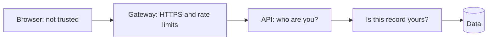
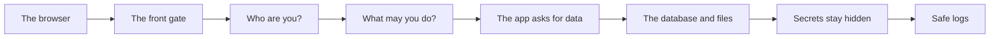
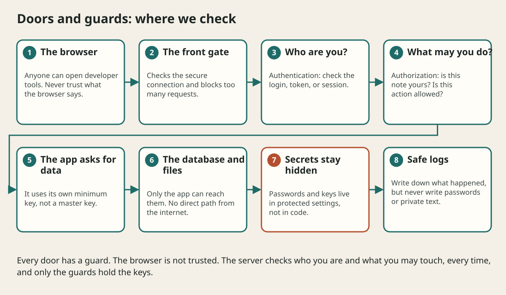

# Security And Privacy

## The big idea in plain words {#picture}

A school has doors, guards, and keys. Visitors sign in at the front desk, students carry ID cards, teachers have keys to their classrooms only, and the principal's office is locked. Nobody has more access than they need.

Security in apps is the same. We decide **who you are**, **what you may do**, and we keep secrets locked away. Most importantly, we never trust the browser, because anyone can change what the browser sends.



## What you will be able to do {#outcomes}

By the end of this lesson you will be able to:

- Tell authentication from authorization.
- Explain least privilege and why secrets stay on the server.
- Know what must never appear in logs.

## Words to know {#vocabulary}

- **authentication**: proving who you are, like showing your ID.
- **authorization**: checking what you are allowed to do, like checking the guest list.
- **least privilege**: giving only the access needed for the job.
- **encryption**: scrambling data so only the right person can read it.
- **secret**: a password or key that must stay private.
- **threat**: a way something bad could happen.

## Why this idea exists {#history}

Apps hold private things: messages, photos, money. One missing check can show one person's data to everybody. We think like a villain for a few minutes so we can block the doors they would try.

## Concept 1: Who are you, and what can you do? {#concept-1}

Authentication answers "who are you?" with a password or token. Authorization answers "may you open this note?" A person can be logged in and still not be allowed to see someone else's note. Both checks are needed on every request.

## Concept 2: Hiding a button is not security {#concept-2}

A button can be hidden on the screen, but anyone can still send the request by hand. The check must happen on the server, where the person cannot change the code.

## Concept 3: Keep secrets in a safe place {#concept-3}

Passwords and keys do not belong in the code, in the browser, or in a link. They live in protected settings on the server, and only the parts that really need them can read them. If a key leaks, replace it right away.

## Concept 4: Give only what is needed {#concept-4}

A service that only reads notes should not have permission to delete them. If it gets hacked, the damage is small. Also, check any web address a visitor gives you, so your server cannot be tricked into visiting private places.

## The wrong note {#example}

Tom is logged in and asks for GET /notes/57. The app checks: is Tom signed in? Yes. Does note 57 belong to Tom? No, it belongs to Maria. The answer is "not found" (404). Tom learns nothing, not even that note 57 exists.

## Going deeper: the technical walkthrough {#walkthrough}

### Security and privacy


Security boundaries include the browser, gateway, API, database, object store,
worker, and external provider. At each boundary ask who is calling, what they
may do, and what data may cross.

Use HTTPS, least-privilege accounts, secret managers, parameterized queries,
input limits, safe file paths, authorization on every resource, secure cookies
or tokens, audit events for sensitive writes, and dependency updates.

Do not log passwords, tokens, full private documents, or raw local paths. A
private network reduces exposure but does not replace API authorization.


## Worked scenario {#worked-scenario}

A signed-in student asks for another student's private note. What should happen?

The justified choice is **Say no, because the ownership check fails**. Select **deny-cross-user** in the structured practical and explain why. Alternatives ignore a requirement, cross a trust boundary, or invent success.

### Structured decision contract

```json

{
  "decision": "deny-cross-user",
  "justification": "The authentication and authorization boundary must preserve the declared contract and ownership.",
  "failureBehavior": "Expose a safe failure and recover through the boundary owner."
}

```

Decision selects one declared behavior. Justification explains the boundary. FailureBehavior explains the observable error and recovery owner. These fields never execute commands. Required terms and minimum lengths form a basic practice rubric, not semantic grading.

## Step-by-step flow and matching picture {#flow}





## Three real-life uses {#use-cases}

1. A bank asks for a second code when you log in from a new phone.
2. A school app lets teachers see only their own classes.
3. A server's database password is read from protected settings, never written in the code.

## What can go wrong, and how to stay safe {#failure-security}

Mistakes: trusting the browser, putting passwords in code that is shared, giving one master key to everything, and writing private data into logs. Logs are read by many people, so they must never contain passwords, tokens, or private messages.

## Practice lab and expected observation {#practice}

1. Predict the scenario decision before opening Practical. Explain each rejected alternative.
2. Run a relevant example above in an isolated exercise project. Record the expected result, then change one input to an invalid or boundary value. A failed assertion or deliberate error should replace silent success.
3. Submit the structured decision. Initially the checks fail. After selecting deny-cross-user and writing an explanation and failure plan, all three pass. Follow the indicated review section for missed checks.

### Broken example to debug

```json

{"decision":"trust-client","justification":"","failureBehavior":""}

```

This ignores the responsible boundary and gives no reasoning or recovery. Correct the fields rather than changing the validator.

## Checkpoint and definition of done {#checkpoint}

- [ ] Define authentication and authorization without looking.
- [ ] Trace input to owner and output.
- [ ] Explain one failure and one alternative.
- [ ] Pass at least four assignment questions.
- [ ] Pass every practical check and submit.
- [ ] Explain the concept again tomorrow.

## Sources, versions, and safe commands {#sources}

Workload figures are assumptions until measured. Review date: 2026-10-02. The supplied blueprint is the teaching source; official landing pages were checked where reachable. No provider or original TM Schedule deployment was tested.

- [Official reference](https://www.postgresql.org/docs/current/)

- [Official reference](https://opentelemetry.io/docs/)

[Course reading order](README.md) · [Previous lesson](11-reliability-and-failure-handling.md) · [Next lesson](13-observability-and-operations.md)

```study-quiz

{
  "schemaVersion": 1,
  "lessonId": "system-design/12-security-and-privacy",
  "title": "Assignment: Security And Privacy",
  "passPercentage": 80,
  "questions": [
    {
      "id": "q1",
      "sectionId": "concept-1",
      "prompt": "In Security And Privacy, what does authentication mean?",
      "options": [
        {
          "id": "a",
          "text": "A permission granted by a hidden browser control",
          "explanation": "This changes the declared meaning or bypasses the responsible boundary."
        },
        {
          "id": "b",
          "text": "proving who someone is",
          "explanation": "This preserves the definition and boundary described in the lesson."
        },
        {
          "id": "c",
          "text": "An unlimited provider operation with no ownership",
          "explanation": "This changes the declared meaning or bypasses the responsible boundary."
        },
        {
          "id": "d",
          "text": "A diagnostic credential intended for public logs",
          "explanation": "This changes the declared meaning or bypasses the responsible boundary."
        }
      ],
      "correctOptionId": "b",
      "explanation": "authentication means proving who someone is.",
      "reviewLabel": "Review concept 1"
    },
    {
      "id": "q2",
      "sectionId": "concept-2",
      "prompt": "In Security And Privacy, which rule is correct for checkpoint 2?",
      "options": [
        {
          "id": "a",
          "text": "Trust client-side checks instead of the server rule.",
          "explanation": "This changes the declared meaning or bypasses the responsible boundary."
        },
        {
          "id": "b",
          "text": "Hide the failure by returning a fabricated successful result.",
          "explanation": "This changes the declared meaning or bypasses the responsible boundary."
        },
        {
          "id": "c",
          "text": "Hiding a button does not protect anything.",
          "explanation": "This preserves the definition and boundary described in the lesson."
        },
        {
          "id": "d",
          "text": "Skip the stated boundary, limit, or ownership check.",
          "explanation": "This changes the declared meaning or bypasses the responsible boundary."
        }
      ],
      "correctOptionId": "c",
      "explanation": "Hiding a button does not protect anything.",
      "reviewLabel": "Review concept 2"
    },
    {
      "id": "q3",
      "sectionId": "concept-3",
      "prompt": "In Security And Privacy, which rule is correct for checkpoint 3?",
      "options": [
        {
          "id": "a",
          "text": "Trust client-side checks instead of the server rule.",
          "explanation": "This changes the declared meaning or bypasses the responsible boundary."
        },
        {
          "id": "b",
          "text": "Hide the failure by returning a fabricated successful result.",
          "explanation": "This changes the declared meaning or bypasses the responsible boundary."
        },
        {
          "id": "c",
          "text": "Skip the stated boundary, limit, or ownership check.",
          "explanation": "This changes the declared meaning or bypasses the responsible boundary."
        },
        {
          "id": "d",
          "text": "Keep passwords and keys in protected server settings.",
          "explanation": "This preserves the definition and boundary described in the lesson."
        }
      ],
      "correctOptionId": "d",
      "explanation": "Keep passwords and keys in protected server settings.",
      "reviewLabel": "Review concept 3"
    },
    {
      "id": "q4",
      "sectionId": "concept-4",
      "prompt": "In Security And Privacy, which rule is correct for checkpoint 4?",
      "options": [
        {
          "id": "a",
          "text": "If users can give a link, control where the server is allowed to go.",
          "explanation": "This preserves the definition and boundary described in the lesson."
        },
        {
          "id": "b",
          "text": "Trust client-side checks instead of the server rule.",
          "explanation": "This changes the declared meaning or bypasses the responsible boundary."
        },
        {
          "id": "c",
          "text": "Hide the failure by returning a fabricated successful result.",
          "explanation": "This changes the declared meaning or bypasses the responsible boundary."
        },
        {
          "id": "d",
          "text": "Skip the stated boundary, limit, or ownership check.",
          "explanation": "This changes the declared meaning or bypasses the responsible boundary."
        }
      ],
      "correctOptionId": "a",
      "explanation": "If users can give a link, control where the server is allowed to go.",
      "reviewLabel": "Review concept 4"
    },
    {
      "id": "q5",
      "sectionId": "worked-scenario",
      "prompt": "A signed-in student asks for another student's private note. What should happen?",
      "options": [
        {
          "id": "a",
          "text": "Allow it because any login is enough",
          "explanation": "This changes the declared meaning or bypasses the responsible boundary."
        },
        {
          "id": "b",
          "text": "Say no, because the ownership check fails",
          "explanation": "This preserves the definition and boundary described in the lesson."
        },
        {
          "id": "c",
          "text": "Believe the role the student claims",
          "explanation": "This changes the declared meaning or bypasses the responsible boundary."
        },
        {
          "id": "d",
          "text": "Send a secret so they can sign in",
          "explanation": "This changes the declared meaning or bypasses the responsible boundary."
        }
      ],
      "correctOptionId": "b",
      "explanation": "Say no, because the ownership check fails. Logs must hide passwords and private content.",
      "reviewLabel": "Review the worked scenario"
    }
  ]
}

```

```study-practical

{
  "schemaVersion": 1,
  "challengeId": "system-design/12-security-and-privacy/decision",
  "lessonId": "system-design/12-security-and-privacy",
  "title": "Practical: Security And Privacy",
  "language": "json",
  "mode": "structured",
  "instructions": "A signed-in student asks for another student's private note. What should happen? Return an object with decision (choose from deny-cross-user, skip-check, unbounded-work, trust-client), justification (at least 40 characters; include authentication and authorization), and failureBehavior (at least 25 characters; include failure and recover while explaining the error and recovery). These are structured reasoning checks, not code execution or an official grade.",
  "starterCode": "{\n  \"decision\": \"\",\n  \"justification\": \"\",\n  \"failureBehavior\": \"\"\n}",
  "entryPoint": "answer",
  "publicExamples": [
    {
      "input": {
        "decision": "skip-check",
        "justification": "",
        "failureBehavior": ""
      },
      "expected": {
        "passed": false
      }
    },
    {
      "input": {
        "decision": "deny-cross-user",
        "justification": "The authentication and authorization boundary must preserve the declared contract and ownership.",
        "failureBehavior": "Show a safe failure and recover through the responsible owner."
      },
      "expected": {
        "passed": true
      }
    }
  ],
  "publicTestIds": [
    "decision",
    "explanation",
    "failure-plan"
  ],
  "reviewSections": {
    "decision": "worked-scenario",
    "explanation": "concept-2",
    "failure-plan": "failure-security"
  },
  "limits": {
    "timeMs": 2000,
    "memoryMb": 128,
    "outputBytes": 20000
  }
}

```

