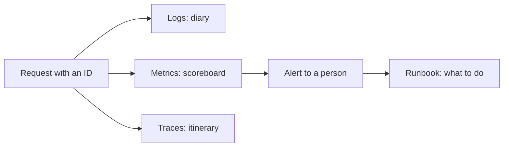
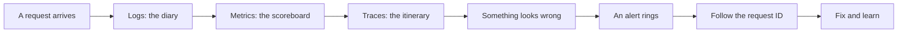
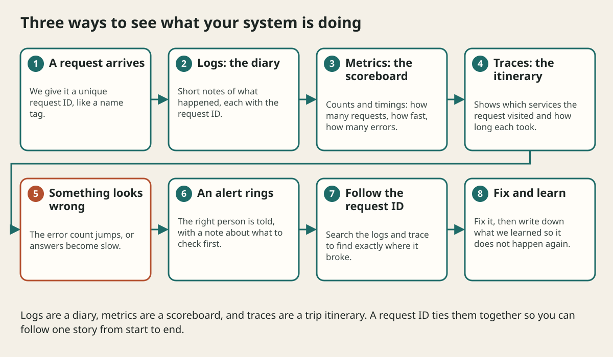

# Observability And Operations

## The big idea in plain words {#picture}

A car has a dashboard: a speedometer, a fuel gauge, and warning lights. You do not need to open the engine to know something is wrong. A good system has a dashboard too.

We use three tools to see inside. **Logs** are a diary of what happened. **Metrics** are a scoreboard of numbers. **Traces** are an itinerary that shows the path of one request. A shared **request ID** ties all three together.



## What you will be able to do {#outcomes}

By the end of this lesson you will be able to:

- Explain logs, metrics, and traces with one example.
- Tell liveness from readiness.
- Describe a useful alert and a short incident review.

## Words to know {#vocabulary}

- **log**: a written note about something that happened.
- **metric**: a number counted over time, like errors per minute.
- **trace**: a map of one request's trip through many parts.
- **SLO**: a goal for how good the service should be, like "99.9 percent of requests succeed".
- **alert**: a message that tells a person to act.
- **runbook**: a short "if this happens, do this" guide.

## Why this idea exists {#history}

Without a dashboard, you learn about a problem when users complain. With one, you often know first and can fix it before most people notice.

## Concept 1: Follow one request with an ID {#concept-1}

Give every request a unique ID and put it into every log line. When a user says "my save failed", you search that ID and see every step the request took, from start to the exact line that broke.

## Concept 2: Look at slow cases, not only the average {#concept-2}

Say 99 requests take 1 second and 1 request takes 100 seconds. The average looks fine at about 2 seconds, but one person is very unhappy. Look at the slowest few percent (the 95th or 99th percentile) to see how bad it gets.

## Concept 3: Alive is not the same as ready {#concept-3}

Liveness asks, "Is the program running?" Readiness asks, "Can it actually serve people right now, with its database connected?" A running app that cannot reach its database is alive but not ready, and the load balancer should stop sending visitors to it.

## Concept 4: Alerts need an owner and a next step {#concept-4}

An alert that wakes someone up must say what is wrong and what to check first. After every big problem, hold a calm review: what happened, why, and what will we change? Blame nobody. Fix the system.

## The slow checkout {#example}

Customers say checkout is slow. The metrics dashboard shows the delay started at 2:15 pm. Traces show the slow part is the payment helper. Logs with the request ID show that helper timed out three times. The team adds a timeout and a fallback, and the delay disappears.

## Going deeper: the technical walkthrough {#walkthrough}

### Observability and operations


The three familiar signals are:

- logs: what happened;
- metrics: how often and how much;
- traces: where time went across boundaries.

Define an owner, alert threshold, health route, rollback, backup, restore drill,
retention policy, and incident note before calling a service complete.

Measure p50, p95, and p99 latency when tail behavior matters. A fast average can
hide a slow experience for one user in twenty.


## Worked scenario {#worked-scenario}

The program is running but its database is unreachable. What should the health checks say?

The justified choice is **Liveness can pass while readiness fails**. Select **readiness-fails** in the structured practical and explain why. Alternatives ignore a requirement, cross a trust boundary, or invent success.

### Structured decision contract

```json

{
  "decision": "readiness-fails",
  "justification": "The log and metric boundary must preserve the declared contract and ownership.",
  "failureBehavior": "Expose a safe failure and recover through the boundary owner."
}

```

Decision selects one declared behavior. Justification explains the boundary. FailureBehavior explains the observable error and recovery owner. These fields never execute commands. Required terms and minimum lengths form a basic practice rubric, not semantic grading.

## Step-by-step flow and matching picture {#flow}





## Three real-life uses {#use-cases}

1. A website shows a dashboard of requests per second and errors.
2. A phone app sends crash reports so developers can see what broke.
3. An on-call engineer follows a runbook to restart a stuck worker.

## What can go wrong, and how to stay safe {#failure-security}

Mistakes: logging private data, logging nothing useful ("error happened"), measuring only averages, and alerts so noisy that people ignore them. A good alert is rare, clear, and means "do something now".

## Practice lab and expected observation {#practice}

1. Predict the scenario decision before opening Practical. Explain each rejected alternative.
2. Run a relevant example above in an isolated exercise project. Record the expected result, then change one input to an invalid or boundary value. A failed assertion or deliberate error should replace silent success.
3. Submit the structured decision. Initially the checks fail. After selecting readiness-fails and writing an explanation and failure plan, all three pass. Follow the indicated review section for missed checks.

### Broken example to debug

```json

{"decision":"trust-client","justification":"","failureBehavior":""}

```

This ignores the responsible boundary and gives no reasoning or recovery. Correct the fields rather than changing the validator.

## Checkpoint and definition of done {#checkpoint}

- [ ] Define log and metric without looking.
- [ ] Trace input to owner and output.
- [ ] Explain one failure and one alternative.
- [ ] Pass at least four assignment questions.
- [ ] Pass every practical check and submit.
- [ ] Explain the concept again tomorrow.

## Sources, versions, and safe commands {#sources}

Workload figures are assumptions until measured. Review date: 2026-10-02. The supplied blueprint is the teaching source; official landing pages were checked where reachable. No provider or original TM Schedule deployment was tested.

- [Official reference](https://www.postgresql.org/docs/current/)

- [Official reference](https://opentelemetry.io/docs/)

[Course reading order](README.md) · [Previous lesson](12-security-and-privacy.md) · [Next lesson](14-deployment-cloud-and-disaster-recovery.md)

```study-quiz

{
  "schemaVersion": 1,
  "lessonId": "system-design/13-observability-and-operations",
  "title": "Assignment: Observability And Operations",
  "passPercentage": 80,
  "questions": [
    {
      "id": "q1",
      "sectionId": "concept-1",
      "prompt": "In Observability And Operations, what does log mean?",
      "options": [
        {
          "id": "a",
          "text": "A permission granted by a hidden browser control",
          "explanation": "This changes the declared meaning or bypasses the responsible boundary."
        },
        {
          "id": "b",
          "text": "An unlimited provider operation with no ownership",
          "explanation": "This changes the declared meaning or bypasses the responsible boundary."
        },
        {
          "id": "c",
          "text": "a written note about something that happened",
          "explanation": "This preserves the definition and boundary described in the lesson."
        },
        {
          "id": "d",
          "text": "A diagnostic credential intended for public logs",
          "explanation": "This changes the declared meaning or bypasses the responsible boundary."
        }
      ],
      "correctOptionId": "c",
      "explanation": "log means a written note about something that happened.",
      "reviewLabel": "Review concept 1"
    },
    {
      "id": "q2",
      "sectionId": "concept-2",
      "prompt": "In Observability And Operations, which rule is correct for checkpoint 2?",
      "options": [
        {
          "id": "a",
          "text": "Trust client-side checks instead of the server rule.",
          "explanation": "This changes the declared meaning or bypasses the responsible boundary."
        },
        {
          "id": "b",
          "text": "Hide the failure by returning a fabricated successful result.",
          "explanation": "This changes the declared meaning or bypasses the responsible boundary."
        },
        {
          "id": "c",
          "text": "Skip the stated boundary, limit, or ownership check.",
          "explanation": "This changes the declared meaning or bypasses the responsible boundary."
        },
        {
          "id": "d",
          "text": "Liveness asks: is the program alive?",
          "explanation": "This preserves the definition and boundary described in the lesson."
        }
      ],
      "correctOptionId": "d",
      "explanation": "Liveness asks: is the program alive?",
      "reviewLabel": "Review concept 2"
    },
    {
      "id": "q3",
      "sectionId": "concept-3",
      "prompt": "In Observability And Operations, which rule is correct for checkpoint 3?",
      "options": [
        {
          "id": "a",
          "text": "Readiness asks: can it really handle visitors right now?",
          "explanation": "This preserves the definition and boundary described in the lesson."
        },
        {
          "id": "b",
          "text": "Trust client-side checks instead of the server rule.",
          "explanation": "This changes the declared meaning or bypasses the responsible boundary."
        },
        {
          "id": "c",
          "text": "Hide the failure by returning a fabricated successful result.",
          "explanation": "This changes the declared meaning or bypasses the responsible boundary."
        },
        {
          "id": "d",
          "text": "Skip the stated boundary, limit, or ownership check.",
          "explanation": "This changes the declared meaning or bypasses the responsible boundary."
        }
      ],
      "correctOptionId": "a",
      "explanation": "Readiness asks: can it really handle visitors right now?",
      "reviewLabel": "Review concept 3"
    },
    {
      "id": "q4",
      "sectionId": "concept-4",
      "prompt": "In Observability And Operations, which rule is correct for checkpoint 4?",
      "options": [
        {
          "id": "a",
          "text": "Trust client-side checks instead of the server rule.",
          "explanation": "This changes the declared meaning or bypasses the responsible boundary."
        },
        {
          "id": "b",
          "text": "Look at slow cases (percentiles), not only the average speed.",
          "explanation": "This preserves the definition and boundary described in the lesson."
        },
        {
          "id": "c",
          "text": "Hide the failure by returning a fabricated successful result.",
          "explanation": "This changes the declared meaning or bypasses the responsible boundary."
        },
        {
          "id": "d",
          "text": "Skip the stated boundary, limit, or ownership check.",
          "explanation": "This changes the declared meaning or bypasses the responsible boundary."
        }
      ],
      "correctOptionId": "b",
      "explanation": "Look at slow cases (percentiles), not only the average speed.",
      "reviewLabel": "Review concept 4"
    },
    {
      "id": "q5",
      "sectionId": "worked-scenario",
      "prompt": "The program is running but its database is unreachable. What should the health checks say?",
      "options": [
        {
          "id": "a",
          "text": "Everything must always say green",
          "explanation": "This changes the declared meaning or bypasses the responsible boundary."
        },
        {
          "id": "b",
          "text": "Return a fake empty success",
          "explanation": "This changes the declared meaning or bypasses the responsible boundary."
        },
        {
          "id": "c",
          "text": "Liveness can pass while readiness fails",
          "explanation": "This preserves the definition and boundary described in the lesson."
        },
        {
          "id": "d",
          "text": "Show the database password in the health reply",
          "explanation": "This changes the declared meaning or bypasses the responsible boundary."
        }
      ],
      "correctOptionId": "c",
      "explanation": "Liveness can pass while readiness fails. A good alert tells who should act and what to do.",
      "reviewLabel": "Review the worked scenario"
    }
  ]
}

```

```study-practical

{
  "schemaVersion": 1,
  "challengeId": "system-design/13-observability-and-operations/decision",
  "lessonId": "system-design/13-observability-and-operations",
  "title": "Practical: Observability And Operations",
  "language": "json",
  "mode": "structured",
  "instructions": "The program is running but its database is unreachable. What should the health checks say? Return an object with decision (choose from readiness-fails, skip-check, unbounded-work, trust-client), justification (at least 40 characters; include log and metric), and failureBehavior (at least 25 characters; include failure and recover while explaining the error and recovery). These are structured reasoning checks, not code execution or an official grade.",
  "starterCode": "{\n  \"decision\": \"\",\n  \"justification\": \"\",\n  \"failureBehavior\": \"\"\n}",
  "entryPoint": "answer",
  "publicExamples": [
    {
      "input": {
        "decision": "skip-check",
        "justification": "",
        "failureBehavior": ""
      },
      "expected": {
        "passed": false
      }
    },
    {
      "input": {
        "decision": "readiness-fails",
        "justification": "The log and metric boundary must preserve the declared contract and ownership.",
        "failureBehavior": "Show a safe failure and recover through the responsible owner."
      },
      "expected": {
        "passed": true
      }
    }
  ],
  "publicTestIds": [
    "decision",
    "explanation",
    "failure-plan"
  ],
  "reviewSections": {
    "decision": "worked-scenario",
    "explanation": "concept-2",
    "failure-plan": "failure-security"
  },
  "limits": {
    "timeMs": 2000,
    "memoryMb": 128,
    "outputBytes": 20000
  }
}

```

