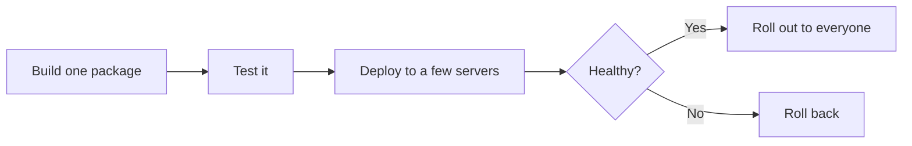
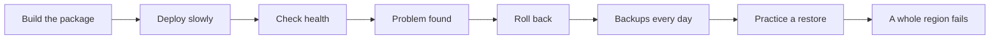
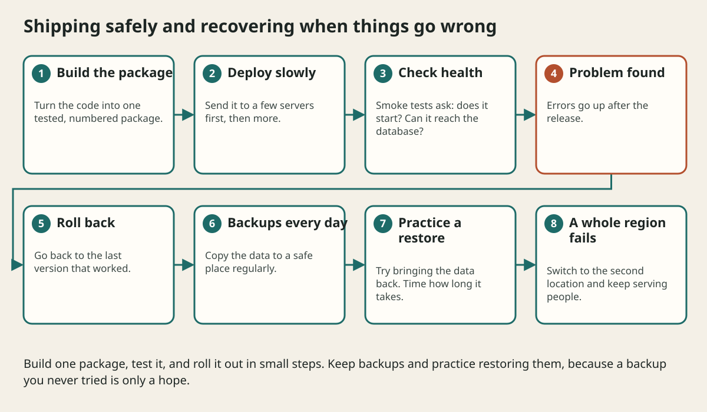

# Deployment Cloud And Disaster Recovery

## The big idea in plain words {#picture}

When a school moves a science project from your home to the classroom, you pack it carefully, test that it still works at school, and bring a spare copy in case something breaks. If it breaks in transit, you go back to the version that worked at home.

Deploying software is that trip. We **build** one tested package, **send** it to the servers, **check** it is healthy, and keep a way to **go back**. We also keep **backups**, because someday a disk will fail.



## What you will be able to do {#outcomes}

By the end of this lesson you will be able to:

- Explain build, artifact, environment, and container.
- Describe a safe rollout and a rollback.
- Explain RPO, RTO, and why restore drills matter.

## Words to know {#vocabulary}

- **artifact**: the finished, numbered package that is ready to ship.
- **environment**: a place the app runs, such as test or production.
- **container**: a sealed box holding the app and everything it needs.
- **rollback**: going back to the last working version.
- **RPO**: how much recent data we can afford to lose, measured in time.
- **RTO**: how long we can afford to be down.

## Why this idea exists {#history}

Releasing by hand, from someone's laptop, is how mistakes happen. A repeatable process makes releases boring, and boring is wonderful.

## Concept 1: One package for every place {#concept-1}

Build once, then ship the same package to test and production. Only the settings change (addresses and passwords come from outside). If you rebuild for each place, "it worked in test" means nothing.

## Concept 2: Roll out slowly {#concept-2}

Send the new version to a small group first, watch health checks, and then continue. If errors rise, stop and roll back. This is much safer than switching everything at once.

## Concept 3: Change the database in small steps {#concept-3}

During a rollout, old and new code run at the same time, so the database must work with both. Add a new column first, then change the code, and remove the old column much later. It is like adding a new door before you close the old one.

## Concept 4: Backups need practice {#concept-4}

A backup you never tried to restore is only a hope. Practice bringing back the data and time how long it takes. RPO says how much data you can lose (for example 5 minutes), and RTO says how long you can be down (for example 1 hour). Your backup schedule and your plan must match those numbers.

## The bad release {#example}

At 3:00 a new version is released to 10 percent of servers. At 3:05 the error graph rises. The team clicks "roll back", and by 3:07 the old version is back. Only a few users saw errors. Later the team fixes the bug and tries again.

## Going deeper: the technical walkthrough {#walkthrough}

### Deployment and disaster recovery


A release path should be repeatable:

```text
source -> checks -> build artifact -> deploy -> health check
       -> smoke test -> monitor -> rollback if needed
```

A backup is not proven until it has been restored. Use a 3-2-1 approach when
data matters: live copy, separate local copy, and encrypted off-site copy. Define
RPO, the amount of data you can lose, and RTO, how long recovery may take.

Keep databases and private object storage off the public internet. A tunnel or
reverse proxy should expose only the intended web/API surface.


### Focused implementation

RPO is the tolerable lost-data interval; RTO is the tolerable recovery time. Daily backups have a potential one-day RPO unless log recovery improves it. Offsite copies protect against site loss, but a restore drill proves usability. Record restore duration, checksums, row counts, safe credential handling, and the recovery owner.

```json

{ "rpoMinutes": 60, "rtoMinutes": 120, "backup": "encrypted-offsite", "restoreChecks": ["checksum", "row-count", "read-smoke"], "numbers": "objectives, not observations" }

```

Read the imports, then the values and checks, then the operation, and finally the result or cleanup. Java Example programs compile as Example.java. Python uses Python 3.11+. JavaScript ESM runs as example.mjs. Framework snippets run inside the generated project.

## Worked scenario {#worked-scenario}

A new release fails its readiness check. What should you do?

The justified choice is **Stop the rollout and go back to the version that worked**. Select **rollback-release** in the structured practical and explain why. Alternatives ignore a requirement, cross a trust boundary, or invent success.

### Structured decision contract

```json

{
  "decision": "rollback-release",
  "justification": "The artifact and rollback boundary must preserve the declared contract and ownership.",
  "failureBehavior": "Expose a safe failure and recover through the boundary owner."
}

```

Decision selects one declared behavior. Justification explains the boundary. FailureBehavior explains the observable error and recovery owner. These fields never execute commands. Required terms and minimum lengths form a basic practice rubric, not semantic grading.

## Step-by-step flow and matching picture {#flow}





## Three real-life uses {#use-cases}

1. A website pushes updates a few times a day with automated checks.
2. A company keeps nightly backups and tests a restore every month.
3. A service runs in two regions, so if one region fails, the other takes over.

## What can go wrong, and how to stay safe {#failure-security}

Mistakes: building by hand, putting passwords in the package, changing the database in a way old code cannot handle, no rollback plan, and never testing backups. Also, a rollout that cannot be paused is risky. Always have a stop button.

## Practice lab and expected observation {#practice}

1. Predict the scenario decision before opening Practical. Explain each rejected alternative.
2. Run a relevant example above in an isolated exercise project. Record the expected result, then change one input to an invalid or boundary value. A failed assertion or deliberate error should replace silent success.
3. Submit the structured decision. Initially the checks fail. After selecting rollback-release and writing an explanation and failure plan, all three pass. Follow the indicated review section for missed checks.

### Broken example to debug

```json

{"decision":"trust-client","justification":"","failureBehavior":""}

```

This ignores the responsible boundary and gives no reasoning or recovery. Correct the fields rather than changing the validator.

## Checkpoint and definition of done {#checkpoint}

- [ ] Define artifact and rollback without looking.
- [ ] Trace input to owner and output.
- [ ] Explain one failure and one alternative.
- [ ] Pass at least four assignment questions.
- [ ] Pass every practical check and submit.
- [ ] Explain the concept again tomorrow.

## Sources, versions, and safe commands {#sources}

Workload figures are assumptions until measured. Review date: 2026-10-02. The supplied blueprint is the teaching source; official landing pages were checked where reachable. No provider or original TM Schedule deployment was tested.

- [Official reference](https://www.postgresql.org/docs/current/)

- [Official reference](https://opentelemetry.io/docs/)

[Course reading order](README.md) · [Previous lesson](13-observability-and-operations.md) · [Next lesson](15-common-architecture-patterns.md)

```study-quiz

{
  "schemaVersion": 1,
  "lessonId": "system-design/14-deployment-cloud-and-disaster-recovery",
  "title": "Assignment: Deployment Cloud And Disaster Recovery",
  "passPercentage": 80,
  "questions": [
    {
      "id": "q1",
      "sectionId": "concept-1",
      "prompt": "In Deployment Cloud And Disaster Recovery, what does artifact mean?",
      "options": [
        {
          "id": "a",
          "text": "A permission granted by a hidden browser control",
          "explanation": "This changes the declared meaning or bypasses the responsible boundary."
        },
        {
          "id": "b",
          "text": "An unlimited provider operation with no ownership",
          "explanation": "This changes the declared meaning or bypasses the responsible boundary."
        },
        {
          "id": "c",
          "text": "A diagnostic credential intended for public logs",
          "explanation": "This changes the declared meaning or bypasses the responsible boundary."
        },
        {
          "id": "d",
          "text": "the finished, versioned package made by a build",
          "explanation": "This preserves the definition and boundary described in the lesson."
        }
      ],
      "correctOptionId": "d",
      "explanation": "artifact means the finished, versioned package made by a build.",
      "reviewLabel": "Review concept 1"
    },
    {
      "id": "q2",
      "sectionId": "concept-2",
      "prompt": "In Deployment Cloud And Disaster Recovery, which rule is correct for checkpoint 2?",
      "options": [
        {
          "id": "a",
          "text": "Keep secrets in the deployment settings, not in the code.",
          "explanation": "This preserves the definition and boundary described in the lesson."
        },
        {
          "id": "b",
          "text": "Trust client-side checks instead of the server rule.",
          "explanation": "This changes the declared meaning or bypasses the responsible boundary."
        },
        {
          "id": "c",
          "text": "Hide the failure by returning a fabricated successful result.",
          "explanation": "This changes the declared meaning or bypasses the responsible boundary."
        },
        {
          "id": "d",
          "text": "Skip the stated boundary, limit, or ownership check.",
          "explanation": "This changes the declared meaning or bypasses the responsible boundary."
        }
      ],
      "correctOptionId": "a",
      "explanation": "Keep secrets in the deployment settings, not in the code.",
      "reviewLabel": "Review concept 2"
    },
    {
      "id": "q3",
      "sectionId": "concept-3",
      "prompt": "In Deployment Cloud And Disaster Recovery, which rule is correct for checkpoint 3?",
      "options": [
        {
          "id": "a",
          "text": "Trust client-side checks instead of the server rule.",
          "explanation": "This changes the declared meaning or bypasses the responsible boundary."
        },
        {
          "id": "b",
          "text": "Run quick smoke checks right after a release.",
          "explanation": "This preserves the definition and boundary described in the lesson."
        },
        {
          "id": "c",
          "text": "Hide the failure by returning a fabricated successful result.",
          "explanation": "This changes the declared meaning or bypasses the responsible boundary."
        },
        {
          "id": "d",
          "text": "Skip the stated boundary, limit, or ownership check.",
          "explanation": "This changes the declared meaning or bypasses the responsible boundary."
        }
      ],
      "correctOptionId": "b",
      "explanation": "Run quick smoke checks right after a release.",
      "reviewLabel": "Review concept 3"
    },
    {
      "id": "q4",
      "sectionId": "concept-4",
      "prompt": "In Deployment Cloud And Disaster Recovery, which rule is correct for checkpoint 4?",
      "options": [
        {
          "id": "a",
          "text": "Trust client-side checks instead of the server rule.",
          "explanation": "This changes the declared meaning or bypasses the responsible boundary."
        },
        {
          "id": "b",
          "text": "Hide the failure by returning a fabricated successful result.",
          "explanation": "This changes the declared meaning or bypasses the responsible boundary."
        },
        {
          "id": "c",
          "text": "A backup only counts if you have practiced restoring it.",
          "explanation": "This preserves the definition and boundary described in the lesson."
        },
        {
          "id": "d",
          "text": "Skip the stated boundary, limit, or ownership check.",
          "explanation": "This changes the declared meaning or bypasses the responsible boundary."
        }
      ],
      "correctOptionId": "c",
      "explanation": "A backup only counts if you have practiced restoring it.",
      "reviewLabel": "Review concept 4"
    },
    {
      "id": "q5",
      "sectionId": "worked-scenario",
      "prompt": "A new release fails its readiness check. What should you do?",
      "options": [
        {
          "id": "a",
          "text": "Delete the backups",
          "explanation": "This changes the declared meaning or bypasses the responsible boundary."
        },
        {
          "id": "b",
          "text": "Hide the health page",
          "explanation": "This changes the declared meaning or bypasses the responsible boundary."
        },
        {
          "id": "c",
          "text": "Update every library to 'latest'",
          "explanation": "This changes the declared meaning or bypasses the responsible boundary."
        },
        {
          "id": "d",
          "text": "Stop the rollout and go back to the version that worked",
          "explanation": "This preserves the definition and boundary described in the lesson."
        }
      ],
      "correctOptionId": "d",
      "explanation": "Stop the rollout and go back to the version that worked. Change databases in steps that old and new code can both handle.",
      "reviewLabel": "Review the worked scenario"
    }
  ]
}

```

```study-practical

{
  "schemaVersion": 1,
  "challengeId": "system-design/14-deployment-cloud-and-disaster-recovery/decision",
  "lessonId": "system-design/14-deployment-cloud-and-disaster-recovery",
  "title": "Practical: Deployment Cloud And Disaster Recovery",
  "language": "json",
  "mode": "structured",
  "instructions": "A new release fails its readiness check. What should you do? Return an object with decision (choose from rollback-release, skip-check, unbounded-work, trust-client), justification (at least 40 characters; include artifact and rollback), and failureBehavior (at least 25 characters; include failure and recover while explaining the error and recovery). These are structured reasoning checks, not code execution or an official grade.",
  "starterCode": "{\n  \"decision\": \"\",\n  \"justification\": \"\",\n  \"failureBehavior\": \"\"\n}",
  "entryPoint": "answer",
  "publicExamples": [
    {
      "input": {
        "decision": "skip-check",
        "justification": "",
        "failureBehavior": ""
      },
      "expected": {
        "passed": false
      }
    },
    {
      "input": {
        "decision": "rollback-release",
        "justification": "The artifact and rollback boundary must preserve the declared contract and ownership.",
        "failureBehavior": "Show a safe failure and recover through the responsible owner."
      },
      "expected": {
        "passed": true
      }
    }
  ],
  "publicTestIds": [
    "decision",
    "explanation",
    "failure-plan"
  ],
  "reviewSections": {
    "decision": "worked-scenario",
    "explanation": "concept-2",
    "failure-plan": "failure-security"
  },
  "limits": {
    "timeMs": 2000,
    "memoryMb": 128,
    "outputBytes": 20000
  }
}

```

